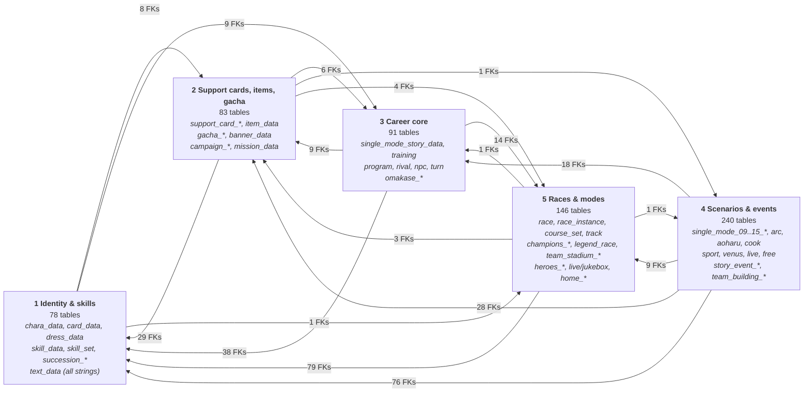

# Wahey! Daitaku Helios in the hooouse! ☆

It's Uma Tools, let's gooo! Wahey!

Okay okay okay, so this is the party for your Umamusume roster, your loops and your races, and Helios is your host, bestieee! Being quiet is sadge, being polite is *omega* sadge, so we're turning it UP. You're saying it's loud?! Well, DUH! If you're gonna build a loop, you gotta make it FUN! ♪

Today's vibe check: six-seven. Don't ask. It's giving party princess.

> Fan-made, for fans, by fans. Not affiliated with Cygames. Umamusume is theirs, the vibes are ours.

---

## The main stage: [uma-tools.umaparty.workers.dev](https://uma-tools.umaparty.workers.dev)

One site, a whole bunch of tools, and every single one of them slaps ★

| Tool | What it does (Helios-approved summary) |
| --- | --- |
| **Roster** | Every uma you trained, sortable and searchable. Loops, sparks, affinity, the whole guest list. Hearts for the faves! Six stars, seven stars, six-seven stars? Calm down, bestie. |
| **Affinity Calculator** | Pick a target uma and see who vibes with who. Compatibility, but make it math. Forever-besties, quantified! |
| **Race Sim** | Pick a course, pick up to 12 umas, hit go. It tells you where you'd place and which skills are legit the MVP. It runs *hundreds* of races, and honestly, if it ran 67 more nobody would complain. |
| **Build Editor** | Make any uma build by hand, get a short code for it, keep it as a prebuilt. Share it so everybody can use it. Mega party! |
| **Stamina Check** | Drop a screenshot (it never leaves your device, Helios promise!), import prebuilts or a whole room, and see if the stamina carries everybody to the finish. Spoiler: 667 stamina is *not* automatically enough. Sorry, bestie. |
| **Game Plugin** | Keeps your roster fresh straight from the game, so you never export by hand. Open your veteran box, done! More below ♪ |
| **Chibi Library** | The smol versions. Zero stats, a hundred percent cute, height six-seven (in millimeters, they're chibis). |

Loops get their own board, too: publish yours, browse everybody else's, and make a team with your friends so you can all search and plan over every roster at once. Squad goals! WOOT!

---

## The backstage crew (the repos)

The repos are backstage for now, VIP only, so no links yet. Here's who's working the lights ☆

- **uma-tools**: the site itself. SvelteKit, runs on Cloudflare, and every push to `main` goes live all by itself. My rizz is off the charts, but the deploy button's rizz is *higher*.
- **uma-race-engine**: the race simulator's brain, compiled to WebAssembly so it runs right in your browser. It's an MIT-licensed fork of kachi-dev's uma-race-simulator, so huge thanks to them! No servers, no waiting, just vibes.
- **hachimi-plugin**: the game plugin. It's a Hachimi Edge plugin that sends your veteran list to *your* account whenever the game loads it. Your own token, your own private roster. It only takes the list from your *own* veteran box, so other people's umas from room matches can't crash your party anymore. Current version: **0.2.1**. Did Helios try to put six-seven jokes in the release notes? Maybe. Did the maintainers say no? Uuugh, yes.

---

## The data vault: what's inside the game files?! ♪

Helios did her homework, bestie! Every table in the game's master database, mapped: what it's for, what its ids point at, and how it all connects. 639 tables, over 800 checked links, and zero homework left over!

- **[Start here: the map](https://github.com/UmaTools/.github/blob/main/profile/mdb/README.md)**: the core relations, an ID cheat sheet, a "I have this, I want that" cookbook, and the gotchas that bit us so they don't bite you.
- Table-by-table notes for each part: [identity and skills](https://github.com/UmaTools/.github/blob/main/profile/mdb/1-identity-skills.md), [support cards, items and gacha](https://github.com/UmaTools/.github/blob/main/profile/mdb/2-supportcards-items-liveops.md), [career mode](https://github.com/UmaTools/.github/blob/main/profile/mdb/3-career-core.md), [scenarios and events](https://github.com/UmaTools/.github/blob/main/profile/mdb/4-scenarios-events.md), [races and modes](https://github.com/UmaTools/.github/blob/main/profile/mdb/5-racing-modes-presentation.md).
- **[edges.json](https://github.com/UmaTools/.github/blob/main/profile/mdb/edges.json)**: every link we found, with how many of its values actually matched.

It's read from the JP data (Global is a subset of it). A link only counts as checked when at least 95% of its values match, and anything we're guessing at is marked as a guess. Spot something wrong? Tell the crew!

---

## Is my stuff safe?! (Helios is a party girl, not a snitch)

- Your roster stays **private to your account** until you decide to share it with a loop team.
- The plugin and the site strip trainer ids from everything *before* it goes anywhere.
- Screenshot reading for the Stamina Check happens on **your own device**. Nothing gets uploaded.
- Want zero uploads? The plugin has a local-only mode. Helios respects the introverts. Sometimes. ♪

---

## Come party with us ☆

- Make a token on the [Game Plugin page](https://uma-tools.umaparty.workers.dev/game-plugin) and keep your roster in sync.
- Found a bug or a cursed number? Tell us, and we'll fix it faster than the six-seven meme goes out of style (so, never, apparently).
- Wanna help out? Hit up the crew! Tell us anything you wanna do. Whatever it is, we bet we can make it work!

Now let me hear you shout, bestie! ☆♪

**WEEEEE-EEEEI!**
