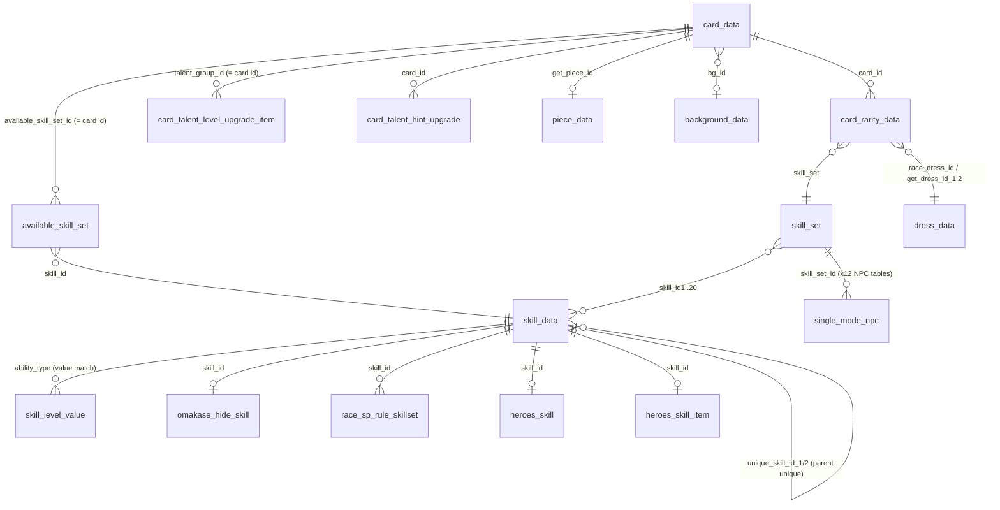
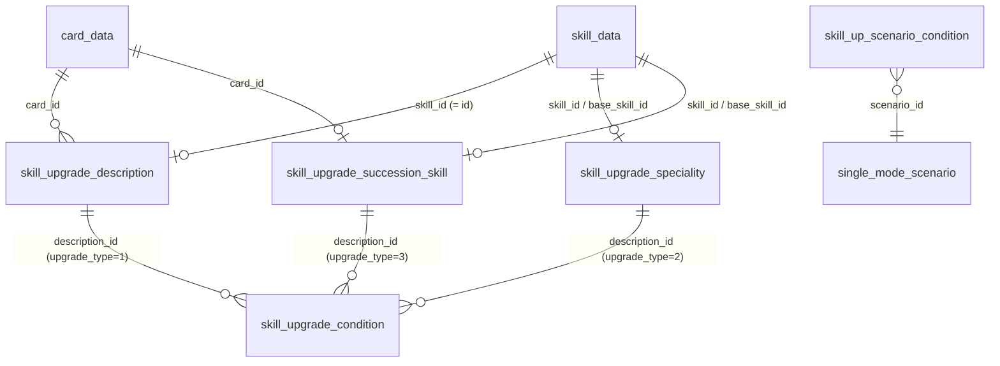
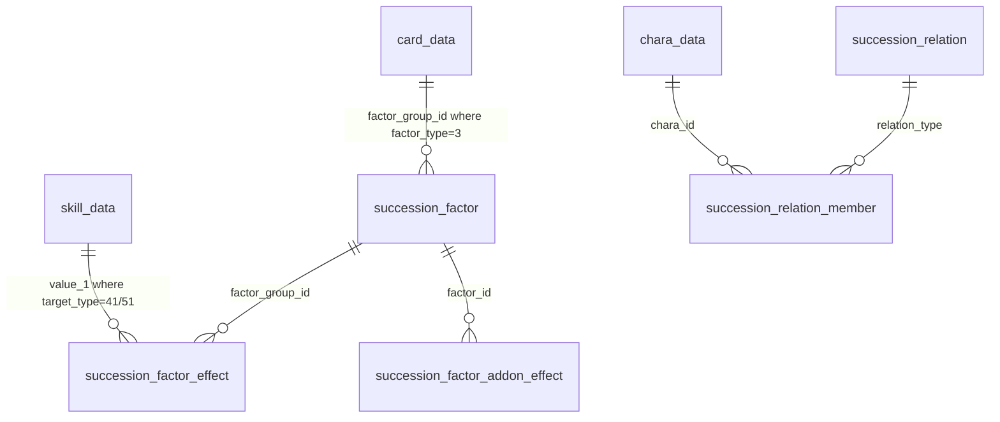
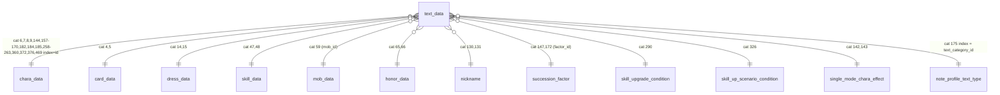

# domain 1: identity and skills (master-jp.mdb; Global = master.mdb subset)

Conventions: `cov` = share of distinct non-null / non-sentinel values found in the target column. `0` and `-1` are null sentinels in all `*_id` columns unless noted. "GL" = Global mdb. Unix times are seconds (`2524575600` = 2050-01-01 = "no end"; `1483196400` = 2017-01-01 = "since launch"). Everything measured on master-jp.mdb. Confidence tags: high / med / low.

## (a) text_data category map

`text_data(id INTEGER, category INTEGER, "index" INTEGER, text TEXT)`, PK = (category, index). 98143 rows JP / 54035 GL; 383 categories JP / 241 GL. `id` is a plain row counter (no FK). `index` = id of the owning row. Several categories share one owner (e.g. 47 = skill name, 48 = skill description for the same skill id). 142 categories exist only in JP (91, 310-487 range = newer scenarios/features). 380 GL-only rows exist (mostly cat 181 story-title rows renumbered/removed in JP). Texts contain literal `\n` (backslash + n, 2 chars) and Unity rich text (`<color=#ff911c>`, `<atlas=...>`); GL cats 423/424 are mojibake.

Method: for each category, compared set(index) with every unique/PK/`*_id` int column across all 639 tables. `cov` = share of the category's indexes present in the owner column; `jacc` = Jaccard between the two sets (1.0 = identical id sets). When several tables tie (different tables sharing the same id space; very common for small 1..N sets) the canonical PK table was preferred and the ties are listed in `alt owners`. **Small categories (< ~30 rows, ids 1..N) are inherently ambiguous**: any table with ids 1..N matches, so `low` there means "owner unknown, probably a scenario/feature table of another domain" - the cov=1.00 is meaningless. Categories 1 and 2 (ids 101..100001, system messages such as "gacha period ended") have no owning table (best spurious match 0.86 cov / 0.03 jacc): ids are defined in client code.

Domain-1 relevant categories (all high): 4,5 (card_data.id); 6,7,8,9,144,157-170,182,184,185,258-263,360,372,376,469 (chara id space, chara_data.id; 8,9,144,157-169,184,185,360,469 cover only the 135 playable chara that have a card); 14,15 (dress_data.id); 47,48 (skill_data.id); 59 (mob_data.mob_id); 65,66 (honor_data.id); 130,131 (nickname.id); 147,172 (succession_factor.factor_id); 175 (note_profile_text_type.text_category_id values, not row ids); 290 (skill_upgrade_condition.id); 326 (skill_up_scenario_condition.id); 92 (chara_story_data.story_id); 142,143 (single_mode_chara_effect.id); cross-domain: 113,114 piece_data.id; 75-78,88 support_card_data.id.

Columns: cat | JP rows | GL rows | owner (`index` = this column) | cov | jacc | conf | known meaning | alternative owners (ties) | sample (index: text).

| cat | JP rows | GL rows | owner (index = ...) | cov | jacc | conf | meaning (if known) | alt owners | sample (index: text) |
|---|---|---|---|---|---|---|---|---|---|
| 1 | 236 | 193 | (none; code-defined message ids) | - | - | low |  |  | 1801: ガチャの開催期間が終了しました\nホームに戻ります |
| 2 | 236 | 193 | (none; code-defined message ids) | - | - | low |  |  | 1801: ガチャ開催期間終了 |
| 3 | 41 | 41 | `team_building_rank_reward_group.id` | 1.00 | 1.00 | low |  | collect_raid_individual_reward.id, single_mode_cook_cooking_type.id | 21: パドックでは、レースに出走するウマ娘の\n能力や人気などが確認できますよ！ |
| 4 | 273 | 139 | `card_data.id` | 1.00 | 1.00 | high | card full name "[epithet]Name" | piece_data.id, piece_data.item_place_id | 105601: [運気上昇☆幸福万来]マチカネフクキタル |
| 5 | 273 | 139 | `card_data.id` | 1.00 | 1.00 | high | card epithet (bracket part) | piece_data.id, piece_data.item_place_id | 105601: [運気上昇☆幸福万来] |
| 6 | 173 | 107 | `chara_data.id` | 1.00 | 1.00 | high | chara name | dress_data.chara_id, chara_type.chara_id | 1087: アストンマーチャン |
| 7 | 173 | 107 | `chara_data.id` | 1.00 | 1.00 | high | chara CV (voice actor) | dress_data.chara_id, chara_type.chara_id | 1087: 井上ほの花 |
| 8 | 142 | 90 | `chara_data.id` | 1.00 | 0.82 | high | chara dorm | team_stadium_race_result_motion.character_id | 1072: 栗東寮 |
| 9 | 135 | 83 | `chara_data.id` | 1.00 | 0.78 | high | chara weight note (note_profile type 2) | chara_category_motion.chara_id, single_mode_change_chara_route.chara_id | 1068: もりもり成長中！ |
| 10 | 803 | 378 | `item_data.id` | 1.00 | 0.99 | high |  |  | 10085: イナリワンの手作りチョコ。\n使用するとTPが30回復する。 |
| 13 | 706 | 223 | `gacha_data.id` | 1.00 | 1.00 | high |  | gacha_top_bg.gacha_id | 30339: 選択したSSRサポートカードの提供割合アップ！ |
| 14 | 521 | 283 | `dress_data.id` | 1.00 | 1.00 | high | dress name |  | 108301: Onyx Soldier |
| 15 | 521 | 283 | `dress_data.id` | 1.00 | 1.00 | high | dress description |  | 108301: シンボリクリスエスの特別衣装 |
| 16 | 207 | 94 | `live_data.music_id` | 1.00 | 1.00 | high | music title |  | 1118: ▷▷▷▶ぶっとび かっとび 全開エンジン！ |
| 17 | 207 | 94 | `live_data.music_id` | 1.00 | 1.00 | high | music credits |  | 1118: 作詞：烏屋茶房\n作曲・編曲：睦月周平 |
| 23 | 810 | 378 | `item_data.id` | 1.00 | 1.00 | high | item name |  | 10082: ユキノビジンの手作りチョコ |
| 24 | 803 | 378 | `item_data.id` | 1.00 | 0.99 | high | item description |  | 10085: イナリワンの手作りチョコ。\n使用するとTPが30回復する。 |
| 25 | 27 | 15 | `item_data.id` | 1.00 | 0.03 | low |  | banner_data.id, single_mode_fan_count.id | 159: 主にレーシングカーニバルのレースに出走すると入手できる。 |
| 26 | 706 | 223 | `gacha_data.id` | 1.00 | 1.00 | high |  | gacha_top_bg.gacha_id | 30339: 4th Anniv.セレクトピックアップガチャ |
| 27 | 58 | 53 | `single_mode_analyze_message.id` | 1.00 | 1.00 | med |  | heroes_ranking_reward.id, single_mode_14_region_feeling.id | 30: 現時点では<color=#FF6D26>【一発に期待】</color>といった雰 |
| 28 | 3411 | 2060 | `race_instance.id` | 1.00 | 1.00 | high | race instance name |  | 650004: スカウトレース 中距離 |
| 29 | 3385 | 2058 | `race_instance.id` | 1.00 | 0.99 | high |  |  | 650017: スカウトレース 中距離 |
| 31 | 17 | 14 | `race_track.id` | 1.00 | 1.00 | med |  | race_course_set.race_track_id, race_env_define.race_track_id | 10009: 阪神レース場 |
| 32 | 2800 | 1469 | `race.id` | 1.00 | 0.96 | high | race name |  | 10128: チーム対抗戦　マイル代表 |
| 33 | 893 | 715 | `race_jikkyo_race.id` | 1.00 | 1.00 | high | race jikkyo race name |  | 9076: 未勝利戦 |
| 34 | 17 | 15 | `race_track.id` | 1.00 | 1.00 | med |  | race_course_set.race_track_id, race_env_define.race_track_id | 10009: 阪神レース場 |
| 35 | 17 | 15 | `race_track.id` | 1.00 | 1.00 | med |  | race_course_set.race_track_id, race_env_define.race_track_id | 10009: 阪神 |
| 36 | 333 | 231 | `race_trophy.trophy_id` | 1.00 | 1.00 | high |  |  | 5946: レジェンドレース　VSサクラバクシンオー |
| 38 | 333 | 231 | `race_trophy.trophy_id` | 1.00 | 1.00 | high |  |  | 5946: レジェンドレース\nVSサクラバクシンオー |
| 39 | 96 | 36 | `item_exchange_top.id` | 1.00 | 0.93 | med |  |  | 8001: サークルPt\n交換 |
| 40 | 96 | 36 | `item_exchange_top.id` | 1.00 | 0.93 | med |  |  | 8001: サークルPtを使用してアイテムと交換します |
| 41 | 20 | 12 | `item_exchange.id` | 1.00 | 0.00 | low |  |  | 8407: 育成シナリオ「新設！URAファイナルズ！！」 URAファイナルズ優勝で解放 |
| 42 | 276 | 71 | `champions_round_schedule.id` | 0.99 | 0.91 | med |  |  | 165: 育成パスセット |
| 47 | 2200 | 1122 | `skill_data.id` | 1.00 | 1.00 | high | skill name |  | 204332: 実直な走り |
| 48 | 2200 | 1122 | `skill_data.id` | 1.00 | 1.00 | high | skill description |  | 204332: レース中盤のどこかで速度が\nわずかに上がる＜作戦・先行＞ |
| 49 | 276 | 71 | `champions_round_schedule.id` | 0.99 | 0.91 | med |  |  | 165: 育成パスセット |
| 55 | 53 | 17 | `legend_race_npc.id` | 1.00 | 0.02 | low |  | story_event_point_reward.id, single_mode_rival.id | 1107: パリ観光 |
| 59 | 1113 | 825 | `mob_data.mob_id` | 1.00 | 1.00 | high | mob name |  | 8556: マリンシーガル |
| 63 | 382 | 196 | `tutorial_guide_data.id` | 1.00 | 1.00 | high |  | single_mode_training_se.id | 197: 移籍先チームの希望する条件に応じて<color=#ff9901>お礼品の内容が変 |
| 64 | 185 | 101 | `gift_message.id` | 1.00 | 0.99 | high |  |  | 10025: 3rd EVENT　WINNING DREAM STAGE Blu-ray 購入 |
| 65 | 1421 | 812 | `honor_data.id` | 1.00 | 1.00 | high | honor name |  | 112005: ウインバリアシオン全冠 |
| 66 | 1421 | 812 | `honor_data.id` | 1.00 | 1.00 | high | honor description/condition |  | 112005: ウインバリアシオンでGⅠ～GⅢの\n全てのトロフィーを獲得しよう |
| 67 | 8702 | 4583 | `mission_data.id` | 1.00 | 1.00 | high |  |  | 1000853: 【マイルCS】育成を5回完了しよう |
| 68 | 626 | 391 | `topics.id` | 1.00 | 1.00 | high | topic title |  | 8088: たづなさんのアドバイス |
| 69 | 626 | 391 | `topics.id` | 1.00 | 1.00 | high | topic body |  | 8088: チーム競技場やルームマッチなどでは\n他のウマ娘のスキル発動も確認できます。\n |
| 70 | 282 | 118 | `login_bonus_data.id` | 1.00 | 1.00 | high |  | login_bonus_detail.login_bonus_id | 30141: 3rd Anniversary 記念ログインボーナス第1弾 |
| 75 | 563 | 310 | `support_card_data.id` | 1.00 | 1.00 | high | support card name (full) | support_card_effect_table.id, support_card_data.effect_table_id | 30036: [徹底管理主義]樫本理子 |
| 76 | 563 | 310 | `support_card_data.id` | 1.00 | 1.00 | high | support card epithet | support_card_effect_table.id, support_card_data.effect_table_id | 30036: [徹底管理主義] |
| 77 | 563 | 310 | `support_card_data.id` | 1.00 | 1.00 | high | support card chara name | support_card_effect_table.id, support_card_data.effect_table_id | 30036: 樫本理子 |
| 78 | 563 | 310 | `support_card_data.id` | 1.00 | 1.00 | high | support card chara name (alt) | support_card_effect_table.id, support_card_data.effect_table_id | 30036: 樫本理子 |
| 88 | 563 | 310 | `support_card_data.id` | 1.00 | 1.00 | high | support card flavour text | support_card_effect_table.id, support_card_data.effect_table_id | 30036: 『レース生活の全てを管理する』\nそれは、まだ未熟な彼女たちにとって\n最良の指 |
| 91 | 2 | 0 | `paid_gacha_button_type.id` | 1.00 | 1.00 | low |  | live_dress_restrict_data.id, single_mode_scenario_update.id | 2: チーム＜アスケラ＞編 |
| 92 | 945 | 581 | `chara_story_data.story_id` | 1.00 | 1.00 | high | chara story episode title |  | 41068004: これぞ祭りの心意気！ |
| 93 | 10 | 7 | `main_story_part.id` | 1.00 | 1.00 | med |  | main_story_data.part_id | 6: 最終章前編 |
| 94 | 169 | 118 | `main_story_data.id` | 1.00 | 1.00 | high |  |  | 516: 信じる思い |
| 95 | 28 | 24 | `single_mode_preview_bgm.id` | 1.00 | 0.97 | low |  | main_story_race_bonus.id, single_mode_training_bg_chara.id | 15: サイレンススズカ |
| 96 | 175 | 124 | `champions_reward_rate.id` | 1.00 | 0.07 | low |  | race_jikkyo_trigger.id, story_event_mission.id | 513: 第3R |
| 97 | 34 | 31 | `single_mode_message.id` | 1.00 | 1.00 | med |  | team_stadium_class_reward.id, rental_deck_alt.id | 18: トレーニングに差し支えのある状態に\nなっているので保健室に行きましょう。 |
| 111 | 214 | 184 | `single_mode_wins_saddle.id` | 1.00 | 1.00 | high |  | single_mode_top_bg.id | 108: CBC賞 |
| 112 | 10 | 7 | `main_story_part.id` | 1.00 | 1.00 | med |  | main_story_data.part_id | 6: 夢の原石 |
| 113 | 272 | 138 | `card_data.id` | 1.00 | 0.99 | high | piece name | piece_data.id, piece_data.item_place_id | 105502: マーベラスサンデーのピース |
| 114 | 272 | 138 | `card_data.id` | 1.00 | 0.99 | high | piece description | piece_data.id, piece_data.item_place_id | 105502: 育成ウマ娘の解放や才能開花などで使用。\n育成ウマ娘ごとの願いが結晶化された専用 |
| 119 | 14 | 5 | `single_mode_recommend.id` | 1.00 | 1.00 | low |  | single_mode_scenario.id, single_mode_cook_motion_status.id | 8: 収穫ッ！満腹ッ！\n大豊食祭 |
| 120 | 14 | 5 | `single_mode_recommend.id` | 1.00 | 1.00 | low |  | single_mode_scenario.id, single_mode_cook_motion_status.id | 8: 秋川理事長の畑開放宣言で開幕した\nトレセン学園大農耕時代。\n陽の下で、みんな |
| 121 | 10 | 10 | `skill_exp.id` | 1.00 | 1.00 | low |  | daily_race.id, rating_race_rating_rank.id | 6: ゴールド |
| 128 | 207 | 94 | `live_data.music_id` | 1.00 | 1.00 | high |  |  | 1118: ターボ全開！限界のかなたまでぶっ飛んじゃえ！！\nあきらめないって、こういうこと |
| 130 | 395 | 276 | `nickname.id` | 1.00 | 1.00 | high | nickname name | single_mode_11_facility_effect.id, live_recommend_formation.id | 209: 非根幹距離の覇者 |
| 131 | 395 | 276 | `nickname.id` | 1.00 | 1.00 | high | nickname condition text | single_mode_11_facility_effect.id, live_recommend_formation.id | 209: 非根幹距離のレースで10勝する\n※Make a new track!!～クライ |
| 133 | 3 | 3 | `chara_data_group.id` | 1.00 | 1.00 | low |  | need_piece_num_data.id, collect_raid_segment_cutt.id | 2: シューズ |
| 136 | 4 | 4 | `collect_raid_mission_top_chara.id` | 1.00 | 1.00 | low |  | collect_raid_dress_color.id, single_mode_outing_set.id | 3: 2人 |
| 138 | 166 | 35 | `single_mode_training.id` | 1.00 | 0.88 | med |  |  | 109: 格闘技 |
| 139 | 40 | 16 | `single_mode_evaluation.id` | 1.00 | 1.00 | high |  |  | 25: 感動とは……貴方たちのような\n強い絆から生まれるのですね。 |
| 140 | 96 | 96 | `team_stadium_raw_score.id` | 1.00 | 1.00 | high |  | single_mode_14_region_effect.id, factor_research_white_factor_item.id | 49: 固有スキルLv7発動[★★★～] |
| 141 | 96 | 96 | `team_stadium_raw_score.id` | 1.00 | 1.00 | high |  | single_mode_14_region_effect.id, factor_research_white_factor_item.id | 49: ★★★以上のウマ娘がLv7の固有スキルを発動した場合に獲得できるスコア |
| 142 | 49 | 27 | `single_mode_chara_effect.id` | 1.00 | 1.00 | high | single_mode_chara_effect name |  | 25: ポジティブ思考 |
| 143 | 49 | 27 | `single_mode_chara_effect.id` | 1.00 | 1.00 | high | single_mode_chara_effect description |  | 25: 強靭なメンタルでやる気をキープ！\nやる気ダウンを一度防ぎ、このコンディションが |
| 144 | 160 | 99 | `chara_data.id` | 1.00 | 0.92 | high | chara catchphrase | character_system_text.character_id | 1081: あーしをナメんな！\nキャンキャン反抗期娘 |
| 147 | 2622 | 1345 | `succession_factor.factor_id` | 1.00 | 1.00 | high | succession factor name |  | 2043601: 大立ち回り |
| 148 | 7 | 7 | `team_stadium_score_bonus.id` | 1.00 | 1.00 | low |  |  | 5: 3連勝ボーナス |
| 150 | 417 | 218 | `support_card_unique_effect.id` | 1.00 | 1.00 | high |  | support_card_data.unique_effect_id | 30112: TT Ignition! |
| 151 | 32 | 31 | `single_mode_14_check_point_pt_effect.id` | 1.00 | 0.97 | low |  | crane_game_hidden_odds.id, training_report_pass.id | 17: ヒントLvアップ |
| 152 | 204 | 204 | `item_pack.id` | 1.00 | 0.97 | high |  | single_mode_wins_saddle.id | 103: アキト(NPC) |
| 154 | 32 | 31 | `single_mode_14_check_point_pt_effect.id` | 1.00 | 0.97 | low |  | crane_game_hidden_odds.id, training_report_pass.id | 17: ヒントイベントで得られるヒントLvがアップ |
| 155 | 417 | 218 | `support_card_unique_effect.id` | 1.00 | 1.00 | high |  | support_card_data.unique_effect_id | 30112: このカードと友情トレーニングをする度に最大5回まで友情ボーナスが上昇 |
| 157 | 159 | 96 | `chara_data.id` | 1.00 | 0.92 | high | chara birthday text | character_system_text.character_id | 1080: 3月9日 |
| 158 | 135 | 83 | `chara_data.id` | 1.00 | 0.78 | high | chara height text | chara_category_motion.chara_id, single_mode_change_chara_route.chara_id | 1068: 162cm |
| 159 | 30 | 30 | `chara_data.id` | 1.00 | 0.17 | low | chara preferred style (note) | heroes_race_default_npc.chara_id | 1017: 先行 |
| 160 | 30 | 30 | `chara_data.id` | 1.00 | 0.17 | low | chara surface (note) | heroes_race_default_npc.chara_id | 1017: 芝 |
| 161 | 30 | 30 | `chara_data.id` | 1.00 | 0.17 | low | chara distance (note) | heroes_race_default_npc.chara_id | 1017: 中～長 |
| 162 | 142 | 90 | `chara_data.id` | 1.00 | 0.82 | high | chara school grade | team_stadium_race_result_motion.character_id | 1072: 高等部 |
| 163 | 159 | 98 | `chara_data.id` | 1.00 | 0.92 | high | chara self-intro | character_system_text.character_id | 1080: てワケで、よろしくね～トレちゃん♪\nゾクゾクワクワクすること、\nいっしょに探 |
| 164 | 135 | 83 | `chara_data.id` | 1.00 | 0.78 | high | note_profile trivia text | chara_category_motion.chara_id, single_mode_change_chara_route.chara_id | 1068: マッサージ |
| 165 | 135 | 83 | `chara_data.id` | 1.00 | 0.78 | high | note_profile trivia text | chara_category_motion.chara_id, single_mode_change_chara_route.chara_id | 1068: 見て見ぬふり |
| 166 | 135 | 83 | `chara_data.id` | 1.00 | 0.78 | high | note_profile trivia text | chara_category_motion.chara_id, single_mode_change_chara_route.chara_id | 1068: 音感に優れている |
| 167 | 135 | 83 | `chara_data.id` | 1.00 | 0.78 | high | note_profile trivia text | chara_category_motion.chara_id, single_mode_change_chara_route.chara_id | 1068: 尻尾でも重たいものが持てる |
| 168 | 135 | 83 | `chara_data.id` | 1.00 | 0.78 | high | note_profile trivia text (shoe size) | chara_category_motion.chara_id, single_mode_change_chara_route.chara_id | 1068: 左右ともに23.0㎝ |
| 169 | 135 | 83 | `chara_data.id` | 1.00 | 0.78 | high | note_profile trivia text | chara_category_motion.chara_id, single_mode_change_chara_route.chara_id | 1068: 父の弟子たちも同居の、30人家族 |
| 170 | 173 | 107 | `chara_data.id` | 1.00 | 1.00 | high | chara name (alt/voice) | dress_data.chara_id, chara_type.chara_id | 1087: アストンマーチャン |
| 171 | 149 | 131 | `single_mode_story_data.id` | 0.72 | 0.01 | low |  |  | 1901: 育成ランクがA |
| 172 | 2622 | 1345 | `succession_factor.factor_id` | 1.00 | 1.00 | high | succession factor description |  | 2043601: 「大立ち回り」のスキルヒントを得られる因子です |
| 173 | 17 | 8 | `chara_data.id` | 1.00 | 0.10 | low |  | character_system_text.character_id, note_profile.chara_id | 9041: トレーニングサポートAI |
| 174 | 2 | 2 | `single_mode_unique_chara.chara_id` | 1.00 | 0.15 | low |  | single_mode_unique_chara.gain_flag_id | 9006: ビターグラッセ、リトルココン |
| 175 | 20 | 23 | `note_profile_text_type.text_category_id` | 1.00 | 1.00 | high | note_profile_text_type label |  | 168: 靴のサイズ |
| 176 | 1 | 10 | `team_stadium_rank.item_id` | 1.00 | 0.50 | low |  |  | 43: ジュエルを10個使用することで\nTPを30回復する。 |
| 177 | 5 | 14 | `mission_race_scenario_group.id` | 1.00 | 1.00 | low |  | race_motivation_rate.id, race_overrun_pattern.id | 3: にんじん山盛り |
| 178 | 2 | 11 | `paid_gacha_button_type.id` | 1.00 | 1.00 | low |  | live_dress_restrict_data.id, single_mode_scenario_update.id | 2: トレセン学園産特別にんじん |
| 179 | 1 | 1 | `legend_race_cutt_chara_data.chara_num` | 1.00 | 1.00 | low |  | team_stadium.race_start_date, team_stadium.interval_start_date | 2: 理事長の扇子 |
| 180 | 21 | 21 | `single_mode_event_item_detail.name_index` | 0.95 | 0.95 | low |  |  | 180010: 濃厚ミルクシェイク |
| 181 | 19784 | 12712 | `single_mode_story_data.story_id` | 0.84 | 0.84 | low |  |  | 501065305: 葵Sの後に・しゅきを目指して！ |
| 182 | 173 | 107 | `chara_data.id` | 1.00 | 1.00 | high | chara name (alt) | dress_data.chara_id, chara_type.chara_id | 1087: アストンマーチャン |
| 184 | 135 | 83 | `chara_data.id` | 1.00 | 0.78 | high | chara TP-full line | chara_category_motion.chara_id, single_mode_change_chara_route.chara_id | 1068: トレーナーさんっ、TPがいっぱいになりました！\nトレーニングの準備はあたしにお |
| 185 | 135 | 83 | `chara_data.id` | 1.00 | 0.78 | high | chara RP-full line | chara_category_motion.chara_id, single_mode_change_chara_route.chara_id | 1068: RPがいっぱいになったみたいです…！\nレースでワッショイ！盛り上がりましょう！ |
| 187 | 671 | 215 | `campaign_data.campaign_id` | 1.00 | 0.66 | low |  |  | 678: 秋のGⅠ記念ミッション 第1弾\nスプリンターズS |
| 188 | 455 | 125 | `campaign_data.campaign_id` | 1.00 | 0.45 | low |  |  | 727: 育成中に獲得できる対象アイテムの量が2倍になります |
| 189 | 57 | 28 | `story_event_data.story_event_id` | 1.00 | 1.00 | low |  | story_event_point_reward.story_event_id, story_event_bonus_card.story_event_id | 1029: フェアウェルを継ぎ接いで |
| 190 | 2467 | 1220 | `story_event_mission.id` | 1.00 | 1.00 | high |  | training_challenge_score.id | 1234: 育成でレースに\n30回勝利しよう |
| 191 | 460 | 228 | `story_event_story_data.id` | 1.00 | 1.00 | high |  | champions_news_title.id, exchange_ticket_detail.id | 231: イライザの苦悩 |
| 192 | 29 | 3 | `mini_bg.id` | 1.00 | 0.78 | low |  | mini_bg_chara_motion.bg_id | 30014: 握手会 |
| 193 | 6 | 6 | `card_talent_upgrade_money_num.id` | 1.00 | 1.00 | low |  | race_single_mode_team_status.id, single_mode_aoharu_result_cutt.id | 4: 伸び盛り |
| 194 | 68 | 68 | `single_mode_team_race_set.id` | 1.00 | 1.00 | high |  |  | 503: インテリジェンツ |
| 195 | 6 | 6 | `single_mode_11_training_mini.member_num` | 1.00 | 1.00 | low |  | champions_bgm.round_id, single_mode_13_top_bg_chara.member_id | 3: にんじんぷりん |
| 196 | 114 | 46 | `home_poster_data.id` | 1.00 | 1.00 | high |  |  | 1065: TVアニメ第3期『ウマ箱３』\n第２コーナー 2/21発売！\nここでしか見られ |
| 197 | 1 | 1 | `team_stadium_rank.item_id` | 1.00 | 0.50 | low |  |  | 43: ジュエルを10個使用することで\nRPを1回復する。 |
| 198 | 66 | 12 | `single_mode_special_chara.id` | 1.00 | 0.90 | med |  |  | 69: メインシナリオで一部イベントが変化します\nサポートカードに編成していなくても\ |
| 199 | 57 | 8 | `single_mode_special_chara.id` | 1.00 | 0.78 | low |  |  | 65: 一部イベントの効果がアップします |
| 200 | 72 | 12 | `single_mode_special_chara.id` | 1.00 | 0.99 | high |  |  | 66: 一部イベントの効果がアップします |
| 201 | 211 | 211 | `champions_news_race.id` | 1.00 | 1.00 | high |  |  | 2505: それぞれの自信を持った走りに期待しよう。 |
| 202 | 126 | 126 | `single_mode_story_data.id` | 0.81 | 0.00 | low |  |  | 10103: いつも通りの実力を発揮できないレースが続いてるが、良い兆候は見えてきている。 |
| 203 | 465 | 465 | `(none)` | 0.00 | 0.00 | low |  |  | 500023: まだ実力はベールに包まれているが、「天皇賞春秋連覇」の異名も持つ。 |
| 204 | 1755 | 1079 | `champions_news_chara_comment.id` | 1.00 | 1.00 | high |  |  | 883: トレーニングで意識してきたことは？ |
| 205 | 1755 | 1079 | `champions_news_chara_comment.id` | 1.00 | 1.00 | high |  |  | 883: 真の敵は、己……そう思い、\n如何なる試練も乗り越えてきました。 |
| 206 | 50 | 26 | `champions_schedule.id` | 1.00 | 1.00 | med |  | rental_deck_card.id, collect_raid_all_reward.id | 26: DIRT |
| 207 | 135 | 135 | `single_mode_live_master_bonus.id` | 0.98 | 0.99 | low |  |  | 13202: スピード <color=#ff911c>+8</color>\nパワー <col |
| 208 | 24 | 24 | `heroes_final_stage_race.id` | 1.00 | 1.00 | low |  | subscription_total_reward.id, single_mode_aoharu_cutt_type.id | 13: 得意率アップ <color=#ff911c>+5</color> |
| 209 | 135 | 135 | `single_mode_live_master_bonus.id` | 0.98 | 0.99 | low |  |  | 13202: ダンス歌唱レッスン 発展編 |
| 210 | 24 | 24 | `single_mode_live_song_list.live_id` | 1.00 | 1.00 | med |  |  | 1036: GIRLS' LEGEND U |
| 211 | 53 | 24 | `announce_event.id` | 1.00 | 0.96 | med |  | single_mode_10_buff.id, single_mode_analyze_message.id | 31: 　ストーリーイベント開催決定！ |
| 212 | 1 | 1 | `collect_event_map_master.collect_tap_max_pos_index` | 1.00 | 1.00 | low |  | rating_race_data.weekday_free_play_num, crane_game_extra_odds_condition.credit | 3: 　<caption = ''>7/29 12:00から、ストーリーイベント「あの |
| 214 | 57 | 28 | `story_event_data.story_event_id` | 1.00 | 1.00 | low |  | story_event_point_reward.story_event_id, story_event_bonus_card.story_event_id | 1029: フェアウェルを継ぎ接いで |
| 215 | 186 | 177 | `transfer_event_detail.transfer_detail_id` | 1.00 | 1.00 | high |  | transfer_event_reward.transfer_detail_id | 14001: 先行で活躍したウマ娘 |
| 216 | 186 | 177 | `transfer_event_detail.transfer_detail_id` | 1.00 | 1.00 | high |  | transfer_event_reward.transfer_detail_id | 14001: 好位を渡さずに前へ進むのが得意なウマ娘を探してるんだ！\nアンタの手腕に期待して |
| 217 | 186 | 177 | `transfer_event_detail.transfer_detail_id` | 1.00 | 1.00 | high |  | transfer_event_reward.transfer_detail_id | 14001: ・脚質適性：先行<color=#FF911C>「B」</color>以上\n・< |
| 218 | 5 | 5 | `single_mode_aoharu_schedule.id` | 1.00 | 1.00 | low |  | deck_recommend_organize.distance_type, story_still.order_id | 2: アオハル杯 プレシーズン 第3戦 |
| 220 | 31 | 22 | `story_event_point_reward.id` | 1.00 | 0.00 | low |  | single_mode_rival.id, succession_rental.id | 2721: 紹介ありがとさん、うれしいぞー！\n今度飲みにいこっか！ |
| 221 | 14 | 4 | `story_extra_data.story_extra_id` | 1.00 | 1.00 | med |  | story_extra_story_data.story_extra_id | 1008: 4th Anniversary |
| 222 | 48 | 19 | `heroes_race_condition.id` | 1.00 | 1.00 | low |  | single_mode_arc_race_debuff.id, single_mode_12_onsen_effect.id | 25: 3周年記念③　～NEW Flowers～ |
| 223 | 9 | 9 | `skill_exp.id` | 1.00 | 0.90 | low |  | daily_race.id, rating_race_rating_rank.id | 5: トレーナー室（クリスマス） |
| 225 | 53 | 53 | `single_mode_free_shop_item.item_id` | 1.00 | 1.00 | high |  | single_mode_free_shop_item.effect_group_id, single_mode_free_shop_effect.effect_group_id | 4002: 名物記者の双眼鏡 |
| 226 | 53 | 53 | `single_mode_free_shop_item.item_id` | 1.00 | 1.00 | high |  | single_mode_free_shop_item.effect_group_id, single_mode_free_shop_effect.effect_group_id | 4002: 「注目株」になる。 |
| 227 | 5 | 5 | `collect_raid_top_data.cut_id` | 1.00 | 1.00 | low |  |  | 4: 伸び盛りの |
| 228 | 531 | 218 | `jukebox_comment.id` | 1.00 | 1.00 | high |  | training_cutt_chara_data.id | 266: 輝く自分になるべく、研鑽を積む…\nそんな日々すら輝かしく思える\n楽曲ですわね |
| 229 | 580 | 574 | `champions_news_win_title.id` | 1.00 | 1.00 | high |  | single_mode_sport_mob.id, team_building_race_npc.id | 291: <character_name>\n<bashin>で制す |
| 230 | 265 | 265 | `(none)` | 0.00 | 0.00 | low |  |  | 22002: <color=#ff9900>チャンピオンズミーティング</color> ラウン |
| 231 | 1620 | 996 | `champions_news_win_comment.id` | 1.00 | 1.00 | high |  |  | 831: 圧巻の走りでした！　今のお気持ちは？ |
| 232 | 1620 | 996 | `champions_news_win_comment.id` | 1.00 | 1.00 | high |  |  | 831: …………まァ、悪かねェよ。 |
| 233 | 7 | 7 | `heroes_lottery_message.id` | 1.00 | 0.37 | low |  |  | 402: Lv2 |
| 234 | 5 | 5 | `mission_race_scenario_group.id` | 1.00 | 1.00 | low |  | race_motivation_rate.id, race_overrun_pattern.id | 3: ランダム報酬 |
| 235 | 2 | 2 | `single_mode_difficulty_box_gauge.difficulty_id` | 1.00 | 1.00 | low |  |  | 1003: SHOWゲージ |
| 236 | 2 | 2 | `single_mode_npc.npc_group_id` | 1.00 | 0.09 | low |  |  | 64: フジキセキのショータイム |
| 237 | 14 | 5 | `single_mode_recommend.id` | 1.00 | 1.00 | low |  | single_mode_scenario.id, single_mode_cook_motion_status.id | 8: 豊食祭 |
| 238 | 53 | 53 | `single_mode_free_shop_item.item_id` | 1.00 | 1.00 | high |  | single_mode_free_shop_item.effect_group_id, single_mode_free_shop_effect.effect_group_id | 4002: 「注目株」になる |
| 239 | 4 | 4 | `single_mode_difficulty_mode.difficulty_id` | 1.00 | 1.00 | low |  | single_mode_difficulty_data.difficulty_id | 1002: このモードで育成すると、\nレース相手がちょっと強くなります\n育成の進捗に応じ |
| 240 | 27 | 10 | `chara_motion_set.id` | 1.00 | 0.00 | low |  | single_mode_story_data.id | 6004: 凱旋門賞優勝 |
| 241 | 7 | 4 | `audio_ignored_cue_on_highspeed.id` | 1.00 | 1.00 | low |  | gacha_item_exchange.id, heroes_skill.id | 4: レーシングカーニバル |
| 242 | 7 | 4 | `audio_ignored_cue_on_highspeed.id` | 1.00 | 1.00 | low |  | gacha_item_exchange.id, heroes_skill.id | 4: レーシングカーニバル |
| 243 | 93 | 93 | `challenge_match_raw_point.id` | 1.00 | 1.00 | high |  |  | 47: 固有スキルLv7発動[★★★～] |
| 244 | 93 | 93 | `challenge_match_raw_point.id` | 1.00 | 1.00 | high |  |  | 47: ★★★以上のウマ娘がLv7の固有スキルを発動した場合に獲得できるスコア |
| 245 | 7 | 7 | `heroes_lottery_message.id` | 1.00 | 0.37 | low |  |  | 402: レース相手がわずかに強くなる |
| 246 | 5 | 5 | `mission_race_scenario_group.id` | 1.00 | 1.00 | low |  | race_motivation_rate.id, race_overrun_pattern.id | 3: ゴルシちゃんの気まぐれで以下のいずれかを獲得できます。 |
| 247 | 36 | 36 | `chara_motion_act.id` | 1.00 | 1.00 | med |  | single_mode_story_root.id, single_mode_free_coin_race.id | 19: 『<color=#ff9900>ダート達人</color>』 |
| 248 | 1 | 1 | `collect_event_map_master.id` | 1.00 | 1.00 | low |  | chara_dress_color_set_default.chara_id, live_extra_data.condition_value_1 | 1001: トップウマドルプロジェクト |
| 249 | 36 | 36 | `chara_motion_act.id` | 1.00 | 1.00 | med |  | single_mode_story_root.id, single_mode_free_coin_race.id | 19: <color=#26c611>ダートのレースで15勝する</color> |
| 250 | 5 | 5 | `mission_race_scenario_group.id` | 1.00 | 1.00 | low |  | race_motivation_rate.id, race_overrun_pattern.id | 3: 3rdライブ |
| 251 | 1 | 1 | `collect_event_map_master.id` | 1.00 | 1.00 | low |  | chara_dress_color_set_default.chara_id, live_extra_data.condition_value_1 | 1001: トップウマドル\nプロジェクト |
| 252 | 18 | 4 | `live_permission_data.music_id` | 1.00 | 0.35 | low |  |  | 1088: ◆【育成】U.A.F.のSHOW DOWNで総合優勝 |
| 253 | 1 | 1 | `collect_event_map_master.id` | 1.00 | 1.00 | low |  | chara_dress_color_set_default.chara_id, live_extra_data.condition_value_1 | 1001: バースデーライブが終わったら\nファル子からの感謝の気持ち受け取ってね！ |
| 254 | 1 | 1 | `character_prop_system_text.id` | 1.00 | 1.00 | low |  | chara_dress_color_set_default.id, nickname_hide.id | 1: レース相手がちょっと強くなります\n育成の進捗に応じてマニー報酬を獲得できます |
| 255 | 2 | 2 | `paid_gacha_button_type.id` | 1.00 | 1.00 | low |  | live_dress_restrict_data.id, single_mode_scenario_update.id | 2: レース相手がすごく強くなり、\n「超遊び癖」のスキルが付与されます\nグッドエン |
| 256 | 1 | 1 | `single_mode_14_check_point_pt.gain_pt` | 1.00 | 0.33 | low |  |  | 300: <color=#FF4400>スキルは育成中に解消できません</color>\n |
| 257 | 38 | 13 | `single_mode_cook_dish_material.id` | 1.00 | 1.00 | low |  | single_mode_11_check_point_eff.id, team_building_collection_set.id | 20: ユキノビジン、スイープトウショウの2人で出走して勝利しよう |
| 258 | 103 | 52 | `chara_data.id` | 1.00 | 0.60 | low | note_profile trivia text | note_profile.chara_id, story_event_top_chara.character_id | 1052: シャンプーハットはもう使わない！ |
| 259 | 103 | 52 | `chara_data.id` | 1.00 | 0.60 | low | note_profile trivia text | note_profile.chara_id, story_event_top_chara.character_id | 1052: にんじんの写真（キングが設定してあげた） |
| 260 | 103 | 52 | `chara_data.id` | 1.00 | 0.60 | low | note_profile trivia text | note_profile.chara_id, story_event_top_chara.character_id | 1052: ワックワク～♪ |
| 261 | 33 | 2 | `legend_race_boss_npc.chara_id` | 1.00 | 0.35 | low |  |  | 1030: 国語（特に現文） |
| 262 | 33 | 2 | `legend_race_boss_npc.chara_id` | 1.00 | 0.35 | low |  |  | 1030: やさしいみんなに囲まれていること |
| 263 | 33 | 2 | `legend_race_boss_npc.chara_id` | 1.00 | 0.35 | low |  |  | 1030: 色鉛筆（特に寒色）、購買のおにぎり |
| 264 | 86 | 46 | `story_wipe_dictionary.id` | 1.00 | 0.97 | high |  | homestory_hip_offset.id, challenge_match_raw_point.id | 44: スペシャルチーム |
| 265 | 7 | 3 | `team_building_data.team_building_event_id` | 1.00 | 0.88 | low |  | team_building_data.scout_pt_item_id, team_building_collection_chara.team_building_event_id | 1004: 目指せ！最強チーム |
| 266 | 146 | 33 | `banner_data.id` | 1.00 | 0.14 | low |  |  | 765: ぱかライブTV　出走中！ |
| 267 | 263 | 18 | `(none)` | 0.00 | 0.00 | low |  |  | 20640315: 目標はナカヤマフェスタ |
| 268 | 191 | 107 | `campaign_walking_location.id` | 1.00 | 0.60 | low |  |  | 194: 屋外スポット |
| 269 | 140 | 30 | `banner_data.id` | 1.00 | 0.13 | low |  |  | 765: 視聴する場合はYouTubeの動画を再生するため\n外部サイトにアクセスします |
| 270 | 3 | 3 | `chara_data_group.id` | 1.00 | 1.00 | low |  | need_piece_num_data.id, collect_raid_segment_cutt.id | 2: {0}が協力者に<color=#FF6D26>加わった！</color> |
| 271 | 243 | 116 | `campaign_sp_present_bonus_data.card_id` | 1.00 | 1.00 | high |  | campaign_n_present_bonus_data.card_id | 105201: トレーナーへ\nいつもおうえんしてくれてありがとう！\nいつもいっしょにがんばっ |
| 272 | 243 | 116 | `campaign_sp_present_bonus_data.card_id` | 1.00 | 1.00 | high |  | campaign_n_present_bonus_data.card_id | 105201: トレーナーへ\nいつもおうえんしてくれてありがとう！\nいつもいっしょにがんばっ |
| 273 | 243 | 116 | `campaign_sp_present_bonus_data.card_id` | 1.00 | 1.00 | high |  | campaign_n_present_bonus_data.card_id | 105201: ハルウララの\nチョコいっぱいにんじんパンケーキ |
| 274 | 16 | 2 | `champions_evaluation_rate.id` | 1.00 | 1.00 | low |  | heroes_league_rank.id, jukebox_motion_data.id | 9: リーグ オブ ヒーローズ |
| 275 | 8 | 8 | `heroes_gauge.id` | 1.00 | 1.00 | low |  | heroes_ranking_border.id, race_bgm_cutin.id | 5: 1レースでの最高位がクビ差以内での2着 |
| 276 | 16 | 4 | `champions_evaluation_rate.id` | 1.00 | 1.00 | low |  | heroes_league_rank.id, jukebox_motion_data.id | 9: ウマ娘 プリティーダービー\n5th EVENT ARENA TOUR\nGO  |
| 277 | 80 | 12 | `gacha_data.id` | 1.00 | 0.11 | low |  | gacha_available.gacha_id, gacha_top_bg.gacha_id | 50035: ★3確定\n2.5th Anniv.中距離ガチャ\n第2R |
| 278 | 63 | 58 | `ultimate_race_contents_change.id` | 1.00 | 1.00 | med |  | single_mode_free_shop_effect.id, single_mode_difficulty_box_reward.id | 32: ユカリ(NPC) |
| 279 | 1 | 1 | `collect_event_map_master.id` | 1.00 | 1.00 | low |  | chara_dress_color_set_default.chara_id, live_extra_data.condition_value_1 | 1001: 開催期間\n12/12 12:00 ～ 12/26 4:59 |
| 280 | 1 | 1 | `collect_event_map_master.id` | 1.00 | 1.00 | low |  | chara_dress_color_set_default.chara_id, live_extra_data.condition_value_1 | 1001: クリスマスプレゼント\nキャンペーン |
| 281 | 1 | 1 | `collect_event_map_master.id` | 1.00 | 1.00 | low |  | chara_dress_color_set_default.chara_id, live_extra_data.condition_value_1 | 1001: 開催期間\n12/21 12:00 ～ 12/24 11:59 |
| 282 | 1 | 1 | `collect_event_map_master.id` | 1.00 | 1.00 | low |  | chara_dress_color_set_default.chara_id, live_extra_data.condition_value_1 | 1001: イベント\nKIRARI MAGIC SHOW |
| 283 | 5 | 1 | `collect_raid_master.id` | 1.00 | 1.00 | low |  | collect_raid_story.collect_raid_id, collect_raid_top_data.collect_raid_id | 1003: 4.5th Anniv.記念イベント |
| 284 | 1 | 1 | `collect_event_map_master.id` | 1.00 | 1.00 | low |  | chara_dress_color_set_default.chara_id, live_extra_data.condition_value_1 | 1001: クリスマスライブが終わったら報酬を受け取って\nリッキー☆　ラッキー☆　みんなで |
| 285 | 5 | 2 | `audio_cuesheet.id` | 1.00 | 0.42 | low |  | gacha_stampsheet.id, heroes_league_score.id | 10: 夢の跡、走り終えて |
| 286 | 5 | 1 | `collect_raid_master.id` | 1.00 | 1.00 | low |  | collect_raid_story.collect_raid_id, collect_raid_top_data.collect_raid_id | 1003: ライブ公開中！ |
| 287 | 1 | 1 | `collect_event_map_master.id` | 1.00 | 1.00 | low |  | chara_dress_color_set_default.chara_id, live_extra_data.condition_value_1 | 1001: キャンペーンページ |
| 288 | 1 | 1 | `collect_event_map_master.id` | 1.00 | 1.00 | low |  | chara_dress_color_set_default.chara_id, live_extra_data.condition_value_1 | 1001: イベント開催予告 |
| 289 | 1 | 1 | `collect_event_map_master.id` | 1.00 | 1.00 | low |  | chara_dress_color_set_default.chara_id, live_extra_data.condition_value_1 | 1001: イベント「KIRARI MAGIC SHOW」は\n12/21 12:00より開 |
| 290 | 1880 | 789 | `skill_upgrade_condition.id` | 1.00 | 1.00 | high | skill upgrade condition text |  | 10570103: ファン数が150000人以上になる |
| 293 | 4 | 4 | `collect_raid_mission_top_chara.id` | 1.00 | 1.00 | low |  | collect_raid_dress_color.id, single_mode_outing_set.id | 3: レースに関わる効果 |
| 294 | 26 | 25 | `support_card_effect_filter.type` | 1.00 | 1.00 | med |  |  | 14: 初期絆ゲージアップ |
| 295 | 21 | 21 | `topics.id` | 1.00 | 0.03 | low |  | single_mode_training_effect.id, single_mode_turn.id | 13: 賢さ |
| 296 | 53 | 53 | `single_mode_venus_spirit_effect.spirit_effect_group_id` | 1.00 | 1.00 | high |  |  | 62: トレーニングのスキルPt上昇量+2 |
| 297 | 19 | 19 | `heroes_lottery_message.id` | 1.00 | 1.00 | med |  |  | 400: メインステージではレース専用アイテムを使用できます |
| 298 | 10 | 10 | `audio_cuesheet.id` | 1.00 | 0.83 | low |  | gacha_stampsheet.id, heroes_league_score.id | 8: サポートイベントのパラメータ上昇量 |
| 299 | 3 | 3 | `chara_data_group.id` | 1.00 | 1.00 | low |  | need_piece_num_data.id, collect_raid_segment_cutt.id | 2: WBC |
| 300 | 3 | 3 | `chara_data_group.id` | 1.00 | 1.00 | low |  | need_piece_num_data.id, collect_raid_segment_cutt.id | 2: WBC |
| 301 | 25 | 2 | `factor_research_data.factor_research_event_id` | 1.00 | 1.00 | med |  | factor_research_box.factor_research_event_id, factor_research_top.factor_research_event_id | 1013: アグネスタキオンの因子研究 |
| 302 | 1 | 1 | `character_prop_system_text.id` | 1.00 | 1.00 | low |  | chara_dress_color_set_default.id, nickname_hide.id | 1: サクラ前線上昇中！花咲かヴィクトリー倶楽部 |
| 303 | 1 | 1 | `character_prop_system_text.id` | 1.00 | 1.00 | low |  | chara_dress_color_set_default.id, nickname_hide.id | 1: 満開ゲージ |
| 304 | 10 | 10 | `skill_exp.id` | 1.00 | 1.00 | low |  | daily_race.id, rating_race_rating_rank.id | 6: 東日本 - 3 |
| 305 | 4 | 4 | `skill_exp.id` | 1.00 | 0.40 | low |  | daily_race.id, rating_race_rating_rank.id | 9: チヨノオー VS わんこそば |
| 306 | 4 | 4 | `skill_exp.id` | 1.00 | 0.40 | low |  | daily_race.id, rating_race_rating_rank.id | 9: サクラホッカイドー？ |
| 307 | 4 | 4 | `skill_exp.id` | 1.00 | 0.40 | low |  | daily_race.id, rating_race_rating_rank.id | 9: サクラ○○○オー七変化 |
| 308 | 2 | 2 | `paid_gacha_button_type.id` | 1.00 | 1.00 | low |  | live_dress_restrict_data.id, single_mode_scenario_update.id | 2: エンディング |
| 309 | 3 | 3 | `chara_data_group.id` | 1.00 | 1.00 | low |  | need_piece_num_data.id, collect_raid_segment_cutt.id | 2: 東日本エリア |
| 310 | 10 | 0 | `skill_exp.id` | 1.00 | 1.00 | low |  | daily_race.id, rating_race_rating_rank.id | 6: フランス語力 |
| 311 | 19 | 0 | `single_mode_arc_potential_bonus.id` | 1.00 | 1.00 | med |  |  | 12: 凱旋門賞で発動する\n特定の能力を引き出すスキルヒントを3つ獲得 |
| 312 | 1 | 1 | `character_prop_system_text.id` | 1.00 | 1.00 | low |  | chara_dress_color_set_default.id, nickname_hide.id | 1: 花咲かヴィクトリー倶楽部 |
| 313 | 13 | 0 | `single_mode_arc_potential_cond.id` | 1.00 | 1.00 | med |  |  | 8: GI勝利数1回 |
| 314 | 8 | 0 | `heroes_gauge.id` | 1.00 | 1.00 | low |  | heroes_ranking_border.id, race_bgm_cutin.id | 5: レース出走時中距離適性<color=#ff911c>A</color>にアップ |
| 315 | 9 | 0 | `single_mode_arc_debuff.id` | 1.00 | 1.00 | med |  | single_mode_arc_race_debuff.debuff_id | 1400051: 未知のコース |
| 316 | 9 | 0 | `single_mode_arc_debuff.id` | 1.00 | 1.00 | med |  | single_mode_arc_race_debuff.debuff_id | 1400051: 中距離適性<color=#2e85e6>G</color>にダウン |
| 317 | 16 | 0 | `character_system_lottery.sys_text_id` | 0.94 | 0.02 | low |  |  | 20102: 遠征中パワートレーニング効果アップ |
| 318 | 7 | 0 | `audio_ignored_cue_on_highspeed.id` | 1.00 | 1.00 | low |  | gacha_item_exchange.id, heroes_skill.id | 4: レース出走時根性値アップ |
| 319 | 180 | 0 | `transfer_rotation_detail.id` | 1.00 | 1.00 | high |  | transfer_rotation_reward.rotation_id | 201101: 差しで活躍したウマ娘 |
| 320 | 180 | 0 | `transfer_rotation_detail.id` | 1.00 | 1.00 | high |  | transfer_rotation_reward.rotation_id | 201101: 終盤で瞬発力を発揮するのが得意なウマ娘を探してるんだ！\nアンタの手腕に期待して |
| 321 | 180 | 0 | `transfer_rotation_detail.id` | 1.00 | 1.00 | high |  | transfer_rotation_reward.rotation_id | 201101: ・脚質適性：差し<color=#FF911C>「B」</color>以上\n・< |
| 322 | 12 | 0 | `audio_cuesheet.id` | 1.00 | 1.00 | low |  | gacha_stampsheet.id, heroes_league_score.id | 7: 適性Pt獲得 |
| 323 | 1 | 0 | `mission_race_scenario_group.scenario_id` | 1.00 | 1.00 | low |  | single_mode_analyze_condition.scenario_id, single_mode_sport_item_effect.item_id | 6: ソノンエルフィー |
| 325 | 57 | 0 | `story_event_data.story_event_id` | 1.00 | 1.00 | low |  | story_event_point_reward.story_event_id, story_event_bonus_card.story_event_id | 1029: きたる聖蹄祭――タニノギムレットの発案で、『演劇』をする\nことになったウマ娘た |
| 326 | 12 | 0 | `skill_up_scenario_condition.id` | 1.00 | 1.00 | high | skill_up_scenario condition text |  | 13030101: GⅠを2勝以上する |
| 327 | 6 | 0 | `gacha_group.group_id` | 1.00 | 1.00 | low |  |  | 50140: SSR確定4th Anniv.グループセレクトガチャ |
| 328 | 5 | 0 | `mission_race_scenario_group.id` | 1.00 | 1.00 | low |  | race_motivation_rate.id, race_overrun_pattern.id | 3: TRIALS 2nd STAGE |
| 329 | 1 | 0 | `rating_race_data.weekend_free_play_num` | 1.00 | 1.00 | low |  | training_report_loop_reward.is_pickup, chara_type_event_cut.cut_id | 5: トレーニング効果アップ |
| 330 | 3 | 0 | `chara_data_group.id` | 1.00 | 1.00 | low |  | need_piece_num_data.id, collect_raid_segment_cutt.id | 2: トレーニングのリンク数が多いほど、\nそのトレーニングのメインの\n基礎能力が上 |
| 331 | 5 | 0 | `single_mode_cook_garden.facility_id` | 1.00 | 1.00 | low |  | single_mode_cook_dish_material.material_id, single_mode_cook_garden_level.facility_id | 300: じゃがいも |
| 332 | 35 | 0 | `single_mode_cook_dish.id` | 1.00 | 1.00 | med |  | chara_motion_act.id, single_mode_story_root.id | 18: ゴロゴロ具材のにんじんポトフ |
| 333 | 5 | 0 | `item_pack.id` | 1.00 | 0.02 | low |  | single_mode_wins_saddle.id, single_mode_top_bg.id | 201: 体力 |
| 334 | 5 | 0 | `single_mode_cook_garden.facility_id` | 1.00 | 1.00 | low |  | single_mode_cook_dish_material.material_id, single_mode_cook_garden_level.facility_id | 300: じゃがいもLv |
| 336 | 20 | 0 | `chara_type_event_cut.id` | 1.00 | 1.00 | low |  | collect_raid_top_random_chara_group.id, idle_single_mode_training_cut.id | 11: <color=#ff911c>体力回復</color> |
| 337 | 1 | 0 | `mission_race_scenario_group.scenario_id` | 1.00 | 1.00 | low |  | single_mode_analyze_condition.scenario_id, single_mode_sport_item_effect.item_id | 6: 競技トレーニングのジャンル1つを、別の\nジャンルに変更することができますッ！！ |
| 338 | 13 | 0 | `single_mode_09_chip.id` | 1.00 | 1.00 | med |  | single_mode_09_chip_effect.chip_id | 1007: 得意率アップ\nチップ |
| 339 | 25 | 0 | `single_mode_09_chip_effect.id` | 1.00 | 0.36 | low |  | gacha_free_campaign.id, single_mode_12_dig_power.id | 58: トレーニングの根性上昇量が<color=#ff6d26>{0}％上がった</co |
| 340 | 70 | 0 | `single_mode_09_chip_effect.id` | 1.00 | 1.00 | high |  | gacha_free_campaign.id, single_mode_12_dig_power.id | 36: 得意率 <color=#ff911c>+15</color> |
| 342 | 3 | 0 | `chara_data_group.id` | 1.00 | 1.00 | low |  | need_piece_num_data.id, collect_raid_segment_cutt.id | 2: 胸部コア |
| 343 | 45 | 0 | `single_mode_09_chip_effect.id` | 1.00 | 0.64 | low |  | gacha_free_campaign.id, single_mode_12_dig_power.id | 48: 総研究Lv300ごとに\n<mecha=obtain_04/>賢さ上昇量 <co |
| 344 | 15 | 0 | `collect_raid_story.id` | 1.00 | 1.00 | med |  | single_mode_sport_sport_type.id, single_mode_sport_compe_se.id | 8: 根性トレーニングの効果アップ <color=#ff911c>+50%</colo |
| 345 | 45 | 0 | `(none)` | 0.00 | 0.00 | low |  |  | 220302: パイルドライバーウマ娘 |
| 346 | 2 | 0 | `support_card_limit_break.rarity` | 1.00 | 1.00 | low |  |  | 3: 第3回試食会後に解放 |
| 347 | 6 | 0 | `card_talent_upgrade_money_num.id` | 1.00 | 1.00 | low |  | race_single_mode_team_status.id, single_mode_aoharu_result_cutt.id | 4: TRIALS 2ndSTAGE終了後 |
| 348 | 5 | 0 | `mission_race_scenario_group.id` | 1.00 | 1.00 | low |  | race_motivation_rate.id, race_overrun_pattern.id | 3: 第3回 試食会 |
| 349 | 31 | 0 | `single_mode_arc_training_eff.id` | 1.00 | 1.00 | high |  | single_mode_cook_dish_name.id, mini_mouth_type.id | 16: 秘湯：極楽ポトフの湯 |
| 350 | 4 | 0 | `collect_raid_mission_top_chara.id` | 1.00 | 1.00 | low |  | collect_raid_dress_color.id, single_mode_outing_set.id | 3: CMムービー |
| 351 | 7 | 0 | `audio_ignored_cue_on_highspeed.id` | 1.00 | 1.00 | low |  | gacha_item_exchange.id, heroes_skill.id | 4: TRIALS 2ndSTAGE |
| 352 | 1 | 0 | `single_mode_sport_stance_effect.id` | 1.00 | 0.12 | low |  |  | 204: 一部のキャラが複数のトレーニングに現れた |
| 353 | 31 | 0 | `single_mode_arc_training_eff.id` | 1.00 | 1.00 | high |  | single_mode_cook_dish_name.id, mini_mouth_type.id | 16: ここは野菜たちの秘湯。一口食べれば疲れ\nは吹き飛び、風のように走れるすごい料理 |
| 354 | 4 | 0 | `collect_raid_mission_top_chara.id` | 1.00 | 1.00 | low |  | collect_raid_dress_color.id, single_mode_outing_set.id | 3: 料理へのモチベーションが高まっています！\n大成功間違いなしですね！ |
| 355 | 5 | 0 | `collect_raid_master.id` | 1.00 | 1.00 | low |  | collect_raid_story.collect_raid_id, collect_raid_top_data.collect_raid_id | 1003: 人 |
| 356 | 5 | 0 | `collect_raid_master.id` | 1.00 | 1.00 | low |  | collect_raid_story.collect_raid_id, collect_raid_top_data.collect_raid_id | 1003: アニバーサリー\nストーリー |
| 357 | 44 | 0 | `jobs_genre.id` | 1.00 | 1.00 | high |  | jobs_reward.genre_id | 1023: 彩り祭り興行 |
| 358 | 105 | 0 | `single_mode_cook_garden_effect.id` | 1.00 | 1.00 | high |  | campaign_swap_motion_data.id, rating_race_finale_reward.id | 53: 保管上限数： |
| 359 | 7 | 0 | `mini_mouth_type.id` | 1.00 | 0.22 | low |  |  | 13: ピザ |
| 360 | 135 | 0 | `chara_data.id` | 1.00 | 0.78 | high | chara jobs-return line | chara_category_motion.chara_id, single_mode_change_chara_route.chara_id | 1068: <jobs_placename>から\n帰りました！ソイヤソイヤと盛り上げてきま |
| 361 | 2 | 0 | `support_card_limit_break.rarity` | 1.00 | 1.00 | low |  |  | 3: 第3回試食会後に解放されます |
| 362 | 44 | 0 | `jobs_genre.id` | 1.00 | 1.00 | high |  | jobs_reward.genre_id | 1023: さまざまな催しでファンと交流しよう！ |
| 363 | 57 | 0 | `single_mode_10_buff.buff_id` | 1.00 | 1.00 | high |  | omakase_modify_legend.buff_id | 2206: 未来を見据えて |
| 364 | 57 | 0 | `single_mode_10_buff.buff_id` | 1.00 | 1.00 | high |  | omakase_modify_legend.buff_id | 2206: 友情トレーニング成功時、次のトレーニングの\nヒントイベントで獲得するヒント+1 |
| 365 | 5 | 0 | `collect_raid_master.id` | 1.00 | 1.00 | low |  | collect_raid_story.collect_raid_id, collect_raid_top_data.collect_raid_id | 1003: チャンネル登録者 |
| 366 | 5 | 0 | `collect_raid_master.id` | 1.00 | 1.00 | low |  | collect_raid_story.collect_raid_id, collect_raid_top_data.collect_raid_id | 1003: 集めた |
| 367 | 5 | 0 | `collect_raid_master.id` | 1.00 | 1.00 | low |  | collect_raid_story.collect_raid_id, collect_raid_top_data.collect_raid_id | 1003: 集める |
| 368 | 5 | 0 | `collect_raid_master.id` | 1.00 | 1.00 | low |  | collect_raid_story.collect_raid_id, collect_raid_top_data.collect_raid_id | 1003: 4.5th Anniv.\n記念イベント |
| 369 | 3 | 0 | `chara_data_group.id` | 1.00 | 1.00 | low |  | need_piece_num_data.id, collect_raid_segment_cutt.id | 2: スピードシンボリの導き |
| 370 | 3 | 0 | `chara_data_group.id` | 1.00 | 1.00 | low |  | need_piece_num_data.id, collect_raid_segment_cutt.id | 2: クラシック級7月前半開始時にスピードシンボリ\nの心得を最も多く獲得している |
| 371 | 11 | 0 | `(none)` | 0.00 | 0.00 | low |  |  | 904703: 挑戦ゾーンは複数の条件のうちいずれかを満たすと終了する |
| 372 | 151 | 0 | `chara_data.id` | 1.00 | 0.87 | high | chara name (romaji/EN) | dress_data.chara_id, chara_type.chara_id | 1076: Sakura Laurel |
| 373 | 723 | 0 | `single_mode_npc.mob_id` | 1.00 | 0.92 | med |  |  | 8361: My Treat |
| 374 | 6 | 0 | `single_mode_11_facility_kind.facility_id` | 1.00 | 1.00 | low |  | single_mode_11_facility_effect.facility_id, single_mode_11_facility_lv_up.facility_id | 104: 根性施設 |
| 375 | 233 | 0 | `single_mode_training_se.id` | 1.00 | 0.59 | low |  | single_mode_11_facility_effect.id, live_recommend_formation.id | 192: 島トレと島合宿期間のトレーニングに\nスキルPtボーナス <color=#ff6 |
| 376 | 143 | 0 | `chara_data.id` | 1.00 | 0.83 | high | chara short name | character_system_text.character_id | 1072: ヤエノ |
| 377 | 10 | 0 | `skill_exp.id` | 1.00 | 1.00 | low |  | daily_race.id, rating_race_rating_rank.id | 6: 挑戦回数UP |
| 378 | 10 | 0 | `skill_exp.id` | 1.00 | 1.00 | low |  | daily_race.id, rating_race_rating_rank.id | 6: 毎日補充されるチケットの枚数が3枚増えます |
| 379 | 2 | 0 | `paid_gacha_button_type.id` | 1.00 | 1.00 | low |  | live_dress_restrict_data.id, single_mode_scenario_update.id | 2: 無償ジュエル毎日50個獲得 |
| 380 | 2 | 0 | `paid_gacha_button_type.id` | 1.00 | 1.00 | low |  | live_dress_restrict_data.id, single_mode_scenario_update.id | 2: 毎日ログインするたびに、\n<atlas=Common sprite=utx_i |
| 381 | 2 | 0 | `paid_gacha_button_type.id` | 1.00 | 1.00 | low |  | live_dress_restrict_data.id, single_mode_scenario_update.id | 2: デイリーレース挑戦回数UP |
| 382 | 2 | 0 | `paid_gacha_button_type.id` | 1.00 | 1.00 | low |  | live_dress_restrict_data.id, single_mode_scenario_update.id | 2: 毎日補充されるチケットの枚数が3枚増えます |
| 383 | 30 | 0 | `(none)` | 0.00 | 0.00 | low |  |  | 360303: パワーカーヴィング |
| 385 | 19 | 0 | `(none)` | 0.00 | 0.00 | low |  |  | 904704: トレーニング実行時に、挑戦ゾーンを継続するかの判定を\n<color=#ff91 |
| 386 | 10 | 0 | `skill_exp.id` | 1.00 | 1.00 | low |  | daily_race.id, rating_race_rating_rank.id | 6: レンタルデッキ（汎用） |
| 387 | 21 | 6 | `omakase_modify.modify_id` | 1.00 | 1.00 | med |  |  | 1102: ヒントイベント重視 |
| 388 | 24 | 8 | `omakase_filter.filter_id` | 1.00 | 0.33 | low |  | omakase_filter_detail.filter_id | 12001: 目標レース出走条件のファン数が足りないとき\n適性が合うレースに出走する |
| 389 | 20 | 0 | `omakase_stopper_event.stopper_id` | 1.00 | 1.00 | med |  |  | 11001: チュートリアル(無人島) |
| 390 | 18 | 6 | `omakase_default_plan.plan_id` | 1.00 | 1.00 | med |  | omakase_default_plan.plan_set_id, omakase_stop_trigger.stop_trigger_id | 120001: ダーレーアラビアンの教え |
| 391 | 18 | 6 | `omakase_default_plan.plan_id` | 1.00 | 1.00 | med |  | omakase_default_plan.plan_set_id, omakase_stop_trigger.stop_trigger_id | 120001: バランスよく\n育成を行うプラン |
| 392 | 39 | 6 | `omakase_stop_condition.stop_condition_id` | 1.00 | 0.95 | high |  |  | 110007: 島トレ券を所持しているとき一時停止して\n手動で島トレを行うか選択する |
| 393 | 18 | 6 | `omakase_default_plan.plan_id` | 1.00 | 1.00 | med |  | omakase_default_plan.plan_set_id, omakase_stop_trigger.stop_trigger_id | 120001: 予約レース |
| 394 | 59 | 36 | `single_mode_event_choice_reward.id` | 1.00 | 1.00 | med |  | heroes_ranking_reward.id, single_mode_14_region_feeling.id | 30: 絆ゲージが一番低いサポートカードの絆ゲージ <color=#FF6D26>+{0 |
| 397 | 10 | 0 | `skill_exp.id` | 1.00 | 1.00 | low |  | daily_race.id, rating_race_rating_rank.id | 6: 剛脚の古湯 |
| 398 | 39 | 0 | `single_mode_cook_garden_bg.id` | 1.00 | 0.97 | low |  | single_mode_11_gain_training_pt.id, main_story_race_data.id | 20: 根性の友情ボーナス <color=#ff911c>40%</color> |
| 399 | 3 | 0 | `chara_data_group.id` | 1.00 | 1.00 | low |  | need_piece_num_data.id, collect_raid_segment_cutt.id | 2: 土の地層 |
| 400 | 49 | 0 | `single_mode_11_facility_state.state_id` | 1.00 | 1.00 | high |  |  | 10342: パワー施設 熟練技巧ルート Lv4  |
| 401 | 18 | 6 | `omakase_default_plan.plan_id` | 1.00 | 1.00 | med |  | omakase_default_plan.plan_set_id, omakase_stop_trigger.stop_trigger_id | 120001: “勇敢”を重視する思考AIが\nVR世界上に形成した存在。\n全ウマ娘の祖、三女 |
| 402 | 3 | 0 | `chara_data_group.id` | 1.00 | 1.00 | low |  | need_piece_num_data.id, collect_raid_segment_cutt.id | 2: アースドリル |
| 403 | 1 | 0 | `character_prop_system_text.id` | 1.00 | 1.00 | low |  | chara_dress_color_set_default.id, nickname_hide.id | 1: [10回引く!]解放 |
| 404 | 2 | 0 | `paid_gacha_button_type.id` | 1.00 | 1.00 | low |  | live_dress_restrict_data.id, single_mode_scenario_update.id | 2: ※獲得したスタンプ報酬は、プレゼントに送られます |
| 407 | 29 | 0 | `single_mode_cook_dish.id` | 1.00 | 0.83 | med |  | chara_motion_act.id, single_mode_story_root.id | 21: 体力 <color=#ff911c>+15</color> |
| 408 | 18 | 0 | `single_mode_12_effect_category.effect_id` | 1.00 | 0.86 | med |  |  | 140105: スタミナの友情ボーナス <color=#ff911c>{0}%</color> |
| 409 | 6 | 0 | `card_talent_upgrade_money_num.id` | 1.00 | 1.00 | low |  | race_single_mode_team_status.id, single_mode_aoharu_result_cutt.id | 4: ⑥の源泉を掘削 |
| 410 | 13 | 0 | `omakase_continue_condition.continue_condition_id` | 1.00 | 1.00 | med |  |  | 110002: GⅡ以下のレースに出走しているとき\nコンティニューを行わない |
| 411 | 2 | 0 | `paid_gacha_button_type.id` | 1.00 | 1.00 | low |  | live_dress_restrict_data.id, single_mode_scenario_update.id | 2: デバフなし |
| 412 | 5 | 0 | `mission_race_scenario_group.id` | 1.00 | 1.00 | low |  | race_motivation_rate.id, race_overrun_pattern.id | 3: 有名な温泉旅館 |
| 413 | 72 | 0 | `single_mode_13_team_sp_effect.id` | 1.00 | 0.85 | med |  |  | 20603: ヒントイベントが<color=#ff6d26>強化された</color> |
| 414 | 3 | 0 | `chara_data_group.id` | 1.00 | 1.00 | low |  | need_piece_num_data.id, collect_raid_segment_cutt.id | 2: テクニック |
| 415 | 17 | 0 | `single_mode_13_rank.id` | 1.00 | 1.00 | med |  | single_mode_13_rank.rank_id, single_mode_13_rank.rank_bonus_effect_group_id | 9: SS |
| 416 | 4 | 0 | `collect_raid_mission_top_chara.id` | 1.00 | 1.00 | low |  | collect_raid_dress_color.id, single_mode_outing_set.id | 3: ウマさんぽ（海） |
| 417 | 5 | 0 | `mission_race_scenario_group.id` | 1.00 | 1.00 | low |  | race_motivation_rate.id, race_overrun_pattern.id | 3: 第3回 トレセン島評価会 |
| 418 | 1 | 0 | `character_prop_system_text.id` | 1.00 | 1.00 | low |  | chara_dress_color_set_default.id, nickname_hide.id | 1: 育成イベント「タッカーさんからの、ご褒美！」の\n選択に応じて変化 |
| 419 | 6 | 0 | `single_mode_11_training_mini.member_num` | 1.00 | 1.00 | low |  | champions_bgm.round_id, single_mode_13_top_bg_chara.member_id | 3: 改築完了だ！また1つ、\n最強の島に近づいたな！ |
| 420 | 51 | 0 | `single_mode_13_team_rank.id` | 1.00 | 1.00 | high |  |  | 91: 得意率アップ <color=#ff911c>85</color> |
| 421 | 33 | 0 | `single_mode_13_rank_bonus_effect_group.id` | 1.00 | 1.00 | high |  |  | 901: トレーニング効果アップ <color=#ff911c>26%</color> |
| 422 | 11 | 0 | `single_mode_12_effect_category.effect_id` | 1.00 | 0.52 | low |  |  | 120000: トレーニングの失敗率が<color=#ff6d26>{0}%下がった</colo |
| 423 | 4 | 0 | `collect_raid_mission_top_chara.id` | 1.00 | 1.00 | low |  | collect_raid_dress_color.id, single_mode_outing_set.id | 3: 繧ｱ縺励※莨代Β縺ｪ |
| 424 | 4 | 0 | `collect_raid_mission_top_chara.id` | 1.00 | 1.00 | low |  | collect_raid_dress_color.id, single_mode_outing_set.id | 3: 譬ｹ諤ｧ+10 |
| 425 | 72 | 0 | `single_mode_13_team_sp_effect.id` | 1.00 | 0.85 | med |  |  | 20603: 編成サポートカードタイプが5種以上なら選択した\nトレーニングの全ヒントイベント |
| 426 | 20 | 0 | `chara_type_event_cut.id` | 1.00 | 1.00 | low |  | collect_raid_top_random_chara_group.id, idle_single_mode_training_cut.id | 11: 札幌 |
| 427 | 15 | 0 | `collect_raid_story.id` | 1.00 | 1.00 | med |  | single_mode_sport_sport_type.id, single_mode_sport_compe_se.id | 8: スキルPtの獲得上限 <color=#ff6d26>+20</color> |
| 428 | 55 | 0 | `single_mode_14_region_effect.text_group_id` | 1.00 | 1.00 | high |  |  | 3112: <atlas=Common sprite=utx_ico_obtain_00/> |
| 429 | 437 | 0 | `collect_raid_message.id` | 1.00 | 1.00 | high |  | story_event_story_data.id | 219: よよよ～ |
| 430 | 3 | 0 | `chara_data_group.id` | 1.00 | 1.00 | low |  | need_piece_num_data.id, collect_raid_segment_cutt.id | 2: 得意率アップ |
| 431 | 1 | 0 | `chara_type_event_cut.event_id` | 1.00 | 1.00 | low |  | collect_raid_message.collect_raid_id | 1004: 応援\nメッセージ |
| 432 | 5 | 0 | `mission_race_scenario_group.id` | 1.00 | 1.00 | low |  | race_motivation_rate.id, race_overrun_pattern.id | 3: 有名な\n温泉旅館 |
| 433 | 8 | 0 | `heroes_gauge.id` | 1.00 | 1.00 | low |  | heroes_ranking_border.id, race_bgm_cutin.id | 5: 第{0}回LoH\n{0:#,0}位 |
| 434 | 437 | 0 | `collect_raid_message.id` | 1.00 | 1.00 | high |  | story_event_story_data.id | 219: よよよー |
| 435 | 6 | 0 | `card_talent_upgrade_money_num.id` | 1.00 | 1.00 | low |  | race_single_mode_team_status.id, single_mode_aoharu_result_cutt.id | 4: 体力<color=#ff6d26>+20</color> |
| 444 | 2 | 0 | `paid_gacha_button_type.id` | 1.00 | 1.00 | low |  | live_dress_restrict_data.id, single_mode_scenario_update.id | 2: トランセンドに質問する |
| 445 | 1 | 0 | `chara_type_event_cut.event_id` | 1.00 | 1.00 | low |  | collect_raid_message.collect_raid_id | 1004: [ウマ娘 プリティーダービー] |
| 446 | 1 | 0 | `chara_type_event_cut.event_id` | 1.00 | 1.00 | low |  | collect_raid_message.collect_raid_id | 1004: オグリキャップへメッセージを贈ったよ。開催中のイベントを楽しもう！ |
| 447 | 1 | 0 | `chara_type_event_cut.event_id` | 1.00 | 1.00 | low |  | collect_raid_message.collect_raid_id | 1004: オグリキャップへメッセージを贈ったよ。一緒にウマ娘を楽しもう！ |
| 448 | 1 | 0 | `chara_type_event_cut.event_id` | 1.00 | 1.00 | low |  | collect_raid_message.collect_raid_id | 1004: ウマ娘 ゲームウマ娘 白の時代 |
| 449 | 10 | 0 | `single_mode_14_finals_effect.text_group_id` | 1.00 | 1.00 | med |  |  | 6: スキルPtの獲得上限 <color=#ff6d26>+100</color> |
| 450 | 11 | 0 | `facial_mouth_change.id` | 1.00 | 0.79 | low |  |  | 9: レース中盤にラストスパートのための持久力が\n不足しそうだと位置取り調整を発動し |
| 451 | 7 | 0 | `audio_ignored_cue_on_highspeed.id` | 1.00 | 1.00 | low |  | gacha_item_exchange.id, heroes_skill.id | 4: バンド演奏シーン |
| 452 | 8 | 0 | `heroes_gauge.id` | 1.00 | 1.00 | low |  | heroes_ranking_border.id, race_bgm_cutin.id | 5: <size=33>{0}</size>位 |
| 453 | 1 | 0 | `dress_data.tail_model_id` | 1.00 | 0.20 | low |  |  | 2008: （博士がメカウマ娘を作った日） |
| 454 | 9 | 0 | `rating_race_weekend_reward.id` | 1.00 | 1.00 | low |  | single_mode_cook_coin_rate.id, single_mode_10_9048_guest.id | 5: <color=#ff911c>芝の中距離路線</color>で戦いながら\nBC |
| 455 | 21 | 0 | `character_prop_animation.id` | 1.00 | 1.00 | med |  | card_talent_level_upgrade_money.id, home_event_schedule.id | 11: 得意率アップ <color=#ff6d26>+60</color> |
| 456 | 17 | 0 | `race_track.id` | 1.00 | 1.00 | med |  | race_course_set.race_track_id, race_env_define.race_track_id | 10009: 阪神 |
| 457 | 5 | 0 | `mission_race_scenario_group.id` | 1.00 | 1.00 | low |  | race_motivation_rate.id, race_overrun_pattern.id | 3: 所持ドリームゲージが少ないチームメンバーから\n順番にドリームゲージを+1（最大 |
| 459 | 10 | 0 | `skill_exp.id` | 1.00 | 1.00 | low |  | daily_race.id, rating_race_rating_rank.id | 6: 玉ねぎ醤油ラーメン |
| 460 | 3 | 0 | `chara_data_group.id` | 1.00 | 1.00 | low |  | need_piece_num_data.id, collect_raid_segment_cutt.id | 2: よくばりトレセンラーメン |
| 464 | 347 | 0 | `single_mode_14_twinkle_ramen.id` | 1.00 | 1.00 | high |  | story_live_position.id, directory.id | 174: 味もサービスも妥協のない全力提供のラーメンで、来場者の満足度も過去最高を更新！ |
| 465 | 3 | 0 | `chara_data_group.id` | 1.00 | 1.00 | low |  | need_piece_num_data.id, collect_raid_segment_cutt.id | 2: スープのコツ |
| 467 | 3 | 0 | `chara_data_group.id` | 1.00 | 1.00 | low |  | need_piece_num_data.id, collect_raid_segment_cutt.id | 2: バ場適性 |
| 468 | 3 | 0 | `chara_data_group.id` | 1.00 | 1.00 | low |  | need_piece_num_data.id, collect_raid_segment_cutt.id | 2: バ場適性が合わず能力を出しきれなかったようですね。\n適性に合うようにローテーシ |
| 469 | 135 | 0 | `chara_data.id` | 1.00 | 0.78 | high | chara training-done line | chara_category_motion.chara_id, single_mode_change_chara_route.chara_id | 1068: トレーナーさん、自主トレ終わりましたよ～！成果、\n見てほしいです！迎えに行って |
| 470 | 8 | 0 | `heroes_gauge.id` | 1.00 | 1.00 | low |  | heroes_ranking_border.id, race_bgm_cutin.id | 5: 獲得因子強化 |
| 471 | 8 | 0 | `heroes_gauge.id` | 1.00 | 1.00 | low |  | heroes_ranking_border.id, race_bgm_cutin.id | 5: 因子獲得時に、獲得した★1・★2の因子の中から\n5個までランダムに★3に強化す |
| 475 | 10 | 0 | `skill_exp.id` | 1.00 | 1.00 | low |  | daily_race.id, rating_race_rating_rank.id | 6: チャーシューの煮汁と醤油ダレで作る\nスープが特徴。薬味は玉ねぎで爽やかに！ |
| 476 | 1 | 0 | `factor_research_task_data.factor_research_event_id` | 1.00 | 1.00 | low |  | factor_research_task_point_reward.factor_research_event_id, factor_research_task_list.factor_research_event_id | 1024: 9月チャンピオンズミーティング\nMILE<size=44>に向けた準備をしよう |
| 477 | 16 | 0 | `champions_evaluation_rate.id` | 1.00 | 1.00 | low |  | heroes_league_rank.id, jukebox_motion_data.id | 9: <color=#ff911c>「ウマ好み」</color>のスキルヒントを得られ |
| 478 | 6 | 0 | `single_mode_recommend.id` | 1.00 | 0.43 | low |  | single_mode_scenario.id, single_mode_cook_motion_status.id | 12: <color=#ff911c>「先行コーナー○」</color>のスキルヒントを |
| 479 | 5 | 0 | `omakase_scenario.scenario_id` | 1.00 | 0.83 | low |  | omakase_state.scenario_id, omakase_modify.scenario_id | 12: <color=#ff911c>「差しコーナー○」</color>のスキルヒントを |
| 480 | 8 | 0 | `heroes_gauge.id` | 1.00 | 1.00 | low |  | heroes_ranking_border.id, race_bgm_cutin.id | 5: 因子獲得時に、獲得した★1・★2の因子の\n中から5個までランダムに★3に強化す |
| 482 | 5 | 0 | `omakase_scenario.scenario_id` | 1.00 | 0.83 | low |  | omakase_state.scenario_id, omakase_modify.scenario_id | 12: <color=#ff911c>「追込コーナー○」</color>のスキルヒントを |
| 483 | 2 | 0 | `omakase_scenario.scenario_id` | 1.00 | 0.33 | low |  | omakase_state.scenario_id, omakase_modify.scenario_id | 13: <color=#ff911c>「差し切り体勢」</color>のスキルヒントを得 |
| 484 | 3 | 0 | `chara_data_group.id` | 1.00 | 1.00 | low |  | need_piece_num_data.id, collect_raid_segment_cutt.id | 2: 麺も具材もたっぷりボリューム満点！\nカロリー爆発で力みなぎる味噌ラーメン！ |
| 485 | 14 | 0 | `facial_mouth_change.id` | 1.00 | 1.00 | med |  |  | 9: 全てのトレーニング効果が<color=#ff6d26>15％上がった</colo |
| 486 | 45 | 0 | `single_mode_14_region_effect.text_group_id` | 1.00 | 0.82 | med |  |  | 3131: パワートレーニングでスキルPtのトレーニング効果が<color=#ff6d26> |
| 487 | 8 | 0 | `single_mode_14_finals_effect.text_group_id` | 1.00 | 0.80 | med |  |  | 7: 一部のキャラが複数のトレーニングに<color=#ff6d26>追加で現れた</ |

## (b) ID conventions (verified against data)

| Entity | Rule | Evidence |
|---|---|---|
| chara id (`chara_data.id`) | 4 digits. 1001-1149 playable umamusume (1001 = Special Week; sequential in release order), 2001-2008 special/NPC umamusume (Happy Meek, ... ST-2), 9001-9051 non-playable humans (Tazuna 9001, chairman 9002, ...). | 173 rows = 99 (10xx) + 46 (11xx) + 8 (20xx) + 20 (90xx). text cat 6 covers exactly these (cov 1.0). 38 chara_data rows have no card (2xxx, 9xxx, 1139...). |
| card id (`card_data.id`) | `chara_id*100 + n`, n = 01,02,03 (n-th outfit-card of that chara). 271/273 satisfy `id//100 == chara_id`; the 2 exceptions 9100101 (chara 1001) and 9101101 (chara 1011) are special cards (`limited_chara=1`). | tail digit counts {01:137, 02:103, 03:33}. |
| card rarity row (`card_rarity_data.id`) | `card_id*100 + rarity` (841/844). rarity 1..5; rarity 1,2 exist for only 9/22 cards, 3,4,5 for all 271 cards. | e.g. 10010103 = card 100101 rarity 3. |
| per-card keys | `card_data.available_skill_set_id`, `.talent_group_id`, `.get_piece_id` each equal `card_data.id` (271/271; the 2 special cards use 0). | |
| `available_skill_set.id` | `available_skill_set_id*100 + k` (k = running index 0..). available_skill_set_id == card id. 271 distinct sets. Global ids are plain 1..N so **JP and GL ids differ**; compare by (set, skill, rank). | JP 10010100 = card 100101, row 0. |
| `skill_set.id` | 8-digit = `card_rarity_data.id` for card sets (372/844 literally equal, the other card_rarity rows reuse another set id); additionally 4/6/7/9-digit ids for NPC/enemy/preset sets. Slots: 20 x (skill_idN, skill_levelN); 920 sets have 1 skill, 345 have 20. | referenced by card_rarity_data.skill_set and 12 NPC tables (edges). |
| dress id (`dress_data.id`) | by `condition_type`: 3 (296 rows) = character outfit `chara_id*100 + n` (100101 = Special Week 1st outfit); 6 (136) = private clothes `900000 + chara_id` (901001; 911007 = 2nd variant of chara 1007); 5 (74) = generic costumes ids 1..113 with `chara_id=0` (gym clothes, swimsuit...); 2 (13) = shared outfits (5, 102, 103); 1 = id 2 summer uniform; 4 = id 101 starting-future. 64 rows have chara_id=0. `card_rarity_data.race_dress_id` is mostly the shared race dress 101, `get_dress_id_2` is the card outfit (= card id). | dress id length: 6-digit 457, 2-digit 42, 3-digit 13, 1-digit 9. 137/457 dress rows with chara_id>0 violate `id//100==chara_id` (all are 9xxxxx/911xxx private clothes). |
| mob id (`mob_data.mob_id`) | 8000-20010; text cat 59 = name. | |
| skill id (`skill_data.id`) | by `rarity`: 1 (normal, 872) 6-digit `2xxxxy` (200011; y distinguishes versions like ◎/○); 2 (gold, 348) 6-digit (`2xxxxy`, `3xxxxy`, `1300071`-like); 3 (22) 5-digit `10071` = chara-group `1007`*10+1; 4 (22) 6-digit `100071`; 5 (253) 6/7-digit `100011` / `1400021` (= group*10+1); 6 (683) evolved/"upgraded" skills: `407011` (scenario "speciality"), 9-digit `100101111` = card_id*1000 + slot(1..3)*100 + 11 (slot ↔ rank 3/5/7), 8-digit `91101351` (succession-upgraded). **group_id**: for unique/evolved ids `id//10`; normal skills = first 5 digits of id; `group_rate` orders versions in a group (1 base, 2 ◎→○ upgrade / second tier, 3 third tier, -1 hidden/obsolete in 61 rows). Parent/inheritable unique skills (id `900011`, rarity 1) carry `unique_skill_id_1 -> 100011` (their source unique skill; 271 rows, + 22 with `unique_skill_id_2`). rarity 6 ids never appear in skill_set / available_skill_set. | rarity semantics 3/4/5 = unique-skill tiers is **med/low**: only the id shapes are verified. |
| factor id (`succession_factor.factor_id`) | `factor_group_id*100 + rarity` (2616/2622); rarity 1..3 = star count. group id: 1..16 base stats/aptitudes (type 1,2,8,10,11), `card_id//100*... = chara-card id` for unique factors (type 3, group = card id: 100101), 2xxxx white-skill factors (type 4), 1xxxx race/scenario factors (type 5,6,9). Exceptions: 4000102..4000107 (type 7 carnival bonus; rarity 1, group = id//100+...). | factor_type enum in c7. |
| nickname id | 1..406 plain counter; `group_id` (= `disp_order` for 386/395) 1..9000000 (9000000 = special). | |
| honor id (`honor_data.id`) | 6-digit; first digits follow `category/100` (cat 100 -> 100xxx, 700 -> 100xxx-12xxxx mixed). `step_group_id` = id of the first row of a multi-step honor (401101 -> 401101, 401102), `step_order` 1..14. | |
| relation_type (`succession_relation`) | 3-6 digit, same value appears in `succession_relation_member.relation_type`; 3500 relation types, 3251 used by members (249 without members). Each relation has 1..126 member charas (mostly 1-2). | |
| story_id (`chara_story_data.story_id`) | `41000000 + chara_id*1000 + episode_index`; resolved only by text cat 92 (no table). 7 episodes per chara, 135 charas. | 945 rows. |
| skill_upgrade_condition.id | type 1: `description_id`-keyed: `skill_upgrade_description.id*100 + k`?? NOT exactly - verified only that `description_id` (9-digit) = upgraded skill id and that `id` ends with slot digit 1..9 (277 rows k=1, 19 rows k=0). Text cat 290 index = `skill_upgrade_condition.id` (1880/1880). | |
| text index | = owner row id (see (a)). | |

Fix to the last row of table (b): `skill_upgrade_condition.id` = `card_id*100 + running index` for upgrade_type 1 (1794/1794: `id//100 == description_id//1000`); for upgrade_type 2 `id//100 == skill_upgrade_speciality.id` (80/80), for type 3 `id//100 == skill_upgrade_succession_skill.id` (6/6). Also `succession_factor` type 3 (unique factor): `factor_group_id == card_data.id` (813/813; factor_id = card_id*100 + rarity). Type 4: group = white-skill group (20001...; value_1 of its effect rows = skill_data.id 200012).

## (c) Per-table dictionary

Notation: `col` (type) meaning. **PK** in bold. FK shown as `-> target (cov)`. GL = Global mdb presence (rows JP / rows GL). `n` = distinct values. Enum values are `value:count`.

### c1 Characters

**chara_data** (173 rows; GL 94, all GL ids in JP) - master record of every playable/NPC character (umamusume + humans). **PK `id`** (chara id; = text cat 6/7/170/182/372/...). Cols: birth_year/month/day (int; JP-only characters carry real-horse birth year 1800-2021), last_year, sex (1:128, 2:45; encoding unknown, low), image_color_main/sub, ui_color_main/sub, ui_training_color_1/2, ui_border_color, ui_num_color_1/2, ui_turn_color, ui_wipe_color_1..3, ui_speech_color_1/2, ui_nameplate_color_1/2 (TEXT hex `RRGGBB`, no `#`, mixed case), height (enum 0:5 1:106 2:62 = body height class), bust (0-4), scale (135-180 cm, 35 distinct = real height), skin (0:72 1:76 2:20 3:5), shape (0:113 1:42 2:18), socks (0-7), personal_dress (all 0), tail_model_id (-1:10, 1:152, 2:11), race_running_type (1:112 2:29 3:32; running-style class used for race animation), ear/tail_random_time_min/max and story_* variants (ms timers for idle ear/tail twitch), attachment_model_id (-1:162, 0:11), mini_mayu_shader_type (0:163 1:2 2:1 3:7), start_date (unix; 109 distinct; 2050 for non-playable), chara_category (0:158 1:15; **1 = non-playable/NPC** (1139, 9001..), high), love_rank_limit (10:38 / 12:135; max love_rank id, FK-like to love_rank.rank but treated as number). Inbound: ~80 columns across other domains reference `chara_data.id` (see edges.json / inbound list).

**chara_data_group** (3 rows; GL 0) - groups charas: **PK id**, group_id (only 1), chara_id -> chara_data.id (3/3, values 2004-2006: Monjeu/Venus Park/Riganto). Used by text cat 254/302/312/403/418 (group_id=1 shared owner - ambiguous).

**chara_type** (24940 rows; GL 3906; **ids differ**: JP id TEXT `chara_id*1000+n`, GL id 1..N) - per-character "type"/personality/behavior table. **PK `id` TEXT** (7-char `1001012`), chara_id -> chara_data.id (172 distinct; 0.994 of chara_data), target_scene (0,1,2,5,6,9,11,1013,1014 ...), target_cut (0 or a cut id, e.g. 101045), target_type (0:18232, 1:3612, 2:1032, 3:344, 4:516, 5:344, 6:516, 7:172, 8:172; meaning unknown), value (0-8). Schema JP == GL. Semantics unverified (looks like per-scene motion/voice category rules).

**chara_type_event_cut** (20 rows; JP-only) - event cut variants: **PK id**, event_category (1), event_id (1004), chara_id -> chara_data.id (8/8), cut_id (5), cut_sub_id (1..3), motion_type (1..3). text cat 336/426 index = id (ambiguous).

**chara_story_data** (945 rows; GL 434) - the 7 "character story" episodes per playable chara (home/gallery story). **PK id**; chara_id -> chara_data.id (135/135); episode_index 1..7; story_id (`41000000+chara*1000+episode`; text cat 92 owner; no table); lock_type_1 (0:539 none, 6:405 = unlock by chara love rank/cond, lock_value_1_1/1_2 = 1001..1149 / 1..6 (love-rank range?), 9:1 special (974,1141)); add_reward_category_1 (90 always), add_reward_id_1 (43 always; item_data.id 43 = ジュエル/jewel), add_reward_num_1 (20 or 50), exp_type (1:540, 2:405). Reward cat 90 / id 43 = Jewel (item_data id 43 resolves, but category code 90 is the generic "item type" enum owned by item domain).

**story_chara_unique_diff_type** (1 row; JP-only) - **PK id**, chara_id 1144, difference_type 1 (story variant flag). Tiny special case.

**love_rank** (13 rows; GL 13) - bond-level thresholds: **PK id** 1..13, rank 0..12, total_point (0,10,22,36,60,100,200,400,800,1600,3200,4800,6400). Used with chara_data.love_rank_limit (10 or 12).

**note_profile** (159 rows; GL 40) - profile-note entries shown in the character's "notebook": **PK id**, chara_id -> chara_data.id (120, 6 null), text_type (1..8 system entries for chara 0, 10:103 trivia, 11:33 secret; -> note_profile_text_type.text_type), lock_type (0:18 none, 1:5, 2:136 = unlock by card/rank?), lock_value (card id-like 100102..113202 for lock_type 2: 0.965 hit card_data.id/ talent group; **med/low**; 1..5 for type 1), secret_flg (0/1), sort (1..6, 20). 
**note_profile_text_type** (25 rows; GL 24) - maps text_type to a text category: **PK id**, text_type (1-8,10,11), text_category_id (text_data.category: 8 dorm,9 weight,157 birthday,158 height,162 grade,163 intro,164..169 trivia,173,174,258-263; 20/20 resolve in text_data categories), sort. 

**nickname** (395 rows; GL 236) - "epithet"/title (二つ名) definitions earned in training: **PK id** (text 130 name, 131 condition), type (0:394 normal, 1:1 hero), scenario_id (null for 266; 13 distinct -> scenario ids 2-14; ids of single_mode_scenario* cov 1.0 but unowned here), disp_order, group_id (= disp_order for 386/395), rank (1:58 2:94 3:243 = tier), chara_data_id -> chara_data.id (135, 0 for 260), user_show (0/1), receive_condition_type (1:29 2:47 3:318 10:1; meaning: 3 = race/condition-count based, 1 = rank-based, 2 = composite; low), start_date/end_date (unix; end always 2050).
**nickname_hide** (1 row; JP-only) - **PK id**, nickname_id -> nickname.id (1/1; 347 "時代に輝く一番星"), chara_id -> chara_data.id (1129).

**honor_data** (1421 rows; GL 525) - profile "honor" (称号) titles shown on the trainer card: **PK id** (text 65 name, 66 description), rank (1-5), category (100 training milestones, 200 GI wins, 300 track wins, 400 misc/story, 500 follows, 600 story views, 700 chara love/fixed, 800 initial, 900 event limited), start_date/end_date (TEXT `YYYY-MM-DD hh:mm:ss`, not unix!), condition_type (0 none:925; 1 event (value=story_event_id 1001-1057 = story_event_data.id); 2 (1-17); 3 (2001-14001); 4,5 (1001/1002); 6 (0..1149; 136); 7 (14); 8 (1001-1009); 10 (1003-1005); 11-14 misc), condition_value, condition_value_2, step_group_id -> honor_data.id (123/123, first row of a multi-step honor), step_order 1..14. condition_type semantics: high for 1 (= story event id), others low.

**mob_data** (1113; GL 823) - generated crowd/NPC character appearance: **PK mob_id** (text 59 name), chara_face_model (0-9), chara_skin_color (0-4), chara_hair_model (1-26, 44 null), chara_hair_color -> mob_hair_color_set.id (337/337), chara_height (143-178), chara_bust_size (0-4), socks (0-7), default_personality (1-5), race_personality (1-4), race_running_type (1-3), sex (1:775 2:338), dress_id -> dress_data.id (6 distinct: 8,11,12,27,28,29; 6/6), dress_color_id -> mob_dress_color_set.id (1085/1085), use_live (0/1), hair_cutoff (4000/6000), attachment_model_id, capture_type (1-3), mayu_visible_type (0/1).
**mob_dress_color_set** (1106; GL 802) **PK id**; color_r1,r2,g1,g2,b1,b2 + toon_color_* (TEXT `#RRGGBB`; 12 color channel strings = 3 channel x 2 variants, base and toon shading). **mob_hair_color_set** (352; GL 102) **PK id**; hair_/hair_toon_/mayu_/mayu_toon_/eye_/tail_/tail_toon_ color_{r,g,b}{1,2} (TEXT hex).
**mini_mob** (12; JP-only) **PK id**, type (901,902,903), body/hair (0/1), tail (0/1): chibi-mob parts.

**audience_data** (176; GL 78) - spectator character templates for live/race: **PK audience_id**, chara_face_model (0/1), chara_skin_color (0,2,3,4), chara_hair_model (0-5), chara_hair_color -> audience_hair_color_set.id (176/176; equal to audience_id), prop_id_1/prop_attach_node_name_type_1/prop_id_2/..._2 (all 0 except node type 3 in 4 rows), chara_height (148-179), shape (0-2), chara_bust_size (0-4), dress_id -> dress_data.id (10 values 15-24; 10/10), dress_color_id -> audience_dress_color_set.id (90 distinct; 90/90).
**audience_dress_color_set** (124; GL 78) / **audience_hair_color_set** (210; GL 78): PK id, color columns as mob_* (TEXT hex). 
**audience_impostor** (192; GL 32) - lottery of audience groups per scene/season/weather: scene_type (1,2), audience_group_id (0-2), season (1-5), weather (1-4), group_id -> audience_impostor_lottery.group_id (24/24), pattern_1..10 (0,4,6,7,10,11; pattern codes, 1 of 3 match lottery.pattern 1..4 = no FK), situation_type (0/1; JP-only column). Composite key (scene_type, audience_group_id, season, weather, situation_type) - no declared PK except scene_type.
**audience_impostor_lottery** (528; GL 132): group_id (100..820, 24 groups), pattern (1-4), asset_id (111000001-124900003; asset ids, no table), odds (weights 95..400).
**audience_impostor_color_set** (0 rows; both): color_group_id, color TEXT, odds - empty.

**chara_category_motion** (135; GL 62) - idle ("standby") motion set per chara: **PK chara_id** -> chara_data.id (135/135), standby_motion_1..6 (-> chara_motion_set.id where >0; 1: 53/53, 2: 87/87, 3: 130/130; values 0 = unused).
**chara_motion_set** (10585; GL 4486) - motion/expression presets: **PK id** (4-7 digit; character_system_text.motion_set targets it, 0.994 cov), body_motion (TEXT clip name `mot02`,`idle01`), body_motion_type (2:625 3:9960), body_motion_path_segment (1:10564 2:21; JP-only col), body_motion_play_type (1,2,4), face_type (TEXT label; matches face_type_data.label *by name*, not verified numerically), cheek (0/1), eye_default (-1..2), ear_motion (TEXT `EarC`), tail_motion (TEXT), tail_motion_type (0-3).
**chara_motion_act** (36; GL 36) - special-act motions: **PK id**, chara_id -> chara_data.id (13/13), target_motion (1:32 2:4), command_name (TEXT `act01`, `act01_mirror`). text cat 247/249 index = id (ambiguous owner).
**face_type_data** (124; GL 124) - facial part presets: **PK label TEXT** (`Base`, `UniqueH`), eyebrow_l/r, eye_l/r, mouth (TEXT part names), mouth_shape_type (0:54 1:45 2:25), inverce_face_type (TEXT label of mirrored face, refs face_type_data.label), set_face_group (0:101 1:6 2:17).
**mini_face_type_data** (36; GL 35) - chibi faces: **PK label TEXT**, eyebrow_l/r, eye_l/r, mouth, cheek (ints = sprite indexes; cheek always 1). **facial_mouth_change** (14; GL 14): **PK id**, chara_id -> chara_data.id (13/13), before_facialname/after_facialname (TEXT face labels, e.g. FutuB -> IkariB). **mini_mouth_type** (32; GL 32): **PK id** (0..31), type (1:23, 2:9), reverse_mouth_id (self-reference ids).
**random_ear_tail_motion** (27; GL 27): **PK id**, parts_type (1 ear:17, 2 tail:10), motion_name (TEXT `earE_act02`), ear_type (0,2,4,7,8,9,11,12), use_story (0/1), use_theater (0/1; JP-only col). 
**home_character_type** (26; GL 26): home-screen personality remap: **PK (pos_id, original_personality)**, pos_id 1-4, original_personality 1-7, change_personality 1-5.
**character_prop_animation** (21; GL 18): **PK id**, prop_id (100300..100312), prop_anim_id (100300), layer_index, use_state_name (TEXT: S/loop/E/`type00_bookA_loop`), scene_type (0/1). **character_prop_system_text** (1; JP-only): **PK id**, prop_id 700200, lip_sync_data TEXT. character_system_text.prop_system_text_id -> this table (1/1).

**character_system_text** (33829; GL 13483; JP adds lip_sync_flag, gallery_key_usage_condition, prop_system_text_id) - every voice line (home/training/race/live/etc.): **PK (character_id, voice_id)**; character_id -> chara_data.id (160/160); voice_id (11..940001; `character_system_lottery.sys_text_id` -> voice_id, 985/985 but sys_text_id alone is NOT unique per chara); text (TEXT line, `\r\n` newlines); cue_sheet (TEXT sound cue sheet e.g. `snd_voi_home_100100` = voice id + card-ish number; unverified FK to audio_cuesheet.id which is numeric); cue_id (1-65 or 0); motion_set -> chara_motion_set.id (6416/6452 = 0.994; 36 missing); scene (0 title:270, 1 home:11081, 2 training:8353, 3 race:1786, 4 live:270, 7 outgame:6904, 8 team stadium start:1747, 9 minigame:2565, 10 team stadium:850, 11:3; names by sample, med); use_gallery (0:2296/1:31533); card_id (all 0 -> unused); lip_sync_data (TEXT); lip_sync_flag; gender (0 both:33403, 1:213, 2:213); motion_second_set -> chara_motion_set.id (3675/3676); motion_second_start (ms); gallery_key_usage_condition (0..4); prop_system_text_id; start_date (unix; 1575126000..1791428400).
**character_system_lottery** (12087; GL 3843) - rules choosing which voice line plays: **PK id**; chara_id -> chara_data.id (140, 2592 null), card_id -> card_data.id (273/273; 0:3793), card_rarity_id (0 or 3,4,5 = rarity not card_rarity_data.id: 0/3), trigger (232 distinct trigger codes e.g. 1001,203,1002,20000,201,1904,6002...; param1 trigger-specific, ranges to 113202 = chara/card id-like), param1, per (always 100), priority (0, 10), sys_text_id -> character_system_text.voice_id (985/985).

### c2 Outfits / cards

**card_data** (273; GL 94) - one row per owned-character card (umamusume "card"/costume): **PK id** (text 4 name, 5 epithet); chara_id -> chara_data.id (135/135); default_rarity (0:2 1:9 2:13 3:249 = starting ★); limited_chara (0:271, 1:2); available_skill_set_id -> available_skill_set.available_skill_set_id (271/271; nullable 2); talent_speed/stamina/pow/guts/wiz (awakening/talent stat bonus % per stat: 0,5-30); talent_group_id -> card_talent_level_upgrade_item.talent_group_id (271/271); bg_id -> background_data.id (178/178; cross-domain); get_piece_id -> piece_data.id (271/271; 2 null); running_style (1 nige:39, 2 senko:115, 3 sashi:89, 4 oikomi:30; high - matches card proper style usage, med).
**card_rarity_data** (844; GL 301) - stats per card x rarity: **PK id** (= card*100+rarity); card_id -> card_data.id (271/271); rarity 1-5; race_dress_id -> dress_data.id (272/272); skill_set -> skill_set.id (844/844); speed/stamina/pow/guts/wiz (initial stat, 54-152) and max_* (always 1200); proper_distance_short/mile/middle/long, proper_running_style_nige/senko/sashi/oikomi, proper_ground_turf/dirt (aptitude grade 1-7: 1=G .. 7=A; med; 7 = A), get_dress_id_1 (-> dress_data.id, 1 value 101) / get_dress_id_2 (-> dress_data.id, 271/271; the card outfit).
**available_skill_set** (1909; GL 644, ids differ) - which skills a card learns at which awakening rank: **PK id**; available_skill_set_id -> (card id) card_data.available_skill_set_id (271/271); skill_id -> skill_data.id (584/584); need_rank (0:813 = initial/base list, 2-5: 271 each = awakening Lv2-5 skill, 6:6, 7:6 = extra). 
**card_talent_hint_upgrade** (30; GL 6; JP adds card_id and item slots 3-6): **PK id** (e.g. 1005100401); card_id -> card_data.id (6 values, 0 for 6 rows = generic), rarity (1,2), talent_level (1-5), item_category_1..6 / item_id_1..6 / item_disp_order_1..6 / item_num_1..6 (cat 11 = item_data.id (4/4 -> hint books 161/163/319), 93 = currency-like (id 44)), money_num. (cost to raise skill-hint level of a ★1/2 card.)
**card_talent_level_upgrade_item** (2776; JP-only) - awakening (talent level) item cost: **PK id**; talent_group_id -> card_data.talent_group_id (271/271); talent_level 1-6; upgrade_talent_level 2-7; item_category_1..13 (11 = item_data.id; 188 = unresolved (36 uses); 0 = none) item_id_1..13, item_num_1..13; start_date (TEXT '' or unix int 1774839600..; mixed types - empty string for most rows).
**card_talent_level_upgrade_money** (21; JP-only): **PK id**, talent_level, upgrade_talent_level, money_num (20000..1970000; cost to go from level to level, ranges). **card_talent_upgrade_money_num** (6; JP-only): **PK id** 1-6, talent_level 2-7, money_num (20000,100000,150000,200000,500000,1000000). text cat 193/347/409/435 index = id (ambiguous).

**dress_data** (521; GL 215) - every outfit (race uniform, live costume, private clothes, tail): **PK id** (text 14 name, 15 description); condition_type (1:1, 2:13, 3:296 card outfit, 4:1, 5:74 generic, 6:136 private clothes; semantic of 1/2/4 low); have_mini (0/1), general_purpose (0:352/1:169), costume_type (0:377 / 1:144), chara_id -> chara_data.id (173; 64 null), use_gender (0; 4 = 1), body_shape (0/1), body_type (n=36 distinct 1-1107 skeleton/model id), body_type_sub, body_setting (0-4), use_race/use_live/use_live_theater/use_home/use_dress_change (0/1), is_wet/is_dirt (0/1), head_sub_id (n=18; -> dress_data.id 11/18 = 0.61 so NOT FK), use_season (0:511 1:10), dress_color_main/sub (TEXT hex no #), color_num (0:517), disp_order (1-201), tail_model_id (-1 or 1002,1013,1026,2008), tail_model_sub_id, mini_mayu_shader_type, start_time (unix 1614135600..), end_time (unix; 2524661999 = never).
**chara_dress_color_set** (56; JP-only): **PK id** (`dress_id*10000+n`), dress_id -> dress_data.id (7/7), area_map_id (0:52 1:4), color_r1,r2,g1,g2,b1,b2 and toon_color_* (TEXT `#RRGGBB`). **chara_dress_color_set_default** (1; JP-only): **PK id**, chara_id 1001, color_set_id 0. **dress_live_limited** (0 rows; JP-only): id, dress_id, music_id - empty.

### c3 Other character-linked (single mode / scenario NPC)

**single_mode_scout_chara** (535; GL 221) - guaranteed "scout" support characters in Team-race / Scout scenario: **PK id**; support_card_id -> support_card_data.id (535/535; cross-domain); chara_id -> chara_data.id (135); race_dress_id/live_dress_id -> dress_data.id (28/28; equal sets); tag_support_card_id -> support_card_data.id (135/135); speed/stamina/pow/guts/wiz (base stats 97-184), proper_* (aptitude 1-7), *_limit (700-750 stat caps).
**single_mode_unique_chara** (181; GL 14) - scenario-unique (NPC) characters per scenario: **PK id**; partner_id (101-115 slot), scenario_id -> single_mode_scenario.id (14/14), chara_id -> chara_data.id (13/13: 1139, 9001, 9002, 9004, 9006...), period (0/2/3), training_placement (0/1), gain_flag_id (0 or chara id), is_support_featured_stock (0/1), gain_role_id (101139..1409050 = scenario*100000+chara).
**single_mode_special_chara** (73; GL 6): **PK id** (`scenario*10+n`), scenario_id (1-14; -> single_mode_scenario.id), chara_id -> chara_data.id (65/65). text cat 198-200 index = id (ambiguous).
**single_mode_chara_program** (229; GL 847 with different schema - JP adds program_group_2, base_id) - per-chara race goal set: **PK id**, chara_id -> chara_data.id (135, 18 null), program_group -> single_mode_program.program_group (100/100), program_group_2 (-> same, 18/18), base_id -> single_mode_program.id (18/18).
**single_mode_chara_effect** (49; GL 24; JP adds disp_order) - named character status effects ("夜ふかし気味"): **PK id** (text 142 name, 143 desc), effect_type (1:34, 2:15), effect_category (1:14 2:30 3:5), effect_group_id (21 distinct 1-104), priority (90-104), disp_order. **single_mode_chara_effect_buff** (8; JP-only; GL 0 but schema differs): **PK id**, chara_id -> chara_data.id (8/8), effect_id -> single_mode_chara_effect.id (8/8), turn/start_turn/end_turn, program_id -> single_mode_program.id (2/2), speed/stamina/power/guts/wiz_add (-50..900), turf/dirt/short/mile/middle/long/nige/senko/sashi/oikomi_add (aptitude deltas).
**single_mode_chara_grade** (10; GL 10): **PK id**, win_num, run_num, need_fan_count (0..320000) - NPC character grade thresholds.

**heroes_skill** (7; JP-only vs GL 0 rows): **PK id**, league_rank_min/max (11, 44), skill_id -> skill_data.id (7/7: 1300011..1300071), rate (1428/1429, per-mille). **heroes_skill_item** (7): **PK id**, skill_id -> skill_data.id (7/7), item_category (150:5, 0:2), item_id (116-120 -> item_data.id 5/5 = motivation sweets). **heroes_skill_motion** (8; JP-only): **PK character_id** -> chara_data.id (8/8), race_dress_id, motion_set_1, stay_motion_set_1, motion_set_2, time_motion_set_2 (all -1/0/1/800 flags).
**trainer_skill** (8; JP-only): **PK id**, effect_group_id (100..800), need_item_num, active_time (12), enable_single_mode / enable_idle_single_mode / enable_generate_succession (0/1), sort, start_date (1787540400 = 2026-08-24 JST). text cats 10/23 index 1..8 ambiguous.
**generate_succession_trained_chara_trade_item** (1; JP-only): id, min_value 0, max_value 9999, trade_item_category 91, trade_item_id 59 (-> item_data.id 1/1), trade_item_num 1000.

### c4 Skills core

**skill_data** (2200; GL 693 - all in JP; JP adds greater_value_skill_detail) - every skill: **PK id** (text 47 name, 48 description). Columns:
- identity/grouping: rarity (1:872 normal, 2:348 gold, 3:22, 4:22, 5:253, 6:683 evolved; see (b)), group_id (n=1749 distinct; skills of the same group are tiers/versions; self-grouping), group_rate (-1:61, 1:1463, 2:645, 3:31), filter_switch (0), grade_value (skill-point-ish rating value; -500..758, 21 distinct; 28 null), skill_category (0:228 aptitude/condition-gated passive "◎○" series, 1:106 start/gate skills (コンセントレーション), 2:543, 3:439 negative/debuff (あきらめ癖), 4:306, 5:571 (unique-like), 101:7 carnival bonus; names from sample skills, **low**), tag_id (TEXT `102/302/401` slash-separated tag ids; 0 = '' ; not resolvable to a table), unique_skill_id_1 / unique_skill_id_2 -> skill_data.id (271/271 and 22/22; only inheritable parents `9xxxxx` set them), exp_type (0:1896, 1:304), potential_per_default (0:609, 10:1584, 100:7), activate_lot (0:537, 1:1663), priority (0:2189, 1:11), is_general_skill (0:331 1:1869), disable_singlemode (0:444 1:1756; rarity 2-6 are always 1), disable_count_condition (0/1), greater_value_skill_detail (0/1; JP-only), plate_type (0:2172, 1-6 special plate styles), disp_order (10..130001), icon_id (125 distinct, 20011.. ; unresolved; likely sprite id), popularity_add_param_1/_value_1/_param_2/_value_2 (popularity (人気) side effect; param 0-5, value -60..60), start_date / end_date (unix; all 1483196400..2524575600 except 7 carnival skills 1000011-1000017 with real windows).
- effect blocks: two blocks `1` and `2` (second = alternate/ second activation). Each block: precondition_N (TEXT, usually ''), condition_N (TEXT expression e.g. `running_style==2&phase_random==1`, `rotation==1`), float_ability_time_N (duration, 1/10000 s: 18000 = 1.8s; 21 distinct 6000..130000), ability_time_usage_N (1:4383, 2..8 rare = value mode), float_cooldown_time_N (0:1929, 300000:65, 5000000:2406 = 500s i.e. once per race), and three ability slots N_1..N_3: ability_type_N_K (see below), ability_value_usage_N_K (1:2159, up to 40 for lookup modes), additional_activate_type_N_K (0:13192, 1-3), ability_value_level_usage_N_K (1:13196 => value scaled via skill_level_value; 0/2 rare), float_ability_value_N_K (x10000: 1500 = 0.15; -5000000..1200000), target_type_N_K (1 self:2126, 4,9,10,11,18..24), target_value_N_K (0, 1-5, 10, 18, 1002). 0 = empty slot.
- ability_type values (counts over all 6 slots; meaning inferred from the description text of the first skill using it, tagged): 0 empty; 1 speed +, 2 stamina +, 3 power +, 4 guts +, 5 wiz + (the conditional-passive stat skills; high); 6 (1) 'big escape' (大逃げ; low); 8 (34) vision/field-of-view up (千里眼; med); 9 (365) stamina recovery (持久力を回復; high); 10 (7) start dash / gate delay improvement (コンセントレーション; med); 13 (4) 'rushed/kakari' calm-down time (逃げ駆け引き; med); 14 (5) gate delay worse / wiz down (med); 21 (67) opponent target-speed down (前のウマ娘の速度をちょっと下げ; med); 22 (467) acceleration up (加速力; med); 27 (1546) target-speed up (速度が上がる; high); 28 (42) lane movement/course-taking (コース取り; med); 29 (4) kakari-resistance up/down (med); 31 (487) current-speed boost / acceleration burst (燃えろ筋肉!: 加速力が少し上がる; low, 22 vs 31 unresolved); 32 (11) all base stats (low); 35 (2) move toward track middle (med); 37 (2) activate other rare skills ignoring condition (med); 38 (1) all stats + debuff immunity (low); 41 (2) trigger 'sympathy' skills of everyone (low); 42 (1) skill-effect extension (low); 48 (8) last-spurt speed bonus (low); 49 (1), 50 (1) unknown; 501-503 carnival bonus (skills 1000011-1000017; text confirms, high).
- target_type_1_1 distribution: 1:2126 self, 4:6, 9:20, 10:11, 11:9, 18:12 .. 24 (other-runner targets; unverified).

**skill_exp** (10; GL 10): **PK id** 1-10, type 1, level 1-10, scale 50..500 (skill hint/upgrade exp scale per level; text cats 121/304/377/386/397/459/475 index 1..10 are NOT this table - small-id coincidence).
**skill_level_value** (331; GL 261): **PK id**, ability_type (35 distinct; same enum as skill_data.ability_type), level (1-10), float_ability_value_coef (1000..12500 per mille: ability 27 lv1 10000 -> lv10 12500) - multiplier applied when `ability_value_level_usage=1`; 10 levels per ability_type (13 types only 5 levels for 501-503).
**omakase_hide_skill** (74; JP-only): **PK skill_id** -> skill_data.id (74/74) - skills hidden from the auto-training ("omakase") skill-buy list.
**race_sp_rule_skillset** (55; JP-only): **PK id**, race_sp_rule_data_id (always 2; -> race_sp_rule_data, table exists, domain 5), skill_id -> skill_data.id (55/55).

### c5 Skill sets

**skill_set** (6153; GL 1429) - preset list of (skill, level) pairs: **PK id**; skill_id1..skill_id20 -> skill_data.id (cov 1.0 for each slot; 0 = empty), skill_level1..20 (0 empty, 1:44113, 2:304, 3:293, 4:526, 5:46, 6:44 = skill level/hint-level (not power)). Used by card_rarity_data.skill_set (844/844) and 13 other-domain NPC/race tables: daily_race_npc, heroes_race_mob_npc(x2), heroes_race_default_npc, legend_race_boss_npc, legend_race_npc, single_mode_npc, main_story_race_chara_data, challenge_match_boss_npc, team_building_race_npc, ultimate_race_npc(x3) - all cov 1.0.
**available_skill_set** - see c2 (card -> learnable skills by awakening rank; PK id = set*100+k).

### c6 Skill upgrades / evolution

**skill_upgrade_description** (633; JP-only) - "evolved skill" unlock per card: **PK id** (= skill_id: 633/633 `id == skill_id`), card_id -> card_data.id (271/271), rank (3:314, 5:313, 7:6 = awakening rank at which the upgraded skill slot opens), skill_id -> skill_data.id (633/633; always rarity 6), start_date (unix 1677207600.. : staggered rollout). Text 47 name of skill_id.
**skill_upgrade_condition** (1880; JP-only): **PK id**; upgrade_type (1:1794 card evolution -> `description_id` is skill_upgrade_description.id, 2:80 scenario speciality -> skill_upgrade_speciality.id, 3:6 succession -> skill_upgrade_succession_skill.id), description_id (683 distinct; 633 in skill_upgrade_description, 47 in skill_upgrade_speciality, 3 in succession; union = 683/683; each is also a skill_data.id), num (1:1138 2:710 3:32), sub_num (1:1286 2:594), timing_type (1:1316 2:558 3:6), count_type (1:1712 2:168) - how many conditions and when counted (meaning of codes unknown; text cat 290 index = id gives the human condition, e.g. "基礎能力[スタミナ]が600以上になる"; 1880/1880).
**skill_upgrade_speciality** (47; JP-only): **PK id** (= skill_id 47/47), scenario_id (7-14; -> single_mode_scenario.id), base_skill_id -> skill_data.id (35/35), skill_id -> skill_data.id (47/47, rarity 6), start_date.
**skill_upgrade_succession_skill** (3; JP-only): **PK id** (= base_skill_id), card_id -> card_data.id (3/3), base_skill_id -> skill_data.id (3/3), skill_id -> skill_data.id (3/3; 91xxxxxx), start_date (1753153200..1787540400 = 2025-07-22..2026-08-24 JST).
**skill_up_scenario_condition** (12; GL 0 -> JP-only): **PK id** (text 326 condition: "日本ダービーを勝利する"), scenario_id (6, 13; -> single_mode_scenario.id), rank (3,5,7), condition_id (60301.. = scenario*10000+..), num (101), sub_num (1/2), timing_type (1,2), count_type (1).

### c7 Succession / factors (inheritance)

**succession_factor** (2622; GL 1130; JP adds succession_search_hidden) - factors ("sparks"): **PK factor_id** (text 147 name, 172 description); factor_group_id (880 distinct) -> succession_factor_effect.factor_group_id (880/880); rarity (1:878 2:871 3:873 = star count in practice (1-3 ★)); grade (1:1809, 2:813 -> 2 for type-3 unique factors only? grade 2 = card/unique); factor_type (1 base stat:15, 2 track/aptitude:30, 3 unique-skill:813, 4 white skill:1361, 5 race:111, 6 scenario:102, 7 carnival event:7, 8 distance gene:12, 9 :153, 10:6, 11:12; names by sample, med for 1-6, low for 8-11); effect_group_id (null 7; 11-63; = factor_type*10 + star: 11-13, 21-23, 31-33, 41-43, 51-53, 61-63 -> looks like an effect "tier id"; no table found, **unverified**); succession_search_hidden (0:2500, 1:122); start_date, end_date (unix).
**succession_factor_effect** (6826; GL 2755): **PK id**; factor_group_id -> succession_factor.factor_group_id (880/880); effect_id (1..10: cumulative stacking index/level = nth star pool; stats 10 steps, skills 5 steps; **med**); target_type (1 base stat, 2-4, 7 :stat/aptitude buckets; 11,12,21-24,31-34 aptitude buckets; 41 = skill hint: value_1 = skill_data.id (3482/3482 cov 1.0), value_2 = hint level 1-5; 51 = carnival-bonus skill (value_1 1000011-1000017 = skill_data.id), 61-65 = per-stat amount boosts attached to unique factors (value_1 1-3, med/low)); value_1, value_2 (amounts).
**succession_factor_addon_effect** (2; JP-only): **PK id**, condition_type (1,2), condition_value_1..6 (31011.. = chara-group / factor group ids; unverified), factor_id -> succession_factor.factor_id (2/2: 3101403, 3102003) - extra bonus on a factor when a condition is met.
**succession_initial_factor** (13; GL 13): **PK id**, factor_type (1:6 2:4 3:3), value_1, value_2, add_point (0..21) - initial inheritance points by relation/lineage (affinity point tables); semantics unverified.
**succession_relation** (3500; GL 1616): **PK relation_type** (compatibility group), relation_point (1:3311, 2:151, 7:10, 8:28; points added to affinity).
**succession_relation_member** (7788; GL 3014): **PK id**, relation_type -> succession_relation.relation_type (3251/3251 distinct = 1.000), chara_id -> chara_data.id (135/135). Affinity of a chara pair/trio = sum of relation_point over relation_types shared by all members (not verified, standard game logic; **med**).
**succession_relation_rank** (3; GL 3): **PK relation_rank** 1-3, rank_value_min/max (0-50, 51-150, 151-9999) = affinity symbol thresholds (○ ◎ ◎◎ style tiers).
**succession_rental** (7450; GL 490): **PK id**; rental_rank (1..298 = rank of inherited chara; -> single_mode_rank.id 298/298 and trained_chara_trade_item.trained_chara_rank, both cross-domain), rental_num (1..25), use_value1, use_value2 (cost tables 10..14650).

### c8 Misc
(trainer_skill, generate_succession_trained_chara_trade_item, heroes_* are documented above under c3 because they key off chara/skill ids.)

## Global vs JP (my 77 tables)
Not in Global at all (JP-only tables): card_talent_level_upgrade_item, card_talent_level_upgrade_money, card_talent_upgrade_money_num, chara_dress_color_set, chara_dress_color_set_default, chara_type_event_cut, character_prop_system_text, dress_live_limited, generate_succession_trained_chara_trade_item, heroes_skill_motion, mini_mob, nickname_hide, omakase_hide_skill, race_sp_rule_skillset, skill_upgrade_speciality, skill_upgrade_succession_skill, story_chara_unique_diff_type, succession_factor_addon_effect, trainer_skill. Present but empty in Global (0 rows): chara_data_group, heroes_skill, heroes_skill_item, single_mode_chara_effect_buff, skill_up_scenario_condition, skill_upgrade_condition, skill_upgrade_description. Id-scheme differences (rows not comparable by PK): available_skill_set, chara_type, single_mode_chara_program. All other tables: Global ids are a strict subset of JP ids (gl_only = 0), JP-only counts: card_data 179 (273 vs 94), chara_data 79, skill_data 1507, skill_set 4724, dress_data 306, mob_data 290, honor_data 896, nickname 159, succession_factor 1492. Schema additions in JP vs GL: skill_data.greater_value_skill_detail, chara_motion_set.body_motion_path_segment, character_system_text.{lip_sync_flag,gallery_key_usage_condition,prop_system_text_id}, card_talent_hint_upgrade (card_id + item slots 3-6), succession_factor.succession_search_hidden, single_mode_chara_effect.disp_order, single_mode_chara_effect_buff.{start_turn,end_turn,*_add aptitude columns}, audience_impostor.situation_type, random_ear_tail_motion.use_theater, single_mode_chara_program.{base_id}, skill_upgrade_condition.upgrade_type, single_mode_chara_program(program_group_2).

## (d) Mermaid ER diagrams (verified relations only; cov >= 0.95)

Cardinality: `||--o{` one-to-many, `||--o|` one-to-zero-or-one. Targets outside the domain are shown as stub entities.

### d1 Characters / dress / mobs

```mermaid
erDiagram
  chara_data ||--o{ card_data : "chara_id (1.00)"
  chara_data ||--o{ dress_data : "chara_id (1.00; 0=generic)"
  chara_data ||--o{ chara_story_data : "chara_id (1.00)"
  chara_data ||--o{ chara_type : "chara_id (1.00)"
  chara_data ||--o{ character_system_text : "character_id (1.00)"
  chara_data ||--o{ character_system_lottery : "chara_id (1.00)"
  chara_data ||--o{ note_profile : "chara_id (1.00)"
  chara_data ||--o{ nickname : "chara_data_id (1.00)"
  chara_data ||--o{ nickname_hide : "chara_id"
  chara_data ||--o| chara_category_motion : "chara_id"
  chara_data ||--o{ chara_motion_act : "chara_id"
  chara_data ||--o{ facial_mouth_change : "chara_id"
  chara_data ||--o{ chara_data_group : "chara_id"
  chara_data ||--o{ chara_type_event_cut : "chara_id"
  chara_data ||--o{ succession_relation_member : "chara_id"
  chara_data ||--o{ single_mode_scout_chara : "chara_id"
  chara_data ||--o{ single_mode_unique_chara : "chara_id"
  chara_data ||--o{ single_mode_special_chara : "chara_id"
  chara_data ||--o{ single_mode_chara_program : "chara_id"
  chara_data ||--o{ single_mode_chara_effect_buff : "chara_id"
  chara_data ||--o| heroes_skill_motion : "character_id"
  chara_motion_set ||--o{ character_system_text : "motion_set / motion_second_set"
  chara_motion_set ||--o{ chara_category_motion : "standby_motion_1..3"
  character_system_text ||--o{ character_system_lottery : "voice_id <- sys_text_id"
  card_data ||--o{ character_system_lottery : "card_id"
  character_prop_system_text ||--o{ character_system_text : "prop_system_text_id"
  note_profile_text_type ||--o{ note_profile : "text_type (by value)"
  nickname ||--o| nickname_hide : "nickname_id"
  honor_data ||--o{ honor_data : "step_group_id (self)"
  dress_data ||--o{ mob_data : "dress_id"
  dress_data ||--o{ audience_data : "dress_id"
  dress_data ||--o{ chara_dress_color_set : "dress_id"
  dress_data ||--o{ single_mode_scout_chara : "race_dress_id / live_dress_id"
  mob_dress_color_set ||--o{ mob_data : "dress_color_id"
  mob_hair_color_set ||--o{ mob_data : "chara_hair_color"
  audience_dress_color_set ||--o{ audience_data : "dress_color_id"
  audience_hair_color_set ||--o{ audience_data : "chara_hair_color"
  audience_impostor_lottery ||--o{ audience_impostor : "group_id"
  single_mode_chara_effect ||--o{ single_mode_chara_effect_buff : "effect_id"
```

### d2 Cards / skills core / skill sets

### d3 Upgrades / evolution

### d4 Succession / factors

### d5 Text ownership (domain-1 categories)

## (e) Unknowns / low confidence

- text_data: ~211 of 383 categories are `low` - mostly small-id (1..N) categories from newer scenarios (cats 299-487) where dozens of tables share ids 1..N; the owner is not decidable from id sets alone. Cats 1,2,3 have no owner table (code-defined message ids). Cats 164-169 / 258-263: trivia texts, exact label per text_type is via note_profile_text_type (164,165 -> text_type 3; 166,167 -> 4; 168 -> 5; 169 -> 6; 258-260 -> 10; 261-263 -> 11).
- chara_data.sex encoding (1:128, 2:45); chara_data.height/bust/skin/shape/socks class meaning; ear/tail timer units (ms assumed).
- chara_type (target_scene / target_cut / target_type / value) semantics; id is TEXT, JP/GL id schemes differ.
- skill_data: meaning of skill_category (0-5, 101), rarity 3/4/5 (unique-skill tier shapes only), tag_id, icon_id (no table), target_type / target_value codes, ability_type 6, 10-14, 21-22, 29-50 are inferred from text, ability_time_usage and ability_value_usage lookup modes, additional_activate_type, popularity_add_param codes.
- skill_set.skill_levelN: values 0-6 (semantics 'level' assumed); no PK relation for the 4/6/7/9-digit ids besides NPC tables.
- skill_upgrade_condition: num / sub_num / timing_type / count_type code meanings; mapping from an upgraded skill (rarity 6) to the base skill it replaces for card evolutions is NOT stored in these tables (only speciality/succession store base_skill_id; the card version appears derived from `rank` 3/5/7 + available_skill_set).
- succession_factor: effect_group_id has no resolvable table (11-63, = factor_type*10 + star); grade semantics; factor_type 8-11; succession_factor_effect.effect_id (stack index) and target_type 61-65.
- succession_initial_factor (all columns), succession_factor_addon_effect.condition_*, succession_rental.use_value1/2.
- honor_data.condition_type codes other than 1; category 100-900 labels derived from sample names.
- nickname.receive_condition_type codes; nickname.scenario_id table owner (single_mode_scenario* in domain 4).
- character_system_text.scene labels (by sample, med); cue_sheet (TEXT, no numeric FK); character_system_lottery.trigger / param1 codes; card_id column unused (always 0).
- item_category codes (11 = item_data confirmed; 90, 93, 150, 188 unresolved: 90/43 and 150/116-120 do resolve in item_data.id, but the category enum belongs to the item domain; 188 (36 uses in card_talent_level_upgrade_item) unresolved).
- audience_impostor.pattern_N and audience_impostor_lottery.asset_id (asset ids, no table); dress_data.body_type/body_type_sub/head_sub_id (model ids; head_sub_id is not dress_data.id: 0.61).
- chara_dress_color_set_default.color_set_id = 0 only (no join possible).
- start_date in card_talent_level_upgrade_item is TEXT '' for most rows and unix int for some (mixed storage class); honor_data dates are TEXT 'YYYY-MM-DD hh:mm:ss' while nickname/skill/dress use unix seconds. Max skill_upgrade_* / trainer_skill start_date = 1787540400 (2026-08-24 JST); skill_upgrade_description start_date is staggered 1677207600 (2023-02-24) .. 1791860400, i.e. per-card rollout dates.
