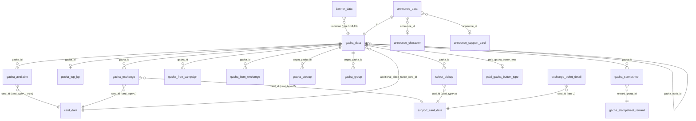
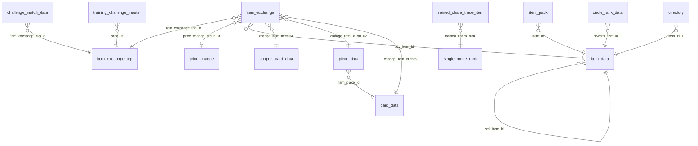
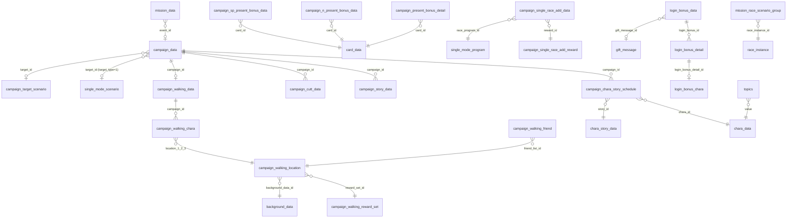

# Domain 2: support cards, items, gacha/banners, campaigns/missions/login, misc (JP master-jp.mdb)

Conventions: `JP/GL` = rows in master-jp.mdb / master.mdb (Global); `-` = table absent from Global. `*` = PK column. Coverage = share of distinct non-zero values found in target. Sentinels: 0 = none (-1 also none where noted). "text N" = `text_data(category=N, index=<owner id>)`.
Time columns: unix seconds UTC (JST = +9h) unless marked `txt` (JST local text `YYYY/MM/DD hh:mm:ss`, or season `MM-DD`). Far-future sentinels: end 2524618799/2524629600 (2049-50), 2556043199, 2542978799; text '2050/01/01'.

## (a) ID conventions (verified)

- support_card_data.id: `rarity*10000 + serial` (R=1xxxx 146, SR=2xxxx 101, SSR=3xxxx 316; ids 10001..30321, 563 rows). effect_table_id == id always; unique_effect_id == id for SR/SSR (417) and 0 for all R (146). support_card_type 1=stat card (535), 2=friend/NPC-support (23, outing_max 3/5), 3=group card (5; members in support_card_group). rarity 1/2/3 = R/SR/SSR (support_card_limit.rarity, support_card_level.id = rarity*1000+level).
- support_card_data.skill_set_id = 9081000 + chara_id (shared per chara); resolves to single_mode_hint_gain.hint_id (rows keyed by support_card_id) - NOT skill_set.id.
- support_card_data.command_id 101/102/103/105/106 = Speed/Stamina/Power/Guts/Wisdom (high conf by distribution; 0 for friend/group). command_type 1 for stat cards.
- gacha_data.id: 5-digit; type family by id prefix: 1xxxx tutorial (type 1), 2xxxx free/ticket "make debut" (types 2, 13), 3xxxx normal pickup (3, 11, 12), 5xxxx anniversary/special (5, 10, 14, 15). Latest 50248. Higher id = later within a prefix (not strictly global; use start_date).
- banner_data: type 1 banner_id = 100000 + gacha_id, transition = gacha_id. type 12/13 banners also transition = gacha_id (banner_id 150000+gacha_id). Other types: transition is page/screen id (9999, 20002...) or 0.
- piece_data.id == card_data.id (character-outfit id, e.g. 100101) plus 100000 = "any selected uma piece". card_data.id 6-digit = chara_id*100 + outfit no.; gacha_available.card_id for card_type=1 uses card_data.id.
- announce_data.id == gacha_data.id; announce_character.movie_id == gacha id; announce_support_card ids 501..633; announce_character 101..288.
- item_data.id: small ints; item_category = item type. mission_data.id: category-ish ranges (1xxxxxx daily/event, 2xxxxxx...). login_bonus_data.id: 10001 normal, 20001 start dash, 30001+ campaigns, 50001+ anniversary.
- item_category enum (shared by every `*_category` column in rewards / costs): all values in item_data.item_category (11 shoes/trophy-lei, 20 energy drink, 21 jelly, 30 support pt, 34 alarm, 40 gacha ticket, 41 3-star exchange, 42 SSR exchange, 90 jewel(id 43), 91 money(59), 93 dream sparkle, 99 clover, 103 friend pt, 160 horseshoe (48-50), 163 cup entry, 164 release crystal, ...) PLUS reward-only values (resolved by id match 100%): **50 = character card -> card_data.id**, **51 = support card -> support_card_data.id**, **55 = honor/title -> honor_data.id**, **70 = outfit -> dress_data.id**, **102 = character piece -> piece_data.id** (id space shared with card_data.id), 0 = none.
- text categories keyed by these ids: support_card_data.id -> 75 full name (`[epithet]Chara`), 76 epithet, 77 chara name, 78 chara name alt, 88 profile line (all 563/563); support_card_unique_effect.id -> 150 name, 155 desc (417/417); support_card_effect_table.type -> 151 name, 154 desc; gacha_data.id -> 26 name, 13 internal name (706/706); item_data.id -> 23 name (810/810), 24/10 desc (99.1%); piece_data.id -> 113 name, 114 desc; mission_data.id -> 67 (8702/8702); login_bonus_data.id -> 70 (282/282); topics.id -> 68 title, 69 body (626/626); gift_message.id -> 64 (99.5%); tutorial_guide_data.id -> 63 (382); item_exchange_top.id -> 39 name, 40 desc (93%; 96 rows, low-med); campaign_chara_story_schedule.story_id -> 92. NOT text-keyed (only id-range coincidence): select_pickup.id, exchange_ticket_detail.id, banner_data.id, campaign_data.campaign_id (no campaign name text found).

### Time windows / release order
- gacha_data.start_date/end_date unix UTC (starts 03:00 UTC = 12:00 JST; end = next start -1s; sentinel end 2524629600 for permanent/ticket gachas). Pool: gacha_available(gacha_id,card_id). A card's debut = MIN(gacha_data.start_date) over gachas where `is_pickup=1` (card_type matching). Check vs support_card_data.start_date (unix; availability): same day for 186/220 SSR with pickup; 96 SSR have no pickup row (permanent pool/old banners; start_date pre-dated 2021-02-23 for launch set). Launch cards: start_date=1614092400.
- banner_data.start_date/end_date are JST text; equal gacha start for 557/561 type-1 banners (so banner_data is a second clock; types 1/12/13 = gacha banners). Other banner types are event/story/shop/campaign banners.
- JP vs Global: same ids/rows are shared (Global ids are a strict subset of JP in all key tables; only `login_bonus_data` has 11 Global-only ids, `topics` 1). For shared gacha/support rows Global's start_date is the Global server's real date: median offset +1493 days (gacha), +1452 (support) vs JP. So release order is identical in both servers; Global gets ids in the same order. Global support_card_data has 4 placeholder rows dated 2099-01-01.
- JP snapshot extent: support_card_data max id 30321 (start 2026-09-30 03:00 UTC); gacha_data max start_date 2026-10-13 03:00 UTC; highest gacha id 50248 (start 2026-10-01). Future-dated rows exist (pre-registered up to ~2026-11).

## (b) Per-table dictionary

### Support cards
| table (JP/GL) | PK | purpose / columns |
|---|---|---|
| support_card_data (563/231) | id | Card master. chara_id->chara_data.id(1.0); rarity 1/2/3 (146/101/316, R/SR/SSR); exchange_item_id 48/49/50 -> item_data (horseshoes; exchange_item_num always 10 = horseshoes for dupes/pt exchange); effect_table_id -> support_card_effect_table.id (==id); unique_effect_id -> support_card_unique_effect.id (==id, 0 for R); command_type 1 (539) / 0 (24); command_id 101-106; support_card_type 1/2/3 (535/23/5); skill_set_id -> single_mode_hint_gain.hint_id (9081000+chara_id; non-zero for the 535 stat cards, 0 for the 28 friend/group cards; 148 distinct values); detail_pos_x/y, detail_scale (10000 = 1.0), detail_rot_z: UI crop of card art; start_date unix availability; disp_order = 1000000+ seq; outing_max 0/1/2/3/5 (friend/group outings); effect_id 0 except 5 rows (100-104; unknown). |
| support_card_effect_table (5163/1920) | id*, type* | Per-card numeric effect values. id=support card id. type 1..32 (26 used, text 151/154): 1 friendship bonus, 2 motivation effect, 3-7 stat bonuses (spd/sta/pow/guts/wiz), 8 training effect up, 9-13 initial stats, 14 initial bond, 15 race bonus, 16 fan bonus, 17 hint lv, 18 hint rate, 19 specialty rate, 25-26 event recover/effect, 27 fail rate down, 28 energy cost down, 30 skill pt bonus, 31 wiz friendship recovery, 32 initial skill pt (names high conf from text 151). Columns init, limit_lv5..limit_lv50 = value at card level breakpoints (5 step); -1 = not defined at that breakpoint (interpolate/carry). Level cap by limit-break count from support_card_limit. |
| support_card_unique_effect (417/152) | id* | Unique (lv30/50 "bond") effect. lv always 1; type_0/value_0(+_1.._4), type_1/value_1(+...) : type 1..32 = effect_table type enum; 101..122 = unique-only types (101: 189 rows, value_0 60-100 is a bond threshold, value_0_1 the bonus - med/low). type_1 0 for 240 rows. idle_mode_sub_rate 0/10/20/30 (idle mode). text 150/155. |
| support_card_level (135/135) | id* | id=rarity*1000+level; rarity, level, total_exp (cumulative). max lv 40/45/50 (R/SR/SSR) |
| support_card_limit (3/3) | rarity* | limit_0..limit_4 = max level at 0..4 limit breaks (R 20-40, SR 25-45, SSR 30-50) |
| support_card_limit_break (2/2) | id* | rarity 2/3 -> item_id 145 gold / 144 rainbow release crystal x1 (disp_order). R has none |
| support_card_group (18/9) | id* | group-card (support_card_type=3) members: support_card_id->support_card_data(1.0, 5 cards), chara_id->chara_data(1.0), outing_max |
| support_card_effect_filter (26/25) | type* | UI filter: type -> group_id (1..4, ->filter_group), sort_id, start_date (unix 1614092400) |
| support_card_effect_filter_group (4/4) | group_id* | group display order sort_id 10..40 |
| support_card_team_score_bonus (15/7) | id* | Team-trials score bonus by (rarity, limit_break_count): level(8-22), score_rate, bonus_group, score_rate_per_card, start/end unix |
| need_piece_num_data (3/3) | id* | rarity 1..3 -> piece_num 25/50/150 (pieces to unlock chara by star) |
| rental_deck (10/-) | id* | Rental deck by distance_type 0-4, ground_type 0, deck_name_id, disp_order, start/end unix (2025-2027) |
| rental_deck_card (50/-) | id* | rental_deck_id->rental_deck(1.0), support_card_id->support_card_data(1.0), limit_break_count=4, position 1-5 |
| rental_deck_alt (34/-) | id* | support_card_id -> support_card_alt_id (both support_card_data, 1.0): substitute card for rental |
| campaign_rental_support_data (1/-) | id* | rental campaign: rental_limit 3, start/end unix |
| campaign_rental_support_card (15/-) | id* | campaign_rental_support_data_id->(1.0), support_card_id->support_card_data(1.0), limit_break_count 4 |
| deck_recommend_exception (95/-) | support_card_id* | cards excluded from auto-deck recommendation (distribution_flag=1); ->support_card_data (1.0) |
| deck_recommend_lv_correction (1/-) | condition_type* | (101 -> correction_lv 10) |
| deck_recommend_organize (5/-) | id* | auto-deck: distance_type 0-4 (->rental_deck.distance_type enum), priority, command_id_1..6 (101-106 training slot order), start/end unix |
| announce_support_card (133/38) | id* | Support gacha announcement cutscene: type 1/3 (115/18), cuts_pattern 2/3, support_card_id_a/b/c->support_card_data (1.0; c=0 for 128) |

### Items / shop / exchange
| table | PK | purpose / columns |
|---|---|---|
| item_data (810/189) | id* | Item master. item_category (see enum above; 52 distinct); group_id 0 (806)/1/2 (-> nothing; item_group.group_id); effect_type_1 2 (502 = recover/evolve? low), 0, 1, 1024... effect_target_1, effect_value_1, effect_type_2 (+target/value), add_value_1-3; limit_num (per-use cap, 9999 typical), possession_limit_num, disp_limit_num; sort; rare 0/1 (71 flagged, e.g. jewel); enable_request/request_reward 0/5 (39 items: request-able "support request"); item_place_id (46 nonzero, UI place id, unverified); sell_item_id 59 (money)/sell_price (50 sellable); start/end txt (2017/1/1..2050/1/1 mostly). text 23/24. |
| item_group (39/39) | id* | only column group_id (values 1.., semantic unknown; item_data.group_id uses 1,2 only) |
| item_pack (210/-) | id* | item_pack_id (60 distinct, 1000-1050, no referenced table found = external/product id) -> {item_category,item_id,item_num}; start/end txt. item_id polymorphic by category (item_data / support_card_data for 51) |
| piece_data (272/93) | id* | character piece master; id == card_data.id (+100000 generic); item_place_id -> card_data.id(1.0); start/end txt. text 113/114 |
| item_exchange_top (103/25) | id* | Shop/exchange tab: item_exchange_disp_order (98..), item_exchange_type 0/1, item_top_category 0/1/2, is_anniv_shop_top 0/1 (10), shop_enter_trigger 0 or 12006-12011 (anniv. shop trigger), start/end unix. referenced by item_exchange, challenge_match_data, training_challenge_master. text 39/40 (93%) |
| item_exchange (8011/690) | id* | Shop entries (one row = one purchasable lot): item_exchange_top_id->item_exchange_top (97.1%; orphans 6,7,106); id range pattern = top_id*? (e.g. 5xxx: 5109 rows main support-card/uma shops); condition_type 0 (7947)/1/3/5 + condition_value_1/2; change_item_limit_type 0 none/1 (650 lim)/4 (50000 lim); change_item_limit_num; change_unit_type 0/1; change_item_category/id/num = what you get (51 support card 3040, 50 card 2130, 11, 102 piece 735...); additional_piece_num 0/60 (bonus pieces with card, 2130 rows); pay_item_category/id/num = cost (42 SSR ticket 2979, 41 3-star ticket 2130, 165 trial coin, 91 money...); price_change_group_id->price_change.group_id (1.0, 59); start/end unix. |
| price_change (132/13) | id* | group_id, min_num..max_num, pay_item_num: tiered price by purchase count |
| exchange_ticket_detail (467/-) | id* | Ticket exchange (SSR/3-star "引換券") eligible cards: card_type 1 (247)/2 (220) -> card_data / support_card_data (1.0 each); additional_piece_num 60 (type1)/0; start/end unix (sentinel end 2524661999) |
| trained_chara_trade_item (298/98) | id* | trained uma rank -> trade reward (91 money x N): trained_chara_rank->single_mode_rank.id (1.0) |
| gift_message (186/108) | id* | present-box message type ids (type_1..4 mostly 0); text 64 |
| directory (350/200) | id* | Collection/"directory" rank rewards: required_point, rank_level, item_category_1/id/num (90 jewel mostly) |
| circle_rank_data (11/11) | id* | circle ranking rewards (need_ranking_min/max, reward_item_category/id/num x2: jewel 43, 161 medal 134) |
| circle_stamp_data (145/43) | id* | circle chat stamps: type 0, disp_order, start_date txt |
| daily_pack (9/4) | shop_data_id*, platform_id* | daily jewel pack per platform_id 1-3: term 30 days, repurchase_day 3, group_id 1, daily_free_num 50 (jewel/day), start/end txt |
| subscription_effect (10/-) | id* | monthly subscription effects: subscription_type 1/2, target_type, effect_type_1/value, image_icon_id, transition_type, start/end unix |
| subscription_total_reward (24/-) | id* | total_month -> reward (item_category/id/num; 188 medalion, 161 medal...) |
| name_card_bg (150/150) | id* | profile namecard background tile: bg_group, time_group 1-5, bg_id->background_data (98.5%), pos/size; start unix |
| piece/gacha_piece (3/3) | id* | see gacha |

### Gacha / banners
| table | PK | purpose / columns |
|---|---|---|
| gacha_data (706/128) | id* | Gacha definition (one row = one pull button/banner pool). type: 1 tutorial(2),2 "make debut" free/ticket(24),3 normal pickup(367),5 special/anniversary(135),10 group-select child(46),11 "Twinkle Collection"(37),12 select-pickup(37),13 special ticket(10),14 step-up step(45),15 stamp-sheet(3); card_type 1 uma(364)/2 support(342); paid_gacha_button_type->paid_gacha_button_type (0/1/2); force_exchange 0/1 (165, pity-exchange forced, high 159/165 have gacha_exchange rows); daily_pay_cost 50 (443: daily 50-jewel single draw) / 0; disp_order UI order (790-853); only_once_flag/draw_limit (180: once-per-account, draw_limit 1; 36 limit 2; 10 limit 3); gacha_odds_id -> gacha_data.id of step-1 for step-up pools (36 rows else 0); rarity_odds_id 1001 (chara std 3%/18%/79%?) /1002 (support std: SSR 3%, SR 18%, R 79% from pool sums) /2001,2002 SSR-guaranteed /3001,3002 SR+ guaranteed /4001; no table holds it (checked) - enum; draw_guarantee_type 0/1 (1 = guarantee applies to 10th draw; step 5), draw_guarantee_rarity 2/3, draw_guarantee_num 1; cost_type 90 (443) / 92 (229) / 40 (34): currency category (90 = jewel per item_category; 92 = paid-only jewel (med-low); 40 = ticket, cost_single 0); cost_single 150 (per 1 draw; step-up 50/70/100/130/150); prize_odds_id 0 (gacha_prize_odds unused); additional_piece_target_card_type_k/card_id_k/rarity_k/num_k (k=1..6): bonus pieces per drawn card (card_type 1, card_id -> card_data.id/piece_data.id (1.0), by rarity 1/2/3: 5/60/90? e.g. num 90 x195, 5 x147, 60 x15, 10 x6); bonus_* all 0 (unused); start_date/end_date unix. |
| gacha_available (118141/12554) | gacha_id*, card_id* | Pool of each gacha: card_type 1/2, rarity 1/2/3 (card rarity: uma star / support R-SR-SSR; matches support_card_data.rarity 100%), odds (ppm; sum over a gacha = 1,000,000), is_pickup 0/1 (8275 rows = banner rate-up), recommend_order (0 or 1..N display order of pickups; 625 with 1), is_prize_selectable 0 (unused). card_id -> card_data.id 96.4% (card_type 1; 10 pseudo ids 301-310) / support_card_data.id 93.5% (card_type 2; 32 pseudo ids 201-222,301-310 = non-card slot ids, probably "pickup slot" placeholders; low). 670/706 gachas have pool rows (36 missing = step-up steps 2-5 reuse step 1 via gacha_odds_id). Global has all 12554 pairs (JP superset). |
| gacha_exchange (1953/255) | gacha_id*, card_id* | Point exchange list ("pity" 200 pt/card): card_type 1/2, pay_item_num 200, disp_order; gacha types 3 (361 gachas), 11, 12 |
| gacha_item_exchange (7/-) | id*, gacha_id* | item (item_id/item_category 42=SSR ticket, item_num 1) exchange for 200 pay_item_num |
| gacha_free_campaign (72/22) | id* | free draw campaign: gacha_id->gacha_data(1.0), target_draw_type 1 (43)/10 (29), start/end unix |
| gacha_group (46/0) | id* | Group-select: group_id (6 values: 50029,50030,50132,50140,50200,50208; all gacha_data.id of type 10) -> target_gacha_id (46 child gachas, type 10, disp_order descending). |
| gacha_stepup (45/-) | id* | stepup_id (== step-1 gacha id) , target_gacha_id, stepup_step 1-5 |
| select_pickup (1982/-) | id* | selectable pickup list for select-pickup gachas: gacha_id->gacha_data(1.0, 49 gachas), card_id (card_type 1->card_data, 2->support_card_data; 1.0 each), recommend_order, recommend_type 0/1 (90 = featured) |
| gacha_stampsheet (12/-) | id* | gacha_id (3 gachas of type 15), sheet_num 1-4, is_loop 0, stampsheet_reward_group_id->gacha_stampsheet_reward.group_id, stampsheet_odds_group_id 1 |
| gacha_stampsheet_reward (43/-) | id* | group_id (1-4), reward_type 1/2/3, reward_order, item_id/item_category/item_num (category 164 crystal, 91 money, 11,93,103) |
| gacha_piece (3/3) | id* | rarity 1-3 -> piece_type 2, piece_num 1/3/20, item_category 97, item_id 115 (goddess statue; piece currency for duplicates) |
| gacha_prize_odds (0/0) | prize_odds_id*, place* | empty |
| gacha_card_addition_num (0/-) | id*,gacha_id* | empty |
| gacha_top_bg (706/128) | id* | 1:1 with gacha: gacha_id->gacha_data (1.0), logo_size_x/y (all 0) |
| paid_gacha_button_type (2/-) | id* | gacha_count 1/3, paid_num 1500, draw_guarantee_rarity 3, draw_guarantee_type 0, draw_guarantee_num 1, draw_count 10 |
| banner_data (1060/235) | id* | Home banners. banner_id/banner_image_id (asset ids), type: 1 gacha(561), 6 (142), 9 (139), 7 (53), 8 (50), 4 (44), 5 (36), 12 group-select gacha (6), 13 step-up gacha (9), 3, 10, 11, 14, 15, 16; group_id (display group; 1/2/13 for gacha types); transition (gacha id for type 1/12/13; 9999/20002/other = screen ids); priority (display order); condition_value; dialog_image_id; start/end **JST text**. |
| shop_banner (10/-) | id* | shop_banner_name (asset), product_id (150-220; unverified target) |
| announce_data (321/89) | id* | gacha announcement: id=gacha_data.id (1.0); announce_type 1 chara->announce_character.id (188) /2 support->announce_support_card.id (133); priority 1/2; start/end unix |
| announce_character (188/51) | id* | movie_id == gacha id, can_end_second (skip time ms) |
| announce_event (55/14) | id* | event voice announcement (cue_name, cue_sheet_name, voice_text_asset, start/end unix); not tied to announce_data |

### Campaigns / missions / login
| table | PK | purpose |
|---|---|---|
| campaign_data (1011/165) | campaign_id* | Time-boxed bonus campaign: target_type (1 single-mode 346, 5 325, 4 209, 2 41, 7 36, 14 12, 9, 6, 12, 8, 10, 11, 3, 18, 19), target_id (0; for type 1 = single_mode_scenario.id or 10001 -> campaign_target_scenario; type 19 = 30411 unresolved), effect_type_1 (0 none; 9 (165) , 11, 2, 7, 4, 1, 17, 13, 5, 12...) + effect_value_1 (e.g. 200 = +200%?), open_flag_id (6 values, unverified), user_show 0/1, disp_order, image_icon_id, transition_type (10001 etc.), image_change, logo_type, start_time/end_time unix. mission_data.event_id -> campaign_id. effect_type meanings not decoded (low). |
| campaign_target_scenario (1/-) | id* | target_id 10001 -> single_mode_scenario_group.id 801 |
| campaign_chara_story_schedule (3904/264) | (campaign_id, chara_id, story_id) no PK | story unlocks per campaign: story_id->chara_story_data.story_id(1.0); text 92 |
| campaign_story_data (16/-) | id* | campaign_id->campaign_data(1.0), condition_type 1/2, condition_value, story_id (120251001..) |
| campaign_cutt_data (1901/-) | id* | campaign cut-in: chara_id->chara_data, campaign_id (5 values)->campaign_data, dress_id (-1 none), color_type, chara_no_change, trainer_gender_type, cut_id, cut_sub_id, motion_type, motion_rate |
| campaign_swap_motion_data (105/-) | id* | chara_id, dress_id, cut_id/cut_sub_id, replace_index |
| campaign_n_present_bonus_data (243/-) , campaign_sp_present_bonus_data (243/-) | id* | birthday-style present: target_type 8, card_id->card_data (1.0), count, item_category_1=20/item_id_1->item_data (1.0), item_num_1; sp version adds prop_id, location_id (->campaign_walking_location.id 1.0 id-range only), motion_type, replace_index (-1) |
| campaign_present_bonus_detail (68/68) | id* | same shape, campaign_id 214 only, second item slot |
| campaign_single_race_add_data (112/20) | id* | extra reward on a race: race_additional_id, race_program_id->single_mode_program (1.0), race_additional_reward_id->campaign_single_race_add_reward, reward_limit |
| campaign_single_race_add_reward (336/54) | id* | race_additional_reward_id, item_category 102/item_id->piece_data (1.0), reward_type 1/2, reward_value, reward_rate (10000=100%) |
| campaign_walking_data (5/-) | id* | "walk" (おさんぽ) mini-event: campaign_id->campaign_data(1.0), special_campaign_type, logo_id, map_id, icon_id_location_1-3, walking_limit, gauge_* |
| campaign_walking_chara (606/-) | (campaign_id,chara_id) | chara-> location_1..3 (->campaign_walking_location.id) |
| campaign_walking_friend (6/-) | id* | friend_list_id -> chara_id |
| campaign_walking_location (316/-) | id* | cut/bg/reward_set_id->campaign_walking_reward_set.reward_set_id(1.0), background_data_id->background_data(1.0), love_point, friend_list_id, positions, bgm/env cues |
| campaign_walking_reward_set (66/-) | id* | reward_set_id, limit_num, item_category/id->item_data, item_num |
| mission_data (8702/3152) | id* | Missions. mission_type: 1 (12), 3 (3029 system/permanent), 4 (2024 event/campaign chara missions, event_id->campaign_data 99.5%), 5 (1170 daily), 6 (910 achievements), 7-12, 14,15 (scout), 16,17,18 (login-count); condition_type (6-digit code, e.g. 100004 = complete training, 200019 = ... enum not decoded), condition_value_1-4, condition_num (threshold), step_group_id (chain; 3501 groups; 0 = standalone 2479?) / step_order, disp_order, item_category/item_id/item_num reward (polymorphic: 90 jewel, 91 money, 102 piece, 55 honor, 51 support card, 70 outfit...), event_id, date_check_flg 0/1, transition_type (screen id), start/end txt JST ('2050/01/01' sentinel). text 67. |
| mission_race_equate (53/21) | id* | input_id -> equate_id race_instance ids (race counted as equal for mission), ->race_instance.id (1.0) |
| mission_race_scenario_group (5/-) | id* | scenario_id 6 -> race_instance_id (931201..) |
| login_bonus_data (282/59) | id* | type 1 normal/2 start-dash/3 campaign/4/5; count_num (days: 1,7,10,15), disp_order, stamp_id, bg_id, group_id (self-ref 50000), step, gift_message_id, anime_file_id/label, new_start_date/start_date/end_date txt. text 70 |
| login_bonus_detail (625/157) | id* | login_bonus_id->login_bonus_data(1.0), count (day no.), item_category/id/num x5 slots (poly) |
| login_bonus_chara (13/-) | id* | login_bonus_detail_id (->detail 1.0), chara_num, chara_id/dress_id/pose_id (+2nd) |
| topics (626/339) | id* | home chara topics: type 1/2/3, value->chara_data.id (1.0), index 0/1/2/51, start/end txt. text 68/69 |
| season_data (28/28) | id* | recurring season windows: type (1..6), season, priority, start/end txt 'MM-DD hh:mm:ss' |
| timezone_data (4/4) | timezone* | time-of-day slot: priority, start_hour/end_hour txt (6:00-10:59, 11:00-17:29, 17:30-18:59, 19:00-5:59) |
| tutorial_guide_data (382/148) | id* | group_id (tutorial group), page_index, guide_type 1, image_index, fa_image_id; text 63 |

## (c) Mermaid ER diagrams (verified relations only)

```mermaid
erDiagram
  support_card_data ||--o{ support_card_effect_table : "effect_table_id=id"
  support_card_data ||--o| support_card_unique_effect : "unique_effect_id=id"
  support_card_data }o--|| chara_data : chara_id
  support_card_data }o--|| item_data : exchange_item_id
  support_card_data }o--|| support_card_limit : rarity
  support_card_level }o--|| support_card_limit : rarity
  support_card_limit_break }o--|| support_card_limit : rarity
  support_card_limit_break }o--|| item_data : item_id
  support_card_group }o--|| support_card_data : support_card_id
  support_card_effect_filter }o--|| support_card_effect_filter_group : group_id
  single_mode_hint_gain }o--|| support_card_data : support_card_id
  single_mode_story_data }o--|| support_card_data : support_card_id
  story_event_bonus_support_card }o--|| support_card_data : support_card_id
  rental_deck_card }o--|| rental_deck : rental_deck_id
  rental_deck_card }o--|| support_card_data : support_card_id
  rental_deck_alt }o--|| support_card_data : support_card_id
  campaign_rental_support_card }o--|| campaign_rental_support_data : data_id
  campaign_rental_support_card }o--|| support_card_data : support_card_id
  deck_recommend_exception }o--|| support_card_data : support_card_id
  announce_support_card }o--|| support_card_data : support_card_id_abc
```

## (d) Unknowns / low confidence
- gacha_available pseudo card ids (201-222 as card_type=2; 301-310 for both types): not in card_data/support_card_data; likely "pickup slot / pool-bucket" placeholders (301 has odds 7500 and is_pickup=1 in select-pickup gachas 30197...). Strict FK coverage 96.4% (chara) / 93.5% (support) -> unverified for support.
- gacha_data.cost_type 90/92/40 are currency categories, not item_data ids (item ids 90/92 are unrelated trophy leis). 92 meaning (paid-only jewel) is a guess.
- gacha_data.rarity_odds_id / gacha_odds_id semantics: rarity_odds_id has no table; ppm per-rarity rates inferred from pool sums (SSR 3% / SR 18% / R 79%). prize_odds_id/gacha_prize_odds/gacha_card_addition_num/bonus_* unused.
- support_card_effect_table null breakpoint semantics: -1 = not defined at that level; exact interpolation not proven. effect_id (support_card_data) 5 weird rows 100-104.
- support_card_unique_effect types 101..122 meanings (101 bond-threshold bonus is a guess); idle_mode_sub_rate.
- mission_data condition_type (6-digit codes) and mission_type 7-17 meanings; campaign_data target_type/effect_type_1/transition_type/open_flag_id/image_icon_id; campaign_data target_id for type 19 (30411).
- item_data effect_type/target/value semantics; item_group role; item_pack.item_pack_id referent (no table); shop_banner.product_id referent; item_exchange_top.shop_enter_trigger (12006-12011).
- item_exchange condition_type 1/3/5 (lot unlock conditions, values 13/14 etc.).
- campaign_sp_present_bonus_data.location_id coverage is id-range only.
- text mapping "item_exchange_top 39/40" 93% - weak; campaign has no dedicated name text.
- Global comparison: Global tables without rows (`-`/0) are JP-only features (rental decks, step-up, select pickup, campaign_walking, stampsheet, exchange tickets, item_pack).
