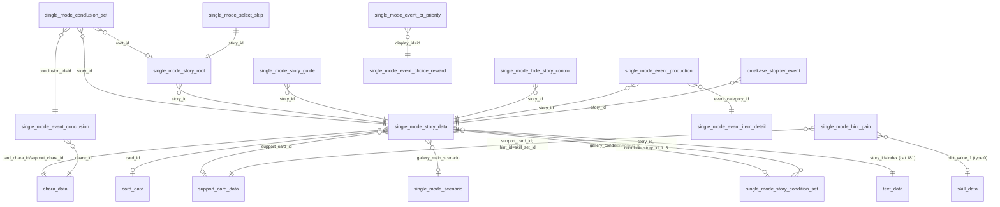
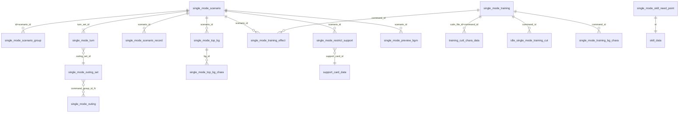
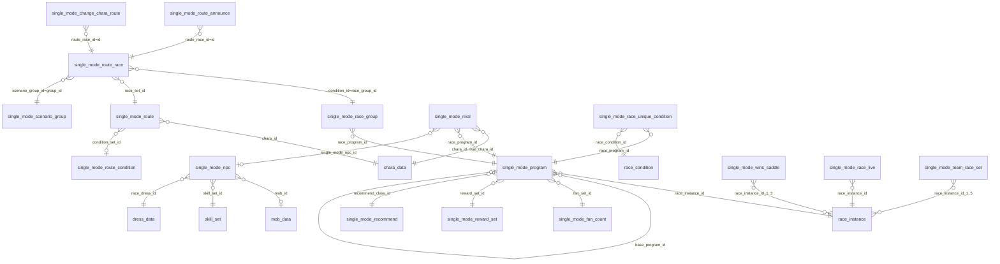
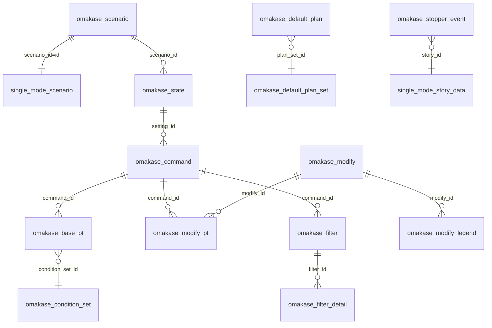
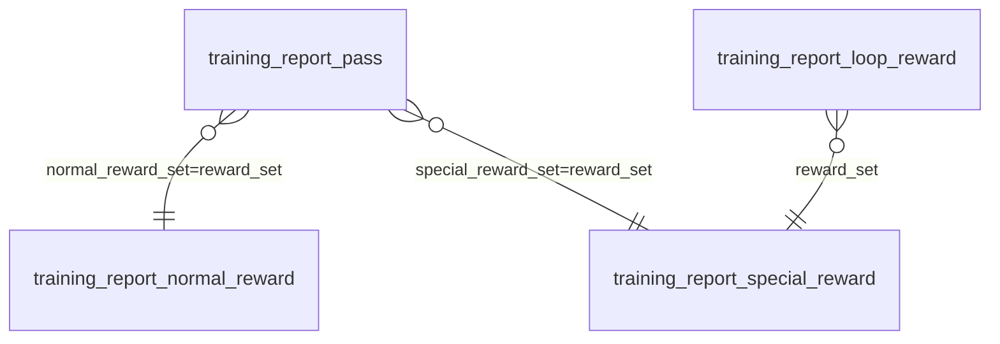

# domain 3: career core (career / single mode core, omakase, training reports, training cutscenes)

Source: `master-jp.mdb` (JP, primary, read-only). `GL` = row count in older Global `master.mdb` (`-` = table absent in Global). Coverage numbers are `distinct non-zero values of the FK column that exist in the target / distinct non-zero values`, computed over the whole DB. All columns are INTEGER unless marked `TEXT`. `0` is the null sentinel everywhere unless stated.
Edge list (machine readable, 155 edges): [`edges.json`](edges.json).

Headline facts
- Event stat/choice effects (the "+10 speed" per choice) are NOT in master.mdb. The mdb only holds the event index (`single_mode_story_data`), title text (text_data cat 181), conclusion/branch bookkeeping and **hint** rewards (`single_mode_hint_gain`). Choice effects live in the story-timeline assets.
- `single_mode_story_data.story_id` is NOT unique (16711 distinct in 20573 rows); PK is the surrogate `id`.
- Everything per-scenario keys on `scenario_id` = `single_mode_scenario.id` (1..14), or on `scenario_group.group_id` (a set of scenarios).
- `race_program_id` columns point at `single_mode_program.id` (career-specific schedule slot), which points to `race_instance.id` (concrete race) -> `race.id` (course/grade).

## (a) ID conventions (verified)

### story_id (9 digits) - `single_mode_story_data.story_id`, text_data category 181 = event title (16620/16711 = 99.5% resolve)
| prefix | layout | meaning | evidence |
|---|---|---|---|
| `4SSSSSNNN` | S = scenario id, 5 digits, `00000` = common to all scenarios; NNN = event no. | scenario/system events (training lv up, URA finals, rival race, ending, outing...) | `substr(story_id,2,5)` equals `gallery_main_scenario` for every non-zero row; `event_category` 0/1 (and some 3/4) |
| `5CCCCCNNN` | C = chara_id zero-padded to 5 digits (`01001` = Special Week), NNN = event no | character events. NNN first digit: 1/2/3 = chara-unique story events (cat 2, mostly 1 row per id), 5/7/8 = shared event templates instantiated per chara (cat 3), 6 = goal/aux, 9 = scenario-start/goal (cat 1 "9xx": `501001901` Grand Live start) | 16427/16427 rows with `card_chara_id!=0` match `substr(story_id,2,5)`. 808 rows with `card_chara_id=0` are 5xxx generic |
| `8CCCCCNNN` | C = support_card_id (5 digits, e.g. 30001 -> `830001001`) or `0`+support_chara_id (`809001010` = chara 9001 Tazuna) | support card events (cat 4) | `substr(story_id,2,5)=support_card_id` for 1162/1215 rows with support_card_id!=0 (the 53 others are shared chara events listed under another card); `=support_chara_id` 496/504 |
| `10001003` (8 digits) | single row, event_category 0 | legacy / odd | quirk |

- `card_id` (outfit/trainee card, 6 digits `CCCCCnn`) is set on cat-3 rows and on a few 4xxx rows: the **outfit-specific** variants (`card_id/100 == card_chara_id` for 2462/2462). Same `story_id` appears once per outfit/card => duplicates. Example: `501017800/801/802` x card 101702.
- `event_category` (story_data): 0 = system/misc (593), 1 = scenario main/chain events (935), 2 = chara-unique (5987, 1 row per story_id), 3 = chara shared/outfit/general (11279), 4 = support-card/support-chara (1779). Confidence medium (inferred from id prefixes and counts).
- `id` ranges: 1..214075 (base), 6,xxx,xxx and 13,xxx,xxx (618 + 742 later additions, same story_ids repeated for new chara/cards). Not meaningful.
- Duplicate rows (5754 rows share 1892 story_ids): rows are identical except `id`, and `gallery_flag/gallery_list_id` (only the first row carries gallery info).

### hint_id - `single_mode_hint_gain.hint_id` = `support_card_data.skill_set_id` (135/135). Pattern `9081001..9081146` = `9081000 + (chara_id-1000)`; 25 support cards (`9081139`, `9089xxx`) point to hint ids that have no rows (cards without hints - friend/group/pal types).

### scenario ids
- `single_mode_scenario.id` 1..14: 1 URA Finals, 2 Aoharu Cup, 3 Grand Live, 4 Make a New Track (Climax), 5 Grand Masters, 6 L'Arc, 7 U.A.F., 8 Harvest Festival (Cooking), 9 Mecha Uma, 10 Legends, 11 Island, 12 Onsen, 13 Dreams, 14 Tresen-ken. Names: text_data cat 237 (short) / cat 119 (long) index = scenario id (verified, 14/14).
- `scenario_image_id`, `sort_id` equal id except sort_id swaps 3<->4 (scenario 4 sorts before 3). `turn_set_id = id` (1:1, 14/14 both ways).
- `single_mode_scenario_group`: `group_id` 1..14 = singleton group of scenario N; `100` = all 14; 601/701/801/901/1801/1901 = hand-made subsets. `single_mode_route_race.scenario_group_id` uses group_id (100,701,13,4,6,5 => 6/6 resolve). Singleton groups share the id with the scenario, so a group_id <=14 is also a scenario id.
- Per-scenario tables other agents own (`single_mode_NN_*`) use NN = scenario id (verified here only via omakase_*: `command_id//10000 = scenario_id`).

### program / turn ids
- `single_mode_program.id` (1..3118) is the "race program" id: one slot in the career race calendar (month/half) bound to `race_instance_id`. 760/1118 rows have race_instance 9xxxxx (= fixed career-only instances), others 1xxxxx-4xxxxx (real G1-OP races). `race_instance.id = race_id*100 + nn` (667 rows exactly; 358/1118 programs satisfy `race_id = race_instance_id/100`).
- `month/half` of program: equal to race_instance.date (MMDD) in 869/893 of 1118 (78-80%); not a derivation, treat as independent.
- `base_program_id` (21 distinct, 64 rows) = program overridden by this alternative program (`program_group` 101..1073 = alternates keyed by `single_mode_chara_program.program_group`, 100/100 resolve; target in another domain).
- `single_mode_race_group`: `race_group_id` -> set of programs. 1-program groups use `race_group_id = race_program_id` (e.g. 18 -> 18); big groups 10001-10003, 40001-40003 (41 programs each) are scenario race lists (programs 2001..).
- `single_mode_turn`: PK `id`; `(turn_set_id, turn)` unique; 78 turns (1..78) for 11 scenarios, 67 for #6, 72 for #10, 69 for #13. `turn` 1-24 = Junior, 25-48 Classic, 49-72 Senior, 73-78 URA finals (year 4). `year/month/half` derived: 2 turns per month; turns 1 and 2 are both Apr-first-half.
- `command_id` (training): 101 speed, 102 power, 103 guts, 105 stamina, 106 wisdom (text_data cat 55 verified); 601-605 = same 5 with `base_command_id`=101.. (summer/camp variants), 901/902/906 (scenario 9), 1101-1106, 2101-2305 (scenario 7 sub-training), 3601-3606 (scenario 11), 301-305 = outing spots (River bank, Karaoke, Shrine, Sea, Onsen), 1106/3606 outing in scenario 6/11, 1003..1057 = type-10 commands (scenario 10 "Legends" group-training-like; unverified), 4001-4003 type 12.
- `omakase_*.command_id = scenario_id*10000 + local`, local in 101..119 (69/69 match scenario via omakase_state). local 101,102,103,105,106 = training command ids (30/30); 104,107..119 = other actions (unverified: rest/outing/race/medic/shop ...).
- Training "cut" id (`cutin_file_id`, 6 digits) e.g. 101055: used by `training_cutt_*.command_id` and in `single_mode_training_se.sheet_id`. NOT a command_id.

## (b) Per-table dictionary

### B1. Story / events
**single_mode_story_data** (20573, GL 7665; GL lacks cols sub_icon_id, gallery_gruop_id, gallery_sort, gallery_condition, gallery_suggest_event, past_race_id_2..4) PK id. Event index. 12908 PK ids JP-only; 2933 Global rows differ in JP (new cols).
- story_id -> text_data[181].index (99.5%); also see (a).
- short_story_id: id of shortened/skip-variant story? 3483 distinct, 91% have text 181; only 0.8% are themselves story_ids. Unverified meaning.
- card_id -> card_data.id (271/271); card_chara_id -> chara_data.id (135/135); support_card_id -> support_card_data.id (420/420); support_chara_id -> chara_data.id (146/146).
- show_progress_1/2/3 (0..5; 441/416/308 non-zero), show_clear (44 distinct, 0 = none; 9 = 144 rows; looks like a clear/ending condition code), show_succession (0/1, 288 rows) - UI flags; unverified.
- event_title_style 0:71 1:14858 2:1777 3:1405 4:2462 (title banner style; 4 correlates with support events, 1 default) low confidence. event_title_dress_icon -> dress_data.id (271/271, = outfit's dress id). sub_icon_id always 0. event_title_chara_icon in {0, 9001,9002,9003,9008} (non-zero 20 rows; chara icons for support chara events, unverified).
- se_change 0/1 (676), ending_type 0/1/2 (135 each => 1/2 = ending variants), race_event_flag 0/1 (4528; set for events containing a race), mini_game_result 0..4 (1/2/3/4 -> Grand Live etc; unverified), force_use_race_dress 0/1 (13).
- gallery_main_scenario -> single_mode_scenario.id (14/14; =substr(story_id,2,5) for 4xxxxxxxx), gallery_flag 0..6 (0:4316 1:13555 2:1594 3:933 4:135 5:28 6:12; gallery class), gallery_list_id (700 distinct), gallery_gruop_id [sic] (786), gallery_sort, gallery_condition -> single_mode_story_condition_set.group_id (312/312), gallery_suggest_event 0/1, available_gallery_key 0/1 (306 rows 0).
- past_race_id (22 distinct) -> race.id (100%); past_race_id_2..4 mostly 0.
- event_category: see (a).

**single_mode_conclusion_set** (1794, GL 824) no PK. (story_id, root_id, conclusion_id). story_id -> story_data.story_id (1780/1780). root_id (0 or 1-3) -> single_mode_story_root.id (3/3; only 3 events 400000043/44, 400001043, 400006317/18, 400011112/13 are rooted). conclusion_id 1-5 (1671/91/6/19/7) -> single_mode_event_conclusion.id 4/5 (id 5 missing). Meaning: which end-of-event motion/pose set an event uses (conclusion = chara pose after event).
**single_mode_event_conclusion** (540, GL 248) PK (id, chara_id): chara_motion_set_id -> chara_motion_set.id (246/246); chara_id -> chara_data.id (135). 4 conclusion ids x 135 charas.
**single_mode_story_root** (36, GL -) PK id: branch roots of events. story_id -> story_data (34/34), suggest_select 0/1/2/4, suggest_index 0..3 (which choice the game recommends), condition_type 0 (33)/1/2, condition_story_id_1..3 -> story_data.story_id (100%), gain_select_N/select_index_N = required gain/choice index of that earlier event. Meaning of condition_type 1/2 (and vs ALL/ANY) unverified.
**single_mode_story_condition_set** (487, GL -) PK id: unlock/occurrence chain for events. group_id (312) <- story_data.gallery_condition; story_id (483) -> story_data (100%); condition_type 0:35 1:409 2:43 (1 = needs condition_story_id_1 (+choice), 2 = two events; unverified); condition_story_id_1..3 -> story_data (100%); gain_select_N 0..4, select_index_N 0..3.
**single_mode_select_skip** (9, -) PK story_id: auto_selected_index (all 0). story_id -> story_root.story_id and story_data (9/9). Events whose choice is auto-chosen.
**single_mode_story_guide** (13, GL 2) PK story_id: guide_id -> tutorial_guide_data.group_id (13/13). Scenario-intro tutorial per scenario (400002041.. = intro events of scenarios 2..14).
**single_mode_hide_story_control** (12, -) PK id: (support_card_id 30305 only, story_id) -> hides listed support events; story_id -> story_data (11/11).
**single_mode_event_production** (147, GL 73) PK story_id: event_category_id (177-189) -> event_item_detail.event_category_id (13/13); max_item_id; item_dir TEXT (Lottery 135/Aoharu 8/Venus/Rival/Plow/Ending); item_name TEXT icon path pattern. Prop/item given in a "production" cutscene (lottery 5 items for Grand Live-style?). `story_id` 100% in story_data.
**single_mode_event_item_detail** (20, GL 17; JP adds is_special) PK id: event_category_id (13 distinct 177-189; NOT story_data.event_category), item_id (1-5), name_index -> text_data[180] (item name, 20/20), is_special 0/1.
**single_mode_event_choice_reward** (59, GL 35) PK id: disp_type (0:54, 1:3, 2:2), effect_value_type_0/1/2 (0..10 / 0..5 / 0..5) - UI display classification of a choice's reward. `id` <- single_mode_event_cr_priority.display_id (59/59). No story link in DB. Semantics unverified.
**single_mode_event_cr_priority** (82, GL 58) PK id: display_id -> event_choice_reward.id (59/59), effect_value_condition_0/1/2, priority (display sort).
**single_mode_hint_gain** (5200, GL 1860) PK id. Support-card hint event gains. hint_id -> support_card_data.skill_set_id (135 hint sets), support_card_id -> support_card_data.id (535/535; ids 1xxxx R? 2xxxx SR? 3xxxx SSR - by prefix 135/100/300 cards), hint_group (1..25 = order/slot within hint set; each (hint_id,support_card_id,hint_group) is one reward "line"), hint_gain_type 0 (4015) = skill hint: hint_value_1 -> skill_data.id (382/382), hint_value_2 = hint level (always 1); 1 (1185) = status/stat bonus bundled with hint: hint_value_1 in {1 spd,2 sta,3 pow,4 guts,5 wiz,30 skill pt} (same coding as training_effect.target_type), hint_value_2 = amount (1..12). group_id (90815201..3, 5 rows), condition_set_id (830098, 3 rows), priority (0, 90, 100): used only for card 30098 (special-conditional gains). Hint skills for event = rows with hint_gain_type=0 sharing (hint_id, hint_group); one group is chosen at random per event.
**short_episode** (11, GL 10) PK id: scene (1-7), sort, condition_type 1/2/3 (1 = always, 2 = value 50/100, 3 = 10000 - looks like fan/progress thresholds), condition_value_1, story_id (1..11, small ids, NOT in single_mode_story_data; resolves nowhere; refers to a separate short-episode story table). Unverified.

### B2. Scenarios
**single_mode_scenario** (14, GL 3) PK id; JP-only cols: skill_upgrade_num, upper_limit_speed/stamina/pow/guts/wiz, max_skill_point, support_num. sort_id, scenario_image_id, prologue_id (80000001..80000014, no resolution), turn_set_id (-> single_mode_turn.turn_set_id), hint_rate (all 0), start_date/end_date (unix seconds; 1577804400 = 2020-01-01, end 2524575600 = 2050), additional_icon_set_id (0 or 5 -> itself), bg_id/bg_sub_id/bg_offset_x/sec_bg_id/sec_bg_sub_id (-> background_data.bg_id/bg_sub, 100%), label_font_color/label_bg_color (TEXT hex), chara_program_change_flag (0/1/2 - whether chara-specific program overrides apply; 1: #4,6,13; 2: #10), max_speed..max_wiz (initial stat cap shown: 100..950, 200 for URA, scenario-specific; low confidence), gimmick_discount_rate (5000), skill_upgrade_num (0 or 2), upper_limit_* (2000 / 2500 for #13,14), max_skill_point (9999; 99999 for #13,14), support_num (0, 4, 5).
**single_mode_scenario_group** (84, GL 11) PK id; (group_id, scenario_id) membership.
**single_mode_scenario_record** (180, GL 27) PK id: per scenario, reward for reaching record score `need_record_min` (4000..42000): reward_item_category/id/num. Categories seen 40,55,90,91,93,97,164 (shared item_category enum; 91/59 = money-like item). scenario_id -> scenario.id (14/14).
**single_mode_scenario_update** (2, GL 2) PK id: scenario_id, tips_group_id (10005,10205), page_index_from/to, start_date/end_date unix. Tutorial pages updated in a period. GL rows differ in dates.
**single_mode_restrict_support** (11, GL 1) PK id: (scenario_id, support_card_id) support cards banned in a scenario.
**single_mode_preview_bgm** (29, GL 0) PK id: scenario_id, preview_order, cue_name TEXT, cuesheet_name TEXT. BGM previews per scenario.
**single_mode_ao_offset** (5, GL 5) id, offset_1..5: layout offsets by team size (Aoharu).
**single_mode_message** (34, GL 26) PK id: advisor-message conditions: priority, emergent 0/1, status_type_1/2 (1-5 stats, 6.., 0=none up to 30) with ranges status_value_X_1/_2, character_type (always 1). Status types not decoded (24 distinct). Unverified.
**single_mode_team_name** (4, GL 4) id 0..3, chara_id (1010,1056,1052,1030) -> chara_data (4/4). Aoharu team-leader names.
**single_mode_team_race_set** (68, GL 68) PK id (100..): rank (1-10), race_instance_id_1..5 -> race_instance.id (id 62xxxx = Aoharu team race instances, 100%), status_correction (e.g. -4000, NPC stat penalty), super_team_chara_id -> chara_data.id (12), motion_id (6). 
**single_mode_race_limit_reward** (1, -) PK id: item_category 161/item 134 x10 limited-time reward (reward_limit 10, start_date 1724468400 (2024-08-24), end 2524618800). Unverified item mapping.
**single_mode_top_bg** (222, GL 62; JP adds half_type) PK id: home-screen background per (scenario_id, month, half_type): month 1-12, half_type 0/1/2 (0 = whole month?), bg_id (16 values, -> background_data.bg_id 100%), bg_sub_id (-> background_data.bg_sub 100%), bg_progress 0-3, bg_effect TEXT (pfb_eff_single_scenario_01 or ''), bgm_cue_name/bgm_cuesheet TEXT, max_placement 0/3. 
**single_mode_top_bg_chara** (21, GL 12) PK id (212401 = scenario 2 * 100000 + bg 124*100 + n): scenario_id, bg_id (-> top_bg.bg_id), group_id, pos_x, pos_z, rotation_y (fixed-point x1e4?), motion_set_id (12 values, no resolve).
**hide_chara_text_scenario** (78, -) PK id: scenario_id (6,7,11), period (2,3,4), character_id -> chara_data (45/45), dress_id (0 or valid dress, 2 values), voice_id -> character_system_text.voice_id (18/18). Chara voice lines hidden during scenario period.
**hide_chara_text_special** (12, -) PK id: special_voice_except_id (always 1), character_id (1097), voice_id -> character_system_text.voice_id (12/12).
**single_mode_tag_card_pos** (8220, GL 3435) PK id: support_card_id -> support_card_data.id (548/548); pattern 1..5 (= number of tagged cards in layout, rows per pattern = pattern: 548/1096/1644/2192/2740), pos_index 1..5, pos_x, pos_y, scale_x, scale_y, rot_z: stored as fixed-point ints (pos x1e4? scale ~9408 = 0.94). Exactly 5*3 = 15 rows per card.

### B3. Training & turns
**single_mode_training** (189, GL 36; JP adds voice_trigger_type) PK id. One row per (command_id, command_level). base_command_id (37 distinct; =101..106 for variant commands), command_level 0..5 (0 = non-leveled commands), command_type 1 training(156) / 3 outing(7: 301-305,1106,3606) / 7 (701) / 10 (22; ids 1003..1057) / 12 (4001-4003) (names by command_type partially inferred), cutin_file_id (cut id, unique per row, 103 distinct), max_chara_num (1/2/5/6; 2 default, 5 for scenario-specific group commands), voice_trigger_type 1/2 (2 only for wisdom 106/906), failure_rate (base failure x10: 504 = 50.4%?? unverified; 0 for no failure), menu_bg_id, menu_bg_sub_id, motion_set (0, 19000..23000 = per-stat motion), sabori_type 0..3 (0 = none, 1 = lv1/5 variants, 2 = default, 3 = lv5 special), dress_type (always 0), dress_id (1-4+), group_id (1 -> 1106, 2 -> 3606).
**single_mode_training_effect** (830, GL 168) PK id. Base gain table per (scenario_id, command_id, sub_id, result_state, target_type): effect_value. target_type (counts): 1 speed 92, 2 stamina 60, 3 power 90, 4 guts 60, 5 wiz 30, 10 vitality 248 (-42..50), 20 motivation 85 (1-2), 30 skill pt 150, 101 15 (value 0 - marker). sub_id 1 (774) /2 /3 (28 each; only command 303 shrine, sub = random result), result_state 2 (803) normal / 1 (27; only wisdom family 106/605/906/1105/3605: vital +5 alt). scenario_id -> scenario (14/14). **Keyed by command_id, not by facility level**: no command_level column - per-level gains are not in this table.
**single_mode_turn** (1066, GL 234) PK id; (turn_set_id, turn) is the natural key. Fields: year 1-4, month, half 1/2, period 0..5 (704..: 0:713 1:168 2:104 3:66 4:14 5:1; stage marker, unverified), unique_command 0/1 (884), training_set_id 1..5 (1:880 2:88 3:14 4:70 5:14; training lineup set, targets not in domain), outing_set_id -> single_mode_outing_set.id (4/4), top_cloth_id (0 or 4 -> dress_data.id), top_bg_id (0,13,89,102,124,180; =background bg ids, 4/5 resolve in background_data.bg_id; unverified), bgm_cue_name/bgm_cuesheet_name/bgm_unique_cue_name/bgm_unique_cuesheet_name TEXT, rest_type 0/1, health_room_type 0/1, race_entry_type 0/1 (1 = races enterable, 877), story_cloth_id (0,3,4,6 -> dress_data.id), story_bg_id (9,42,243 -> background_data.bg_id), story_bg_sub_id (120,2110,2121 -> background_data.bg_sub). `turn_set_id` -> scenario.turn_set_id (14/14).
**single_mode_outing** (5, GL 3) PK id: command_group_id (301,304,390,1106,3606; 4/5 are training command_ids), condition 0/1, is_play_cutt 0/1. **single_mode_outing_set** (4, GL 2) id, command_group_id_1..5 (outing options per turn; refs outing.command_group_id).
**single_mode_training_bg_chara** (30, -) PK id: (scenario_id 9, command_id, command_level, cut_id 1-8) -> background character cut for Mecha scenario training (command_id -> training, 10/10).
**single_mode_training_se** (398, GL 220) PK id: sheet_id TEXT unique (`Bad01_101011_001_01_000`: Bad|Suc, cut id 101011, ...), se_cue_name/se_cuesheet_name TEXT, chara_index (0), voice_trigger_id (0). digits 7-12 of sheet_id = cutin_file_id (380/398 resolve).
**single_mode_training_plate** (4, -) PK id: scenario_id 0, value_min/value_max (1-5, 6-19, 20-100, 101-999): level thresholds for training plate tiers.
**idle_single_mode_training_cut** (20, -) PK id: scenario_id (0..), command_id -> training.command_id (20/20), max_training_lv, designated_chara_id (-> chara_data, 1 value).

### B4. Race program / rivals / NPC
**single_mode_program** (1118, GL 775) PK id. race_instance_id -> race_instance.id (1074/1074). base_program_id/reserve_program_id -> self. program_group -> single_mode_chara_program.program_group (100/100). race_permission 1..9 (5:287 9:243 2:188 1:157 4:122 3:118 6-8:1 each; eligibility class, unverified; 5/9 cluster on Jan dates = finals/URA?). month 1-12, half 1/2. random_group_id (10101..10105; no resolve). grade_rate_id (90 distinct, 74/90 are program ids? unverified), entry_decrease 0/1/2/4/6/11, entry_decrease_flag 0/1, recommend_class_id -> single_mode_recommend.id (14/14), filly_only_flag 0/1 (56), need_fan_count (21 distinct; 0 = none; values match fan_count ladder), fan_set_id -> single_mode_fan_count.fan_set_id (55/55), reward_set_id -> single_mode_reward_set.reward_set_id (65/65).
**single_mode_race_group** (1112, GL 773) PK id: race_group_id (590 groups) -> race_program_id (-> program.id, 1112/1112; 1112 of 1118 programs covered).
**single_mode_route** (144, GL 69) PK id: (scenario_id 0 or 4/6/13, chara_id -> chara_data, race_set_id -> route_race.race_set_id, condition_set_id -> route_condition.condition_set_id (6/6), priority 0 or 400-408). Chara-specific objective (target races) lists.
**single_mode_route_race** (1844, GL 809; JP adds alt_determine_race, alt_determine_race_flag, determine_race_for_generate) PK id: one objective per row. race_set_id (143 -> single_mode_route), scenario_group_id -> scenario_group.group_id (100/701/13/4/6/5), target_type 1 (1420) / 3 (424), sort_id, turn (1-78 turn index), race_type 0 (1416)/1/2/3 (141 each)/4, condition_type 1 (1724), 3 (63), 9/7 (18), 2 (10), 8 (7), 11/12/13; **condition_id -> race_group.race_group_id (211/211 for type 1)**; condition_value_1 (1,3,5 = required finish place?; 5000/3000/40000 = fan counts for other types), condition_value_2, determine_race/alt_determine_race/determine_race_for_generate (race pick when a group has several; 8/4/2 distinct, ~88-100% program ids), determine_race_flag/alt_determine_race_flag (65/25 distinct opaque flag ids).
**single_mode_route_condition** (16, GL 16): condition_set_id, condition_type_1 (1 or 3), condition_value_1/2 (e.g. 1,6 = e.g. "year 1..6?" ) unverified.
**single_mode_route_announce** (20, GL 18): route_race_type 7 (18) / 11 (2), route_race_id -> route_race.id (20/20; ids 4001..), turn, target_type 1, target_value (race program / group id?).
**single_mode_change_chara_route** (135, GL 62): route_race_group_id (always 40000), chara_id -> chara_data (135/135), route_race_id -> route_race.id (135/135). One alternate route entry per chara.
**single_mode_rival** (7309, GL 2055) PK id: chara_id (135 trainees), turn (0 for 738 rows = any), race_program_id -> program.id (235/235), rival_flag_id (0 or 16 opaque), condition_type 1/2/3 (6460/766/83), rival_chara_id -> chara_data (140/140; 0 for 144 rows), single_mode_npc_id -> single_mode_npc.id (2720/2720; 10200 = rival 1020*10, 1020001.. = NPC variants), frame_order (gate order, mostly 0). 54 rows per trainee on average.
**single_mode_npc** (3969, GL 1683) PK id: npc_group_id (22 groups), chara_id -> chara_data (151/152), mob_id -> mob_data.mob_id (786/786 where non-zero; 3069 rows have 0), race_dress_id -> dress_data (166/166), speed..wiz stat values, proper_distance_{short,mile,middle,long}, proper_running_style_{nige,senko,sashi,oikomi}, proper_ground_{turf,dirt} (1-8 aptitude codes), skill_set_id -> skill_set.id (707/707), motivation_min/max (1-5). Fixed opponent definitions.
**single_mode_race_unique_condition** (188, -) PK id: chara_id (52) -> chara_data, year 1-3, race_program_id -> program.id (142/142), race_condition_id -> race_condition.id (20/20, 21 values), frame_order (0 mostly), finish_order_0 (0, 4). Forced weather/ground for a chara's target race.
**single_mode_race_live** (247, GL 139) PK id: grade (100,200,..900), race_instance_id -> race_instance.id (240/240), music_id -> live_data.music_id (15/15): winner-live song per race.
**single_mode_race_restrict_turn** (31, GL 0) no PK (chara_id, turn, gain_id): chara_id -> chara_data (24/24); gain_id 9-digit (e.g. 106211811) opaque, unresolved: race-entry restriction for a chara at a turn.
**single_mode_audience_overwrite** (11, -) PK id: chara_id (1132), race_grade (-1,100..900), audience_type (0/70/80), crowd_sound_type, live_type, start_turn, end_turn, group_id (801).
**single_mode_wins_saddle** (214, GL 181; JP adds relation_group_id) PK id: priority, group_id (166 distinct), relation_group_id (165), condition 0/1, win_saddle_type 0:20 1:76 2:45 3:73 (type 0 = multi-race saddle with race_instance_id_1..3; types 1-3 single-race), race_instance_id_1..8 -> race_instance.id (slots 1-3 used only).

### B5. Ranks / fans / evaluation / rewards
**single_mode_rank** (298, GL 98) PK id: min_value/max_value = evaluation-point range for rank id (1 = 0-299 ... 298 = 190400-999999). Rank id -> letter (G..SS+...) derivation not stored here (UG..): likely sequential.
**single_mode_evaluation** (40, GL 12) PK id: evaluation (90,70,40,0) x chara_id (9001 Tazuna, 9002, 9003, 9006, 9008, 9043, 9044, 9049, 9050, 1139) -> chara_data (10/10). Per-npc evaluation thresholds (bond tiers); unverified.
**single_mode_fan_count** (1084, GL 972) PK id: fan_set_id (61 sets), order (1-18 finishing place), fan_count (reward fans). program.fan_set_id -> here.
**single_mode_member_rank** (8, GL 8): value_min/value_max -> member_rank_id (team member score bands). **single_mode_member_rank_points** (12, GL 12): rank_id, points. Both unreferenced in DB.
**single_mode_reward_set** (637, GL 798; GL has 304 rows JP lacks) PK id: reward_set_id (66; =program.reward_set_id), order_min/max (finish order range; 1, 1..18/14/20), reward_type 1 (187: always) /2 (450: chance), bonus 0..5 (race class bonus tier; 5 = max), odds (out of 1,000,000), item_category (11 item_data 97, 90:70, 91:376, 93:24, 97:70) / item_id (-> item_data.id 43/43) / item_num.
**single_mode_skill_need_point** (1182, GL 562) PK id **= skill_data.id** (1182/1182 resolve): need_skill_point (base cost in skill pt; 50..200+, 20 distinct), status_type & status_value (always 0), solvable_type (0, 1 for 9 skills). Only skill_data rows with rarity 1-2 (normal/gold) and skill_category 0-5 are purchasable; rarity >=3 (unique/evolved), category 101 are absent. 1018 of 2200 skills have no row.
**single_mode_recommend** (14, GL 14) PK id = scenario id (14): grade_upper_limit / grade_lower_limit (race grade codes); single_mode_recommend_setting (3): recommend_course_id, header_font_color TEXT.

### B6. Omakase (auto-training) - 18 tables, JP only (none in Global); `scenario_id` -> single_mode_scenario.id; active scenarios per omakase_scenario: 1 (2025-02-24), 10, 11 (2025-06-27), 12 (2025-10-29), 13 (2026-02-24), 14 (2026-06-29).
- omakase_scenario (6): scenario_id PK, start_date TEXT (JST datetime).
- omakase_state (36): id, scenario_id, state_id (1-6 plan states), setting_id (only state_id 1 has non-zero: 101,1001,1101,1201,1301,1401).
- omakase_command (69): command_id (= scenario*10000+local), setting_id -> omakase_state.setting_id (6/6), base_weight (0..).
- omakase_base_pt (600) PK id (= command_id*1000+cond): command_id -> omakase_command, condition_set_id -> omakase_condition_set.condition_set_id (41/41), add_value (weight points, 13 distinct incl. negative). omakase_base_pt_onsen (8) same with omakase_condition_set_onsen.id.
- omakase_condition_set (91) id, condition_set_id (+ many rows per set), condition_type (29 distinct codes: 1,2,3.. basic; 14xx scenario-14 types), condition_value1/2 (range [v1,v2], 99 = open end). omakase_condition_set_onsen (5): id, condition_type (1,2,3), condition_value1/2.
- omakase_filter (73): filter_id, is_modifiable 0/1, command_id, scenario_id, condition_set_id (11/11), priority. omakase_filter_detail (73): id, filter_id (73/73), command_id, filter_type 0/1.
- omakase_modify (21): modify_id, scenario_id. omakase_modify_pt (111): id, command_id, modify_id (18/18), condition_set_id (4 values), add_value0..2. omakase_modify_legend (57): buff_id PK, base_pt, modify_id (3 values), add_value0..2.
- omakase_outing_base_pt (15): id, chara_id (0 default; 9050 etc.), scenario_id (0/12..), condition_set_id (9/13 in omakase_condition_set, 4/13 in _onsen - mixed spaces), add_value.
- omakase_default_plan (18): plan_id, plan_chara_id (9040-9042 = default plan personas), plan_set_id -> omakase_default_plan_set.plan_set_id (18/18), scenario_id. omakase_default_plan_set (126): id, plan_set_id, plan_set_type 1 (54) = (setting/command 101.. , count) / 2 (72) = (1001.. 14004 option id, 0), condition_value_1/2.
- omakase_continue_condition (13): continue_condition_id, condition_type (1,2,1001), scenario_id. omakase_stop_condition (41): stop_condition_id, condition_type (1-5 generic; 1001.. scenario specific), stopper_type (always 1), scenario_id. omakase_stop_trigger (18): stop_trigger_id, trigger_type 1-3, scenario_id. omakase_stopper_event (20): stopper_id, is_modifiable, condition_type (5/3/1101/1401), stop_type 0/1, scenario_id (-> single_mode_scenario 13/13), story_id -> story_data (20/20; 4xxxxxxxx scenario intro events that stop auto-play).
- Condition type codes unverified.

### B7. Training reports (monthly "Training Report" pass) - JP only
- training_report_pass (33) PK id: season_id (YYYYMM), product_master_id (92 always; -> shop_banner.product_id, unverified), inflation_coef (10000), normal_reward_set -> normal_reward.reward_set (5/5), special_reward_set -> special_reward.reward_set (5/5), jobs_training_report_point_limit (60000/300000), remind_date/start_date/end_date TEXT (JST), reward_remind_data, bg_image TEXT. id 9999 = open-ended sentinel season (999999).
- training_report_normal_reward (1218) / training_report_special_reward (1218): id, reward_set, is_pickup 0/1, base_point (milestone points 100..), reward_item_category/id/num (11 item_data 571 rows; 91/59 money; 150/116-120; ...), special adds reward_remind_point. training_report_loop_reward (1): reward_set 2004 -> pass.special_reward_set, per_point 50000, loop_num 18, item 191/333 x150.
- training_report_inflation (61): point_threshold -> value (point-gain bonus ramp, 0..20000). training_report_ratio (3): id, type 1-3, value (10000/5000/500).

### B8. Training cutscenes
- training_cutt_data (145, GL 82) no PK: (command_id=cut id, sub_id, chara_num 1/2/6, target_chara_index 0/1, target_value 1-7, cutt_index, success_flg 0-3). cut selection rows: for a given cut and which partner index/value the sub-cut `cutt_index` is played.
- training_cutt_chara_data (531, GL 325) PK id: command_id (cut id; 39/39 -> single_mode_training.cutin_file_id), sub_id (1), chara_num 1/2, chara_id -> chara_data (51/51), dress_id -> dress_data (7/7), target_timeline, target_list_index, prop_target, selector_label.
- training_cutt_flash (1, -) PK command_id (cut 104055 -> training row 1105 lv5): sub_folder TEXT, file_format TEXT, control_type. training_cutt_group_data (7, -): group_id (1,2), order, command_id (cut id), sub_id.

### B9. Remaining misc
All tables are covered above; the reverse-reference list for `story_id` was checked exhaustively (only conclusion_set, story_condition_set, event_production, story_root, omakase_stopper_event, story_guide, hide_story_control, select_skip reference it).

## (c) Mermaid ER diagrams (verified relations only)

### Story / events

### Scenario / turn / training

### Race program / rivals / NPC

### Omakase

### Training report

## (d) Unknowns / low confidence
- Event choice effects (stat gains, bond, status) are absent from the mdb; only hint gains + conclusion/motion sets exist. `single_mode_event_choice_reward` / `cr_priority` are display-order tables with no link to story ids.
- `short_story_id` semantics, `show_progress_*`, `show_clear`, `event_title_style`, `gallery_*` meanings (UI), `mini_game_result`.
- `story_root` / `story_condition_set` condition_type codes (1/2) and gain_select/select_index semantics.
- `single_mode_program`: `race_permission` codes, `grade_rate_id` (90 values, 74 coincide with program ids - probably not a FK), `entry_decrease`, `random_group_id` (no target).
- `single_mode_route_race`: `condition_type` 2/3/7/8/9/11-13 (condition_id is a race_group_id only for type 1), `condition_value_1` meaning (finish place vs fans), `determine_race*_flag` (opaque flag ids).
- `single_mode_race_restrict_turn.gain_id`, `single_mode_race_limit_reward` item 161/134 mapping, `single_mode_message` status type codes.
- `single_mode_turn.period` values 0-5, `training_set_id` target (no table in this domain), `top_bg_id` resolves only 4/5 in background_data.bg_id.
- `single_mode_training.command_type` 10 / 12 / 7 meanings, `failure_rate` scale, `max_chara_num`, `sabori_type`.
- `single_mode_training_effect.result_state` (1 vs 2) and sub_id for non-303 commands; per-level gains not stored here.
- Omakase: all `condition_type`/`filter_type`/`stop_type`/`trigger_type` codes; local command codes 104, 107-119.
- `training_cutt_data.command_id` is really a cut id (24/29 resolve to `cutin_file_id`, rest are sub-cuts in `training_cutt_group_data`); `training_se.sheet_id` digit parse covers 380/398.
- Global comparison: tables absent from Global (`-`): hide_chara_text_*, idle_single_mode_training_cut, omakase_*, training_report_*, single_mode_story_root/condition_set/select_skip/hide_story_control, single_mode_audience_overwrite, race_unique_condition, race_limit_reward, training_bg_chara, top-level extras; empty-in-Global: preview_bgm, race_restrict_turn, training_plate, training_cutt_flash/group_data; Global-only rows exist only in `single_mode_reward_set` (304 rows JP restructured). Global also lacks `single_mode_scenario` cols for max_skill_point/upper_limit_*.
