# Domain 4 - Scenarios and Events (master-jp.mdb, 240 tables)

Source: `master-jp.mdb` (read-only). Global `master.mdb` used only for presence. Conventions: FK claims only at >=95% of distinct non-zero values (cov in `edges.json`); `0` is the universal "none" sentinel; composite refs written `(a,b)`. Dates in these tables are Unix seconds (story_event/team_building/factor_research/transfer/training_challenge/jobs/collect) unless noted. `PK` absent on a few tables (single_mode_14_deck_info, _check_point_effect, _check_point_pt, _feeling_bonus have an `id` column but no declared PK).

## (a) Scenario / mode index

`single_mode_scenario.id` (domain 3) holds ids 1..14 (no row 15). Names: `text_data` category 119 (full title, index = scenario id), category 237 (short name). `sort_id` swaps 3/4 (display order only).

| scenario id | short name (cat 237) | table family | evidence (verified) |
|---|---|---|---|
| 1 | URA Finals | (none in this domain) | - |
| 2 | Aoharu Cup (Unity) | `single_mode_aoharu_*` (3) | `training_challenge_master.target_main_scenario` lists 2..14; Global has scenario 2 and these tables |
| 3 | Grand Live | `single_mode_live_*` (4) | live_live_data = 5 lives at turns 24/36/48/60/72; absent in Global (Global scenarios = 1,2,4) |
| 4 | Climax (Make a new track) | `single_mode_free_*` (7), `single_mode_difficulty_*` (5), `single_mode_analyze_*` (3 - see note) | `single_mode_difficulty_box_gauge.scenario_id=4`; free_shop turns 13..78 (Climax 78 turns); Global has scenario 4 + all `free_*` and `difficulty_*` rows |
| 5 | Grand Masters | `single_mode_venus_*` (4) | venus_spirit_group.chara_id 9040-9042 == `single_mode_special_chara` scenario 5 = 9040 |
| 6 | L'Arc | `single_mode_arc_*` (11) | command ids 1101-1106 only in `single_mode_training_effect` scenario 6; `single_mode_analyze_condition.scenario_id`=6 for all 5 rows; arc_win_pt race_instance 931xxx (overseas races) |
| 7 | U.A.F. | `single_mode_sport_*` (10) | command ids 2101-2305 only in `single_mode_training_effect` scenario 7 (text_data cat 55 = move names) |
| 8 | Harvest Festival (cook) | `single_mode_cook_*` (24) | cook_power_data turns 24-72; scenario 8 name = food festival |
| 9 | Mecha Umamusume | `single_mode_09_*` (8) | command ids 901/902/906 only in scenario 9 training_effect; `single_mode_training_bg_chara.scenario_id`=9 |
| 10 | Legends | `single_mode_10_*` (13) | legend ids 9046/9047/9048 = chara ids; `single_mode_special_chara` scenario 10 has 9047 |
| 11 | Island (Shima) | `single_mode_11_*` (10) | command ids 3101,3601-3606 only in scenario 11 training_effect |
| 12 | Onsen (Yukoma) | `single_mode_12_*` (14) | chara 9050 == special_chara scenario 12; command 305 onsen |
| 13 | Dreams (Beyond Dreams, team) | `single_mode_13_*` (10) | member chara_ids 1081/1132/1136/1138/1139/1140 == special_chara scenario 13 (+ top_bg_chara.member_id) |
| 14 | Tresen-ken (ramen shop, "twinkle") | `single_mode_14_*` (15) | table `_twinkle_ramen`; text_data 119[14]; schedule 3 checkpoints at turns 24/48/72 |
| 15 | not in single_mode_scenario | `single_mode_15_*` (11) | ALL 11 tables have 0 rows in JP and are absent from Global: schema placeholder for the next scenario (columns hint "act", "advice", "fusion", "finals_act") |

Notes: `analyze` = pre-race rival analysis (Global has message 53 rows + ticket 7 rows); `analyze_condition` only for scenario 6. Number of tables per family: 09:8 10:14 11:11 12:15 13:10 14:16 15:11 aoharu:3 arc:11 cook:25 sport:10 venus:4 live:4 free:7 difficulty:5 analyze:3; non-scenario: collect_raid_* 12 + collect_event_map_* 2, map_event_* 6, crane_game_* 8, factor_research_* 10, jobs_* 6, story_event_* 12, team_building_* 15, training_challenge_* 5, transfer_* 7 (total 240).

Global master.mdb (older) presence: scenarios 1,2,4 only. Present with rows: `aoharu_*`, `free_*`, `difficulty_*` (all rows), `analyze_message/ticket`, `crane_game_*`, `story_event_*` (16 events, max id 1016), `team_building_*` except `sp_race_schedule`/`retry_bonus`/`team_race_set` (1 event), `training_challenge_master/exam/score` (2), `transfer_event_*` (14 events) but not `transfer_rotation_*`, `jobs_*` absent, `factor_research_*` empty/absent, `collect_*`/`map_event_*` tables exist but 0 rows. Per-table Global row counts: Appendix A.

## (b) Shared enums and id spaces

### b1. Polymorphic reward reference `(item_category, item_id, item_num)`
Used everywhere a reward/cost appears (`*_reward`, `story_event_*`, `jobs_reward`, `training_challenge_*`, mission-like). Resolution (verified over every pair in this domain):
- `item_category` 51 -> `support_card_data.id` (121 pairs), 55 -> `honor_data.id` (66 pairs, titles), 102 -> `card_data.id` (chara card; 1 pair; plus id 0 placeholders), all other categories -> `item_data (item_category, id)` composite (`item_data.id` is itself unique; the category is a property of the item). id 0 / category 0 = none.
- Categories seen: 11 (equipment/training items), 20 (stat jelly/ items), 21, 30 (money? id 110 = Support Pt), 34, 40 (tickets), 41, 90 (jewel id 43), 91 (mani id 59), 93 (id 44 Dream Sparkle), 94 (id 45 Roulette Coin), 97 (id 115 Goddess statue), 98/100/103 (Friend Pt id 98), 150 (items 116-118), 161-165, 172, 174 (Star Fruit), 191, 194, 195. Name = `text_data` cat 23 (index=item id), description cat 24. Confidence: category->table mapping HIGH; category names MEDIUM-LOW (derived from item names).

### b2. Status index 1..5 / command ids
- Stat index used by `target_type`, `param_type`, `perf_type_*`, spirit/stance effects: 1 Speed, 2 Stamina, 3 Power, 4 Guts, 5 Wiz (text_data cat 295 / 55). 6 = Skill Pt (cat 295; 9-14 and 17-22 are the same sequence offset by +8 / +16 for other effect flavours). `target_type` 10 and 30 appear in shima_effect / sport_link / assistant_effect with 10 ~ vitality/energy, 30 ~ all-stat/"training effect" (LOW confidence).
- `command_id` is the training/command id (`single_mode_training.command_id`, domain 3): 101 Speed, 105 Stamina, 102 Power, 103 Guts, 106 Wiz, 108 rest, 109 outing, 301-305 outings, 601-605 summer-camp stats; scenario-specific: 901/902/906 (mecha), 1101-1106 (arc), 2101-2305 (UAF moves), 3101/3601-3606 (island), 4001-4003 (PR activity). Names: `text_data` cat 55 (index = command id, 53 rows). Verified: `single_mode_11_*`, `single_mode_sport_*`, `single_mode_live_song_list` command_id -> `single_mode_training.command_id` (cov 1.0).

### b3. `effect_type` + `effect_value_1..4` (NOT one global enum)
Many tables carry `effect_type, effect_value_1..4` (some only `effect_value`). The number space overlaps but meanings and value layouts differ by family; no master table defines them (there is `single_mode_chara_effect` in domain 3 with its own `effect_type`). Observed types (best-guess; confidence LOW unless stated):

| type | where | observed layout |
|---|---|---|
| 1,2 | 10_buff_effect, 10_group_outing_eff, 11_facility_effect, free_shop, venus_spirit, arc_potential_bonus, sport_stance | v1 = amount (10_*) or (9,class,amount) in 11_facility; MEDIUM that 1/2 = stat gain flavours (10_group_outing_eff 1,2 = stat/energy) |
| 3 | 10_buff, 13_team_rank/team_sp (v=percent 10..100), cook_material_rate (v=quantity rate) | percent-like |
| 4,5 | 09_chip, 12_onsen, 14_*_effect | (0,amount) - 14_basic_effect v=30/45 (bonus %), 13_team_sp v=0 |
| 6,7,8 | 13_team_sp (6=30,10..; 7=3..7; 8=5..100), 12_onsen (7: v2=40..120; 8: v4=30..80), 10_buff | numeric amount |
| 13,14 | 14_check_point_effect / 14_check_point_pt_effect (13 = pt gain 30..250, 14 = other), 09_link_effect 14: (3|4,100) | checkpoint rewards |
| 19,20,21 | 09_chip (19: v3,v4), 14_region_effect (20: v=1 x32, 21: v=50 x20, 19: 1/2/0), cook_dish 21 (25..60) | region buff flags |
| 22,24..30 | 09_chip_effect / 09_link_effect / 10_buff (28-30: link stuff) | per-scenario |
| 100,110,130,140,150 | cook_garden_effect | (facility/crop, ..., amount) |
| 101-108 | 11_facility_effect, 12_onsen_effect, 12_dig_bonus (101 only: v1=stratum-type/step, v2 = amount, 504 rows) | (target, amount, ref) ; 101 with ref 3601/3602 = command id (island facility acts on island training command) |
| 200-206 | 11_check_point_eff (200,202,204), 11_facility_effect (201,204,205,206), cook_dish_effect (201-203), cook_success_effect (201-205) | percent / flags; cook success 201 = value x10, 202=1,203=2/3,204=1/2,205=4 |
Pure-numeric `effect_value` meaning cannot be derived from the DB alone; client code defines it. Text for the effect is stored as rendered strings in text_data (e.g. cat 296 venus spirit effect names, cat 420/421 rank bonuses, cat 428/449 ramen region/finals, cat 363/364 legend buff name/desc, cat 358 cook garden).

### b4. Result tiers / check points
`result_state` (11_check_point_eff 1/2, 11_shima_effect 1/2, 14_check_point_effect 1/2/3, 14_twinkle_ramen 1/2) and `single_mode_14_finals_gain_skill.skill_level_normal/success/great_success` (1/1/2): 1=normal(fail), 2=success, 3=great success (MEDIUM). `check_point_type` (11: 1..5, 14: 1..3) is the index of the checkpoint/goal (14 ties to turn 24/48/72 via `single_mode_14_check_point`).
`result_type` 1..3 (crane_game_arm_swing, 09_progress_rate, 12_check_dug_result, difficulty_*) = outcome tier. `deck_id` 1..3 (11_planning, 11_gain_training_pt, 13_add_dream_point) = deck/team slot.

### b5. Shared with domain 2/3
- Mission enums: `story_event_mission.mission_type` (1,4,6), `.condition_type` (17 values 100003..900001), `.transition_type` (0,10001,20001,20003) are the SAME id spaces as `mission_data` columns (cov 1.0 / 0.941 / 1.0; 1 value in condition_type only exists here).
- `race_group_id` / `race_program_id` / `race_instance_id` (races): `single_mode_race_group`, `single_mode_program`, `race_instance` (domain 5/3). `scenario turn_num` columns hold career turns (24/36/48/60/72 = year-end goal turns; also 12/13/..78 elsewhere); `single_mode_turn.id` is the turn table.
- `skill_id` -> `skill_data.id`; `support_card_id` -> `support_card_data.id`; `chara_id` -> `chara_data.id`; `dress_id` -> `dress_data.id`; `mob_id` -> `mob_data.mob_id`; `card_id` -> `card_data.id`.

## (c) Per-family dictionary

Columns for every table: Appendix A. Below: purpose and non-obvious relations. `->` = verified FK (cov >=0.95, details in edges json); `~` = unverified/weak.

### c1. Scenario 9 - Mecha (research boards)
- `single_mode_09_board` (3 rows; only id): research board 1..3.
- `single_mode_09_chip` (13): chip id 1001..2003 (text cat 338 chip name), `board_id`->09_board, `schedule_id`->09_schedule (values 2..4 only), `type` 1/2 (chip kind 9:4).
- `single_mode_09_chip_effect` (70): what each chip grants per research `point` level (1..15); `chip_id`->09_chip; `group_id` 1..6 (50 rows group 1), `effect_category` 1..3, `effect_type` 2..27 (b3), `effect_value_1..4`.
- `single_mode_09_link_effect` (13): per-character (`chara_id`->chara_data, 5 charas 1023/1036/1050/1083/1084) link bonus; effect_type 14/28/29/30.
- `single_mode_09_schedule` (5): research checkpoints at turn 24/36/48/60/72, `target_pt` 600..2400, `stock_num` 2, `dress_id`->dress_data (200801-3: mecha outfit stage).
- `single_mode_09_learning_bonus` (2): research pt band (`point_min..max`) -> `base_value` 100 + `bonus_value` 6 (multiplier on learning).
- `single_mode_09_progress_rate` (3): progress % band (`progress_min..max` 70..100, 0..69) -> `result_type` 1..3.
- `single_mode_09_training_boost` (54): per boost set (1..3) and training level band (`level_min..level_max`) -> `add_value` 3..72.

### c2. Scenario 10 - Legends
Legend ids 9046/9047/9048 are chara ids (`->chara_data`, text cat 173 names; each legend = a character whose "buffs" you earn).
- `single_mode_10_buff` (57): buff definition: `buff_id` 1101..3309 (name cat 363, description cat 364; also referenced by domain-3 `omakase_modify_legend.buff_id`), `legend_id`, `buff_rank` 1..3, `buff_trigger` 0/1, `condition_group_id`->10_buff_condition, `effect_group_id`->10_buff_effect, `buff_turn_type` 0/1/4/5 + `buff_turn_value`, `buff_ct` cooldown, `icon`, `is_enable_inactivation` 0/1.
- `single_mode_10_buff_condition` (13): `condition_group_id` (201..1401, 9046-9048) -> condition_type 1..14 + values.
- `single_mode_10_buff_effect` (56): `effect_group_id` -> effect_type/value_1,2 (+ `legend_id`, `bonus_value` 30/35).
- `single_mode_10_buff_num` (12): per legend gauge band (`gauge_min..max`) -> `num` buffs activated (1..3), `highest_num`, `link_num`.
- `single_mode_10_masterly` (3): legend "masterly" (full-buff) condition/effect groups (`buff_num` 7).
- `single_mode_10_group_outing_eff` (5): group outing step effects per legend chara.
- `single_mode_10_9047_reward` (12), `_9048_bonus` (8), `_9048_guest` (9): legend-specific (table name suffix = legend chara id 9047/9048) level/turn bands -> gain / bonus values.
- `single_mode_10_audience_effect` (3): turn bands -> audience effect 1/2. `_lottery_turn` (11): turns 6..66 when the lottery occurs. `_sprace` (3): special race group (->single_mode_race_group) at turns 24/48/72. `_cm_detail` (36): CM/cutscene routing (route_id 1..5, condition/target, voice_id). `_staging_sound` (19): SE cue per cut.

### c3. Scenario 11 - Island (Shima)
- `single_mode_11_facility_kind` (6): facility 101..106 (speed/stamina/power/guts/wiz facilities + "hand-made beach house" 106; text cat 374), `command_id`->single_mode_training (3601-3605).
- `single_mode_11_facility_state` (49): state_id = facility*100+level (text cat 400), `facility_lv` 1..5.
- `single_mode_11_facility_lv_up` (43): current_state -> target_state, `cost` 100/200/300 (island training pt).
- `single_mode_11_facility_effect` (403): effect per (facility, state): effect_type 1/101-104/201/204-206.
- `single_mode_11_shima_effect` (64): island training command effect per `result_state`, `target_type` (b2) and `required_facility_id`->facility_kind.
- `single_mode_11_planning` (20): per deck, check_point_type 1..5, planning/check turn, `target_pt`; `_pioneer_pt_bonus` (5), `_gain_training_pt` (40: deck/turn band -> island training pt gain), `_check_point_eff` (38: checkpoint x result_state -> effect 200-204), `_training_mini` (6: level band -> mini member count), `_outing_effect` (4: chara 9049 outing level -> value).

### c4. Scenario 12 - Onsen (digging)
- `single_mode_12_onsen` (10): onsen spot; `open_turn` (1,3,3,3,24..65), `group_id`->12_onsen_effect.group_id (effect applied once dug). `_onsen_effect` (48): effect_type 1-17/101-108.
- `_stratum` (20): per onsen (`onsen_id`->12_onsen) layers: `stratum_order` 1..3, `stratum_type` 1..3 (soil kinds), `stratum_volume` (HP of layer 90..400).
- `_dig_item` (18): dig tools (item_id 1..3 local, level 1..6) -> `dig_value`; `_dig_power_rank` (24): dig power band -> rank; `_dig_power` (72): stratum_type x param_type (1..5 stat) x rank band -> `bonus_value` (stat rank gives digging power); `_factor_bonus` (9): factor group (1..5) x stratum_type -> bonus; `_dig_bonus` (504): stratum (`stratum_id`->12_stratum) x dug_value -> effect 101 reward.
- `_ryokan_rank` (5), `_check_dug_result` (7: schedule x ryokan rank band -> result_type), `_schedule` (3: turns 24/48/72), `_spa_ticket` (12), `_outing_effect` (15): chara 9050; `_assistant_effect` (7), `_effect_category` (21; effect_id -> sort_id).

### c5. Scenario 13 - Dreams (team / bc)
- `single_mode_13_member` (5): 5 teammates; `chara_id`->chara_data, `bc_npc_id`->single_mode_npc.id, `bc_group_id`.
- `_bc_program_flag` (18): bc group 1..9 x program 3101..3118 (->single_mode_program) `determine_race_flag` 101..118, `skill_id`->skill_data (reward skill).
- `_rank` (17) / `_rank_bonus_effect_group` (33) / `_team_rank` (51: rank_group->13_rank.rank_id, effect_type 1..3): team rank ladder and its bonuses (text cat 420/421).
- `_team_sp_level` (25) + `_team_sp_effect` (85): team special ("SP") by group_type 1..3 and level 1..8, `effect_group`; `num_support_type` 5.
- `_schedule` (6): meeting turns 3,12,24,36,48,60; `need_team_rank`, `team_sp_lv`. `_add_dream_point` (18), `_top_bg_chara` (7: member_id->13_member).

### c6. Scenario 14 - Tresen-ken ("twinkle ramen")
- `_check_point` (3: turn 24/48/72, `success_pt` 1500/3000/3500, `great_success_pt` 5000 final); `_check_point_pt` (3: gain pt), `_check_point_pt_effect` (33: pt band -> effect), `_check_point_effect` (21: type x result_state 1..3), `_basic_effect` (15), `_finals_effect` (19; text cat 449), `_finals_gain_skill` (3: skill by select_type, levels normal/success/great), `_feeling_bonus` (4), `_region_select` (3: turns 3/..48 choose region), `_region_effect` (98; text cat 428), `_region_effect_bonus` (180), `_region_feeling` (60), `_deck_info` (5: support cards), `_outing_effect` (25: support cards story_step 1..5), `_special_gain_turn` (11), `_twinkle_ramen` (347: dialogue text catalogue; text cat 464 probable).

### c7. Scenario 15 (reserved, all empty)
`single_mode_15_act_effect, _act_info, _act_member, _advice, _advice_effect, _advice_recommend, _check_point_effect, _finals_act_effect, _fusion_effect, _outing_effect, _schedule`. 0 rows. Column semantics: act (act_type->command_id, chara+priority), advice (fusion_type, add_schedule_type), schedule (turn_num, need_act_num, need_act_level), outing_effect (support_card_id,story_step,add_level).

### c8. Aoharu (scenario 2)
`single_mode_aoharu_schedule` (5: team-race turns 24..72, notice turns), `_cutt_type` (24: cutt_type/cutt_id/chara_type cutscene variants), `_result_cutt` (6; its `chara_id` column holds dress ids 103001/105501/108001 -> dress_data, cutt_id 5..30). Global: yes.

### c9. Arc (scenario 6, L'Arc)
Potential tree: `_potential` (10 nodes; `row` 1..4, `queue` 1..3), `_potential_level` (18: node x level 2..3 -> global_exp), `_potential_cond` (13: unlock conditions, count_type), `_potential_bonus` (19: effect_type 1-9), `_potential_buff` (8: +stat per node, turf/middle), `_debuff` (9: negative stat debuffs; text cat 315/316), `_race_debuff` (48: overseas race_instance -> debuff_id), `_win_pt` (122: race_instance x grade x finishing order -> pt), `_training_eff` (31: pt band -> training %), `_schedule` (4: race_program 2901-2904 at turns 24,36,54,60 -> single_mode_program), `_taiman_peff_grp` (12: icon/effect ids for "taiman" display). Only in JP (not in Global).

### c10. Sport (scenario 7, UAF)
`_sport_type` (15 moves: command_id 2101..2305 -> training; `sport_type` 1..3 = three move groups of 5 (2101-05, 2201-05, 2301-05; group naming not in DB), `target_type` stat 1..5), `_link` (150: command x training_level 1..5 -> target_type effect_value), `_training_cut` (75 cutins), `_competition` (5: compe_type 1..5 at turns 24..72, win_num 12, win_sport_rank 10..50), `_compe_effect` (15: sport_type x rank band -> effect_type 5), `_compe_se` (15), `_stance` (30: sport_type x total rank band -> up to 5 stance effects), `_stance_effect` (8), `_item_effect` (7: item id 6 UAF item; item_id not in item_data -> unverified), `_mob` (600: mob_id 8000..8599 -> mob_data).

### c11. Cook (scenario 8)
- Dishes: `_dish` (35: dish_set/group, material_group_id, effect_group_id, success_effect_group_id, gain_coin, gain_power, dish_type 0..3), `_dish_material` (38: material_group x material_id 100..500 x num), `_dish_effect` (69), `_dish_name` (31: names via chara/great success), `_dish_icon` (13), `_dish_cutt` / `_dish_cutt_se` (cutscenes), `_success_effect` (20: effect_group 1..4, condition, rate, odds), `_success_odds` (8: power band -> success_rate), `_success_type`.
- Cooking mini-game: `_cooking_rate` (112: dish_type x cooking cutt -> success/great rates), `_cooking_cutt` (59), `_cooking_type` (42), `_motion_group` (36), `_motion_status` (14), `_stand_motion` (30; chara_id->chara_data), `_listener` (6), `_message` (4).
- Garden: `_garden` (5 facilities 100..500), `_garden_level` (25: facility x garden_lv 1..3 x facility_lv 1..5 -> effect_group, coin_num), `_garden_effect` (105; effect 100-150), `_garden_bg` (40), `_coin_rate` (9), `_material_rate` (8: boost_type -> quantity rate), `_power_data` (5: turns 24..72, success_num, great_success_num).
Only in JP.

### c12. Venus (scenario 5, Grand Masters)
`_spirit_group` (18: spirit_id, chara 9040-9042, bonus_group, 5 effect groups), `_spirit_effect` (83: spirit_effect_group_id -> effects; text cat 296), `_crystal_group` (15: chara x venus_level 1..5 -> passive/active effect group, active_effect_turn 1), `_sprace_data` (3: race_group 50001-3 at turns 24/48/72).

### c13. Live (scenario 3, Grand Live)
`_live_data` (5 lives; normal_music_id 1036 / special_music_id 1029 -> live_data.music_id), `_song_list` (24 songs per command_id 1003..1057 with level and bonus), `_master_bonus` (133: master bonus type 1..4 with gain types/values), `_square` (269: lesson squares, square_type 1..4, perf types 1..5; text cat 207/209 = square contents/title keyed by id 11001..40020).

### c14. Free (scenario 4, Climax) / difficulty / analyze
- `_free_shop` (11: turn windows 13..78 -> lineup_group_id), `_free_shop_item` (53: shop-local key `item_id`==`effect_group_id`, `coin_num`, `limit_num` 5; names cat 225/226/238), `_free_shop_effect` (64: effect_group -> effect_type 1..14), `_free_shop_bg` (5), `_free_training_plate` (3), `_free_coin_race` (36: grade x order -> coin), `_free_win_point` (66: race_group_id->single_mode_race_group x grade x order -> win pt).
- `_difficulty_mode` (4: modes 1000-1003, hero show motion, reward_set_id, TP ratios), `_difficulty_data` (13: difficulty level rows; `addition_skill`->skill_data; text cat 233/245), `_difficulty_box` (5), `_difficulty_box_gauge` (16: result band -> gauge; scenario_id 0/4), `_difficulty_box_reward` (65: composite reward).
- `_analyze_condition` (5), `_analyze_message` (58: rival message tables by condition set), `_analyze_ticket` (7: grade -> cost 1).

### c15. story_event_* (limited story events; 57 events 1001..1057, 2021-03 .. 2026-09)
Hub: `story_event_data` (57; PK story_event_id; `announce_id`->announce_event.id (0 for 2); `consume_tp_ratio`,`bonus_reward_ratio` 20000 (x2.0 TP / reward); `notice_date`, `start_date`, `middle_date_01/02`, `ending_date`, `end_date` unix). Text: cat 189/214 title, 325 synopsis.
- Banner/gacha link: `banner_data.condition_value` = story_event_id for `banner_data.group_id=7` (type 6 for events 1001-1004, type 7 for 1005-1057; 57/57), and `banner_data.banner_id = 500000 + (story_event_id - 1000)` in 57/57. `collect_event_map_master.banner_id` is a different banner. No table in the DB references a story_event_id to a gacha id; gacha/campaign connection is only via the banner (and via the character: bonus rows share chara ids with scout banners).
- Bonus cards: `story_event_bonus_support_card` (987: story_event_id, `chara_id`, `rarity` 1/2/3 (R/SR/SSR), `support_card_id`->support_card_data, `limit_0..limit_4` = bonus % at limit-break 0..4 (e.g. SSR 10/13/16/20/25), start/end). Only 762/987 rows have `chara_id` equal to the support card's chara (quirk, rest are cards of other charas in the event bonus pool). `story_event_bonus_card` (420: chara cards `card_id`->card_data; `rarity_1..5` = bonus by star rarity; 345/420 rows have chara_id matching card's chara). `story_event_bonus_group_support_card` (22: fixed support-card group bonus: support_card_id->support_card_data, limit_0..4).
- Missions: `story_event_mission` (2467; `mission_type` 1/4/6, `condition_type`/`value` (shared enum with mission_data), `step_group_id` (1123 values; ~story_event_id*1000+n), `step_order`, reward composite (b1), `transition_type`; text cat 190 index = mission id), `story_event_mission_top_chara` (114).
- Points & rewards: `story_event_point_reward` (6236: point thresholds -> composite reward), `story_event_nickname_bonus` (171: nickname_rank 1..3 -> bonus_point 10/30/50), `story_event_story_data` (460 episodes: episode_index 1..10, `story_id_1` (timeline id 11..90057008, not in DB), `need_point`, `add_reward_*`; text cat 191), `story_event_top_chara` (721: menu character `character_id`/`dress_id` by episode range).
- Roulette/bingo: `story_event_roulette_bingo` (237; roulette_id == story_event_id in 237/237; sheet_num (rows per event: 4 sheets), cost: item (94,45)=roulette coin x10; `reset_line` 1/8; reward_set_id 1..111 -> `story_event_bingo_reward` (888, line_num 1..8)).
- `jobs_reward` feeds events (see c18).

### c16. team_building_* (scout/team-building events 1001..1008)
`team_building_data` (8: event window, stamina default 5 / max 10 / add 5 per `stamina_add_time` 12:00, `ticket_item_id` 2001-2008, `scout_pt_item_id` 1001-1008 -> item_data, `special_race_count`, `required_race_count` 10). `_collection_chara` (711: per event chara collection bonus: `bonus_type_1` 1..5, bonus 15), `_chara_group` (76) + `_collection_set` (38: group -> reward `skill_id` (skill 1200011..)), `_chara_count` (10: collected chara count band -> bonus 1000..10000), `_scout_point` (298: chara_rank -> scout pt 1000..5000), `_rank` (30: team rank thresholds -> reward group) + `_rank_reward_group` (41), `_discount_point` (30: team_rank -> 0), `_consecutive_wins` (10), `_win_reward` (2), `_retry_bonus` (5), `_race_npc` (608 NPC runners per npc_group_id, stats, aptitude, skill_set), `_team_race_set` (46: npc_group_id->race_npc), `_sp_race_schedule` (40, JP only: special race_instance).

### c17. Transfer events (trainer request / rotation)
`transfer_event_data` (26: events 1..26, window, trigger ids), `transfer_event_detail` (186: per request: trainer_type 101..374, difficulty 1..4, limited_type, windows, `conditionN_type/valueN` N=1..5), `transfer_event_reward` (478: reward ranks -> composite, odds 1000000). Permanent rotation (JP only): `transfer_rotation_schedule` (3), `_data` (60: schedule_id), `_detail` (180), `_reward` (780; its `rotation_id` actually points at `transfer_rotation_detail.id`). Request texts cat 215-217 / 319-321.

### c18. Other event tables
- `training_challenge_master` (13; `target_main_scenario`->single_mode_scenario, exam_id_1..5/ex/free->`training_challenge_exam`, `shop_id`->item_exchange_top.id), `_exam` (81: feature_type 1..11, score thresholds good/great/excellent -> coin, `score_group_id`->`_score` (2532 score rules), 5 reward items), `_ranking_border` (8, JP) / `_ranking_reward` (8: reward cat 55 honor).
- `factor_research_*` (Agnes Tachyon factor research, events 1001..1025): `_data` (25), `_top` (56 menu characters), `_box` (25) / `_box_reward` (368; prize_type), `_factor_upgrade` (14: factor_type 1..7), `_task_data/_task_list/_task_point_reward` (JP only; 1 event: tasks with condition types 1..6/100), `_white_factor_item` (98: factor_id->succession_factor.factor_id, item 6001), `_animation_data` (9).
- `jobs_*` (part-time jobs): `jobs_place` (14: race_track_id->race course), `_genre` (44, mini_bg), `_reward` (103: place x genre; main reward slots 1..6 as (disp_type,category,id,num), money/support pt/fan/trainer_medal, `minutes_to_job_complete` 600, plus event feed values: story_event_event_pt 15000, story_event_roulette_coin 10, factor_research_gauge_up 100, campaign_walking_gauge_up 2, training_challenge_reward_coin 1000, training_report_pt 2500), `_limited_schedule` (6), `_point_limit` (1), `_reward_sort_disp_order` (40).
- `crane_game_*` (claw-machine minigame): `_arm_swing` (3 result types odds), `_catch_result` (68: odds_id->hidden_odds x get_num 1..5 -> lottery weights per credit), `_define_param` (1), `_extra_odds_condition` (1), `_hidden_odds` (33: animations/prize types), `_prize_face` (3), `_prize_pattern` (3), `_prop` (2).
- `collect_raid_*` (collect-items raid events 1001..1005, JP mostly; Global has empty tables): `_master` (5: collect_item_id->item_data, reward sets, story_extra_id), `_individual_reward` / `_all_reward` (item thresholds -> composite reward), `_mission`(->mission_data), `_story`, `_top_data`, `_message`, `_staging_mini_chara`, `_dress_color`, `_top_random_chara_group`, `_mission_top_chara`, `_segment_cutt`; `collect_event_map_master` (1: bg, short_episode_id->short_episode, login_bonus_id->login_bonus_data, banner_id->banner_data) and `_bg_data`.
- `map_event_*` (1 map event): `_data` (gauge), `_area_data` (4), `_map_point` (10), `_flavor_text` (18), `_mini_motion` (3), `_story_data` (2).

## (d) Mermaid ER (verified relations only)

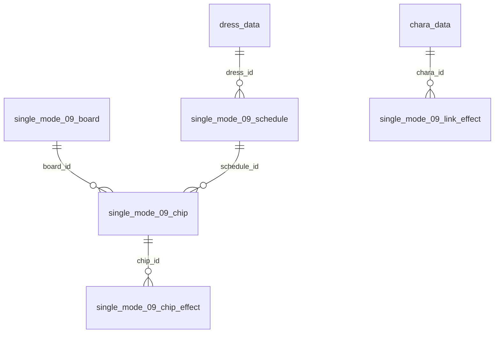
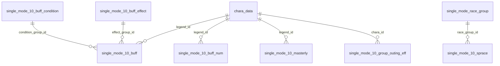
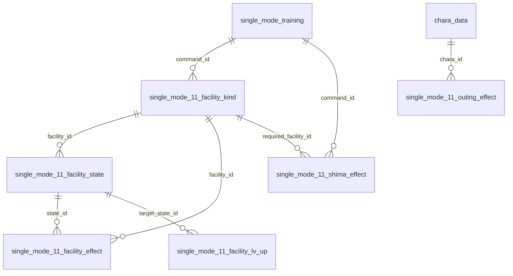
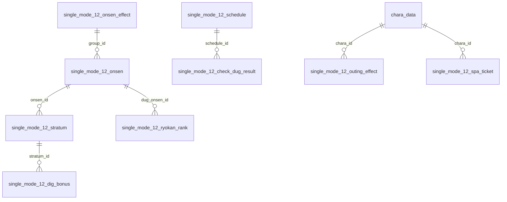
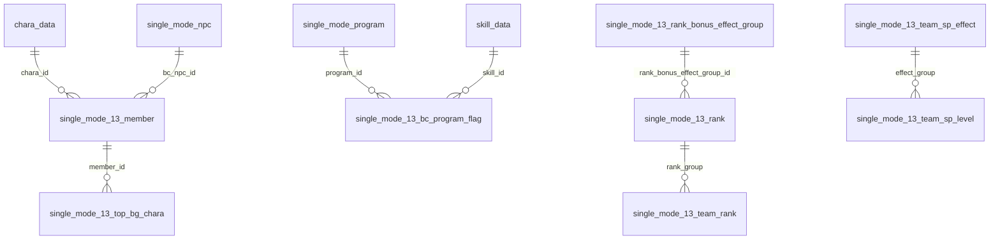
```mermaid
erDiagram
  single_mode_14_check_point ||--o{ single_mode_14_check_point_effect : check_point_type
  single_mode_14_check_point ||--o{ single_mode_14_check_point_pt : check_point_type
  single_mode_14_check_point ||--o{ single_mode_14_basic_effect : check_point_type
  single_mode_14_check_point ||--o{ single_mode_14_twinkle_ramen : check_point_type
  single_mode_14_region_effect ||--o{ single_mode_14_region_feeling : region_id
  single_mode_14_region_effect ||--o{ single_mode_14_region_effect_bonus : region_id
  single_mode_14_region_select ||--o{ single_mode_14_region_feeling : region_select_type
  single_mode_14_finals_effect ||--o{ single_mode_14_finals_gain_skill : select_type
  support_card_data ||--o{ single_mode_14_deck_info : support_card_id
  support_card_data ||--o{ single_mode_14_outing_effect : support_card_id
  skill_data ||--o{ single_mode_14_finals_gain_skill : skill_id
```
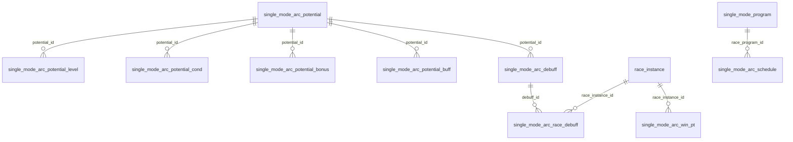
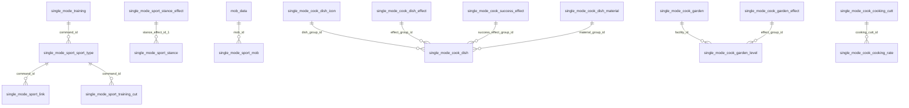
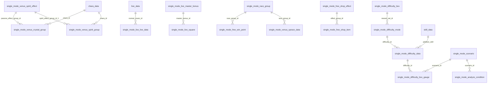
```mermaid
erDiagram
  story_event_data ||--o{ story_event_bonus_card : story_event_id
  story_event_data ||--o{ story_event_bonus_support_card : story_event_id
  story_event_data ||--o{ story_event_bonus_group_support_card : story_event_id
  story_event_data ||--o{ story_event_mission : story_event_id
  story_event_data ||--o{ story_event_mission_top_chara : story_event_id
  story_event_data ||--o{ story_event_nickname_bonus : story_event_id
  story_event_data ||--o{ story_event_point_reward : story_event_id
  story_event_data ||--o{ story_event_roulette_bingo : story_event_id
  story_event_data ||--o{ story_event_story_data : story_event_id
  story_event_data ||--o{ story_event_top_chara : story_event_id
  story_event_bingo_reward ||--o{ story_event_roulette_bingo : reward_set_id
  banner_data }o--|| story_event_data : "condition_value (group_id=7)"
  announce_event ||--o{ story_event_data : announce_id
  support_card_data ||--o{ story_event_bonus_support_card : support_card_id
  support_card_data ||--o{ story_event_bonus_group_support_card : support_card_id
  card_data ||--o{ story_event_bonus_card : card_id
  chara_data ||--o{ story_event_top_chara : character_id
  dress_data ||--o{ story_event_top_chara : dress_id
```
```mermaid
erDiagram
  team_building_data ||--o{ team_building_collection_chara : team_building_event_id
  team_building_data ||--o{ team_building_collection_set : team_building_event_id
  team_building_data ||--o{ team_building_sp_race_schedule : event_id
  team_building_chara_group ||--o{ team_building_collection_set : chara_group_id
  team_building_rank_reward_group ||--o{ team_building_rank : reward_group_id
  team_building_rank ||--o{ team_building_discount_point : team_rank
  team_building_race_npc ||--o{ team_building_team_race_set : npc_group_id
  skill_data ||--o{ team_building_collection_set : skill_id
  race_instance ||--o{ team_building_sp_race_schedule : special_race_instance_id
  transfer_event_data ||--o{ transfer_event_detail : transfer_event_id
  transfer_event_detail ||--o{ transfer_event_reward : transfer_detail_id
  transfer_rotation_schedule ||--o{ transfer_rotation_data : schedule_id
  transfer_rotation_data ||--o{ transfer_rotation_detail : rotation_id
  transfer_rotation_detail ||--o{ transfer_rotation_reward : rotation_id
  training_challenge_master ||--o{ training_challenge_ranking_border : training_challenge_master_id
  training_challenge_ranking_border ||--o{ training_challenge_ranking_reward : training_challenge_ranking_border_id
  training_challenge_exam ||--o{ training_challenge_master : exam_id_1
  training_challenge_score ||--o{ training_challenge_exam : score_group_id
  single_mode_scenario ||--o{ training_challenge_master : target_main_scenario
  factor_research_data ||--o{ factor_research_box : factor_research_event_id
  factor_research_data ||--o{ factor_research_top : factor_research_event_id
  factor_research_box ||--o{ factor_research_box_reward : box_id
  jobs_place ||--o{ jobs_reward : place_id
  jobs_genre ||--o{ jobs_reward : genre_id
  jobs_limited_schedule ||--o{ jobs_reward : limited_schedule_id
  collect_raid_master ||--o{ collect_raid_story : collect_raid_id
  collect_raid_master ||--o{ collect_raid_mission : collect_raid_master_id
  collect_raid_master ||--o{ collect_raid_top_data : collect_raid_id
  collect_event_map_master ||--o{ collect_raid_master : collect_event_map_master_id
  collect_event_map_bg_data ||--o{ collect_event_map_master : bg_data_id
  map_event_data ||--o{ map_event_map_point : event_id
  map_event_area_data ||--o{ map_event_map_point : area_id
  crane_game_hidden_odds ||--o{ crane_game_catch_result : odds_id
```

## (e) Unknowns / low confidence
- Exact meaning of every `effect_type`/`effect_value_N` combination (b3) and `target_type` 10/30; need client code. Layouts and value ranges are reliable, semantics are not.
- `single_mode_11_check_point_eff.check_point_type`, `10_buff.buff_turn_type` (0/1/4/5), `buff_trigger`, `13_team_sp_effect.group_type` 0..3, `14_twinkle_ramen.text_type` 0/1/3/4, `cook_dish.dish_type` 0..3: enum values listed in Appendix counts only.
- Mechanic names for tables 10 `_9047_reward` / `_9048_*`, 13 `bc_*` ("bc" = presumably Breeders' Cup race flags), 14 `deck_info`/`special_gain_turn`, 12 `assistant_effect`: inferred from column names, MEDIUM-LOW.
- Weak small-int links not claimed: crane_game_* internal ids (animation_id->character_prop_animation?), `single_mode_10_cm_detail.route_id` (~single_mode_route), `single_mode_live_song_list.live_id` (equal to command_id in 22/24 rows), `collect_event_map_master.collect_tap_reward_set_id`, `map_event_flavor_text.story_id` (8008..8025; only 28% in single_mode_story_data; 8001-8006 in `map_event_map_point` do resolve), `single_mode_sport_item_effect.item_id` (value 6, not in item_data), `transfer_*_detail.trainer_type/condition*_value*` semantics, `factor_research_task_list.condition*` semantics, `single_mode_aoharu_cutt_type.chara_type`.
- story_event bonus tables: ~23% of `story_event_bonus_support_card` rows and ~18% of `story_event_bonus_card` rows carry a chara_id that differs from the referenced card's chara - meaning (event-owner chara vs card chara) not established. Story timeline ids (`story_event_story_data.story_id_*`, e.g. 90057001) do not resolve to any mdb column (resolved in asset bundles). Gacha tie-in of a story event is only via `banner_data` (no gacha_id column).
- `single_mode_15_*` semantic: tables empty in JP, nothing to verify.
- text_data keyed by `team_building_event_id` not found; team_building names unknown. Onsen / stratum / island text not located.

## Appendix A. Table inventory (all 240 tables; `*` = PK column; rows JP / Global, `-` = table absent from Global)

| table | rows JP | rows Global | columns (type: i=INTEGER unless marked t=TEXT) |
|---|---|---|---|
| collect_event_map_bg_data | 1 | 0 | id*,bg_id,bg_sub_id,bgm_cue_name:t,bgm_cuesheet_name:t |
| collect_event_map_master | 1 | 0 | id*,bg_data_id,short_episode_id,tips_group_id,login_bonus_id,banner_id,collect_tap_max_pos_index,collect_tap_reward_set_id,collect_tap_end_date,start_date,event_end_date,end_date |
| collect_raid_all_reward | 52 | 0 | id*,all_reward_set_id,all_collect_item_num,item_category,item_id,item_num |
| collect_raid_dress_color | 4 | - | id*,collect_raid_id,chara_id,dress_id,color_id |
| collect_raid_individual_reward | 42 | 0 | id*,individual_reward_set_id,individual_collect_item_num,item_category,item_id,item_num |
| collect_raid_master | 5 | 0 | id*,use_mission,use_transition_dialog,story_extra_id,story_voice_type,use_all_reward_voice,ending_play_order,collect_item_id,raid_type,gain_collect_item_rate,gain_collect_item_min,individual_reward_set_id,all_reward_set_id,mission_top_chara_group_id,staging_mini_chara_group_id,story_list_bg_id,story_list_bg_sub_id,collect_event_map_master_id,notice_date,start_date,calc_start_date,calc_end_date,end_date |
| collect_raid_message | 437 | - | id*,collect_raid_id,category_id |
| collect_raid_mission | 18 | 0 | id*,collect_raid_master_id,mission_data_id |
| collect_raid_mission_top_chara | 4 | 0 | id*,mission_top_chara_group_id,ending_flag,chara_id,dress_id,bg_id,bg_sub_id |
| collect_raid_segment_cutt | 3 | 0 | id*,cut_id,cut_sub_id |
| collect_raid_staging_mini_chara | 66 | 0 | id*,staging_mini_chara_group_id,staging_type,bg_id,chara_id,dress_id,mini_motion_id,chara_angle,chara_id_2,dress_id_2,mini_motion_id_2,chara_angle_2,chara_id_3,dress_id_3,mini_motion_id_3,chara_angle_3,chara_id_4,dress_id_4,mini_motion_id_4,chara_angle_4,rate |
| collect_raid_story | 15 | 0 | id*,collect_raid_id,story_condition_type,unlock_condition,episode_index_id,story_type_1,story_id_1,story_type_2,story_id_2,story_type_3,story_id_3 |
| collect_raid_top_data | 18 | 0 | id*,collect_raid_id,cut_id,cut_sub_id,cut_sheet_num,random_chara_group_id,bgm_cue_name:t,bgm_cuesheet_name:t,env_cue_name:t,env_cuesheet_name:t,segment_cutt_id,condition_type,condition_value |
| collect_raid_top_random_chara_group | 20 | - | id*,group_id,chara_id |
| crane_game_arm_swing | 3 | 3 | result_type*,odds_1,odds_2,odds_3 |
| crane_game_catch_result | 68 | 68 | odds_id*,get_num*,lottery_weight_1_1,lottery_weight_1_2,lottery_weight_2_1,lottery_weight_2_2,lottery_weight_3_1,lottery_weight_3_2,lottery_weight_extra_1,lottery_weight_extra_2 |
| crane_game_define_param | 1 | 1 | id*,distance1:t,distance2:t,move_speed_1:t,move_speed_2:t,move_speed_3:t |
| crane_game_extra_odds_condition | 1 | 1 | credit*,get_num |
| crane_game_hidden_odds | 33 | 33 | id*,animation_id,crane_animation_id,type_id,num,big,big_index,odds_1,odds_2,odds_3,odds_extra,rare_effect_odds,joint_type,lift_type,push_type |
| crane_game_prize_face | 3 | 3 | id*,face_type:t |
| crane_game_prize_pattern | 3 | 3 | id*,prop_pattern_id |
| crane_game_prop | 2 | 2 | type*,num |
| factor_research_animation_data | 9 | - | id*,special_event_type,prise_type,chara_order,chara_angle,chara_id,dress_id,in_motion,stand_motion,prize_motion |
| factor_research_box | 25 | 0 | box_id*,factor_research_event_id,box_step |
| factor_research_box_reward | 368 | 0 | id*,box_id,box_num,item_category,item_id,item_num,rate,prize_type |
| factor_research_data | 25 | 0 | factor_research_event_id*,consume_tp_ratio,bonus_reward_ratio,result_type,special_event_type,chara_id,dress_id,in_motion,stand_motion,prize_motion1,prize_motion2,notice_date,start_date,ending_date,end_date |
| factor_research_factor_upgrade | 14 | 0 | id*,factor_type,is_upgradable,factor_rarity,use_item_num |
| factor_research_task_data | 1 | - | id*,factor_research_event_id,all_factor_item_id,white_factor_item_id,presen_motion_change_point1,presen_motion_change_point2,bgm_cue_name:t,bgm_cuesheet_name:t,env_cue_name:t,env_cuesheet_name:t |
| factor_research_task_list | 16 | - | id*,factor_research_event_id,task_type,logic_type,condition1_line_count,condition1_type,condition1_value1,condition1_value2,condition1_value3,condition1_value4,condition1_value5,condition1_value6,condition1_value7,condition2_line_count,condition2_type,condition2_value1,condition2_value2,condition2_value3,condition2_value4,condition2_value5,condition2_value6,condition2_value7,condition3_line_count,condition3_type,condition3_value1,condition3_value2,condition3_value3,condition3_value4,condition3_value5,condition3_value6,condition3_value7,condition4_line_count,condition4_type,condition4_value1,condition4_value2,condition4_value3,condition4_value4,condition4_value5,condition4_value6,condition4_value7,condition5_line_count,condition5_type,condition5_value1,condition5_value2,condition5_value3,condition5_value4,condition5_value5,condition5_value6,condition5_value7,research_point |
| factor_research_task_point_reward | 22 | - | id*,factor_research_event_id,item_category,item_id,item_num,pickup_flag,reward_point |
| factor_research_top | 56 | 0 | id*,factor_research_event_id,ending_flag,character_id,dress_id,menu_bg_id,menu_bg_sub_id,bgm_cue_name:t,bgm_cuesheet_name:t,env_cue_name:t,env_cuesheet_name:t |
| factor_research_white_factor_item | 98 | - | id*,item_id,factor_id,label_type |
| jobs_genre | 44 | - | id*,mini_bg_id_1,mini_bg_id_2,mini_bg_id_3,mini_bg_id_4,mini_bg_id_5 |
| jobs_limited_schedule | 6 | - | id*,start_date,ending_date,end_date |
| jobs_place | 14 | - | id*,race_track_id |
| jobs_point_limit | 1 | - | id*,jobs_story_event_point_limit,jobs_story_event_roulette_coin_limit,jobs_training_challenge_coin_limit |
| jobs_reward | 103 | - | id*,place_id,genre_id,main_reward_slots_id,main_reward_1_item_disp_type,main_reward_1_item_category,main_reward_1_item_id,main_reward_1_item_num,main_reward_2_item_disp_type,main_reward_2_item_category,main_reward_2_item_id,main_reward_2_item_num,main_reward_3_item_disp_type,main_reward_3_item_category,main_reward_3_item_id,main_reward_3_item_num,main_reward_4_item_disp_type,main_reward_4_item_category,main_reward_4_item_id,main_reward_4_item_num,main_reward_5_item_disp_type,main_reward_5_item_category,main_reward_5_item_id,main_reward_5_item_num,main_reward_6_item_disp_type,main_reward_6_item_category,main_reward_6_item_id,main_reward_6_item_num,main_reward_7_item_disp_type,main_reward_7_item_category,main_reward_7_item_id,main_reward_7_item_num,main_reward_8_item_disp_type,main_reward_8_item_category,main_reward_8_item_id,main_reward_8_item_num,main_reward_9_item_disp_type,main_reward_9_item_category,main_reward_9_item_id,main_reward_9_item_num,random_drop_reward_group_id,money_reward_item_odds_group_id,money_min,support_point_reward_item_odds_group_id,support_point_min,trainer_medal,fan_num_odds_group_id,fan_num_min,love_point,minutes_to_job_complete,story_event_event_pt,story_event_roulette_coin,factor_research_gauge_up,campaign_walking_gauge_up,training_challenge_reward_coin,training_report_pt,limited_schedule_id,limited_max_count |
| jobs_reward_sort_disp_order | 40 | - | id*,item_category,item_id,disp_order |
| map_event_area_data | 4 | 0 | id*,area_id,event_id,start_date |
| map_event_data | 1 | 0 | event_id*,gauge_max,gauge_up_singlemode,gauge_up_teamstadium,gauge_up_login,start_date,end_date |
| map_event_flavor_text | 18 | 0 | id*,event_id,image_type,story_id,story_condition_type |
| map_event_map_point | 10 | 0 | id*,event_id,map_point_id,area_id,check_point_flag,disp_flag,next_episode_unlock_map_point_id,gauge_num,story_id_1,story_id_2,item_category_1,item_id_1,item_num_1,chara_id,dress_id,motion_id,next_episode_id,start_date,movie_start_date |
| map_event_mini_motion | 3 | 0 | id*,event_id,chara_id,dress_id,stand_motion,walk_motion,arrive_motion,checkpoint_motion,tap_motion,complete_motion |
| map_event_story_data | 2 | 0 | id*,event_id,episode_index_id,story_condition_type,story_id,point_condition_type,start_date |
| single_mode_09_board | 3 | - | id* |
| single_mode_09_chip | 13 | - | id*,schedule_id,type,board_id |
| single_mode_09_chip_effect | 70 | - | id*,chip_id,point,group_id,effect_category,effect_type,effect_value_1,effect_value_2,effect_value_3,effect_value_4 |
| single_mode_09_learning_bonus | 2 | - | id*,point_min,point_max,base_value,bonus_value |
| single_mode_09_link_effect | 13 | - | id*,chara_id,effect_type,effect_value_1,effect_value_2,effect_value_3,effect_value_4 |
| single_mode_09_progress_rate | 3 | - | id*,progress_min,progress_max,result_type |
| single_mode_09_schedule | 5 | - | id*,turn_num,target_pt,stock_num,dress_id |
| single_mode_09_training_boost | 54 | - | id*,boost_set_id,level_min,level_max,add_value |
| single_mode_10_9047_reward | 12 | - | id*,min_turn,max_turn,end_type,gain_type,gain_value |
| single_mode_10_9048_bonus | 8 | - | id*,min_level,max_level,level_bonus |
| single_mode_10_9048_guest | 9 | - | id*,min_level,max_level,level_bonus_1,level_bonus_2 |
| single_mode_10_audience_effect | 3 | - | id*,min_turn,max_turn,audience_effect |
| single_mode_10_buff | 57 | - | id*,buff_id,legend_id,buff_rank,buff_trigger,condition_group_id,effect_group_id,buff_turn_type,buff_turn_value,buff_ct,icon,is_enable_inactivation |
| single_mode_10_buff_condition | 13 | - | id*,condition_group_id,condition_type,condition_value_1,condition_value_2,condition_value_3,condition_value_4 |
| single_mode_10_buff_effect | 56 | - | id*,effect_group_id,effect_type,effect_value_1,effect_value_2,legend_id,bonus_value |
| single_mode_10_buff_num | 12 | - | id*,legend_id,gauge_min,gauge_max,num,highest_num,link_num |
| single_mode_10_cm_detail | 36 | - | id*,route_id,condition_type,condition_value,priority,voice_id,target_type,target_value |
| single_mode_10_group_outing_eff | 5 | - | id*,chara_id,step,effect_type,effect_value |
| single_mode_10_lottery_turn | 11 | - | id*,turn |
| single_mode_10_masterly | 3 | - | id*,legend_id,buff_num,condition_group_id,effect_group_id |
| single_mode_10_sprace | 3 | - | id*,race_group_id,turn_num |
| single_mode_10_staging_sound | 19 | - | id*,staging_type,cut_number,motion_type,se_cue_name:t,se_cuesheet_name:t |
| single_mode_11_check_point_eff | 38 | - | id*,check_point_type,result_state,effect_type,effect_value_1,effect_value_2,effect_value_3,effect_value_4 |
| single_mode_11_facility_effect | 403 | - | id*,facility_id,state_id,effect_type,effect_value_1,effect_value_2,effect_value_3,effect_value_4 |
| single_mode_11_facility_kind | 6 | - | facility_id*,command_id |
| single_mode_11_facility_lv_up | 43 | - | id*,facility_id,current_state_id,target_state_id,cost |
| single_mode_11_facility_state | 49 | - | id*,facility_id,facility_lv,icon_id,state_id |
| single_mode_11_gain_training_pt | 40 | - | id*,deck_id,turn_min,turn_max,gain_shima_training_pt |
| single_mode_11_outing_effect | 4 | - | id*,chara_id,min_lv,value |
| single_mode_11_pioneer_pt_bonus | 5 | - | id*,check_point_type,group_id,pt_rate,add_value_max |
| single_mode_11_planning | 20 | - | id*,deck_id,check_point_type,planning_turn,check_point_turn,target_pt |
| single_mode_11_shima_effect | 64 | - | id*,command_id,result_state,target_type,effect_value,required_facility_id |
| single_mode_11_training_mini | 6 | - | id*,min_lv,max_lv,member_num |
| single_mode_12_assistant_effect | 7 | - | id*,command_type,target_type,effect_value |
| single_mode_12_check_dug_result | 7 | - | id*,schedule_id,ryokan_rank_min,ryokan_rank_max,result_type |
| single_mode_12_dig_bonus | 504 | - | id*,stratum_id,dug_value,effect_type,effect_value_1,effect_value_2,effect_value_3,effect_value_4 |
| single_mode_12_dig_item | 18 | - | id*,item_id,item_level,stratum_type,dig_value |
| single_mode_12_dig_power | 72 | - | id*,stratum_type,param_type,param_rank_min,param_rank_max,bonus_value |
| single_mode_12_dig_power_rank | 24 | - | id*,dig_power_rank,dig_power_min,dig_power_max |
| single_mode_12_effect_category | 21 | - | effect_id*,sort_id |
| single_mode_12_factor_bonus | 9 | - | id*,factor_group_id,stratum_type,bonus_value |
| single_mode_12_onsen | 10 | - | id*,open_turn,group_id |
| single_mode_12_onsen_effect | 48 | - | id*,group_id,effect_type,effect_value_1,effect_value_2,effect_value_3,effect_value_4 |
| single_mode_12_outing_effect | 15 | - | id*,chara_id,rarity,story_step,ticket_num |
| single_mode_12_ryokan_rank | 5 | - | id*,group_id,dug_onsen_num,dug_onsen_id |
| single_mode_12_schedule | 3 | - | id*,turn_num |
| single_mode_12_spa_ticket | 12 | - | id*,type_id,chara_id,rarity,ticket_num |
| single_mode_12_stratum | 20 | - | id*,onsen_id,stratum_order,stratum_type,stratum_volume |
| single_mode_13_add_dream_point | 18 | - | id*,deck_id,condition_type,condition_value,value |
| single_mode_13_bc_program_flag | 18 | - | id*,bc_group_id,program_id,determine_race_flag,skill_id |
| single_mode_13_member | 5 | - | id*,chara_id,bc_group_id,bc_npc_id |
| single_mode_13_rank | 17 | - | id*,rank_id,rank_exp,rank_bonus_effect_group_id |
| single_mode_13_rank_bonus_effect_group | 33 | - | id*,group_id,condition_type,effect_type,effect_value |
| single_mode_13_schedule | 6 | - | id*,meeting_turn,start_turn,end_turn,need_team_rank,team_sp_lv |
| single_mode_13_team_rank | 51 | - | id*,rank_group,effect_type,effect_value |
| single_mode_13_team_sp_effect | 85 | - | id*,group_type,effect_group,effect_type,num_support_type,effect_value |
| single_mode_13_team_sp_level | 25 | - | id*,group_type,level,need_point,effect_group |
| single_mode_13_top_bg_chara | 7 | - | id*,cut_id,required_team_progress,member_id,rate |
| single_mode_14_basic_effect | 15 | - | id*,check_point_type,effect_type,effect_value,condition_type_1,condition_value_1,condition_type_2,condition_value_2,condition_type_3,condition_value_3 |
| single_mode_14_check_point | 3 | - | id*,check_point_type,turn,success_pt,great_success_pt |
| single_mode_14_check_point_effect | 21 | - | id,check_point_type,result_state,effect_type,effect_value,condition_type_1,condition_value_1,condition_type_2,condition_value_2,condition_type_3,condition_value_3 |
| single_mode_14_check_point_pt | 3 | - | id,check_point_type,gain_pt |
| single_mode_14_check_point_pt_effect | 33 | - | id*,pt_min,pt_max,effect_type,effect_value,condition_type_1,condition_value_1,condition_type_2,condition_value_2,condition_type_3,condition_value_3 |
| single_mode_14_deck_info | 5 | - | id,deck_type,support_card_id |
| single_mode_14_feeling_bonus | 4 | - | id,feeling_num_min,feeling_num_max,add_value |
| single_mode_14_finals_effect | 19 | - | id*,text_group_id,select_type,effect_type,effect_value,condition_type_1,condition_value_1,condition_type_2,condition_value_2,condition_type_3,condition_value_3 |
| single_mode_14_finals_gain_skill | 3 | - | id*,select_type,skill_id,skill_level_normal,skill_level_success,skill_level_great_success |
| single_mode_14_outing_effect | 25 | - | id*,support_card_id,story_step,special_feeling_num |
| single_mode_14_region_effect | 98 | - | id*,region_id,text_group_id,effect_type,effect_value,condition_type_1,condition_value_1,condition_type_2,condition_value_2,condition_type_3,condition_value_3 |
| single_mode_14_region_effect_bonus | 180 | - | id*,region_id,effect_type,min_pt,max_pt,add_value |
| single_mode_14_region_feeling | 60 | - | id*,region_id,region_select_type,feeling_id,feeling_num |
| single_mode_14_region_select | 3 | - | id*,region_select_type,turn |
| single_mode_14_special_gain_turn | 11 | - | id*,turn,count |
| single_mode_14_twinkle_ramen | 347 | - | id*,text_group,text_number,check_point_type,result_state,text_type,text_type_value |
| single_mode_15_act_effect | 0 | - | id*,level,condition_type,condition_value,effect_type,effect_value_1,effect_value_2,effect_value_3,effect_value_4 |
| single_mode_15_act_info | 0 | - | act_type*,command_id |
| single_mode_15_act_member | 0 | - | id*,act_type,chara_id,priority |
| single_mode_15_advice | 0 | - | id*,fusion_type,add_schedule_type |
| single_mode_15_advice_effect | 0 | - | id*,advice_id,level,condition_type,condition_value,effect_type,effect_value_1,effect_value_2,effect_value_3,effect_value_4 |
| single_mode_15_advice_recommend | 0 | - | id*,turn_num |
| single_mode_15_check_point_effect | 0 | - | id*,schedule_id,result_state,effect_type,effect_value_1,effect_value_2,effect_value_3,effect_value_4 |
| single_mode_15_finals_act_effect | 0 | - | id*,condition_type,condition_value,effect_type,effect_value_1,effect_value_2,effect_value_3,effect_value_4 |
| single_mode_15_fusion_effect | 0 | - | id*,advice_id,condition_type,condition_value,effect_type,effect_value_1,effect_value_2,effect_value_3,effect_value_4 |
| single_mode_15_outing_effect | 0 | - | id*,support_card_id,story_step,add_level |
| single_mode_15_schedule | 0 | - | id*,turn_num,need_act_num,need_act_level |
| single_mode_analyze_condition | 5 | 0 | id*,scenario_id,condition_type,condition_value_1,condition_value_2,condition_value_3 |
| single_mode_analyze_message | 58 | 53 | id*,condition_set,proper_ground,proper_distance,popularity,year,priority,rate,motion_type,character_type |
| single_mode_analyze_ticket | 7 | 7 | id*,grade,cost_ticket |
| single_mode_aoharu_cutt_type | 24 | 24 | id*,cutt_type,cutt_id,chara_type |
| single_mode_aoharu_result_cutt | 6 | 4 | id*,chara_id,cutt_id |
| single_mode_aoharu_schedule | 5 | 5 | id*,turn_num,notice_turn_1,notice_turn_2,notice_turn_3,notice_turn_4,notice_turn_5 |
| single_mode_arc_debuff | 9 | 0 | id*,potential_id,potential_lv,speed,stamina,power,guts,wiz,turf,middle |
| single_mode_arc_potential | 10 | 0 | id*,row,queue |
| single_mode_arc_potential_bonus | 19 | 0 | id*,potential_id,potential_lv,effect_type,effect_value_1,effect_value_2,effect_value_3,effect_value_4 |
| single_mode_arc_potential_buff | 8 | 0 | id*,potential_id,potential_lv,speed,stamina,power,guts,wiz,turf,middle |
| single_mode_arc_potential_cond | 13 | 0 | id*,potential_id,num,count_type,display_total_count,condition_type_1,condition_value_1,condition_value_2,condition_value_3,condition_value_4,condition_value_5 |
| single_mode_arc_potential_level | 18 | 0 | id*,potential_id,potential_lv,global_exp |
| single_mode_arc_race_debuff | 48 | 0 | id*,race_instance_id,debuff_id |
| single_mode_arc_schedule | 4 | 0 | id*,race_program_id,turn_num |
| single_mode_arc_taiman_peff_grp | 12 | 0 | id*,icon_id,sub_id,effect_id_1,effect_id_2 |
| single_mode_arc_training_eff | 31 | 0 | id*,require_pt_min,require_pt_max,training_eff |
| single_mode_arc_win_pt | 122 | 0 | id*,race_instance_id,grade,order_min,order_max,point_num |
| single_mode_cook_coin_rate | 9 | - | id*,period,material_count,coin_quantity_rate |
| single_mode_cook_cooking_cutt | 59 | - | id*,cooking_num,cooking_motion_id_1,cooking_motion_id_2,cooking_motion_id_3,cooking_motion_id_4,success_motion_id,camera:t |
| single_mode_cook_cooking_rate | 112 | - | id*,dish_type,cooking_cutt_id,cooking_num,success_rate,great_success_rate,confirmed_great_success_rate |
| single_mode_cook_cooking_type | 42 | - | id*,cooking_motion_id,swap_type,cooking_motion_swap_id,cooking_effect_name_1:t,cooking_effect_position_1,cooking_effect_name_2:t,cooking_effect_position_2,cooking_effect_swap_name_1:t,cooking_effect_swap_position_1,cooking_effect_swap_name_2:t,cooking_effect_swap_position_2 |
| single_mode_cook_dish | 35 | - | id*,dish_set_id,dish_group_id,priority,material_group_id,effect_group_id,success_effect_group_id,gain_coin,gain_power,sort_order,dish_type |
| single_mode_cook_dish_cutt | 55 | - | id*,command_group_id,material_group_id,is_success,cutt_id:t,prop_id:t |
| single_mode_cook_dish_cutt_se | 66 | - | id*,command_group_id,chara_type,se_cue_name:t,se_cuesheet_name:t |
| single_mode_cook_dish_effect | 69 | - | id*,effect_group_id,effect_type,effect_value_1,effect_value_2,effect_value_3,effect_value_4 |
| single_mode_cook_dish_icon | 13 | - | dish_group_id*,icon_id |
| single_mode_cook_dish_material | 38 | - | id*,material_group_id,material_id,material_num |
| single_mode_cook_dish_name | 31 | - | id*,dish_group_id,effect_group_id,great_success_flag,chara_id |
| single_mode_cook_garden | 5 | - | facility_id* |
| single_mode_cook_garden_bg | 40 | - | id*,month,half_type,progress,bg_id,sub_bg_id,mini_motion_group_id_min,mini_motion_group_id_max |
| single_mode_cook_garden_effect | 105 | - | id*,effect_group_id,effect_type,effect_value_1,effect_value_2,effect_value_3,effect_value_4 |
| single_mode_cook_garden_level | 25 | - | id*,facility_id,garden_lv,facility_lv,effect_group_id,coin_num |
| single_mode_cook_listener | 6 | - | id*,camera:t,pos_x,pos_y,pos_z |
| single_mode_cook_material_rate | 8 | - | id*,boost_type,material_count,effect_type,material_quantity_rate |
| single_mode_cook_message | 4 | - | id*,view_type,condition_flag |
| single_mode_cook_motion_group | 36 | - | id*,bg_motion_id_1,bg_swap_motion_id_1_1,bg_swap_motion_speed_1_1,bg_swap_motion_blend_1_1,bg_swap_motion_id_1_2,bg_swap_motion_speed_1_2,bg_swap_motion_blend_1_2,bg_motion_id_2,bg_swap_motion_id_2_1,bg_swap_motion_blend_2_1,bg_swap_motion_id_2_2,bg_swap_motion_blend_2_2,bg_motion_id_3,bg_swap_motion_id_3_1,bg_swap_motion_blend_3_1,bg_swap_motion_id_3_2,bg_swap_motion_blend_3_2 |
| single_mode_cook_motion_status | 14 | - | id*,turn_progress,garden_progress,motion_id_1,motion_id_2 |
| single_mode_cook_power_data | 5 | - | id*,cook_type,turn_num,success_num,great_success_num,garden_lv |
| single_mode_cook_stand_motion | 30 | - | id*,chara_id,type,condition_type,mini_chara_motion_id |
| single_mode_cook_success_effect | 20 | - | id*,effect_group_id,condition_type,condition_value_1,condition_value_2,effect_type,effect_value_1,effect_value_2,effect_value_3,effect_value_4,priority,rate,odds |
| single_mode_cook_success_odds | 8 | - | id*,power_min,power_max,success_rate |
| single_mode_cook_success_type | 4 | - | id*,success_motion_id,success_motion_swap1_id,success_motion_swap2_id,success_effect_name:t,success_effect_position,success_effect_swap1_name:t,success_effect_swap2_name:t |
| single_mode_difficulty_box | 5 | 5 | reward_set_id*,box_step*,box_open_condition,box_type,box_id,cue_name_icon:t,cue_name_popout:t,cuesheet_name_icon:t,cuesheet_name_popout:t |
| single_mode_difficulty_box_gauge | 16 | 16 | id*,scenario_id,difficulty_id,result_min,result_max,gauge_rate,add_condition_type,add_condition_min,add_condition_max |
| single_mode_difficulty_box_reward | 65 | 65 | id*,box_id,box_num,item_category,item_id,item_num,rate,prize_type |
| single_mode_difficulty_data | 13 | 13 | difficulty_id*,difficulty*,description_id,difficulty_index,condition_type,condition_value,condition_type_2,condition_value_2,result_type,difficulty_rate,difficulty_motivation,continue_flag,addition_skill,special_flag,gauge_rate,item_category,item_id,max_num,firstclear_item_category,firstclear_item_id,firstclear_num |
| single_mode_difficulty_mode | 4 | 4 | difficulty_id*,guide_id,consume_tp_ratio,consume_tp_bonus_ratio,chara_id,dress_id,in_motion,stand_motion,play_motion,gauge_motion,gauge_motion2,gauge_motion3,popout_motion,firstclear_motion,prize_motion1,prize_motion2,prize_motion3,bgm_cue_name:t,bgm_cuesheet_name:t,reward_type,reward_set_id,gauge_max,gauge_up,item_category,item_id,max_num |
| single_mode_free_coin_race | 36 | 36 | id*,grade,order_min,order_max,coin_num |
| single_mode_free_shop | 11 | 11 | id*,start_turn,end_turn,lineup_group_id,max_lineup_num |
| single_mode_free_shop_bg | 5 | 5 | id*,start_turn,end_turn,bg_id,bg_sub_id |
| single_mode_free_shop_effect | 64 | 64 | id*,effect_group_id,effect_type,effect_value_1,effect_value_2,effect_value_3,effect_value_4,turn |
| single_mode_free_shop_item | 53 | 53 | id*,item_id,effect_group_id,coin_num,limit_num,effect_group,effect_priority,motion_id,use_flag |
| single_mode_free_training_plate | 3 | 3 | id*,condition_type,value_min,value_max |
| single_mode_free_win_point | 66 | 66 | id*,race_group_id,grade,order_min,order_max,point_num |
| single_mode_live_live_data | 5 | 0 | id*,live_type,turn_num,great_success_num,song_num,normal_music_id,special_music_id |
| single_mode_live_master_bonus | 133 | 0 | id*,master_bonus_type,master_bonus_type_value,master_bonus_gain_type_1,master_bonus_gain_value_1_1,master_bonus_gain_value_1_2,master_bonus_gain_value_1_3,master_bonus_gain_value_1_4,master_bonus_gain_type_2,master_bonus_gain_value_2_1,master_bonus_gain_value_2_2,master_bonus_gain_value_2_3,master_bonus_gain_value_2_4,master_bonus_gain_type_3,master_bonus_gain_value_3_1,master_bonus_gain_value_3_2,master_bonus_gain_value_3_3,master_bonus_gain_value_3_4 |
| single_mode_live_song_list | 24 | 0 | id*,command_id,live_id,level,master_bonus_content_text_id,live_bonus_type,live_bonus_value |
| single_mode_live_square | 269 | 0 | id*,square_title_text_id,square_content_text_id,master_bonus_id,square_type,perf_type_1,perf_value_1,perf_type_2,perf_value_2,perf_type_3,perf_value_3,perf_type_4,perf_value_4,perf_type_5,perf_value_5 |
| single_mode_sport_compe_effect | 15 | - | id*,sport_type,min_num,max_num,effect_type,effect_value_1,effect_value_2,effect_value_3,effect_value_4 |
| single_mode_sport_compe_se | 15 | - | id*,sheet_id:t,se_cue_name:t,se_cuesheet_name:t |
| single_mode_sport_competition | 5 | - | id*,compe_type,turn,win_num,win_sport_rank |
| single_mode_sport_item_effect | 7 | - | id*,item_id,effect_type,effect_value_1,effect_value_2,effect_value_3,effect_value_4,motion_id |
| single_mode_sport_link | 150 | - | id*,command_id,training_level,target_type,effect_value |
| single_mode_sport_mob | 600 | - | id*,mob_id |
| single_mode_sport_sport_type | 15 | - | id*,command_id,training_set_id,target_type,sport_type |
| single_mode_sport_stance | 30 | - | id*,sport_type,total_sport_rank,stance_effect_id_1,stance_effect_id_2,stance_effect_id_3,stance_effect_id_4,stance_effect_id_5,effect_turn |
| single_mode_sport_stance_effect | 8 | - | id*,effect_type,effect_value_1,effect_value_2,effect_value_3,effect_value_4 |
| single_mode_sport_training_cut | 75 | - | id*,command_id,training_level,success_cutin_name:t,failure_cutin_name:t |
| single_mode_venus_crystal_group | 15 | 0 | id*,chara_id,venus_level,passive_effect_group_id,active_effect_group_id,active_effect_turn |
| single_mode_venus_spirit_effect | 83 | 0 | id*,spirit_effect_group_id,effect_type,effect_value_1,effect_value_2,effect_value_3,effect_value_4 |
| single_mode_venus_spirit_group | 18 | 0 | spirit_id*,chara_id,bonus_group,spirit_effect_group_id_1,spirit_effect_group_id_2,spirit_effect_group_id_3,spirit_effect_group_id_4,spirit_effect_group_id_5 |
| single_mode_venus_sprace_data | 3 | 0 | id*,race_group_id,turn_num |
| story_event_bingo_reward | 888 | 264 | id*,reward_set_id,line_num,item_category,item_id,item_num |
| story_event_bonus_card | 420 | 103 | id*,story_event_id,chara_id,card_id,rarity_1,rarity_2,rarity_3,rarity_4,rarity_5,start_date,end_date |
| story_event_bonus_group_support_card | 22 | 2 | id*,story_event_id,chara_id,support_card_id,limit_0,limit_1,limit_2,limit_3,limit_4,start_date,end_date |
| story_event_bonus_support_card | 987 | 244 | id*,story_event_id,chara_id,rarity,support_card_id,limit_0,limit_1,limit_2,limit_3,limit_4,start_date,end_date |
| story_event_data | 57 | 16 | story_event_id*,announce_id,consume_tp_ratio,bonus_reward_ratio,notice_date,start_date,middle_date_01,middle_date_02,ending_date,end_date |
| story_event_mission | 2467 | 703 | id*,story_event_id,mission_type,condition_type,condition_value_1,condition_value_2,condition_value_3,condition_value_4,condition_num,step_group_id,step_order,disp_order,item_category,item_id,item_num,transition_type,date_check_flg,start_date |
| story_event_mission_top_chara | 114 | 32 | id*,story_event_id,ending_flag,character_id,dress_id,dress_color,chara_dress_color_set_id,menu_bg_id,menu_bg_sub_id,bgm_cue_name:t,bgm_cuesheet_name:t,env_cue_name:t,env_cuesheet_name:t |
| story_event_nickname_bonus | 171 | 48 | id*,story_event_id,nickname_rank,bonus_point |
| story_event_point_reward | 6236 | 1608 | id*,story_event_id,item_category,item_id,item_num,point |
| story_event_roulette_bingo | 237 | 64 | id*,roulette_id,story_event_id,sheet_num,can_loop,use_item_category,use_item_id,use_item_num,character_id,dress_id,reset_line,reward_set_id,roulette_max_num,start_date,end_date |
| story_event_story_data | 460 | 130 | id*,story_event_id,episode_index_id,story_condition_type,story_type_1,story_id_1,story_type_2,story_id_2,story_type_3,story_id_3,story_type_4,story_id_4,story_type_5,story_id_5,need_point,add_reward_category_1,add_reward_id_1,add_reward_num_1,add_reward_category_2,add_reward_id_2,add_reward_num_2,start_date |
| story_event_top_chara | 721 | 188 | id*,story_event_id,min_episode_index,max_episode_index,ending_flag,character_id,dress_id,dress_color,chara_dress_color_set_id,menu_bg_id,menu_bg_sub_id,bgm_cue_name:t,bgm_cuesheet_name:t,env_cue_name:t,env_cuesheet_name:t |
| team_building_chara_count | 10 | 10 | id*,collection_chara_min,collection_chara_max,bonus_value |
| team_building_chara_group | 76 | 6 | id*,chara_group_id,chara_id |
| team_building_collection_chara | 711 | 60 | id*,team_building_event_id,chara_id,condition_type_1,bonus_type_1,bonus_value_1,condition_type_2,bonus_type_2,bonus_value_2 |
| team_building_collection_set | 38 | 3 | id*,team_building_event_id,chara_group_id,skill_id |
| team_building_consecutive_wins | 10 | 10 | id*,consecutive_wins_num,bonus_value |
| team_building_data | 8 | 1 | team_building_event_id*,bg_id,bg_sub_id,stamina_default,stamina_max,stamina_add,stamina_add_time:t,start_add_scout_point,ticket_item_id,scout_pt_item_id,special_race_count,required_race_count,notice_date,start_date,middle_date,ending_date,end_date |
| team_building_discount_point | 30 | 24 | id*,team_rank,discount_value |
| team_building_race_npc | 608 | 286 | id*,npc_group_id,chara_id,mob_id,race_dress_id,speed,stamina,pow,guts,wiz,proper_distance_short,proper_distance_mile,proper_distance_middle,proper_distance_long,proper_running_style_nige,proper_running_style_senko,proper_running_style_sashi,proper_running_style_oikomi,proper_ground_turf,proper_ground_dirt,skill_set_id |
| team_building_rank | 30 | 24 | id*,team_rank,team_min_value,team_max_value,reward_group_id |
| team_building_rank_reward_group | 41 | 27 | id*,reward_group_id,item_category,item_id,item_num |
| team_building_retry_bonus | 5 | 0 | id*,retry_min,retry_max,bonus_rate,down_rate,resimulate_num |
| team_building_scout_point | 298 | 98 | id*,chara_rank,scout_value |
| team_building_sp_race_schedule | 40 | - | id*,event_id,special_race_instance_id,race_condition_id,start_date,end_date |
| team_building_team_race_set | 46 | 0 | id*,npc_group_id,motion_id |
| team_building_win_reward | 2 | 2 | id*,win_loop_num,item_category,item_id,item_num |
| training_challenge_exam | 81 | 8 | id*,feature_type,good_score,good_score_reward_coin,great_score,great_score_reward_coin,exellent_score,exellent_score_reward_coin,score_group_id,item_category_1,item_id_1,item_num_1,item_category_2,item_id_2,item_num_2,item_category_3,item_id_3,item_num_3,item_category_4,item_id_4,item_num_4,item_category_5,item_id_5,item_num_5 |
| training_challenge_master | 13 | 2 | id*,target_main_scenario,exam_id_1,exam_id_2,exam_id_3,exam_id_4,exam_id_5,ex_exam_id,free_exam_id,shop_id,rental_value,consume_tp_ratio,bonus_reward_ratio,ranking_entry_love_point_reward,ranking_entry_change_num,notice_date,start_date,ranking_entry_end_date,end_date,start_result_date,end_result_date |
| training_challenge_ranking_border | 8 | - | id*,training_challenge_master_id,rank_start,rank_end |
| training_challenge_ranking_reward | 8 | - | id*,training_challenge_ranking_border_id,item_category,item_id,item_num |
| training_challenge_score | 2532 | 140 | id*,score_group_id,score_type,data,disp_order,bonus_score,reward_coin |
| transfer_event_data | 26 | 14 | transfer_event_id*,logo_id,bg_id,bg_sub_id,tutorial_guide_id,bgm_cue_name:t,bgm_cuesheet_name:t,top_trigger,finish_trigger,clear_trigger,pre_start_date,start_date,end_date |
| transfer_event_detail | 186 | 102 | transfer_detail_id*,transfer_event_id,trainer_type,difficulty,limited_type,start_date,end_date,cool_time,condition1_type,condition1_value1,condition1_value2,condition2_type,condition2_value1,condition2_value2,condition3_type,condition3_value1,condition3_value2,condition4_type,condition4_value1,condition4_value2,condition5_type,condition5_value1,condition5_value2 |
| transfer_event_reward | 478 | 248 | transfer_reward_id*,transfer_detail_id,reward_rank,item_category,item_id,item_num,odds |
| transfer_rotation_data | 60 | 0 | id*,schedule_id |
| transfer_rotation_detail | 180 | 0 | id*,rotation_id,trainer_type,difficulty,limited_type,condition1_type,condition1_value1,condition1_value2,condition2_type,condition2_value1,condition2_value2,condition3_type,condition3_value1,condition3_value2,condition4_type,condition4_value1,condition4_value2,condition5_type,condition5_value1,condition5_value2 |
| transfer_rotation_reward | 780 | 0 | id*,rotation_id,item_category,item_id,item_num,odds |
| transfer_rotation_schedule | 3 | 0 | id*,rotation_start_day,rotation_start_time:t,base_date,start_date,end_date |
