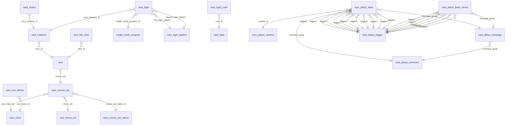
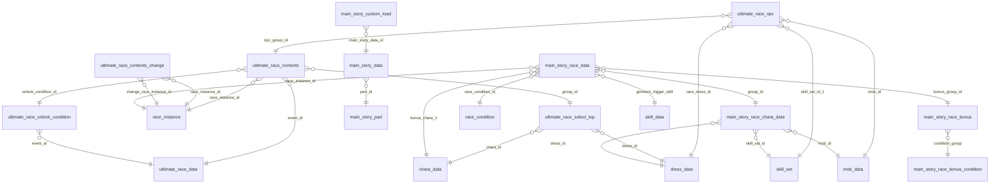

# Domain 5: racing modes, presentation and leftovers

Source: master-jp.mdb (JP, primary), master.mdb (Global, older subset). 146 tables. All coverage figures = share of non-zero, non -1 values found in the target column of the JP db. Coverage >= 95% => FK; lower => `unverified`. Edges are in `edges.json` (216+ rows).

Global presence: "Global rows = N" given per table; "absent" = table not in Global mdb; "0" = table exists but empty in Global (JP-only content).

## (a) Race ID conventions and enum decodings

### a.1 id spaces
| id | range | rule |
|---|---|---|
| race_track.id | 10001-10010 JRA (Sapporo, Hakodate, Niigata, Fukushima, Nakayama, Tokyo, Chukyo, Kyoto, Hanshin, Kokura); 10101 Ooi, 10103 Kawasaki, 10104 Funabashi, 10105 Morioka; 10201 Longchamp, 10202 Santa Anita Park, 10203 Del Mar | verified by text_data cat 31/34/35 (names) |
| race_course_set.id | 10101-11709 (140) | `10000 + 100*track_index + seq`; track_index 1-10 = JRA in track id order, 11 Ooi, 12 Longchamp, 13 Kawasaki, 14 Funabashi, 15 Morioka, 16 Santa Anita, 17 Del Mar (e.g. 10606 = Tokyo #6 = 2400m turf; 11612-11621 Santa Anita; 11201-11203 Longchamp). Verified on all 140 rows by min/max per race_track_id. |
| race.id | 1001-27388 (2923) | name = text_data cat 32 (index = race.id). Block prefix = usage (see a.7), e.g. 1xxx-4xxx G1/G2/G3/OP career races, 5001-5190 practice races, 6001-6502 Champions Meeting, 7001.. etc. |
| race_instance.id | 100101-1204702 (3411) | `race_id*100 + seq` for 667 rows (seq 1 = base instance; 11/21 = alternate editions); else special series prefix: 580001.. Daily Race, 592001.. Legend, 600001-600502 CM, 630001.. Challenge, 670001.. Heroes, 680001-684721 Ultimate, 690001.. Rating. Names: text_data cat 28 (long) and 29 (short) keyed by race_instance.id. 37 races have no instance. |
| race_instance.date | 105..1229 | MMDD calendar date (219 = Feb 19; 0 = none). race.start_date (unix) 1498838400 = placeholder (2017-07-01); real values = release time. |
| race_instance.time | 2 (3251) / 3 (82) / 4 (78) | time-of-day (2 = daytime default, 3 = evening, 4 = night; matches race_env_define.timezone 1..4 = morning/day/evening/night; medium). clock_time = HHMM (e.g. 1608) or 0. race_number = nth race of the day (11 = main race; -1 = n/a; 629 rows -1). |
| race_instance.npc_group_id | 23..690005 | key of an NPC roster; resolved polymorphically (see edges). 132 rows 0. |

### a.2 distance / surface / turn / inner-outer (race_course_set) - verified against 104 "練習 <track> <surface><in/out><turn><dist>m" practice-race names (group 6)
| column | value | meaning | evidence |
|---|---|---|---|
| ground | 1 (80 courses) / 2 (60) | 1 = turf (芝), 2 = dirt (ダート) | 104/104 practice names match; race.is_dirtgrade=1 in 185/187 cases when ground=2 |
| turn | 1 (75) / 2 (63) / 4 (2) | 1 = right (右), 2 = left (左), 4 = straight (Niigata 1000m 直線, Longchamp 1000) | 103/104 name match; 4 only on 10301 (Niigata 1000) and 11201 (Longchamp 1000) |
| inout | 1 (104) / 2 (18) / 3 (17) / 4 (1) | 1 = none, 2 = inner (内), 3 = outer (外), 4 = outer->inner (外内, Hanshin 3200 = 10914) | 104/104 name match (1/2/3), 4 by name 外内 |
| distance | 1000..3600 | metres (21 distinct values; 1000,1150,1200,1300,1400,1500,1600,1700,1800,1900,2000,2100,2200,2300,2400,2500,2600,3000,3200,3400,3600) | 104/104 equal to name |
| distance_type | (derived, not stored) | short <=1400, mile 1401-1800, middle 1801-2400, long >=2401 (game rule; not a column) | - |
| tight_track / run_outside / ex_camera / run_up | 0/1 flags (run_up 50/60 on 2 rows) | rendering flags; semantics unverified | - |
| finish_time_min/max (+_random_range 10000) | x10000 s units (e.g. 675000 = 67.5 s for 1200 m) | NPC/pace finish-time envelope | scale inferred |

### a.3 race.grade (verified with race names)
| grade | n | meaning | evidence |
|---|---|---|---|
| 100 | 1331 | G1 | e.g. フェブラリーS, 高松宮記念, BCクラシック |
| 200 | 165 | G2 | 日経新春杯, 青葉賞 |
| 300 | 229 | G3 | CBC賞, 鳴尾記念, 京都金杯 |
| 400 | 357 | OP (Open / listed) | BSN賞, 鳳雛ステークス |
| 700 | 78 | pre-OP / 条件特別 | きんもくせい特別, 黒松賞 |
| 800 | 53 | maiden (未勝利) | クラシック級未勝利, ジュニア級未勝利 |
| 900 | 158 | debut (新馬) + practice (練習 ... ) | ジュニア級新馬, 練習 阪神 芝外右2600m |
| 999 | 133 | fictional/scenario/special races | ジュピターカップ, ムーンライト賞 |
| 1000 | 270 | team-mode races (team trials/stadium) | L'Arc代表交流戦, 理事長代理チーム戦 |
| 0 | 26 | story/dream races | アメリカンオークスの夢, 離れぬ憂慮 |

### a.4 season / weather / timezone / ground-condition codes
| column family | values | decode | confidence |
|---|---|---|---|
| season (race_condition, race_env_define, *_race.season, home_env_setting) | 1..5 | 1 spring, 2 summer, 3 autumn, 4 winter, 5 = cherry-blossom/early-spring variant (race_env_define has exactly 272 rows for each of 1..5 incl. 5; counts equal => 5 is a full season, not a sentinel) | 1-4 medium-high (standard Umamusume convention), 5 medium |
| weather | 1 (sunny), 2 (cloudy), 3 (rain), 4 (snow); 0 = unspecified in *_race tables; race_env_define has 1 odd row weather=5 (id 1441, Tokyo, season 3) | race_env_define: exactly 340 rows each for 1-4 | medium |
| timezone (race_env_define, home_env_setting) | 1..4 | morning, day, evening, night (340/341/340/340 rows) | medium |
| ground (race_condition.ground, *_race.ground) | 1..4 | ground condition: 1 firm(良), 2 good-ish(稍重), 3 soft(重), 4 heavy(不良); race_condition rows with ground_type 1/2 (turf/dirt) exist only for ground 3,4 (forced bad-going combos); legend/daily weather+ground distributions heavily 1 (102/110) | medium |
| ground_type (race_condition) | 1 turf, 2 dirt, 999 any | same code space as race_course_set.ground | high |
| area (race_condition) | 5, 6, 999 | = race_track.area (5 Longchamp 10201, 6 Santa Anita/Del Mar 10202/10203; 0-4 JRA/local); 999 any | medium-high |
| tension, audience, flag_type, etc. | small ints | rendering, unverified | - |

### a.5 aptitude ranks (used across all NPC tables)
proper_distance_* / proper_running_style_* / proper_ground_* in every NPC table (legend/daily/ultimate/heroes/main_story/challenge...) use rank 1..8 = G,F,E,D,C,B,A,S (0 = none/unset in main_story_race_chara_data; ultimate_race_npc uses 8 = S). Evidence: multipliers in race_proper_*_rate (b.1) equal the known G=0.1..S=1.05/1.1 curve, and NPC value counts peak at 7 (A) for main aptitude.

### a.6 race_track.area and misc
race_track.area (0..6): looks like a region code - 0 Sapporo/Hakodate, 1 Niigata/Fukushima/Morioka, 2 Nakayama/Tokyo/Ooi/Kawasaki/Funabashi, 3 Chukyo/Kyoto/Hanshin, 4 Kokura, 5 Longchamp, 6 Santa Anita/Del Mar (derived from row values; meaning of 0-4 is inference, 5/6 consistent with race_condition.area). overrun_result_type / result_board_type / turf_vision_type etc. are rendering enums (unverified).

### a.7 race.group (usage bucket) - decoded from the tables that reference each group's race_instances
| group | n races (instances) | name sample | referenced by | decode |
|---|---|---|---|---|
| 1 | 347 (349) | 京都金杯.. G1-OP calendar | single_mode_program (381), race_bgm, race_trophy(194), mission_race_scenario_group, main_story_race_data(14) | real-calendar career races |
| 2 | 10 (10) | ムーンライト賞 | daily_race 10/10 | Daily Race |
| 3 | 1 (1) | URAファイナルズ決勝 | - | URA finals |
| 4 | 26 (26) | チーム練習 | main_story_race_data (26), race_bgm | main story races |
| 5 | 94 (94) | スカウトレース 短距離 | none in master | scout race (team building scenario) |
| 6 | 176 (205) | 練習 札幌 芝右2600m / 練習 <G1 name> | none | practice races (client logic) |
| 7 | 618 (738) | many | single_mode_program (737), race_trophy (321), single_mode_race_live | career race variants (class-specific) |
| 8 | 71 (130) | ジャパンカップ... | legend_race 130/130, daily_legend_race 110/110, race_trophy (130) | Legend Race |
| 9 | 249 (249) | チームレース 短距離代表 | none | team trials race (client) |
| 10 | 225 (355) | チーム対抗戦 短距離代表 | race_bgm (10) | Team Stadium races |
| 11 | 100 (100) | チャンピオンズミーティング カプリコーン杯 | champions_race_condition (100 distinct instances) | Champions Meeting |
| 12 | 176 (205) | ルームマッチ フェブラリーS 条件 | none | room match |
| 13 | 42 (42) | カーニバルレース HARD | challenge_match_race 42/42 | Challenge Match |
| 14 | 32 (32) | リーグ オブ ヒーローズ メインステージ | heroes_race_condition (32 distinct) | League of Heroes |
| 15 | 48 (197) | 有馬記念 | ultimate_race_contents 134/134, race_bgm (54) | Ultimate Race |
| 16 | 25 (25) | レギュラーレース 1週目 短距離 | rating_race_condition 25/25 | Rating Race |
| 17 | 265 (265) | 京都金杯 | none | unknown (probably later scenario/mode races) |
| 19 | 388 (388) | 京都金杯 | none | unknown |
| 61 | 30 (0) | フェブラリーS | none, no instances | unknown |


### a.8 reward tuple convention (item_category, item_id, item_num)
Used by first_clear_item_*, pick_up_item_*, item_category_N, add_reward_*. item_category value = item_data.item_category of the target item (90 jewels=item 43, 91 money=59, 30 support pt=110, 103 friend pt=98, 161 hint book=134, 150/164/193/188/97/93/40/34/21/20/11 other item_data rows); 50 -> card_data.id; 51 -> support_card_data.id; 102 -> card_data.id (legend/daily legend/challenge showcase); 55 -> unresolved ids 700000+. 0 = empty slot. Text for jewel etc. = text_data cat 23 (name) / 24 (desc).

### a.9 race model summary
```
race_track (17) <-- race_course_set (140; ground,distance,turn,inout,fence_set,status) <-- race (2923; grade,group,gates,...) <-- race_instance (3411; date MMDD,time,npc_group_id)
race_instance <-- single_mode_program.race_instance_id (domain 3), race_trophy, race_bgm, single_mode_race_live,
                  champions_race_condition, legend_race, daily_legend_race, daily_race, heroes_race_condition,
                  challenge_match_race, rating_race_condition, ultimate_race_contents(+_change), main_story_race_data
race_env_define: (track, season, weather, timezone) -> environment resource   (no FK from race tables; chosen at runtime)
race_condition : weighted (area,season,weather,ground) lottery rows; CM and main story point at one row per round
race.group is NOT referenced by single_mode_program (domain 3 links via race_instance only); race.group is an implicit usage tag.
```

## (b) Aptitude + motivation lookup tables (rate scale: 10000 = x1.00)

### b.1 race_proper_*_rate (JP = Global identical, 9 rows each, id 0..8; id = aptitude rank 0 none, 1 G, 2 F, 3 E, 4 D, 5 C, 6 B, 7 A, 8 S)
| id | rank | distance: proper_rate_speed | distance: proper_rate_power | ground: proper_rate | runningstyle: proper_rate |
|---|---|---|---|---|---|
| 0 | - | 0 | 0 | 0 | 0 |
| 1 | G | 1000 | 4000 | 1000 | 1000 |
| 2 | F | 2000 | 5000 | 3000 | 2000 |
| 3 | E | 4000 | 6000 | 5000 | 4000 |
| 4 | D | 6000 | 10000 | 7000 | 6000 |
| 5 | C | 8000 | 10000 | 8000 | 7500 |
| 6 | B | 9000 | 10000 | 9000 | 8500 |
| 7 | A | 10000 | 10000 | 10000 | 10000 |
| 8 | S | 10500 | 10000 | 10500 | 11000 |

Column names: race_proper_distance_rate(id, proper_rate_speed, proper_rate_power), race_proper_ground_rate(id, proper_rate), race_proper_runningstyle_rate(id, proper_rate). Only the rates are in master; which stat each multiplier applies to is client logic (distance table has two columns: speed and power; power factor is 1.0 from D upward).

### b.2 race_motivation_rate (id = motivation 1..5)
| id | motivation | motivation_rate | x |
|---|---|---|---|
| 1 | awful | 9600 | 0.96 |
| 2 | bad | 9800 | 0.98 |
| 3 | normal | 10000 | 1.00 |
| 4 | good | 10200 | 1.02 |
| 5 | great | 10400 | 1.04 |

Motivation labels 1..5 = 絶不調..絶好調 (convention; table itself only carries the rate). Same 1..5 scale is used in main_story_race_chara_data.motivation (49/61/139/92/119 rows for 1..5).

### b.3 evaluation rates (rank 1..8 = G..S)
champions_evaluation_rate(id, proper_type 1|2, proper_rank 1..8, rate) and team_stadium_evaluation_rate(id, proper_type 1|2|3, proper_rank 1..8, rate; PK proper_type+proper_rank):
| rank | CM type1 | CM type2 | TS type1 | TS type2 | TS type3 |
|---|---|---|---|---|---|
| G | 3000 | 3000 | 3000 | 3000 | 7000 |
| F | 4000 | 4000 | 4000 | 4000 | 7500 |
| E | 5000 | 5000 | 5000 | 5000 | 8000 |
| D | 6000 | 6000 | 6000 | 6000 | 8500 |
| C | 7000 | 7000 | 7000 | 7000 | 9000 |
| B | 9000 | 9000 | 9000 | 9000 | 9500 |
| A | 10000 | 10000 | 10000 | 10000 | 10000 |
| S | 10200 | 10200 | 10200 | 10200 | 10200 |

Meaning of proper_type (1/2/3) is unverified: types 1 and 2 are identical; type 3 (Team Stadium only) is a flatter 7000..? curve. Probably 1=distance, 2=surface, 3=running style, mirroring the 3 aptitude families.

### b.4 race_single_mode_team_status (career team rank -> bonus)
| id | team_rank_threshold | add_status |
|---|---|---|
| 1 | 6 | 50 |
| 2 | 11 | 30 |
| 3 | 16 | 20 |
| 4 | 21 | 10 |
| 5 | 26 | 0 |
| 6 | 99999 | 0 |

### b.5 race_overrun_pattern (finish_order_{0..4,lose}_type)
| id | o0 | o1 | o2 | o3 | o4 | lose |
|---|---|---|---|---|---|---|
| 1 | 2 | 4 | 4 | 4 | 4 | 3 |
| 2 | 2 | 4 | 4 | 5 | 5 | 3 |
| 3 | 2 | 2 | 2 | 4 | 4 | 3 |
| 4 | 2 | 5 | 5 | 5 | 5 | 3 |
| 5 | 2 | 2 | 2 | 2 | 2 | 2 |

## (c) Per-table dictionary
Format: **table** (JP rows; Global rows; PK) - purpose. Cols: name[range|distinct|{value:count}] (":T" = TEXT). FK: verified-or-flagged outbound relations with coverage.

### C1. Races / courses / tracks / race presentation

**race** (2923 rows; Global 1524; PK ['id']) - Race definition master (2923). One row per race template: grade, course, gate/presentation, entry count. `group` = usage bucket (see a.7). Playable dated occurrence = race_instance. Names: text_data cat 32 keyed by race.id.
- Cols: id[1001..27388], group[1..61], grade[100..1000], course_set[10101..11709], thumbnail_id[1001..21025], ff_cue_name:T, ff_cuesheet_name:T, real_ff_cue_name:T, real_ff_cuesheet_name:T, ff_anim[1001..19002], ff_camera[101..440], ff_camera_sub{0:2848,1:75}, ff_sub{0:2889,1:34}, start_gate[1..202], start_gate_panel{0:2666,100:195,200:41,1:8,211:6,101:4,11:3}, goal_gate[1..313], goal_flower[1..8], result_podium{-1:2903,0:11,2:6,1:3}, audience_group_id{0:2790,2:113,1:20}, paddock_bg_id{0:2789,70004:114,70003:20}, audience{0:2447,3:225,1:138,4:113}, entry_num[5..20], change_full_gate{0:2912,1:11}, is_dirtgrade{0:2736,1:187}, start_date[1498838400..1792206000]
- FK: course_set->race_course_set.id (100%); id->text cat 32

**race_instance** (3411 rows; Global 1794; PK ['id']) - Dated/variant occurrence of a race (3411): race_id, calendar date MMDD, time-of-day, race number, NPC group. THE id other systems point at (single_mode_program, CM, legend...). Names: text_data cat 28 (long) / 29 (short) keyed by race_instance.id.
- Cols: id[100101..1204702], race_id[1001..27388], npc_group_id[23..690005], date[105..1229], time{2:3251,3:82,4:78}, clock_time[1202..1818], race_number[-1..12]
- FK: race_id->race.id (100%); npc_group_id->legend_race_npc.npc_group_id (77%); npc_group_id->ultimate_race_npc.npc_group_id (100%); npc_group_id->daily_race_npc.npc_group_id (100%); npc_group_id->heroes_race_mob_npc.npc_group_id (100%); npc_group_id->heroes_race_default_npc.default_npc_group_id (81%); npc_group_id->single_mode_npc.npc_group_id (0%, unverified); id->text cat 28; id->text cat 29

**race_course_set** (140 rows; Global 121; PK ['id']) - Concrete course (140): track + distance + surface + inner/outer + turn + finish-time envelope + fence set + stat-bias status. id = 10000 + 100*track_index + seq (a.1).
- Cols: id[10101..11709], race_track_id[10001..10203], distance[1000..3600], ground{1:80,2:60}, inout{1:104,2:18,3:17,4:1}, turn{1:75,2:63,4:2}, tight_track{1:72,0:68}, run_outside{0:139,1:1}, ex_camera{0:139,2:1}, run_up{0:138,50:1,60:1}, fence_set[10101..11704], float_lane_max[11000..135000], course_set_status_id[1..12], finish_time_min[547000..2231000], finish_time_min_random_range{10000:140}, finish_time_max[560000..2270000], finish_time_max_random_range{10000:140}
- FK: race_track_id->race_track.id (100%); fence_set->race_fence_set.id (100%); course_set_status_id->race_course_set_status.course_set_status_id (100%)

**race_course_set_status** (12 rows; Global 11; PK ['course_set_status_id']) - Course -> up to 2 favoured stat ids (target_status_1/2; 1..5 = Speed/Stamina/Power/Guts/Wisdom, 0 = none; medium confidence).
- Cols: course_set_status_id[1..12], target_status_1{2:4,1:3,3:2,4:2,5:1}, target_status_2{0:5,5:3,3:2,2:1,4:1}
- FK: none verified (see (e) if columns are id-like)

**race_track** (17 rows; Global 15; PK ['id']) - Racecourse master (17): 10 JRA (10001-10010), local 10101/10103/10104/10105 (Ooi/Kawasaki/Funabashi/Morioka), overseas 10201/10202/10203 (Longchamp/Santa Anita/Del Mar). Rendering flags. Names: text_data cat 31/34 (long), 35 (short).
- Cols: id[10001..10203], initial_lane_type{1:10,2:5,4:1,3:1}, enable_half_gate{1:12,0:5}, horse_num_gate_variation{0:14,1:3}, turf_vision_type{1:10,2:4,4:1,5:1,6:1}, footsmoke_color_type{1:11,2:6}, area{2:5,1:3,3:3,0:2,6:2,4:1,5:1}, overrun_result_type{0:14,1:1,2:1,3:1}, flag_type{0:11,1:4,2:2}, gate_panel_type{1:16,2:1}, gate_lamp_type{1:16,2:1}, board_condition_type{2:10,3:3,4:3,1:1}, result_board_type{0:14,1:1,2:1,3:1}
- FK: id->text cat 31

**race_condition** (119 rows; Global 32; PK ['id']) - Weighted (season, weather, ground) outcome table (119) keyed by area(5/6/999)+season; rate sums to 100,000,000 per (area, season, ground_type) group (verified for area 5; area 6 groups sum to 5M+5M+95M by ground_type). Used by champions_race_condition.race_condition_id and main_story_race_data.race_condition_id.
- Cols: id[1..174], area{999:45,6:42,5:32}, season{4:29,3:24,1:22,2:22,5:22}, weather{3:40,2:37,1:36,4:6}, sub_weather{0:118,5:1}, ground_type{999:99,1:10,2:10}, ground{2:33,1:31,3:29,4:26}, rate[60000..68250000]
- FK: none verified (see (e) if columns are id-like)

**race_env_define** (1361 rows; Global 1200; PK ['id']) - Environment resource lookup (1361): (race_track_id, season, weather, timezone) -> resource id (sky/lighting asset). 80 rows/track = 5 seasons x 4 weather x 4 timezones (+1 odd weather=5 row, Tokyo).
- Cols: id[1..1441], race_track_id[10001..10203], season{3:273,1:272,2:272,4:272,5:272}, weather{1:340,2:340,3:340,4:340,5:1}, timezone{2:341,1:340,3:340,4:340}, resource[111..534]
- FK: race_track_id->race_track.id (100%)

**race_fence_set** (120 rows; Global 114; PK ['id']) - Per-course fence/rail configuration (120): fence_1..8 (0 = unused). id space = race_course_set.fence_set (117 distinct values used).
- Cols: id[10101..11704], fence_1[1..9], fence_2[2..10], fence_3{0:98,8:8,7:5,6:2,5:2,3:2,4:2,9:1}, fence_4{0:113,6:3,8:2,5:1,7:1}, fence_5{0:117,8:2,11:1}, fence_6{0:120}, fence_7{0:120}, fence_8{0:120}
- FK: none verified (see (e) if columns are id-like)

**race_trophy** (645 rows; Global 288; PK ['id']) - Race-win trophy list (645): trophy_id (333 distinct; text cat 36 name / 38 text) -> race_instance. Dates are TEXT yyyy/mm/dd h:mm:ss.
- Cols: id[1..657], trophy_id[1001..1204702], race_instance_id[100101..1204702], original_flag{1:562,0:83}, disp_order[1..1131], size{1:467,0:178}, event_type{1:451,0:194}, start_date:T, display_end_date:T
- FK: race_instance_id->race_instance.id (100%); trophy_id->text cat 36

**race_bib_color** (92 rows; Global 92; PK ['grade', 'race_id']) - Gate bib / font color per (grade, race_id) (92).
- Cols: grade{400:64,100:11,300:8,200:7,0:1,700:1}, race_id[1004..4116], bib_color{3:65,0:21,4:2,1:2,2:2}, font_color{2:84,1:6,0:2}
- FK: race_id->race.id (100%)

**race_player_camera** (122 rows; Global 104; PK ['id']) - Camera prefab catalogue for jikkyo/events (122): prefab_name, category, priority.
- Cols: id[100000..70000006], priority{0:95,1:27}, prefab_name:T, category{1:93,6:9,4:7,7:7,2:6}
- FK: none verified (see (e) if columns are id-like)

**race_overrun_pattern** (5 rows; Global 5; PK ['id']) - Post-finish run-over pattern per finish order (5 patterns; *_type enums 2..5; semantics unverified).
- Cols: id{1:1,2:1,3:1,4:1,5:1}, finish_order_0_type{2:5}, finish_order_1_type{4:2,2:2,5:1}, finish_order_2_type{4:2,2:2,5:1}, finish_order_3_type{4:2,5:2,2:1}, finish_order_4_type{4:2,5:2,2:1}, finish_order_lose_type{3:4,2:1}
- FK: none verified (see (e) if columns are id-like)

**race_single_mode_team_status** (6 rows; Global 6; PK ['id']) - Career team-rank -> additive status (6): team_rank_threshold 6/11/16/21/26/99999 -> add_status 50/30/20/10/0/0.
- Cols: id{1:1,2:1,3:1,4:1,5:1,6:1}, team_rank_threshold{6:1,11:1,16:1,21:1,26:1,99999:1}, add_status{0:2,50:1,30:1,20:1,10:1}
- FK: none verified (see (e) if columns are id-like)

**race_sp_rule_data** (2 rows; Global absent; PK ['id']) - Special race rule types (2; JP only). race_sp_rule_type 0/1.
- Cols: id{1:1,2:1}, race_sp_rule_type{0:1,1:1}
- FK: none verified (see (e) if columns are id-like)

**race_sp_rule_schedule** (5 rows; Global absent; PK ['id']) - Special-rule event schedule (5; JP only): event_category=1, event_id, event_month, unix start/end; race_sp_rule_data_id always 2.
- Cols: id{1:1,2:1,3:1,4:1,5:1}, race_sp_rule_data_id{2:5}, event_category{1:5}, event_id{39:1,42:1,46:1,47:1,49:1}, event_month{7:2,12:1,6:1,9:1}, start_date{1750993200:1,1764471600:1,1780196400:1,1782702000:1,1790218800:1}, end_date{1753930799:1,1766804399:1,1782701999:1,1785380399:1,1791169199:1}
- FK: none verified (see (e) if columns are id-like)

**race_motivation_rate** (5 rows; Global 5; PK ['id']) - Motivation (1..5) -> stat multiplier x10000. See b.2.
- Cols: id{1:1,2:1,3:1,4:1,5:1}, motivation_rate{9600:1,9800:1,10000:1,10200:1,10400:1}
- FK: none verified (see (e) if columns are id-like)

**race_proper_distance_rate** (9 rows; Global 9; PK ['id']) - Distance aptitude rank (0..8) -> speed/power multiplier x10000. See b.1.
- Cols: id[1..8], proper_rate_speed[1000..10500], proper_rate_power{10000:5,0:1,4000:1,5000:1,6000:1}
- FK: none verified (see (e) if columns are id-like)

**race_proper_ground_rate** (9 rows; Global 9; PK ['id']) - Surface aptitude rank -> multiplier x10000. See b.1.
- Cols: id[1..8], proper_rate[1000..10500]
- FK: none verified (see (e) if columns are id-like)

**race_proper_runningstyle_rate** (9 rows; Global 9; PK ['id']) - Running-style aptitude rank -> multiplier x10000. See b.1.
- Cols: id[1..8], proper_rate[1000..11000]
- FK: none verified (see (e) if columns are id-like)

**race_bgm** (625 rows; Global 228; PK ['id']) - Race BGM override table (625): per race_type (=race.group) / race_instance / program / grade / difficulty / condition -> paddock/entry/result cues + first/second BGM pattern ids. -1 = wildcard/unused.
- Cols: id[1..639], race_type[2..18], race_instance_id[-1..931434], grade{-1:618,100:1,200:1,300:1,400:1,700:1,800:1,900:1}, single_mode_route_race_id{-1:625}, single_mode_program_id[-1..3025], difficulty[-1..1000], condition_type{-1:601,11:10,20:10,30:1,21:1,1:1,10:1}, paddock_bgm_cue_name:T, paddock_bgm_cuesheet_name:T, entrytable_bgm_cue_name:T, entrytable_bgm_cuesheet_name:T, first_bgm_pattern[1..75], second_bgm_pattern[2..76], result_cutin_bgm_cue_name_1:T, result_cutin_bgm_cuesheet_name_1:T, result_cutin_bgm_cue_name_2:T, result_cutin_bgm_cuesheet_name_2:T, result_cutin_bgm_cue_name_3:T, result_cutin_bgm_cuesheet_name_3:T, result_list_bgm_cue_name_1:T, result_list_bgm_cuesheet_name_1:T, result_list_bgm_cue_name_2:T, result_list_bgm_cuesheet_name_2:T, result_list_bgm_cue_name_3:T, result_list_bgm_cuesheet_name_3:T
- FK: race_instance_id->race_instance.id (100%); single_mode_program_id->single_mode_program.id (100%); first_bgm_pattern->race_bgm_pattern.id (100%); second_bgm_pattern->race_bgm_pattern.id (100%); race_type->race.group (97%, enum)

**race_bgm_pattern** (74 rows; Global 36; PK ['id']) - BGM time-slice pattern (74; 30 timed slots bgm_time_N + cue/cuesheet). Referenced by race_bgm.first/second_bgm_pattern and champions_bgm.
- Cols: id[1..76], bgm_time_1[8..999], bgm_cue_name_1:T, bgm_cuesheet_name_1:T, bgm_time_2[11..999], bgm_cue_name_2:T, bgm_cuesheet_name_2:T, bgm_time_3[13..999], bgm_cue_name_3:T, bgm_cuesheet_name_3:T, bgm_time_4[15..33], bgm_cue_name_4:T, bgm_cuesheet_name_4:T, bgm_time_5[18..37], bgm_cue_name_5:T, bgm_cuesheet_name_5:T, bgm_time_6[20..40], bgm_cue_name_6:T, bgm_cuesheet_name_6:T, bgm_time_7[22..99], bgm_cue_name_7:T, bgm_cuesheet_name_7:T, bgm_time_8[24..38], bgm_cue_name_8:T, bgm_cuesheet_name_8:T, bgm_time_9[26..41], bgm_cue_name_9:T, bgm_cuesheet_name_9:T, bgm_time_10[28..99], bgm_cue_name_10:T, bgm_cuesheet_name_10:T, bgm_time_11[31..44], bgm_cue_name_11:T, bgm_cuesheet_name_11:T, bgm_time_12[33..47], bgm_cue_name_12:T, bgm_cuesheet_name_12:T, bgm_time_13[35..50], bgm_cue_name_13:T, bgm_cuesheet_name_13:T, bgm_time_14[37..52], bgm_cue_name_14:T, bgm_cuesheet_name_14:T, bgm_time_15[39..99], bgm_cue_name_15:T, bgm_cuesheet_name_15:T, bgm_time_16[41..58], bgm_cue_name_16:T, bgm_cuesheet_name_16:T, bgm_time_17[44..61], bgm_cue_name_17:T, bgm_cuesheet_name_17:T, bgm_time_18[46..64], bgm_cue_name_18:T, bgm_cuesheet_name_18:T, bgm_time_19[48..99], bgm_cue_name_19:T, bgm_cuesheet_name_19:T, bgm_time_20[50..99], bgm_cue_name_20:T, ... (+36 more cols, all 96 total)
- FK: none verified (see (e) if columns are id-like)

**race_bgm_cutin** (8 rows; Global 3; PK ['id']) - Card-specific race cut-in jingles (8): card_id -> short/long cutin cues.
- Cols: id{1:1,2:1,3:1,4:1,5:1,6:1,7:1,8:1}, card_id{100302:1,101302:1,103602:1,104602:1,106803:1,109302:1,110201:1,9100101:1}, bgm_group_id{1:2,2:1,3:1,4:1,5:1,6:1,7:1}, fadeout_time{0:4,140000:3,150000:1}, exclusive_control{1:8}, is_jingle{0:5,1:3}, short_cutin_bgm_cue_name:T, short_cutin_bgm_cuesheet_name:T, long_cutin_bgm_cue_name:T, long_cutin_bgm_cuesheet_name:T
- FK: card_id->card_data.id (100%)

**race_jikkyo_base** (7965 rows; Global 4046; PK ['id']) - Live-commentary rule rows (7965): (mode, sub_mode, situation) + up to 10 trigger ids -> message_group/comment_group/camera, priority, tension. Summary level only.
- Cols: id[1..20107], mode[1..16], sub_mode[1..26], sub_mode_jump[-1..26], situation[1..254], sub_situation{0:7951,1:13,2:1}, situation_end{0:7933,1:32}, disable_reentry_situation{1:4432,0:3533}, trigger0[1..2636], trigger1[3..2625], trigger2[3..2617], trigger3[1..2628], trigger4[18..2617], trigger5[2..2591], trigger6[2..2618], trigger7[97..2612], trigger8[97..2543], trigger9[184..2543], message_group[100000..900035], comment_group[100022..900035], priority[500..99999], per[20..200], immediate{0:7965}, discard{0:7921,1:44}, tension{1:4774,3:2797,0:237,2:157}, camera_id[101000..109006], camera_horse1[1..2004], camera_horse2{0:7956,11:5,71:2,1001:1,70:1}, is_force_play_event_camera{0:7958,1:7}, disable_reuse{0:6673,1:1292}
- FK: camera_id->race_player_camera.id (100%); message_group->race_jikkyo_message.group_id (100%); comment_group->race_jikkyo_comment.group_id (100%); trigger0->race_jikkyo_trigger.id (100%); trigger1->race_jikkyo_trigger.id (100%); trigger2->race_jikkyo_trigger.id (100%); trigger3->race_jikkyo_trigger.id (100%); trigger4->race_jikkyo_trigger.id (100%); trigger5->race_jikkyo_trigger.id (100%); trigger6->race_jikkyo_trigger.id (100%); trigger7->race_jikkyo_trigger.id (100%); trigger8->race_jikkyo_trigger.id (100%); trigger9->race_jikkyo_trigger.id (100%)

**race_jikkyo_base_venus** (1431 rows; Global 0; PK ['id']) - Same schema as race_jikkyo_base for the Venus variant (1431; JP only; Global table empty).
- Cols: id[23..1554], mode[1..16], sub_mode[1..26], sub_mode_jump{-1:1315,2:46,4:30,1:24,3:11,6:5}, situation[1..263], sub_situation{0:1427,1:4}, situation_end{0:1417,1:14}, disable_reentry_situation{0:983,1:448}, trigger0[9..2171], trigger1[88..2163], trigger2[86..2161], trigger3[86..1694], trigger4[134..1838], trigger5[112..2164], trigger6{0:1431}, trigger7{0:1431}, trigger8{0:1431}, trigger9{0:1431}, message_group[100800..340022], comment_group[150031..150073], priority[500..9999], per{100:1364,0:22,20:22,30:15,200:4,60:2,40:2}, immediate{0:1431}, discard{0:1407,1:24}, tension{1:830,3:424,2:109,0:68}, camera_id[101000..109006], camera_horse1[1..41], camera_horse2{0:1425,11:6}, disable_reuse{0:1289,1:142}
- FK: message_group->race_jikkyo_message.group_id (100%); trigger0->race_jikkyo_trigger.id (100%); trigger1->race_jikkyo_trigger.id (100%); trigger2->race_jikkyo_trigger.id (100%); trigger3->race_jikkyo_trigger.id (100%); trigger4->race_jikkyo_trigger.id (100%); trigger5->race_jikkyo_trigger.id (100%)

**race_jikkyo_comment** (384 rows; Global 296; PK ['id']) - Commentary comment lines (384): group_id -> text + voice cue tag string.
- Cols: id[1..9035], group_id[100000..900035], message:T, voice:T, per{100:384}, message_group{0:384}, omit_tag{0:384}
- FK: none verified (see (e) if columns are id-like)

**race_jikkyo_message** (3253 rows; Global 2877; PK ['id']) - Commentary message lines (3253): group_id -> text + voice cue tag string.
- Cols: id[1..70000], group_id[100000..900035], message:T, voice:T, per{100:3252,30:1}, comment_group[100000..160014], reuse{0:3169,1:84}, omit_tag{0:3219,1:34}
- FK: comment_group->race_jikkyo_comment.group_id (100%)

**race_jikkyo_cue** (2307 rows; Global 1640; PK ['id', 'cuesheet_type']) - Commentary voice cuesheet conditions (2307; PK id+cuesheet_type): condition_type_1..3 / condition_value_1..3 -> cuesheet_name/id.
- Cols: id[1..6313241], condition_type_1{1:2307}, condition_value_1{0:2184,1:123}, condition_type_2{0:1313,2:736,4:258}, condition_value_2[5..1149], condition_type_3{0:1782,3:525}, condition_value_3{0:1782,5:250,6:93,2:68,4:63,10:25,13:16,1:10}, cuesheet_name[1000000..9999926], cuesheet_id{1:1526,3:429,2:234,0:118}, cuesheet_type{1:1955,2:352}
- FK: none verified (see (e) if columns are id-like)

**race_jikkyo_race** (893 rows; Global 647; PK ['id']) - Race -> jikkyo cue_id (893; ids mostly race.id; 62 ids not in race). Names text cat 33.
- Cols: id[1001..23600], cue_id[1005..9038]
- FK: id->race.id (93%); id->text cat 33

**race_jikkyo_trigger** (2448 rows; Global 1833; PK ['id']) - Trigger definitions (2448): command (1..138), inequality, horse1/horse2, param1/2.
- Cols: id[1..2636], command[1..138], inequality{0:1616,3:341,4:151,1:150,5:144,2:46}, horse1[1..68], horse2[1..64], param1[-60..2001902], param2[-4..15000]
- FK: none verified (see (e) if columns are id-like)

### C2. Champions Meeting

**champions_schedule** (50 rows; Global 16; PK ['id']) - One row per Champions Meeting (50): resource_id (17 art sets), info_detail_1/2 -> text cat 203, bg ids, unix start/end, notice_date constant -32400.
- Cols: id[1..50], resource_id[1..17], info_detail_1[100006..500095], info_detail_2[100002..500096], champions_bg_id[24..372], champions_league_select_bg_sub_id{110:31,410:18,120:1}, champions_bg_sub_id{111:31,411:18,121:1}, champions_finish_bg_sub_id{130:42,134:7,132:1}, champions_bg_position_x{-6000000:28,5500000:18,-4500000:3,3000000:1}, champions_chara_select_bg_id{76:44,110:6}, champions_chara_select_bg_sub_id{110:31,410:18,120:1}, start_date[1620615600..1792206000], end_date[1621479599..1792983599], info_detail{0:50}, champions_finish_bg_id{0:50}, champions_finish_bg_position_x{0:50}, notice_date{-32400:50}
- FK: champions_bg_id->background_data.bg_id (100%); champions_chara_select_bg_id->background_data.bg_id (100%); champions_bg_sub_id->background_data.bg_sub (100%); champions_league_select_bg_sub_id->background_data.bg_sub (100%); resource_id->champions_news_title.resource_id (100%); info_detail_1->text cat 203

**champions_round_schedule** (300 rows; Global 96; PK ['id']) - Phase timetable per CM (300): (champions_id, round 0..3, round_detail 0..3) -> unix start/end/interval windows.
- Cols: id[1..300], champions_id[1..50], round{3:150,0:50,1:50,2:50}, round_detail{0:150,1:50,2:50,3:50}, start_date[1620615600..1792897200], end_date[1620961199..1792983599], interval_start_time[1620961199..1792983599], interval_end_time[1620961199..1792983599]
- FK: champions_id->champions_schedule.id (100%)

**champions_round_detail** (700 rows; Global 224; PK ['id']) - Round structure per CM x league_type(1/2) x round_id(0..6) (700): round, tier, round_number, breakthrough counts, entry counts.
- Cols: id[1..700], champions_id[1..50], league_type{1:350,2:350}, round_id{0:100,1:100,2:100,3:100,4:100,5:100,6:100}, round{3:300,2:200,0:100,1:100}, tier{2:300,0:200,1:200}, round_number{5:300,0:200,1:200}, breakthrough_number_1{0:400,3:202,1:98}, breakthrough_number_2{0:600,1:98,2:2}, entry_number{0:400,3:198,4:102}, free_entry_number{1:398,0:302}
- FK: champions_id->champions_schedule.id (100%)

**champions_race_condition** (350 rows; Global 112; PK ['champions_id', 'round_id']) - Which race_instance + race_condition each (CM, round_id 0..6) uses (350; PK champions_id+round_id). round_id 0-3 share a preliminary instance, 4-6 a final instance (verified for CM 1 and 50).
- Cols: champions_id[1..50], round_id{0:50,1:50,2:50,3:50,4:50,5:50,6:50}, race_instance_id[600001..600502], race_condition_id[1..54]
- FK: champions_id->champions_schedule.id (100%); race_instance_id->race_instance.id (100%); race_condition_id->race_condition.id (100%)

**champions_reward_rate** (2400 rows; Global 768; PK ['id']) - Reward lookup per (CM, league_type, round_id, win_count, ranking) (2400): reward_set_id (target unverified), box_grade 1..8.
- Cols: id[1..2400], champions_id[1..50], league_type{1:1200,2:1200}, round_id{1:600,2:600,3:600,4:300,5:300}, win_count{0:900,1:300,2:300,3:300,4:300,5:300}, ranking{0:1800,3:200,2:200,1:200}, rate{10000:2400}, reward_set_id[101..5074], box_grade[1..8]
- FK: champions_id->champions_schedule.id (100%); reward_set_id->single_mode_reward_set.reward_set_id (0%, unverified)

**champions_entry_reward** (2 rows; Global 2; PK ['champions_id', 'item_id']) - Entry rewards (2): item_category/item_id/num; champions_id=0 = all CMs.
- Cols: champions_id{0:2}, item_category{20:1,34:1}, item_id{32:1,95:1}, item_num{3:2}
- FK: item_id->item_data.id (100%)

**champions_evaluation_rate** (16 rows; Global 16; PK ['id']) - Aptitude-rank -> evaluation multiplier for CM team scoring (16): proper_type 1/2 x rank 1..8 -> rate x10000. See b.3.
- Cols: id[1..16], proper_type{1:8,2:8}, proper_rank{1:2,2:2,3:2,4:2,5:2,6:2,7:2,8:2}, rate{3000:2,4000:2,5000:2,6000:2,7000:2,9000:2,10000:2,10200:2}
- FK: none verified (see (e) if columns are id-like)

**champions_bgm** (55 rows; Global 55; PK ['id']) - CM BGM per scene_type/round/race_number (55) -> race_bgm_pattern.
- Cols: id[1..55], round_id{1:15,2:15,3:15,0:4,4:3,5:3}, scene_type{1:17,2:17,3:17,11:1,12:1,13:1,14:1}, race_number{1:15,2:9,3:9,4:9,5:9,0:4}, cue_name:T, cuesheet_name:T, first_bgm_pattern{1:38,20:6,8:4,10:3,12:2,18:2}, second_bgm_pattern{1:38,21:6,9:4,11:3,13:2,19:2}
- FK: first_bgm_pattern->race_bgm_pattern.id (100%); second_bgm_pattern->race_bgm_pattern.id (100%)

**champions_news_title** (467 rows; Global 438; PK ['id']) - CM news headline pool (467): round, win_percent_type, resource, track/ground/distance filters, title/sub_title ids.
- Cols: id[1..467], round_id{4:109,5:109,1:83,2:83,3:83}, win_percent_type{3:218,1:132,2:117}, resource_id[1..17], race_track_id{0:464,10006:3}, ground{0:454,1:11,2:2}, distance{0:459,3:2,1:2,2:2,4:2}, weather{0:467}, title[1..228], sub_title[1..435]
- FK: resource_id->champions_schedule.resource_id (100%); race_track_id->race_track.id (100%)

**champions_news_win_title** (580 rows; Global 541; PK ['id']) - CM news winner-headline pool (580).
- Cols: id[1..580], round_id{1:154,2:154,3:154,4:59,5:59}, win_percent_type{0:520,1:60}, resource_id[1..17], bashin_min{0:433,11:54,9:39,13:39,14:15}, bashin_max{20:409,5:93,9:39,11:39}, running_style{0:580}, race_track_id{0:580}, ground{0:570,1:8,2:2}, distance{0:572,1:2,2:2,3:2,4:2}, weather{0:580}, sub_title[7..436]
- FK: resource_id->champions_schedule.resource_id (100%)

**champions_news_win_comment** (1625 rows; Global 749; PK ['id']) - CM news winner comment pool (1625) by chara_id and round.
- Cols: id[1..1649], round_id{2:406,3:406,1:271,4:271,5:271}, chara_id[1001..1149], big_flag{0:1625}
- FK: chara_id->chara_data.id (100%)

**champions_news_chara_comment** (1760 rows; Global 811; PK ['id']) - CM news per-character comment pool (1760).
- Cols: id[1..1760], round_id{1:406,2:406,3:406,4:271,5:271}, chara_id[1001..1149], big_flag{0:1756,1:4}
- FK: chara_id->chara_data.id (100%)

**champions_news_race** (211 rows; Global 211; PK ['id']) - CM news per-race text template (211).
- Cols: id[1000..5211], round_id{1:53,2:53,3:53,4:26,5:26}, win_percent_type{1:93,2:66,3:52}, text_number{2:78,3:69,1:64}, resource_id{0:211}, race_track_id{0:211}, ground{0:208,1:3}, distance{0:211}, weather{0:208,1:3}
- FK: none verified (see (e) if columns are id-like)

**champions_stand_motion** (18 rows; Global 18; PK ['chara_id', 'type']) - Stand (spectator) motion per character/type for CM (18).
- Cols: chara_id{0:10,1020:4,1050:4}, type[1..15], race_dress_id{0:18}, motion_set{1:7,1001:4,1050006:4,9:2,5:1}
- FK: chara_id->chara_data.id (100%); motion_set->chara_motion_set.id (100%)

### C3. Legend / daily / team stadium / heroes / challenge / rating / ultimate / main story

**legend_race** (130 rows; Global 40; PK ['id']) - Legend Race stage master (130; race group 8): race_instance, boss NPC, season/weather/ground, reward odds ids, first-clear/pick-up items, unix dates.
- Cols: id[2..141], group_id[100106..112406], legend_bg_id{77:36,79:31,78:28,24:27,114:6,88:2}, legend_bg_sub_id{111:91,411:33,431:4,131:2}, has_unique_bg_env{0:91,1:39}, image_id[100101..10710102], difficulty{3:130}, race_instance_id[592001..1204702], season{1:47,3:43,4:25,5:15}, weather{1:93,2:30,3:7}, ground{1:116,4:8,2:4,3:2}, legend_race_boss_npc_id[109..371], cost_num{1:130}, drop_reward_odds_id[10001..10259], victory_reward_odds_id[10002..10260], first_clear_item_category_1{102:130}, first_clear_item_id_1[100101..112401], first_clear_item_num_1{10:130}, first_clear_item_category_2{90:130}, first_clear_item_id_2{43:130}, first_clear_item_num_2{150:130}, first_clear_item_category_3{91:130}, first_clear_item_id_3{59:130}, first_clear_item_num_3{10000:78,20000:52}, pick_up_item_category_1{102:130}, pick_up_item_id_1[100101..112401], pick_up_item_num_1{1:130}, pick_up_item_category_2{0:130}, pick_up_item_id_2{0:130}, pick_up_item_num_2{0:130}, pick_up_item_category_3{0:130}, pick_up_item_id_3{0:130}, pick_up_item_num_3{0:130}, notice_date[1618196400..1791662400], start_date[1615863600..1791662400], end_date[1616097599..1791921599]
- FK: race_instance_id->race_instance.id (100%); legend_race_boss_npc_id->legend_race_boss_npc.id (100%); legend_bg_id->background_data.bg_id (100%); first_clear_item_id_1->card_data.id (100%); image_id->card_data.id (98%); drop_reward_odds_id->(none found) (0%, unverified); victory_reward_odds_id->(none found) (0%, unverified)

**legend_race_billing** (1 rows; Global 1; PK ['id']) - Legend Race ticket cost (1).
- Cols: id{1:1}, frequency{0:1}, pay_cost{0:1}
- FK: none verified (see (e) if columns are id-like)

**legend_race_boss_npc** (135 rows; Global 45; PK ['id']) - Legend Race boss NPC (135): chara/dress/card_rarity/nickname + 5 stats + aptitude ranks + skill_set_id. post 0/2.
- Cols: id[103..371], chara_id[1001..1124], race_dress_id[100101..112401], nickname_id[43..337], card_rarity_data_id[10010103..11240103], post{0:81,2:54}, speed[400..910], stamina[367..799], pow[380..955], guts[365..803], wiz[430..784], proper_distance_short{1:41,2:26,7:23,3:16,6:12,5:9,4:8}, proper_distance_mile{7:54,6:27,5:22,2:11,3:9,1:6,4:6}, proper_distance_middle{7:107,6:11,1:7,3:5,2:2,4:2,5:1}, proper_distance_long{7:50,1:27,6:20,3:16,5:13,2:6,4:3}, proper_running_style_nige{1:47,6:20,7:19,5:17,2:13,4:12,3:7}, proper_running_style_senko{7:62,6:48,5:8,1:6,3:5,4:5,2:1}, proper_running_style_sashi{6:44,7:40,5:15,3:12,1:10,2:8,4:6}, proper_running_style_oikomi{1:55,5:19,2:18,7:14,6:11,4:10,3:8}, proper_ground_turf{7:127,2:4,3:2,1:2}, proper_ground_dirt{1:85,7:21,2:13,3:7,4:4,6:3,5:2}, skill_set_id[32100102..32997142]
- FK: chara_id->chara_data.id (100%); race_dress_id->dress_data.id (100%); nickname_id->nickname.id (100%); card_rarity_data_id->card_rarity_data.id (100%); skill_set_id->skill_set.id (100%)

**legend_race_npc** (2185 rows; Global 715; PK ['id']) - Legend Race field NPCs (2185): npc_group_id 20..152 (also reused as generic NPC pools by regular race_instance rows), mob or chara, stats, skill_set_id. chara_id=1 sentinel -> use mob_id.
- Cols: id[101..11913], npc_group_id[20..152], chara_id[1..1121], mob_id[8001..8598], race_dress_id[8..112101], race_instance_id{0:2185}, speed[258..741], stamina[130..728], pow[277..794], guts[198..683], wiz[193..730], proper_distance_short{2:957,1:592,6:267,5:265,7:51,3:34,4:19}, proper_distance_mile{5:1177,1:530,6:327,7:100,3:20,2:18,4:13}, proper_distance_middle{6:970,5:724,7:209,1:147,2:121,4:8,3:6}, proper_distance_long{5:930,6:546,1:376,2:185,7:113,3:28,4:7}, proper_running_style_nige{4:645,5:608,3:427,6:340,1:98,2:36,7:31}, proper_running_style_senko{5:937,6:687,4:427,7:114,1:14,3:5,2:1}, proper_running_style_sashi{5:1022,6:692,4:340,7:90,3:15,1:15,2:11}, proper_running_style_oikomi{5:630,4:580,6:462,3:346,1:99,2:41,7:27}, proper_ground_turf{6:1819,7:248,1:114,2:4}, proper_ground_dirt{1:1998,6:108,7:37,4:14,2:14,3:13,5:1}, skill_set_id[32100101..32998530]
- FK: skill_set_id->skill_set.id (100%); mob_id->mob_data.mob_id (100%); race_dress_id->dress_data.id (100%); npc_group_id->race_instance.npc_group_id (98%)

**legend_race_cutt_chara_data** (1 rows; Global 1; PK ['id']) - Legend Race cut-in character data (1).
- Cols: id{1:1}, sub_id{1:1}, chara_num{2:1}, chara_id{1058:1}, target_timeline{0:1}, target_list_index{0:1}
- FK: none verified (see (e) if columns are id-like)

**daily_legend_race** (110 rows; Global 29; PK ['id']) - Daily-reopened Legend Race list (110): same shape as legend_race; group_id = legend_race.group_id.
- Cols: id[10001..10110], group_id[100106..111906], legend_bg_id{77:32,79:25,78:24,24:23,114:4,88:2}, legend_bg_sub_id{111:82,411:24,131:2,431:2}, has_unique_bg_env{0:82,1:28}, image_id[100101..111901], difficulty{3:110}, race_instance_id[592001..1203602], season{3:37,1:37,4:21,5:15}, weather{1:84,2:21,3:5}, ground{1:102,4:4,3:2,2:2}, legend_race_boss_npc_id[109..331], cost_num{1:110}, drop_reward_odds_id[10101..21001], victory_reward_odds_id[10102..21002], first_clear_item_category_1{102:110}, first_clear_item_id_1[100101..111901], first_clear_item_num_1{10:110}, first_clear_item_category_2{90:110}, first_clear_item_id_2{43:110}, first_clear_item_num_2{150:110}, first_clear_item_category_3{91:110}, first_clear_item_id_3{59:110}, first_clear_item_num_3{10000:78,20000:32}, pick_up_item_category_1{102:110}, pick_up_item_id_1[100101..111901], pick_up_item_num_1{1:110}, pick_up_item_category_2{0:110}, pick_up_item_id_2{0:110}, pick_up_item_num_2{0:110}, pick_up_item_category_3{0:110}, pick_up_item_id_3{0:110}, pick_up_item_num_3{0:110}, start_date[1647572400..1789156800]
- FK: race_instance_id->race_instance.id (100%); legend_race_boss_npc_id->legend_race_boss_npc.id (100%); group_id->legend_race.group_id (100%); legend_bg_id->background_data.bg_id (100%); drop_reward_odds_id->(none found) (0%, unverified); victory_reward_odds_id->(none found) (0%, unverified)

**daily_race** (10 rows; Global 8; PK ['id']) - Daily Race master (10; race group 2): difficulty 1..5, odds ids, NPC unique counts, first-clear items.
- Cols: id[1..10], group_id{1:5,4:5}, difficulty{1:2,2:2,3:2,4:2,5:2}, race_instance_id[580001..580035], cost_num{1:10}, unique_chara_npc_min{1:2,3:2,5:2,6:2,7:2}, unique_chara_npc_max{1:2,3:2,5:2,6:2,7:2}, normal_rewards_odds_id[1100..2500], bonus_rewards_odds_id{0:10}, rare_reward_odds_id[1101..2501], first_clear_item_category_1{90:10}, first_clear_item_id_1{43:10}, first_clear_item_num_1{150:6,50:2,100:2}, first_clear_item_category_2{91:5,11:4,93:1}, first_clear_item_id_2{59:5,44:1,160:1,161:1,162:1,163:1}, first_clear_item_num_2{4:4,3000:1,8000:1,12000:1,20000:1,5:1,60000:1}, first_clear_item_category_3{0:10}, first_clear_item_id_3{0:10}, first_clear_item_num_3{0:10}, pick_up_item_category_1{91:5,11:5}, pick_up_item_id_1{59:5,160:3,162:2}, pick_up_item_num_1{1:5,300:1,400:1,500:1,800:1,2900:1}, pick_up_item_category_2{0:5,11:5}, pick_up_item_id_2{0:5,161:3,163:2}, pick_up_item_num_2{0:5,1:5}, pick_up_item_category_3{0:10}, pick_up_item_id_3{0:10}, pick_up_item_num_3{0:10}, start_date{1759762800:5,1483196400:3,1646683200:1,1734638400:1}, end_date{2524575600:10}
- FK: race_instance_id->race_instance.id (100%); normal_rewards_odds_id->(none found) (0%, unverified); rare_reward_odds_id->(none found) (0%, unverified)

**daily_race_billing** (1 rows; Global 1; PK ['id']) - Daily Race ticket cost (1).
- Cols: id{1:1}, frequency{1:1}, pay_cost{30:1}
- FK: none verified (see (e) if columns are id-like)

**daily_race_npc** (220 rows; Global 176; PK ['id']) - Daily Race NPCs (220; npc_group_id 5801..5835).
- Cols: id[1..315], npc_group_id[5801..5835], chara_id[1..1061], mob_id[8002..8446], race_dress_id[1..106101], race_instance_id{0:220}, speed[71..1442], stamina[52..1109], pow[67..1301], guts[43..1318], wiz[48..1322], proper_distance_short{2:56,6:43,7:41,1:41,5:23,3:11,4:5}, proper_distance_mile{6:97,7:54,5:38,1:31}, proper_distance_middle{7:86,6:81,5:23,2:14,1:11,3:5}, proper_distance_long{7:61,2:51,6:41,5:32,1:30,3:5}, proper_running_style_nige{4:67,5:53,6:32,3:21,1:17,7:15,2:15}, proper_running_style_senko{6:93,5:84,4:21,7:20,1:1,2:1}, proper_running_style_sashi{5:74,6:64,7:35,4:27,3:15,2:5}, proper_running_style_oikomi{5:72,4:63,1:30,3:22,6:21,2:10,7:2}, proper_ground_turf{6:148,7:72}, proper_ground_dirt{1:190,7:11,6:11,4:4,2:4}, skill_set_id[40100101..42844601]
- FK: skill_set_id->skill_set.id (100%); mob_id->mob_data.mob_id (100%); race_dress_id->dress_data.id (100%); npc_group_id->race_instance.npc_group_id (100%)

**team_stadium** (1 rows; Global 1; PK ['id']) - Team Stadium season clock (1 row; day offsets + TEXT times).
- Cols: id{1:1}, race_start_date{2:1}, race_start_time:T, race_end_date{1:1}, race_end_time:T, interval_start_date{2:1}, interval_start_time:T, interval_end_date{2:1}, interval_end_time:T, calc_start_date{2:1}, calc_start_time:T, calc_end_date{2:1}, calc_end_time:T, start_date:T, end_date:T
- FK: none verified (see (e) if columns are id-like)

**team_stadium_class** (6 rows; Global 6; PK ['id']) - Team Stadium class table (6): unit_max_num, class_up/down ranges.
- Cols: id{1:1,2:1,3:1,4:1,5:1,6:1}, team_stadium_id{1:6}, team_class{1:1,2:1,3:1,4:1,5:1,6:1}, unit_max_num{3:4,1:1,2:1}, class_up_range{100:1,90:1,80:1,60:1,28:1,0:1}, class_down_range{0:3,15:1,30:1,57:1}
- FK: team_stadium_id->team_stadium.id (100%)

**team_stadium_class_reward** (34 rows; Global 17; PK ['id']) - Class rewards (34).
- Cols: id[1..34], team_stadium_id{1:34}, team_class{4:8,5:8,3:6,6:6,2:4,1:2}, class_reward_type{3:12,1:10,2:6,4:6}, item_category_1{90:32,103:2}, item_id_1{43:32,98:2}, item_num_1[25..1500], item_category_2{103:32,0:1,161:1}, item_id_2{98:32,0:1,134:1}, item_num_2{3000:8,4000:8,2000:6,5000:6,1000:4,0:1,50:1}, item_category_3{0:18,161:16}, item_id_3{0:18,134:16}, item_num_3{0:17,300:4,400:4,200:3,500:3,100:2,50:1}, item_category_4{0:34}, item_id_4{0:34}, item_num_4{0:34}, item_category_5{0:34}, item_id_5{0:34}, item_num_5{0:34}, disp_start_date{1614135600:17,1724616000:17}, disp_end_date{1724615999:17,2524593599:17}, start_date{1614135600:17,1725220800:17}, end_date{1725220799:17,2524593599:17}
- FK: team_stadium_id->team_stadium.id (100%); team_class->team_stadium_class.team_class (100%)

**team_stadium_rank** (165 rows; Global 30; PK ['id']) - Team rank thresholds + reward (165).
- Cols: id[1..165], team_rank[1..165], team_rank_group[1..18], team_min_value[1..1576000], team_max_value[2999..9999999], item_category{90:164,0:1}, item_id{43:164,0:1}, item_num{500:86,200:54,250:6,300:6,50:4,100:4,150:4,0:1}
- FK: none verified (see (e) if columns are id-like)

**team_stadium_raw_score** (96 rows; Global 95; PK ['id']) - Raw score rules per condition (96).
- Cols: id[1..97], priority{1:93,2:2,3:1}, condition_type[1..11], condition_value_1[1..20], condition_value_2[1..99999999], score[-500..10000], race_score_name_id{0:57,2:33,3:2,1:1,100:1,101:1,102:1}, sort_order[1..1000]
- FK: none verified (see (e) if columns are id-like)

**team_stadium_score_bonus** (7 rows; Global 7; PK ['id']) - Score bonus rules (7).
- Cols: id{1:1,2:1,4:1,5:1,6:1,7:1,8:1}, priority{4:4,1:1,2:1,3:1}, condition_type{4:4,1:1,3:1,5:1}, condition_value_1{0:2,1:1,2:1,3:1,4:1,5:1}, condition_value_2{0:7}, score_rate{1000:1,200000:1,200:1,300:1,400:1,500:1,0:1}
- FK: none verified (see (e) if columns are id-like)

**team_stadium_evaluation_rate** (24 rows; Global 24; PK ['proper_type', 'proper_rank']) - Aptitude evaluation multipliers (24; PK proper_type+proper_rank). See b.3.
- Cols: id[1..24], proper_type{1:8,2:8,3:8}, proper_rank{1:3,2:3,3:3,4:3,5:3,6:3,7:3,8:3}, rate[3000..10200]
- FK: none verified (see (e) if columns are id-like)

**team_stadium_bgm** (11 rows; Global 11; PK ['id']) - Team Stadium BGM cues (11).
- Cols: id[1..11], scene_type{1:5,2:1,3:1,4:1,5:1,6:1,7:1}, priority{100:11}, cue_name:T, cuesheet_name:T
- FK: none verified (see (e) if columns are id-like)

**team_stadium_race_result_motion** (142 rows; Global 76; PK none) - Per-character win/lose/draw result motion ids (142).
- Cols: character_id[1001..1149], win_1[1..1149000], win_2[1..1149000], win_2_position_y{0:142}, win_3[1..1149000], win_3_position_y{0:142}, win_4[1..1149000], win_4_position_y{0:142}, win_5[1..1149000], lose_1{5:141,1005:1}, lose_2{5:141,1005:1}, lose_3{5:141,1005:1}, lose_4{5:141,1005:1}, lose_5{5:141,1005:1}, draw_1{9:140,1009:2}, draw_2{9:140,1009:2}, draw_3{9:140,1009:2}, draw_4{9:140,1009:2}, draw_5{9:140,1009:2}, position_y{0:142}
- FK: character_id->chara_data.id (100%)

**team_stadium_stand_motion** (14 rows; Global 14; PK none) - Stand motions (14; no PK).
- Cols: character_id{1010:6,1020:6,1041:2}, type{2:14}, race_dress_id{0:14}, position{3:3,6:3,1:2,2:2,4:2,5:2}, motion_set{1001:12,1:2}, rotation{135:7,225:7}, position_x{0:12,-200:1,200:1}
- FK: character_id->chara_data.id (100%); motion_set->chara_motion_set.id (100%)

**heroes_data** (16 rows; Global 0; PK ['heroes_id']) - League of Heroes season master (16; Global table empty): info texts, unix dates, ticket/gauge limits.
- Cols: heroes_id[1..16], info_detail_1[510001..510033], info_detail_2[510002..510034], info_detail_3{0:13,510029:1,510032:1,510035:1}, ticket_add{5:16}, ticket_max{10:16}, race_item_limit{3:16}, hero_gauge_max{100:16}, final_stage_user_num{96:16}, start_date[1683687600..1786417200], end_date[1684637999..1787453999]
- FK: info_detail_1->text cat 203

**heroes_stage_schedule** (112 rows; Global 0; PK ['id']) - Stage timetable (112).
- Cols: id[1..112], heroes_id[1..16], stage{2:64,1:32,0:16}, stage_step{1:32,2:32,0:16,3:16,4:16}, race_num{0:96,5:16}, start_date[1683687600..1787367600], end_date[1683860399..1787453999]
- FK: heroes_id->heroes_data.heroes_id (100%)

**heroes_race_condition** (48 rows; Global 0; PK ['id']) - Per heroes_id x stage(0..2) race_instance + season (48). Race group 14.
- Cols: id[1..48], heroes_id[1..16], stage{0:16,1:16,2:16}, race_instance_id[670001..670032], season{3:15,1:12,2:12,4:9}, weather{0:48}, ground{0:48}
- FK: heroes_id->heroes_data.heroes_id (100%); race_instance_id->race_instance.id (100%)

**heroes_final_stage_race** (24 rows; Global 0; PK ['id']) - Final-stage ranking bands (24).
- Cols: id[1..24], ranking_min[1..93], ranking_max[4..96], group_id{1:12,2:12}, race_number[1..12], race_play{0:22,11:1,12:1}, heroes_special_reward{0:22,4:2}
- FK: heroes_special_reward->heroes_special_reward.id (100%)

**heroes_gauge** (8 rows; Global 0; PK ['id']) - Hero gauge gain rules (8).
- Cols: id{1:1,2:1,3:1,4:1,5:1,6:1,7:1,8:1}, priority{10:6,30:1,20:1}, condition_type{2:3,4:3,1:1,3:1}, condition_value_1{2:5,0:1,3:1,4:1}, condition_value_2{2:2,3:2,0:1,12:1,4:1,5:1}, gauge_up{1:3,2:2,3:2,4:1}, add_timing{1:5,2:3}
- FK: none verified (see (e) if columns are id-like)

**heroes_league_rank** (16 rows; Global 0; PK ['id']) - League rank bands + BGM + ticket (16).
- Cols: id[1..16], league_rank_type{1:4,2:4,3:4,4:4}, league_rank[11..44], league_min_value[1000..30000], league_max_value[999..999999999], ticket_num{1:12,0:4}, reward_group_id[12..44], top_bgm_cue_name:T, top_bgm_cuesheet_name:T, racing_base_bgm_cue_name:T, racing_base_bgm_cuesheet_name:T
- FK: reward_group_id->heroes_league_rank_reward_group.reward_group_id (100%)

**heroes_league_rank_reward_group** (85 rows; Global 0; PK ['id']) - League rank rewards (85).
- Cols: id[1..85], reward_group_id[12..44], item_category[40..188], item_id[41..710001], item_num[1..100000]
- FK: none verified (see (e) if columns are id-like)

**heroes_league_score** (12 rows; Global 0; PK ['id']) - League score per order (12).
- Cols: id[1..12], league_rank{0:12}, order[1..12], league_score{10:7,100:1,60:1,40:1,30:1,20:1}
- FK: none verified (see (e) if columns are id-like)

**heroes_lottery_message** (19 rows; Global 0; PK ['id']) - Lottery messages (19).
- Cols: id[100..503], view_type{4:6,1:5,5:4,3:3,2:1}, condition_flag{0:13,1:4,2:2}
- FK: none verified (see (e) if columns are id-like)

**heroes_race_default_npc** (159 rows; Global 0; PK ['id']) - Default NPC team members (159): stats, skill_set_id and one skill_id.
- Cols: id[1..189], default_npc_group_id{2002:51,2003:27,2001:21,2000:15,2011:15,2012:15,2020:15}, default_npc_team_id[1..63], card_rarity_data_id[10010103..11000103], chara_id[1001..1100], race_dress_id[100101..110001], speed[505..742], stamina[326..711], pow[413..721], guts[440..709], wiz[426..708], proper_distance_short{1:38,7:37,2:34,3:18,4:17,5:9,6:6}, proper_distance_mile{7:72,6:29,5:26,4:11,2:11,3:8,1:2}, proper_distance_middle{7:112,1:14,6:14,3:10,5:5,2:4}, proper_distance_long{7:55,1:45,6:21,3:20,5:10,2:5,4:3}, proper_running_style_nige{1:54,7:29,5:26,2:17,6:16,3:11,4:6}, proper_running_style_senko{7:99,6:30,3:9,5:9,1:5,4:5,2:2}, proper_running_style_sashi{7:70,6:26,5:20,3:16,2:12,1:10,4:5}, proper_running_style_oikomi{1:62,5:21,7:20,4:16,2:15,3:14,6:11}, proper_ground_turf{7:143,2:7,1:6,3:3}, proper_ground_dirt{1:76,7:24,2:21,6:19,3:11,4:8}, skill_id[100011..101001], skill_level{3:159}, skill_set_id[510001..512022]
- FK: default_npc_team_id->heroes_race_default_user.default_npc_team_id (100%); chara_id->chara_data.id (100%); race_dress_id->dress_data.id (100%); card_rarity_data_id->card_rarity_data.id (100%); skill_set_id->skill_set.id (100%); skill_id->skill_data.id (100%)

**heroes_race_default_user** (63 rows; Global 0; PK ['default_npc_team_id']) - Default NPC team id list (63).
- Cols: default_npc_team_id[1..63]
- FK: none verified (see (e) if columns are id-like)

**heroes_race_mob_npc** (110 rows; Global 0; PK ['id']) - Heroes mob NPCs (110): npc_group_id 2000..2033, two skill_set ids.
- Cols: id[1..130], npc_group_id[2000..2033], mob_id{-1:110}, speed[366..409], stamina[246..409], pow[347..385], guts[277..362], wiz[333..377], proper_distance_short{1:59,6:16,7:12,3:12,2:9,5:2}, proper_distance_mile{2:39,1:29,6:18,3:12,7:12}, proper_distance_middle{3:38,2:24,7:22,1:18,6:8}, proper_distance_long{1:60,2:30,7:20}, proper_running_style_nige{3:44,7:22,1:22,6:14,2:8}, proper_running_style_senko{7:41,3:25,6:25,4:11,5:8}, proper_running_style_sashi{4:35,3:25,7:25,6:14,2:11}, proper_running_style_oikomi{1:55,7:22,3:19,6:14}, proper_ground_turf{7:78,1:20,6:12}, proper_ground_dirt{1:90,6:10,7:10}, skill_set_id_1[500001..502031], skill_set_id_2[500002..502032]
- FK: skill_set_id_1->skill_set.id (100%); skill_set_id_2->skill_set.id (100%)

**heroes_ranking_border** (8 rows; Global absent; PK ['id']) - Ranking rank bands (8).
- Cols: id{1:1,2:1,3:1,4:1,5:1,6:1,7:1,8:1}, rank_start{1:1,2:1,3:1,4:1,97:1,301:1,1001:1,10001:1}, rank_end{1:1,2:1,3:1,96:1,300:1,1000:1,10000:1,30000:1}
- FK: none verified (see (e) if columns are id-like)

**heroes_ranking_reward** (60 rows; Global absent; PK ['id']) - Ranking rewards per heroes_id x border (60; JP only).
- Cols: id[1..60], heroes_id{14:20,15:20,16:20}, heroes_ranking_border_id{1:9,2:9,3:9,4:9,5:6,6:6,7:6,8:6}, item_category{90:24,55:24,193:12}, item_id{43:24,750014:8,750015:8,750016:8,316:6,315:3,317:3}, item_num[1..5000]
- FK: heroes_id->heroes_data.heroes_id (100%); heroes_ranking_border_id->heroes_ranking_border.id (100%)

**heroes_special_reward** (13 rows; Global 0; PK ['id']) - Special rewards (13).
- Cols: id[1..13], condition_type{1:7,6:3,2:1,3:1,4:1}, condition_value_1{0:9,2000:3,4000:1}, condition_value_2{0:12,3:1}, item_category{150:5,90:3,20:1,34:1,55:1,97:1,91:1}, item_id[32..700000], item_num{1:6,3:3,50:1,30:1,100:1,20000:1}
- FK: none verified (see (e) if columns are id-like)

**challenge_match_data** (7 rows; Global 2; PK ['challenge_match_id']) - Challenge Match (race group 13, "Carnival Race" in race names) event master (7): bonus skill/factor, exchange top, dates.
- Cols: challenge_match_id{1:1,2:1,3:1,4:1,5:1,6:1,7:1}, announce_id{0:7}, bonus_skill_id{1000011:1,1000012:1,1000013:1,1000014:1,1000015:1,1000016:1,1000017:1}, bonus_factor_id{4000101:1,4000102:1,4000103:1,4000104:1,4000105:1,4000106:1,4000107:1}, item_exchange_top_id{20001:1,20002:1,20003:1,20004:1,20005:1,20006:1,20007:1}, challenge_match_top_bg_id{77:3,88:2,78:2}, challenge_match_top_bg_sub_id{111:7}, notice_date{1641524400:1,1649905200:1,1674356400:1,1684638000:1,1695265200:1,1703041200:1,1728529200:1}, start_date{1641870000:1,1649991600:1,1674442800:1,1684724400:1,1695351600:1,1703127600:1,1728615600:1}, ending_date{1642474799:1,1650596399:1,1675047599:1,1685329199:1,1695956399:1,1703732399:1,1729393199:1}, end_date{1642733999:1,1650855599:1,1675306799:1,1685588399:1,1696215599:1,1703991599:1,1729652399:1}
- FK: bonus_skill_id->skill_data.id (100%); bonus_factor_id->succession_factor.factor_id (100%); item_exchange_top_id->item_exchange_top.id (100%)

**challenge_match_race** (42 rows; Global 12; PK ['id']) - 42 races (6 per event): race_instance, difficulty, season/weather/ground, boss NPC, rewards.
- Cols: id[1..42], challenge_match_id{1:6,2:6,3:6,4:6,5:6,6:6,7:6}, disp_order{1:7,2:7,3:7,4:7,5:7,6:7}, challenge_match_bg_id{78:15,77:13,88:9,24:3,79:2}, challenge_match_bg_sub_id{111:42}, difficulty{3:28,4:7,5:7}, race_type{0:28,1:14}, race_appearance_rate{0:28,70:6,30:6,60:1,40:1}, race_instance_id[630001..630042], season{4:18,3:12,5:6,1:6}, weather{1:42}, ground{1:42}, challenge_match_race_boss_npc_id[1..42], cost_rp{1:42}, drop_reward_odds_id[10101..10142], victory_reward_odds_id{0:42}, first_clear_item_category_1{90:42}, first_clear_item_id_1{43:42}, first_clear_item_num_1{150:40,200:1,300:1}, first_clear_item_category_2{91:42}, first_clear_item_id_2{59:42}, first_clear_item_num_2{10000:36,20000:6}, first_clear_item_category_3{30:42}, first_clear_item_id_3{110:42}, first_clear_item_num_3{5000:42}, pick_up_item_category_1{102:42}, pick_up_item_id_1[100101..110401], pick_up_item_num_1{1:42}, pick_up_item_category_2{11:34,20:8}, pick_up_item_id_2{160:12,7:10,32:8,1:4,162:3,163:3,4:2}, pick_up_item_num_2{1:42}, pick_up_item_category_3{103:16,93:14,11:12}, pick_up_item_id_3{98:16,44:14,161:12}, pick_up_item_num_3{1:42}, pick_up_item_category_4{91:42}, pick_up_item_id_4{59:42}, pick_up_item_num_4{1:42}, pick_up_item_category_5{30:42}, pick_up_item_id_5{110:42}, pick_up_item_num_5{1:42}
- FK: challenge_match_id->challenge_match_data.challenge_match_id (100%); race_instance_id->race_instance.id (100%); challenge_match_race_boss_npc_id->challenge_match_boss_npc.id (100%); challenge_match_bg_id->background_data.bg_id (100%); pick_up_item_id_1->card_data.id (100%); drop_reward_odds_id->(none found) (0%, unverified)

**challenge_match_boss_npc** (42 rows; Global 12; PK ['id']) - Boss NPC stats (42).
- Cols: id[1..42], chara_id[1001..1104], race_dress_id[100101..110401], nickname_id[44..286], card_rarity_data_id[10010103..11040103], post{2:21,0:21}, speed[575..1057], stamina[508..859], pow[562..988], guts[388..882], wiz[437..903], proper_distance_short{2:15,1:10,7:8,3:6,6:2,5:1}, proper_distance_mile{7:20,5:11,4:4,3:3,6:3,2:1}, proper_distance_middle{7:31,6:5,3:2,1:2,2:1,5:1}, proper_distance_long{7:15,6:9,1:8,5:5,3:2,2:2,4:1}, proper_running_style_nige{1:11,2:8,7:7,3:5,5:5,6:5,4:1}, proper_running_style_senko{6:24,7:16,1:1,5:1}, proper_running_style_sashi{7:17,6:9,3:7,4:3,5:3,1:3}, proper_running_style_oikomi{1:16,2:8,5:7,4:5,3:3,7:2,6:1}, proper_ground_turf{7:42}, proper_ground_dirt{1:23,2:9,6:4,4:4,7:2}, skill_set_id[51100132..53101732]
- FK: chara_id->chara_data.id (100%); race_dress_id->dress_data.id (100%); skill_set_id->skill_set.id (100%); nickname_id->nickname.id (100%); card_rarity_data_id->card_rarity_data.id (100%)

**challenge_match_raw_point** (93 rows; Global 92; PK ['id']) - Point rules per condition (93).
- Cols: id[1..93], priority{1:92,2:1}, condition_type[1..12], condition_value_1[1..20], condition_value_2[1..99999999], point[20..1500], race_point_name_id{0:57,2:33,3:2,1:1}, sort_order[1..1000]
- FK: none verified (see (e) if columns are id-like)

**rating_race_data** (1 rows; Global absent; PK none) - Rating Race season (1; JP only; race group 16 "レギュラーレース").
- Cols: id{1:1}, notice_date{1709434800:1}, start_date{1709521200:1}, end_date{1711915199:1}, weekday_free_play_num{3:1}, weekend_free_play_num{5:1}, rating_rank_initial_limit{1000:1}, rating_rank_reset_limit{700:1}
- FK: none verified (see (e) if columns are id-like)

**rating_race_condition** (25 rows; Global absent; PK none) - 25 race conditions (race_instance, season, background).
- Cols: id[1..25], race_instance_id[690001..690025], season{1:15,5:10}, weather{0:25}, ground{0:25}, bg_id{78:10,77:6,88:5,79:2,114:2}, bg_sub_id{111:25}
- FK: race_instance_id->race_instance.id (100%); bg_id->background_data.bg_id (100%)

**rating_race_phase_schedule** (8 rows; Global absent; PK none) - Per-week phase schedule (8) -> condition ids for short/mile/middle/long/dirt.
- Cols: id{1:1,2:1,3:1,4:1,5:1,6:1,7:1,8:1}, rating_race_data_id{1:8}, week{1:2,2:2,3:2,4:2}, phase{1:4,2:3,3:1}, rating_race_condition_id_short{1:2,6:2,11:2,16:1,21:1}, rating_race_condition_id_mile{2:2,7:2,12:2,17:1,22:1}, rating_race_condition_id_middle{3:2,8:2,13:2,18:1,23:1}, rating_race_condition_id_long{4:2,9:2,14:2,19:1,24:1}, rating_race_condition_id_dirt{5:2,10:2,15:2,20:1,25:1}, start_date{1709521200:1,1709928000:1,1710100800:1,1710532800:1,1710705600:1,1711137600:1,1711310400:1,1711742400:1}, end_date{1709927999:1,1710100799:1,1710532799:1,1710705599:1,1711137599:1,1711310399:1,1711742399:1,1711915199:1}
- FK: rating_race_data_id->rating_race_data.id (100%); rating_race_condition_id_short->rating_race_condition.id (100%); rating_race_condition_id_mile->rating_race_condition.id (100%); rating_race_condition_id_middle->rating_race_condition.id (100%); rating_race_condition_id_long->rating_race_condition.id (100%); rating_race_condition_id_dirt->rating_race_condition.id (100%)

**rating_race_rating_rank** (10 rows; Global absent; PK none) - Rating ranks 100..1000 (10).
- Cols: id[1..10], rating_race_data_id{1:10}, rating_rank[100..1000], rating_score_min[200..1800], rating_score_max[199..999999], downgrade_permitted{0:10}, npc_count{0:6,11:1,8:1,5:1,2:1}, reward_group_id[1020001..1100001]
- FK: reward_group_id->rating_race_reward_group.reward_group_id (100%); rating_race_data_id->rating_race_data.id (100%)

**rating_race_reward_group** (173 rows; Global absent; PK none) - Reward group items (173).
- Cols: id[1..173], reward_group_id[1020001..3100004], item_category{164:72,90:54,91:18,30:18,21:3,93:3,97:3,40:2}, item_id[34..150], item_num[1..10000]
- FK: none verified (see (e) if columns are id-like)

**rating_race_finale_reward** (108 rows; Global absent; PK none) - Finale rewards by rating_rank x finish_order (108).
- Cols: id[1..108], rating_race_data_id{1:108}, rating_rank[200..1000], finish_order[1..12], reward_group_id[3020001..3100004]
- FK: reward_group_id->rating_race_reward_group.reward_group_id (100%)

**rating_race_weekend_reward** (9 rows; Global absent; PK none) - Weekend rewards (9).
- Cols: id[1..9], rating_race_data_id{1:9}, rating_rank[200..1000], weekend_reward_point{100:9}, reward_group_id[2020001..2100001]
- FK: reward_group_id->rating_race_reward_group.reward_group_id (100%)

**ultimate_race_data** (9 rows; Global absent; PK ['id']) - Ultimate Race editions (9; JP only; race group 15).
- Cols: id[1001..1009], bg_id{37:9}, bg_sub_id{120:9}, notice_date[1703693700..1785330000], start_date[1703732400..1785380400], end_date[1710989999..1792983599], archive_start_date{1756004400:3,2524618800:3,1761706800:1,1771902000:1,1782702000:1}, bgm_cue_name:T, bgm_cuesheet_name:T
- FK: none verified (see (e) if columns are id-like)

**ultimate_race_contents** (134 rows; Global absent; PK none) - 134 stages (event_id, group_id, difficulty, race_instance) with first-clear items.
- Cols: id[1..134], event_id[1001..1009], group_id[1001..1048], difficulty{1:43,2:43,3:43,90:5}, race_instance_id[680001..684721], is_hidden_race{0:130,1:4}, unlock_condition_id{0:130,1:3,2:1}, season{3:64,1:37,4:24,5:6,2:3}, weather{1:90,2:41,3:3}, ground{1:121,4:6,3:4,2:3}, first_clear_item_category_1{90:129,55:5}, first_clear_item_id_1{43:129,720024:1,720025:1,720026:1,720037:1,720043:1}, first_clear_item_num_1{300:129,1:5}, first_clear_item_category_2{164:86,55:43,0:5}, first_clear_item_id_2[149..720048], first_clear_item_num_2{1:129,0:5}, first_clear_item_category_3{0:134}, first_clear_item_id_3{0:134}, first_clear_item_num_3{0:134}, first_clear_item_category_4{0:134}, first_clear_item_id_4{0:134}, first_clear_item_num_4{0:134}, first_clear_item_category_5{0:134}, first_clear_item_id_5{0:134}, first_clear_item_num_5{0:134}, start_date[1703732400..1785380400]
- FK: event_id->ultimate_race_data.id (100%); group_id->ultimate_race_select_top.group_id (100%); race_instance_id->race_instance.id (100%); unlock_condition_id->ultimate_race_unlock_condition.id (100%)

**ultimate_race_contents_change** (63 rows; Global absent; PK none) - Stage replacement mapping (63).
- Cols: id[1..63], race_instance_id[680001..680721], npc_id[1..1239], change_race_instance_id[680002..680722], add_clear_item_category_1{0:63}, add_clear_item_id_1{0:63}, add_clear_item_num_1{0:63}, add_clear_item_category_2{0:63}, add_clear_item_id_2{0:63}, add_clear_item_num_2{0:63}, add_clear_item_category_3{0:63}, add_clear_item_id_3{0:63}, add_clear_item_num_3{0:63}
- FK: race_instance_id->race_instance.id (100%); change_race_instance_id->race_instance.id (100%); npc_id->ultimate_race_npc.id (33%, unverified)

**ultimate_race_npc** (2183 rows; Global absent; PK ['id']) - NPCs (2183): npc_group_id = ultimate stage race_instance id; up to 3 skill_set ids.
- Cols: id[1..3083], npc_group_id[680001..684721], chara_id[1..9048], mob_id[8001..9181], race_dress_id[8..904801], cutin_flag{0:1649,1:261,2:133,3:91,4:31,5:9,6:6,7:3}, use_replacing{0:1923,1:260}, replace_npc_id[17..3083], replace_midboss_id[2..3073], replace_boss_id[16..3082], speed[661..2231], stamina[494..1895], pow[530..1770], guts[466..1816], wiz[343..1836], proper_distance_short{1:528,7:519,2:514,5:276,6:250,3:46,4:34,8:16}, proper_distance_mile{7:798,5:582,6:346,1:345,2:36,4:31,8:24,3:21}, proper_distance_middle{7:982,5:487,6:289,1:198,2:180,8:29,3:18}, proper_distance_long{1:578,7:506,5:340,2:328,6:317,3:65,4:26,8:23}, proper_running_style_nige{5:539,4:500,7:442,3:367,1:205,6:72,2:58}, proper_running_style_senko{5:868,7:685,4:327,6:246,3:24,1:24,2:9}, proper_running_style_sashi{5:885,7:585,4:406,6:197,2:45,1:41,3:24}, proper_running_style_oikomi{4:564,5:509,3:433,7:357,1:228,6:69,2:23}, proper_ground_turf{7:1732,1:304,6:114,2:21,3:12}, proper_ground_dirt{1:1694,7:350,2:46,3:37,4:33,6:22,5:1}, skill_set_id_1[70110001..79403205], skill_set_id_2[70110002..79403206], skill_set_id_3[70710203..70950209]
- FK: npc_group_id->ultimate_race_contents.race_instance_id (100%); replace_npc_id->ultimate_race_npc.id (100%); skill_set_id_1->skill_set.id (100%); mob_id->mob_data.mob_id (100%); race_dress_id->dress_data.id (100%)

**ultimate_race_select_top** (48 rows; Global absent; PK none) - Selectable top character per group (48).
- Cols: id[1..48], group_id[1001..1048], chara_id[1002..9048], dress_id[100201..904801], clear_history_racetitle[1004..9124], clear_history_racetitle_sub{0:48}
- FK: chara_id->chara_data.id (100%); dress_id->dress_data.id (100%)

**ultimate_race_unlock_condition** (2 rows; Global absent; PK ['id']) - Unlock conditions (2).
- Cols: id{1:1,2:1}, event_id{1005:1,1008:1}, condition_race_contents_id_1{57:1,106:1}, condition_race_contents_id_2{60:1,109:1}, condition_race_contents_id_3{63:1,112:1}, condition_race_contents_id_4{66:1,115:1}, condition_race_contents_id_5{69:1,118:1}, cutt_id{1:1,2:1}, cutt_chara_id_1{0:2}, cutt_dress_id_1{0:2}, cutt_chara_id_2{0:2}, cutt_dress_id_2{0:2}, cutt_chara_id_3{0:2}, cutt_dress_id_3{0:2}, txt_position_x{0:2}, txt_position_y{0:2}
- FK: event_id->ultimate_race_data.id (100%)

**main_story_part** (10 rows; Global 7; PK ['id']) - Main story part (10).
- Cols: id[1..23], section_id{1:7,2:3}, part_index{1:2,2:2,3:2,4:1,5:1,6:1,7:1}, is_last_part{0:8,1:2}, start_date[1483196400..1753153200], ui_color:T
- FK: none verified (see (e) if columns are id-like)

**main_story_data** (169 rows; Global 118; PK ['id']) - Main story episodes (169): up to 5 story slots (type/id), lock conditions, rewards. Episode label text cat 96 keyed by id.
- Cols: id[101..2317], part_id[1..23], episode_index[1..18], prev_episode_index[1..17], next_episode_index[2..18], lock_reference_episode_id{0:167,2116:1,2216:1}, story_number[1..24], display_type{0:168,1:1}, story_type_1{1:124,4:40,3:4,5:1}, story_id_1[1..20203131], story_type_2{0:134,3:27,1:4,2:3,5:1}, story_id_2[1..20203132], story_type_3{0:149,1:17,3:2,2:1}, story_id_3[28..20203133], story_type_4{0:160,2:8,5:1}, story_id_4[2..23], story_type_5{0:165,1:4}, story_id_5{0:165,20003134:1,20004134:1,20005134:1,20006134:1}, lock_type_1{0:168,4:1}, lock_value_1_1{0:168,2117:1}, lock_value_1_2{0:169}, lock_type_2{0:168,4:1}, lock_value_2_1{0:168,2217:1}, lock_value_2_2{0:169}, lock_type_3{0:169}, lock_value_3_1{0:169}, lock_value_3_2{0:169}, add_reward_category_1{90:160,51:7,50:1,0:1}, add_reward_id_1[43..100103], add_reward_num_1{30:155,1:8,150:4,0:1,60:1}, add_reward_category_2{0:165,51:3,50:1}, add_reward_id_2{0:165,30194:1,30217:1,30259:1,110902:1}, add_reward_num_2{0:165,1:4}, is_custom_load{0:167,1:2}
- FK: part_id->main_story_part.id (100%); id->text cat 96

**main_story_custom_load** (7 rows; Global absent; PK none) - Custom loading screen config (7; JP only).
- Cols: main_story_data_id{2316:4,2315:3}, story_type_order{3:3,2:2,1:1,4:1}, custom_load_type{1:4,0:1,3:1,2:1}, keep_cue_name:T, custom_load_effect_pattern{3:3,0:2,1:1,2:1}, image_effect_asset_name:T, use_action_cue{0:6,1:1}, wait_time{0:6,7000:1}, target_story_id{0:6,2316:1}
- FK: main_story_data_id->main_story_data.id (100%)

**main_story_race_data** (40 rows; Global 28; PK ['id']) - Main-story race stages (40): race_instance (race group 1/4), race_condition_id, clear_rank, bonus group.
- Cols: id[1..40], race_instance_id[100801..703301], group_id[9..48], race_condition_id[1..27], clear_rank{1:29,2:6,3:3,5:1,12:1}, bonus_group_id[1..20], gimmick_type{0:38,1:1,2:1}, gimmick_trigger_skill{0:39,300131:1}, gimmick_match_race_asset{0:39,1:1}, gimmick_unmatch_race_asset{0:39,2:1}, bonus_chara_1{0:28,1013:4,1030:4,1035:4}, bonus_chara_2{0:40}, bonus_chara_3{0:40}
- FK: race_instance_id->race_instance.id (100%); group_id->main_story_race_chara_data.group_id (100%); race_condition_id->race_condition.id (100%); bonus_group_id->main_story_race_bonus.group_id (100%); gimmick_trigger_skill->skill_data.id (100%); bonus_chara_1->chara_data.id (100%)

**main_story_race_chara_data** (460 rows; Global 320; PK ['id']) - Per-bracket racer definitions for main story races (460).
- Cols: id[71..552], group_id[9..48], bracket_number[1..18], chara_id[1..1129], mob_id[8000..20010], is_player{0:420,1:40}, dress_id[1..112901], chara_color_type{0:449,1:11}, motivation{3:139,5:119,4:92,2:61,1:49}, running_style{2:138,3:124,4:85,1:74,0:39}, speed[100..1502], stamina[103..1084], pow[107..1600], guts[103..1154], wiz[96..1183], proper_distance_short{2:202,1:85,3:45,0:39,6:39,5:17,7:17,4:16}, proper_distance_mile{5:118,6:103,7:78,3:48,0:39,4:36,2:36,1:2}, proper_distance_middle{7:259,6:83,0:39,5:33,4:22,3:15,2:9}, proper_distance_long{7:108,6:95,1:56,5:55,2:54,3:43,0:39,4:10}, proper_running_style_nige{5:78,1:73,2:64,6:62,3:53,7:47,4:44,0:39}, proper_running_style_senko{5:125,7:121,6:83,4:56,0:39,3:18,2:16,1:2}, proper_running_style_sashi{5:137,7:112,4:79,6:60,0:39,3:27,2:4,1:2}, proper_running_style_oikomi{3:78,4:74,2:69,5:67,7:55,1:48,0:39,6:30}, proper_ground_turf{7:327,6:94,0:39}, proper_ground_dirt{1:301,3:66,0:39,2:38,5:8,6:4,7:3,4:1}, skill_set_id[8004..78303002], show_skill_type{0:458,2:1,3:1}
- FK: mob_id->mob_data.mob_id (100%); skill_set_id->skill_set.id (100%); dress_id->dress_data.id (100%)

**main_story_race_bonus** (29 rows; Global 24; PK ['id']) - Race bonus rules (29).
- Cols: id[1..29], group_id[1..20], bonus_type{1:16,2:13}, bonus_value[5..300161], condition_group[1..19]
- FK: condition_group->main_story_race_bonus_condition.group_id (100%)

**main_story_race_bonus_condition** (19 rows; Global 16; PK ['id']) - Bonus conditions (19).
- Cols: id[1..20], group_id[1..19], condition_type{101:11,401:4,201:3,301:1}, condition_value_1[7..202061], condition_value_2{0:14,1:5}
- FK: none verified (see (e) if columns are id-like)

**room_match_training_rank** (148 rows; Global absent; PK ['id']) - Room-match training rank/rule line table (148; JP only; race group 12 = room match).
- Cols: id[1..148], rank[1..148], rule_line{0:138,1:10}, start_date:T
- FK: none verified (see (e) if columns are id-like)

### C4. Live / jukebox / audio

**live_data** (207 rows; Global 38; PK ['music_id']) - Song master for Live (207; music_id 1001..9051): music_type, member count, default dresses.
- Cols: music_id[1001..9051], sort[1..20007], music_type{5:161,1:25,99:12,2:7,3:2}, title_color_top:T, title_color_bottom:T, condition_type{2:206,3:1}, song_chara_type{2:204,1:3}, live_member_number[1..20], default_main_dress[25..104], default_main_dress_color{0:206,2:1}, default_mob_dress[7..104], default_mob_dress_color{0:177,1:13,3:9,2:8}, backdancer_order[2..11], backdancer_dress[5..104], backdancer_dress_color{0:171,1:19,3:9,2:8}, has_live{0:156,1:51}, start_date[1527832800..1790517600], end_date{4102412399:207}
- FK: default_main_dress->dress_data.id (100%); default_mob_dress->dress_data.id (100%); backdancer_dress->dress_data.id (100%); music_id->text cat 16

**live_permission_data** (1565 rows; Global 257; PK ['music_id', 'chara_id']) - Which characters may perform which song (1565; PK music_id+chara_id).
- Cols: music_id[1001..9051], chara_id[1001..2008]
- FK: music_id->live_data.music_id (100%); chara_id->chara_data.id (100%)

**live_recommend_formation** (414 rows; Global absent; PK none) - Recommended formation per song (414; JP only).
- Cols: id[1..414], music_id[1004..1193], position_id[1..18], chara_type{1:414}, chara_id[1001..1149], dress_id[7..114501], dress_color{0:306,1:50,2:40,3:18}, second_dress_id{0:413,100302:1}, second_dress_color{0:414}
- FK: music_id->live_data.music_id (100%); chara_id->chara_data.id (100%); dress_id->dress_data.id (100%)

**live_extra_data** (1 rows; Global 1; PK ['id']) - Extra song unlock (1).
- Cols: id{1:1}, music_id{1051:1}, group_id{1:1}, condition_type{1:1}, condition_value_1{1001:1}, condition_value_2{1:1}, next_music_id{9051:1}
- FK: music_id->live_data.music_id (100%); next_music_id->live_data.music_id (100%)

**live_dress_restrict_data** (2 rows; Global absent; PK ['id']) - Dress restriction per song (2; JP only).
- Cols: id{1:1,2:1}, music_id{1154:2}, dress_id{25:1,50:1}
- FK: dress_id->dress_data.id (100%); music_id->live_data.music_id (100%)

**live_fix_member_data** (3 rows; Global absent; PK ['id']) - Fixed members of a song (3; JP only).
- Cols: id{1:1,2:1,3:1}, music_id{1157:2,1154:1}, order{7:2,8:1}, chara_id{9049:1,9051:1,9050:1}, dress_id1{904901:1,905101:1,905001:1}, dress_id2{-1:3}, dress_color1{0:3}, dress_color2{0:3}
- FK: music_id->live_data.music_id (100%); chara_id->chara_data.id (100%); dress_id1->dress_data.id (100%)

**jukebox_music_data** (196 rows; Global 34; PK ['music_id']) - Jukebox song catalogue (196) = live_data.music_id; BGM cues, lamp, song_type.
- Cols: music_id[1001..8510], sort[1..52009], condition_type{0:155,1:41}, is_hidden{0:195,1:1}, version_type{1:184,3:10,2:2}, request_type{0:185,2:10,1:1}, lamp_color{4:42,2:41,1:41,5:37,3:35}, lamp_animation{1:132,2:64}, name_texture_length[32..835], song_type{6:47,1:39,2:36,3:31,5:29,4:14}, bgm_cue_name_short:T, bgm_cuesheet_name_short:T, bgm_cue_name_gamesize:T, bgm_cuesheet_name_gamesize:T, short_length[17000..63600], alter_jacket{0:195,1:1}, start_date[1527832801..1790517600], end_date{4102412399:192,4102412400:4}
- FK: music_id->live_data.music_id (100%)

**jukebox_setlist_data** (16 rows; Global 0; PK ['id']) - Setlist (16; Global empty).
- Cols: id[1..16], disp_order[92001..99002], start_date{1667962800:2,1689908400:2,1695178800:2,1707274800:2,1711681200:2,1748574000:2,1761706800:2,1782702000:2}, end_date{4102412399:16}
- FK: none verified (see (e) if columns are id-like)

**jukebox_setlist_music_data** (420 rows; Global 0; PK ['id']) - Setlist tracks (420; Global empty).
- Cols: id[100101..101626], setlist_id[1..16], set_order[1..31], music_id[1001..1210], play_length[51800..159300]
- FK: music_id->jukebox_music_data.music_id (100%); setlist_id->jukebox_setlist_data.id (100%)

**jukebox_setlist_singer_data** (3149 rows; Global 0; PK ['id']) - Per-track performer list (3149; Global empty).
- Cols: id[10010001..10160183], setlist_music_id[100101..101626], performer[1001..9049]
- FK: setlist_music_id->jukebox_setlist_music_data.id (100%); performer->chara_data.id (100%)

**jukebox_comment** (531 rows; Global 160; PK ['id']) - Character jukebox comments (531).
- Cols: id[1..532], comment_id[1001101..1149201], chara_id[1001..1149], comment_type{1:393,2:138}, variation_type{0:525,1:6}, variation_value{0:525,2:3,1:3}
- FK: chara_id->chara_data.id (100%)

**jukebox_motion_data** (16 rows; Global 16; PK ['id']) - Jukebox motion per song_type (16).
- Cols: id[1..16], song_type{1:3,2:3,3:3,5:3,4:2,6:2}, motion_id[500001..500016]
- FK: song_type->jukebox_music_data.song_type (100%, enum)

**audio_cuesheet** (12 rows; Global 12; PK ['id']) - Cue sheet registry with attribute (12).
- Cols: id[1..12], cue_sheet:T, attribute{1:4,2:3,103:1,104:1,105:1,106:1,108:1}
- FK: none verified (see (e) if columns are id-like)

**audio_ignored_cue_on_highspeed** (7 rows; Global 7; PK ['id']) - Cues silenced at high speed (7).
- Cols: id{1:1,2:1,3:1,4:1,5:1,6:1,7:1}, cue_name:T, cue_sheet:T
- FK: none verified (see (e) if columns are id-like)

**audio_story_effect** (18 rows; Global 12; PK ['id']) - Story sound effects (18) with loop flag.
- Cols: id[1..18], effect_name:T, cue_name:T, cue_sheet:T, loop_set{0:15,1:3}
- FK: none verified (see (e) if columns are id-like)

**highlight_interpolate** (3 rows; Global 3; PK ['id']) - Highlight in/out interpolation times (3).
- Cols: id{0:1,1:1,2:1}, in_time{0:2,3000:1}, out_time{0:2,5000:1}
- FK: none verified (see (e) if columns are id-like)

**memory_data** (0 rows; Global absent; PK ['id']) - EMPTY (0 rows) in JP, absent in Global; columns id, chara_id, start_date, end_date.
- Cols: id{}, chara_id{}, start_date:T, end_date:T
- FK: none verified (see (e) if columns are id-like)

### C5. Story / home / backgrounds / motion

**story_extra_data** (14 rows; Global 2; PK ['story_extra_id']) - Extra story hub (14; story_extra_id 1001..1014; type 1/2).
- Cols: story_extra_id[1001..1014], story_extra_type{1:11,2:3}, start_date[1629082800..1788058800], end_date{2556068399:14}
- FK: none verified (see (e) if columns are id-like)

**story_extra_story_data** (48 rows; Global 13; PK ['id']) - Extra story episodes (48), 5 story slots.
- Cols: id[1..48], story_extra_id[1001..1014], episode_index_id[1..10], story_type_1{1:47,3:1}, story_id_1[20290011..140001003], story_type_2{0:35,2:11,1:1,6:1}, story_id_2[8..140001001], story_type_3{0:48}, story_id_3{0:48}, story_type_4{0:48}, story_id_4{0:48}, story_type_5{0:48}, story_id_5{0:48}, add_reward_category_1{90:44,0:4}, add_reward_id_1{43:44,0:4}, add_reward_num_1{20:44,0:4}, add_reward_category_2{0:48}, add_reward_id_2{0:48}, add_reward_num_2{0:48}, start_date[1629082800..1788058800], notice_end_date{1743217199:14,1632884399:10,1711681199:6,1774839599:6,1648522799:3,1664420399:3,1680058799:3,1695956399:3}, end_date{2556068399:48}
- FK: story_extra_id->story_extra_data.story_extra_id (100%)

**story_extra_movie_data** (4 rows; Global absent; PK ['id']) - Extra movie list (4; JP only).
- Cols: id{1:1,2:1,3:1,4:1}, movie_path:T, movie_type{0:2,1:1,2:1}, sort{1:1,2:1,3:1,100:1}, start_date{1711681200:2,1743390000:1,1774839600:1}, end_date{2556068399:4}
- FK: none verified (see (e) if columns are id-like)

**story_extra_event_movie** (7 rows; Global absent; PK ['id']) - Event movie link (7; JP only).
- Cols: id{1:1,2:1,3:1,4:1,5:1,6:1,7:1}, story_data_id{97:1,195:1,275:1,316:1,348:1,380:1,420:1}
- FK: story_data_id->story_event_story_data.id (100%)

**story_hip_offset** (133 rows; Global 133; PK ['category_id', 'chara_id']) - Per-category/chara hip offset for story scenes (133).
- Cols: category_id{50:43,40:36,83:26,80:16,82:12}, chara_id[1001..9041], offset{100:132,150:1}
- FK: chara_id->chara_data.id (100%)

**story_live_position** (346 rows; Global 116; PK ['id']) - Story live stage formations (346; set_id x position_id).
- Cols: id[1..346], set_id[1..34], music_id[1004..3180], position_id[1..19], chara_type{1:250,2:96}, chara_id[1001..10298], dress_id[2..901121], dress_color{0:279,1:50,3:16,2:1}, second_dress_id{0:345,100302:1}, second_dress_color{0:346}, vocal_chara_id{0:342,1045:1,1011:1,1032:1,1056:1}
- FK: music_id->live_data.music_id (100%); dress_id->dress_data.id (100%); chara_id->chara_data.id (72%, unverified)

**story_race_track_bg_replace** (8 rows; Global absent; PK ['id']) - Story-specific race-track background overrides (8; JP only).
- Cols: id{1:1,2:1,3:1,4:1,5:1,6:1,7:1,8:1}, story_id{400013028:4,400013029:2,400013030:2}, bg_group_id{1:2,2:2,3:2,4:2}, race_track_id{10202:4,10203:4}, bg_id{371:3,373:3,374:1,375:1}, bg_sub_id{112:6,110:2}
- FK: race_track_id->race_track.id (100%); bg_id->background_data.bg_id (100%); story_id->text cat 181

**story_still** (175 rows; Global 84; PK ['id']) - Story still images (175).
- Cols: id[1..174], still_id[20001011..90057008], page_id{0:154,1:18,2:3}, order_id{0:140,1:21,2:8,3:4,4:2}
- FK: none verified (see (e) if columns are id-like)

**story_wipe_dictionary** (89 rows; Global 49; PK ['id']) - Story wipe/transition dictionary (89).
- Cols: id[1..89], motion_root:T, wipe_id[1..57], sub_id[1..13], type[1..8], default_length[15..120], offset_length{0:87,40:1,13:1}, vertical_extend_length{0:87,7:1,10:1}, ignore_tap_length[3..86], se_name:T, sheet_name:T, use_mini{0:86,1:3}, mini_motion_name:T, mini_motion_start{0:87,10:2}, mini_motion_end{0:87,65:1,33:1}, emotion_label:T, emotion_label_start:T, emotion_label_end:T, emotion_icon:T, emotion_icon_start:T, emotion_icon_end:T
- FK: none verified (see (e) if columns are id-like)

**home_story_trigger** (1454 rows; Global 336; PK ['id']) - Home-screen character story triggers (1454).
- Cols: id[1..1513], pos_id[110..530], home_event_type{0:851,1:600,2:3}, num{2:678,1:430,3:346}, story_id[1..9051002], chara_id_1[1001..9051], chara_id_2[1001..9051], chara_id_3[1001..9050], condition_type{0:808,1:281,2:201,3:142,4:22}, gallery_chara_id[1001..9051], disp_order[1..12], available_gallery_key{1:1454}, start_date[1614135600..1781017200]
- FK: chara_id_1->chara_data.id (100%); gallery_chara_id->chara_data.id (100%)

**home_event_schedule** (21 rows; Global 4; PK ['id']) - Home event timetable (21).
- Cols: id[1..21], event_id[20001..20014], event_story_type{0:20,2:1}, event_walk_type{0:16,3:3,2:2}, event_walk_propid{0:19,100306:1,100312:1}, event_footer_type{0:19,2:2}, event_footer_propid{0:19,100306:1,100312:1}, start_date[1629082800..1786676400], end_date[1632884399..1790737199]
- FK: none verified (see (e) if columns are id-like)

**home_env_setting** (172 rows; Global 116; PK ['id']) - Home environment per (event_type, season, weather, timezone) (172) -> resource.
- Cols: id[1..172], home_set_id{10001:172}, home_event_type[20001..20014], resource_event_check{0:172}, season{4:44,2:40,5:36,1:32,3:20}, weather{1:100,2:24,3:24,4:24}, timezone{1:43,2:43,3:43,4:43}, resource[112..514], bgm_cue_name:T, bgm_cuesheet_name:T, env_cue_name:T, env_cuesheet_name:T
- FK: resource->race_env_define.resource (100%)

**home_poster_data** (114 rows; Global 9; PK ['id']) - Home poster banners (114).
- Cols: id[1001..1122], pos_index{2:45,3:40,1:29}, priority{4:84,0:18,5:7,1:3,2:1,3:1}, height[123..256], width[149..256], posi_vertical{-11:106,-9:4,3:2,-3:1,-7:1}, posi_horizontal[-80..85], detail_value{1:114}, url_value{1:106,0:8}, url:T, start_date[1519884000..1792897200], end_date[1621022399..2524575600]
- FK: none verified (see (e) if columns are id-like)

**home_prop_setting** (20 rows; Global 20; PK ['pos_id', 'personality']) - Home prop setting (20; PK pos_id+personality).
- Cols: pos_id{1:5,2:5,3:5,4:5}, personality{1:4,2:4,3:4,4:4,5:4}, prop_id{0:15,100303:5}, attach_node{0:15,2:3,1:2}
- FK: none verified (see (e) if columns are id-like)

**home_walk_group** (157 rows; Global 62; PK ['id']) - Home walking groups (157).
- Cols: id[1..159], chara_id_1[1001..9051], dress_id_1[-1..905101], enable_eat_1{0:133,1:24}, chara_id_2{0:157}, dress_id_2{-1:157}, enable_eat_2{0:157}, chara_id_3{0:157}, dress_id_3{-1:157}, enable_eat_3{0:157}
- FK: chara_id_1->chara_data.id (100%); dress_id_1->dress_data.id (100%)

**home_walk_path_restriction** (3 rows; Global absent; PK ['id']) - Walk path restrictions (3; JP only).
- Cols: id{2:1,3:1,1:1}, chara_id{9005:2,9045:1}, route:T
- FK: none verified (see (e) if columns are id-like)

**home_eat** (373 rows; Global 56; PK none) - Home eating animation table (373; no PK).
- Cols: chara_id[1001..1149], event_type{3:269,0:104}, body_shape{0:281,1:92}, prop_id_right{0:218,153900:63,118301:26,113503:26,120700:26,153400:14}, prop_eat_animation_right:T, override_motion_right:T, prop_id_left{0:223,153500:72,117800:52,116600:26}, prop_eat_animation_left:T, override_motion_left:T, walk_motion:T, walk_chara_face_type:T, eat_motion:T, eat_facial_motion:T, odds{60:135,40:134,7:78,80:26}
- FK: chara_id->chara_data.id (100%)

**homestory_hip_offset** (90 rows; Global 26; PK none) - Home story hip offsets (90; no PK).
- Cols: id[1..90], home_event_type{1:48,0:42}, num{2:54,3:30,1:6}, story_id[3..1105002], chara_id[1002..1104], offset{100:89,50:1}
- FK: chara_id->chara_data.id (100%); story_id->home_story_trigger.story_id (100%)

**background_data** (917 rows; Global 445; PK ['id']) - Background registry (917): bg_id + bg_sub -> cue/position. Race/menu backgrounds referenced by CM/legend/rating/challenge.
- Cols: id[1..971], bg_id[1..404], bg_sub[1..29112], cue_name:T, sheet_name:T, bus_param_set_name:T, pos_x[-14850000..15770000], pos_y{0:913,10000:2,50000:1,-10000:1}, width{10000:875,10009:42}, height{10000:917}
- FK: none verified (see (e) if columns are id-like)

**background_offset_data** (692 rows; Global 57; PK ['id']) - Per-bg offset variants (692).
- Cols: id[1..1023], bg_id[1..404], bg_sub[1..29111], offset_id{1:419,2:264,3:9}, pos_x[-16090000..15990000], pos_y{0:685,-20000:3,-10000:3,10000:1}, width{10000:645,10009:47}, height{10000:692}
- FK: bg_id->background_data.bg_id (100%); bg_sub->background_data.bg_sub (100%)

**mini_bg** (37 rows; Global 6; PK ['id']) - Mini-character scene backgrounds (37).
- Cols: id[10001..99002], scene_type{3:24,99:6,1:3,2:1,4:1,5:1,6:1}, release_num{0:34,1:1,11:1,21:1}, size_x{15:35,18:1,0:1}, size_y{9:19,5:15,7:1,6:1,0:1}, grid_offset_x:T, grid_offset_y:T, dress_id{2:28,6:6,48:1,5:1,0:1}, position:T, env_id{-1:37}
- FK: none verified (see (e) if columns are id-like)

**mini_bg_chara_motion** (844 rows; Global 94; PK ['id']) - Mini chara placement/motion per bg (844).
- Cols: id[1000101..9900009], bg_id[10001..99002], group_id[1..9], sub_group_id{0:268,1:244,2:128,3:96,4:56,5:52}, is_mob{0:596,1:248}, main_chara_num{5:285,4:180,1:162,3:135,2:82}, pos_obj:T, second_pos_obj:T, position_file:T, grid_pos_x[1..99], grid_pos_y{2:296,3:235,0:193,6:66,1:38,4:12,5:4}, priority{5:288,0:180,4:133,3:105,2:76,1:62}, motion_name:T, timeline:T, timeline_actor:T, direction{0:729,1:69,3:22,7:12,8:4,2:3,6:3,4:2}, chara_pos_y:T, chara_shadow{1:831,0:13}, use_grid_pos_job_select{0:838,1:6}, position_anim:T, fixed_render_order{0:837,1:2,3:2,2:2,4:1}, se_cue_name01:T, se_cue_sheet01:T, se_start_frame01{0:841,4:2,26:1}, se_cue_name02:T, se_cue_sheet02:T, se_start_frame02{0:843,259:1}, effect_id{0:724,2:56,3:56,8:4,9:4}, effect_start_sec:T
- FK: bg_id->mini_bg.id (100%)

**mini_motion_set** (456 rows; Global 229; PK ['label']) - Mini motion set (456; PK label).
- Cols: id[1..900713], label:T, body_motion:T, body_motion_type{3:405,2:29,4:11,5:7,6:3,7:1}, body_motion_play_type{1:247,2:199,3:10}, body_motion_scene_type{0:227,9:89,1:56,3:53,2:21,4:10}, scene_sub_folder:T, chara_type_target[1..8], add_layer_index{0:448,1:8}, is_mirror{0:448,1:8}, facial_motion:T, chara_face_type:T, transition_time{0:454,15:2}, ear_motion:T, is_enable_randome_ear{0:247,1:209}, tail_motion:T, tail_motion_type{0:449,1:7}, is_enable_randome_tail{1:296,0:160}, use_tail_in_body_motion{0:455,1:1}, prop_id[100300..403100], prop_motion:T, prop_motion_scene_type{0:404,5:33,7:17,4:2}, prop_attach_node_name_type{0:379,2:54,1:18,801:5}, prop_id_2{0:440,401900:6,401200:4,402000:4,401700:1,401800:1}, prop_motion_2:T, prop_motion_scene_type_2{0:454,7:2}, prop_attach_node_name_type_2{0:440,2:15,1:1}, is_prop_require_motion_end{0:456}
- FK: none verified (see (e) if columns are id-like)

**event_motion_data** (2281 rows; Global 1223; PK ['id']) - Event motion command catalogue (2281).
- Cols: id[1..2322], command_name:T, base_state_name:T, pose_blend{1:2021,0:260}, type{0:2249,-2:32}, state_group{2:1920,0:218,4:141,5:2}, category{0:2248,2:20,1:13}, start_blend_time{2300:2281}, end_blend_time{1600:2281}
- FK: none verified (see (e) if columns are id-like)

**event_motion_plus_data** (153 rows; Global 151; PK ['id']) - Extra layers for event motions (153).
- Cols: id[1..153], command_name:T, base_state_name:T, layer_index{2:127,3:26}, tail_motion_type{0:149,1:4}, start_blend_time{2300:122,0:26,5000:4,2500:1}, end_blend_time{1600:122,0:27,3000:4}
- FK: none verified (see (e) if columns are id-like)

**constant_walking_data** (4 rows; Global absent; PK ['id']) - Always-on walking campaign (4; JP only) -> campaign_data.campaign_id.
- Cols: id{1:1,2:1,3:1,4:1}, campaign_id{279:1,333:1,370:1,663:1}, start_time{1757386800:4}
- FK: campaign_id->campaign_data.campaign_id (100%)

**system_voice_standby_motion** (3 rows; Global absent; PK ['chara_id']) - System voice standby motions for 3 charas (3; JP only).
- Cols: chara_id{1118:1,1144:1,1146:1}, standby_motion_id_1{18:3}, standby_motion_id_2{8017:3}
- FK: chara_id->chara_data.id (100%)

## (d) ER diagrams (verified relations only: coverage >= 95% or documented polymorphic subset)

### races/courses


### Champions Meeting

```mermaid
erDiagram
    champions_race_condition }o--|| champions_schedule : "champions_id"
    champions_race_condition }o--|| race_instance : "race_instance_id"
    champions_race_condition }o--|| race_condition : "race_condition_id"
    champions_round_schedule }o--|| champions_schedule : "champions_id"
    champions_round_detail }o--|| champions_schedule : "champions_id"
    champions_reward_rate }o--|| champions_schedule : "champions_id"
    champions_schedule }o--|| background_data : "champions_bg_id"
    champions_schedule }o--|| background_data : "champions_chara_select_bg_id"
    champions_schedule }o--|| background_data : "champions_bg_sub_id"
    champions_schedule }o--|| background_data : "champions_league_select_bg_sub_id"
    champions_news_title }o--|| champions_schedule : "resource_id"
    champions_news_win_title }o--|| champions_schedule : "resource_id"
    champions_news_title }o--|| race_track : "race_track_id"
    champions_news_chara_comment }o--|| chara_data : "chara_id"
    champions_news_win_comment }o--|| chara_data : "chara_id"
    champions_stand_motion }o--|| chara_data : "chara_id"
    champions_bgm }o--|| race_bgm_pattern : "first_bgm_pattern"
    champions_bgm }o--|| race_bgm_pattern : "second_bgm_pattern"
    champions_entry_reward }o--|| item_data : "item_id"
```


### Legend / Daily / Challenge

```mermaid
erDiagram
    legend_race }o--|| race_instance : "race_instance_id"
    legend_race }o--|| legend_race_boss_npc : "legend_race_boss_npc_id"
    legend_race }o--|| background_data : "legend_bg_id"
    legend_race }o--|| card_data : "first_clear_item_id_1"
    legend_race }o--|| card_data : "image_id"
    daily_legend_race }o--|| race_instance : "race_instance_id"
    daily_legend_race }o--|| legend_race_boss_npc : "legend_race_boss_npc_id"
    daily_legend_race }o--|| legend_race : "group_id"
    daily_legend_race }o--|| background_data : "legend_bg_id"
    daily_race }o--|| race_instance : "race_instance_id"
    legend_race_boss_npc }o--|| chara_data : "chara_id"
    legend_race_boss_npc }o--|| dress_data : "race_dress_id"
    legend_race_boss_npc }o--|| nickname : "nickname_id"
    legend_race_boss_npc }o--|| card_rarity_data : "card_rarity_data_id"
    legend_race_boss_npc }o--|| skill_set : "skill_set_id"
    legend_race_npc }o--|| skill_set : "skill_set_id"
    legend_race_npc }o--|| mob_data : "mob_id"
    legend_race_npc }o--|| dress_data : "race_dress_id"
    daily_race_npc }o--|| skill_set : "skill_set_id"
    daily_race_npc }o--|| mob_data : "mob_id"
    daily_race_npc }o--|| dress_data : "race_dress_id"
    challenge_match_race }o--|| challenge_match_data : "challenge_match_id"
    challenge_match_race }o--|| race_instance : "race_instance_id"
    challenge_match_race }o--|| challenge_match_boss_npc : "challenge_match_race_boss_npc_id"
    challenge_match_race }o--|| background_data : "challenge_match_bg_id"
    challenge_match_race }o--|| card_data : "pick_up_item_id_1"
    challenge_match_boss_npc }o--|| chara_data : "chara_id"
    challenge_match_boss_npc }o--|| dress_data : "race_dress_id"
    challenge_match_boss_npc }o--|| skill_set : "skill_set_id"
    challenge_match_boss_npc }o--|| nickname : "nickname_id"
    challenge_match_boss_npc }o--|| card_rarity_data : "card_rarity_data_id"
    challenge_match_data }o--|| skill_data : "bonus_skill_id"
    challenge_match_data }o--|| succession_factor : "bonus_factor_id"
    challenge_match_data }o--|| item_exchange_top : "item_exchange_top_id"
```


### Heroes / Team Stadium / Rating

```mermaid
erDiagram
    team_stadium_class }o--|| team_stadium : "team_stadium_id"
    team_stadium_class_reward }o--|| team_stadium : "team_stadium_id"
    team_stadium_class_reward }o--|| team_stadium_class : "team_class"
    team_stadium_race_result_motion }o--|| chara_data : "character_id"
    team_stadium_stand_motion }o--|| chara_data : "character_id"
    team_stadium_stand_motion }o--|| chara_motion_set : "motion_set"
    heroes_race_condition }o--|| heroes_data : "heroes_id"
    heroes_race_condition }o--|| race_instance : "race_instance_id"
    heroes_stage_schedule }o--|| heroes_data : "heroes_id"
    heroes_ranking_reward }o--|| heroes_data : "heroes_id"
    heroes_ranking_reward }o--|| heroes_ranking_border : "heroes_ranking_border_id"
    heroes_league_rank }o--|| heroes_league_rank_reward_group : "reward_group_id"
    heroes_race_default_npc }o--|| heroes_race_default_user : "default_npc_team_id"
    heroes_race_default_npc }o--|| chara_data : "chara_id"
    heroes_race_default_npc }o--|| dress_data : "race_dress_id"
    heroes_race_default_npc }o--|| card_rarity_data : "card_rarity_data_id"
    heroes_race_default_npc }o--|| skill_set : "skill_set_id"
    heroes_race_default_npc }o--|| skill_data : "skill_id"
    heroes_race_mob_npc }o--|| skill_set : "skill_set_id_1"
    heroes_race_mob_npc }o--|| skill_set : "skill_set_id_2"
    heroes_final_stage_race }o--|| heroes_special_reward : "heroes_special_reward"
    rating_race_condition }o--|| race_instance : "race_instance_id"
    rating_race_condition }o--|| background_data : "bg_id"
    rating_race_phase_schedule }o--|| rating_race_data : "rating_race_data_id"
    rating_race_phase_schedule }o--|| rating_race_condition : "rating_race_condition_id_short"
    rating_race_phase_schedule }o--|| rating_race_condition : "rating_race_condition_id_mile"
    rating_race_phase_schedule }o--|| rating_race_condition : "rating_race_condition_id_middle"
    rating_race_phase_schedule }o--|| rating_race_condition : "rating_race_condition_id_long"
    rating_race_phase_schedule }o--|| rating_race_condition : "rating_race_condition_id_dirt"
    rating_race_rating_rank }o--|| rating_race_reward_group : "reward_group_id"
    rating_race_weekend_reward }o--|| rating_race_reward_group : "reward_group_id"
    rating_race_finale_reward }o--|| rating_race_reward_group : "reward_group_id"
    rating_race_rating_rank }o--|| rating_race_data : "rating_race_data_id"
```


### Ultimate / Main story


### Live / Jukebox / Story / Home / Background

```mermaid
erDiagram
    live_permission_data }o--|| live_data : "music_id"
    live_permission_data }o--|| chara_data : "chara_id"
    live_recommend_formation }o--|| live_data : "music_id"
    live_recommend_formation }o--|| chara_data : "chara_id"
    live_recommend_formation }o--|| dress_data : "dress_id"
    live_extra_data }o--|| live_data : "music_id"
    live_extra_data }o--|| live_data : "next_music_id"
    live_dress_restrict_data }o--|| dress_data : "dress_id"
    live_dress_restrict_data }o--|| live_data : "music_id"
    live_fix_member_data }o--|| live_data : "music_id"
    live_fix_member_data }o--|| chara_data : "chara_id"
    live_fix_member_data }o--|| dress_data : "dress_id1"
    live_data }o--|| dress_data : "default_main_dress"
    live_data }o--|| dress_data : "default_mob_dress"
    live_data }o--|| dress_data : "backdancer_dress"
    jukebox_music_data }o--|| live_data : "music_id"
    jukebox_setlist_music_data }o--|| jukebox_music_data : "music_id"
    jukebox_setlist_music_data }o--|| jukebox_setlist_data : "setlist_id"
    jukebox_setlist_singer_data }o--|| jukebox_setlist_music_data : "setlist_music_id"
    jukebox_setlist_singer_data }o--|| chara_data : "performer"
    jukebox_comment }o--|| chara_data : "chara_id"
    story_live_position }o--|| live_data : "music_id"
    story_live_position }o--|| dress_data : "dress_id"
    story_extra_story_data }o--|| story_extra_data : "story_extra_id"
    story_extra_event_movie }o--|| story_event_story_data : "story_data_id"
    story_race_track_bg_replace }o--|| race_track : "race_track_id"
    story_race_track_bg_replace }o--|| background_data : "bg_id"
    home_story_trigger }o--|| chara_data : "chara_id_1"
    home_story_trigger }o--|| chara_data : "gallery_chara_id"
    home_walk_group }o--|| chara_data : "chara_id_1"
    home_walk_group }o--|| dress_data : "dress_id_1"
    home_eat }o--|| chara_data : "chara_id"
    homestory_hip_offset }o--|| chara_data : "chara_id"
    homestory_hip_offset }o--|| home_story_trigger : "story_id"
    story_hip_offset }o--|| chara_data : "chara_id"
    background_offset_data }o--|| background_data : "bg_id"
    background_offset_data }o--|| background_data : "bg_sub"
    mini_bg_chara_motion }o--|| mini_bg : "bg_id"
    system_voice_standby_motion }o--|| chara_data : "chara_id"
    constant_walking_data }o--|| campaign_data : "campaign_id"
```


## (e) Unknowns / low confidence
- race_instance.npc_group_id: career-race rosters (ids 199-303, 1379 instances in groups 6,9,12,13,16,17,19 and half of group 1) do not resolve to any master table. single_mode_npc.npc_group_id (0..69) is a different space (0.5% overlap). Likely defined in a server-side or other DB.
- race.group 5,6,9,12,17,19,61 are not referenced by any master FK (implicit client-side tags). 17/19/61 modes unidentified.
- race.thumbnail_id (78% in race.id; 92% in single_mode_story_data.id), race.ff_anim, ff_camera, start_gate, goal_gate, goal_flower, audience, paddock_bg_id, result_podium: presentation ids/enums; targets not in master tables (assets).
- race_course_set_status.target_status_1/2 = stat ids 1..5 (assumed Speed..Wisdom), medium.
- season=5 and weather=5 (single odd env row) decoding; ground 1-4 decoding = convention, no localized label in master (text_data lacks 良/稍重 labels outside skill text).
- champions_reward_rate.reward_set_id (2400 distinct, 101..5074), *odds_id in legend_race/daily_legend_race/daily_race/challenge_match_race: no master table resolves them (checked single_mode_reward_set, gacha_prize_odds).
- champions_round_detail columns round/tier/round_number/breakthrough_number_1,2/entry_number/free_entry_number and round_id 0..6 semantics: only structural, not decoded.
- champions_evaluation_rate / team_stadium_evaluation_rate proper_type meaning (1,2,3).
- item_category 55 (ids 700000+; heroes/ultimate/rating event items): not in item_data.
- race_jikkyo_race.cue_id (592 nonzero, 54 distinct 1005..9038) and race_jikkyo_cue.cuesheet_name: relation unresolved (0% overlap with race_jikkyo_cue.id / cuesheet_name).
- race_jikkyo_base.mode/sub_mode/situation/camera_horse semantic enums, race_jikkyo_trigger.command (131 distinct): summary-level only, not decoded.
- story_id / still_id style ids (main_story_data.story_id_1..5, home_story_trigger.story_id, story_still.still_id, story_extra_story_data.story_id_1): 0% overlap with single_mode_story_data/chara_story_data; they are timeline asset ids (story_type_N selects the family, unverified).
- ultimate_race_contents_change.npc_id (33% resolve in ultimate_race_npc.id) and story_live_position.chara_id (72% in chara_data.id; remainder ids > 10000 likely mob/extra performers).
- team_stadium_rank.team_rank_group (1..18) does not match team_stadium_class.id (14%); target unknown.
- rating_race_*, ultimate_race_*, heroes_* tables are JP-only (absent or empty in Global).
- memory_data: empty in JP.
- JP-only rows within shared tables: e.g. race 1399 extra rows (Global race 1524 vs JP 2923), champions_schedule 50 vs Global 16, legend_race 130 vs 40 (Global lacks later content).