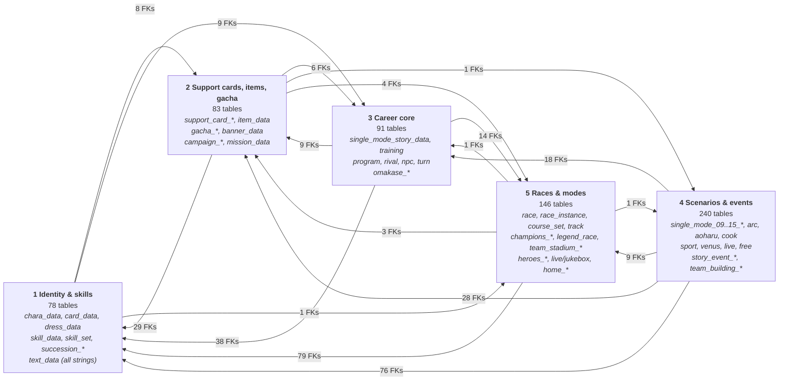
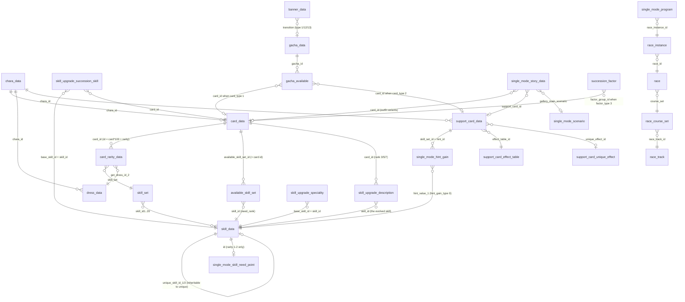
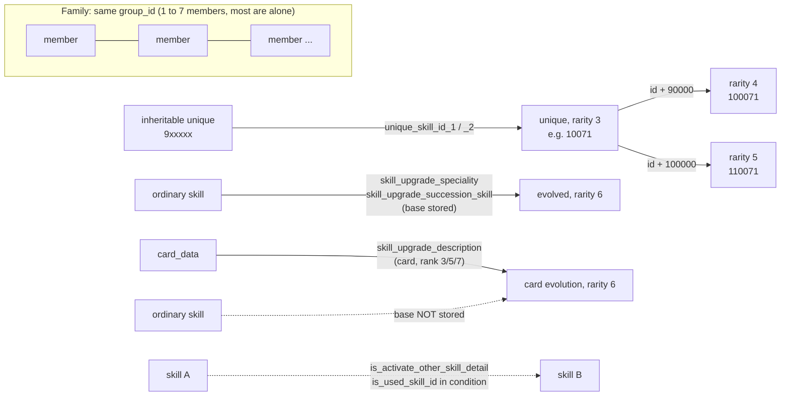

# Umamusume `master.mdb` map

What each table is for, what its ids resolve to, and how the tables connect. Built from `master-jp.mdb` (Oct 2026 snapshot, 639 tables) by walking every table and testing each id-like column against every candidate key in the whole database.

- **Verified** means at least 95% of the column's non-zero values were found in the target key. 811 such foreign keys are listed in [`edges.json`](edges.json) with their measured coverage. Anything weaker is marked *unverified* or *low confidence* in the per-domain files.
- **JP is the superset.** Global's `master.mdb` ids are a subset of JP's in nearly every table. Release order is the same on both servers; Global's own dates are about 1450 to 1490 days behind JP. Exceptions are listed under [Gotchas](#6-gotchas).
- Enum meanings are inferred (from names, sample rows and text lookups) unless stated otherwise. Each is tagged with a confidence in the domain files.

## 1. The five domains

The 639 tables are split into five domains. Arrows show how many verified foreign keys cross from one domain into another. Domain 1 is the hub: almost everything points into characters, cards, skills and `text_data`.

| Domain | Doc | What is in it |
|---|---|---|
| 1 Identity & skills | [1-identity-skills.md](1-identity-skills.md) | Characters, outfits (cards), costumes, mobs, skills and skill sets, skill upgrades, succession/factors, and the **`text_data` category map** |
| 2 Support cards, items, gacha | [2-supportcards-items-liveops.md](2-supportcards-items-liveops.md) | Support cards and their effects, items and rewards, gacha, banners, campaigns, missions, login bonuses |
| 3 Career core | [3-career-core.md](3-career-core.md) | Career events and stories, hints, training, turns, race program, rivals, NPCs, ranks, omakase auto-training |
| 4 Scenarios & events | [4-scenarios-events.md](4-scenarios-events.md) | Per-scenario mechanics (`single_mode_09_*` to `_15_*`, arc, aoharu, cook, sport, venus, ...), story events, team building, raids |
| 5 Races & modes | [5-racing-modes-presentation.md](5-racing-modes-presentation.md) | Races, courses, tracks, aptitude and motivation multipliers, Champions Meeting, legend/daily/heroes/team stadium, live, home, motion |

Most referenced tables (verified FKs pointing in):

| Table | Domain | FKs in |
|---|---|---|
| `chara_data` | 1 | 119 |
| `dress_data` | 1 | 59 |
| `item_data` | 2 | 48 |
| `support_card_data` | 2 | 28 |
| `card_data` | 1 | 25 |
| `single_mode_scenario` | 3 | 24 |
| `race_instance` | 5 | 24 |
| `skill_data` | 1 | 23 |
| `background_data` | 5 | 19 |
| `race_jikkyo_trigger` | 5 | 16 |
| `gacha_data` | 2 | 15 |
| `skill_set` | 1 | 14 |
| `single_mode_story_data` | 3 | 14 |
| `single_mode_program` | 3 | 13 |
| `story_event_data` | 4 | 12 |

## 2. The core relations

The tables most projects need, with only verified relations. Names use the real column names.

Reading the diagram:

- A **card** (`card_data`) is a playable outfit of a character. A **dress** is a costume. They are linked through `card_rarity_data.get_dress_id_2`, not by a column on `card_data`.
- A **skill set** is a row of up to 20 `(skill_id, level)` slots. It is used by card rarity rows (unique skills per stage) and by about 13 NPC and race tables.
- **Support card hints do not go through `skill_set`.** `support_card_data.skill_set_id` is a hint id, resolved by `single_mode_hint_gain`.
- **Evolved skills are never in `skill_set` or `available_skill_set`.** They are reachable only from `skill_upgrade_description`.

## 3. ID cheat sheet

| Entity | Rule |
|---|---|
| `chara_data.id` | 4 digits. 1001-1149 playable umamusume (release order), 2001-2008 special NPC umamusume, 9001-9051 humans |
| `card_data.id` | `chara_id*100 + n` (n = 01, 02, 03). Two special cards break the rule (9100101, 9101101) |
| `card_rarity_data.id` | `card_id*100 + rarity` |
| per-card keys | `available_skill_set_id`, `talent_group_id`, `get_piece_id` all equal the card id. `piece_data.id` = card id |
| `dress_data.id` | by `condition_type`: 3 = character outfit `chara_id*100 + n`; 6 = private clothes `900000 + chara_id`; 5 = generic costumes 1..113 |
| `skill_data.id` | 6-digit `2xxxxy` for normal and gold. Unique tiers `10071` / `100071` / `110071`. Evolved (rarity 6): `407011` for scenario upgrades, `card*1000 + slot*100 + 11` for card evolutions (slot = awakening rank 3, 5, 7). Inheritable uniques `9xxxxx` point to their unique through `unique_skill_id_1` |
| `skill_data.group_id` | skills that are alternatives of each other. `group_rate` orders members in the group. Most groups have one member. It carries no fixed role: a group has whichever of the ○ / ◎ / × / gold members actually exist |
| `support_card_data.id` | `rarity*10000 + serial` (R 1xxxx, SR 2xxxx, SSR 3xxxx). `effect_table_id` = id; `unique_effect_id` = id for SR and SSR, 0 for R |
| hint id | `support_card_data.skill_set_id = 9081000 + (chara_id - 1000)` = `single_mode_hint_gain.hint_id` |
| `gacha_data.id` | 5 digits: 1xxxx tutorial, 2xxxx free/ticket, 3xxxx normal pickup, 5xxxx anniversary and special. Use `start_date` for order, not id |
| `banner_data` | type 1: `banner_id = 100000 + gacha_id`, `transition = gacha_id`. Story event banners: `condition_value = story_event_id`, `banner_id = 500000 + (story_event_id - 1000)` |
| `story_id` (9 digits) | `4SSSSSNNN` scenario events (S = scenario id, `00000` = all), `5CCCCCNNN` trainee events (C = chara id), `8CCCCCNNN` support card events (C = support card id). Not unique: one row per outfit variant |
| scenario ids | `single_mode_scenario.id` 1-14: 1 URA, 2 Aoharu, 3 Grand Live, 4 Climax, 5 Grand Masters, 6 L'Arc, 7 U.A.F., 8 Harvest Festival (cook), 9 Mecha, 10 Legends, 11 Island, 12 Onsen, 13 Dreams, 14 Tresen-ken. `single_mode_15_*` tables exist but are empty (reserved) |
| `race_track.id` | 10001-10010 JRA, 10101 Ooi, 10103-10105 other local tracks, 10201-10203 overseas |
| `race_course_set.id` | `10000 + 100*track_index + seq` |
| `race.id` | name in `text_data` 32. The id block shows usage (5001-5190 practice, 6001-6502 Champions Meeting) |
| `race_instance.id` | `race_id*100 + seq` for most rows. Special series: 580001 daily, 592001 legend, 600001 CM, 630001 challenge, 670001 heroes, 680001 ultimate, 690001 rating |
| `race.group` | usage tag: 1 career calendar, 2 daily, 8 legend, 10 team stadium, 11 Champions Meeting, 13 challenge, 14 heroes, 15 ultimate, 16 rating. Not a foreign key |
| aptitude rank | 1..8 = G, F, E, D, C, B, A, S (0 = none). Multipliers in `race_proper_*_rate` (rate scale 10000 = x1.00) |
| `race_course_set` enums | `ground` 1 turf / 2 dirt; `turn` 1 right / 2 left / 4 straight; `inout` 1 none / 2 inner / 3 outer / 4 outer-to-inner; `distance` in metres |
| `race.grade` | 100 G1, 200 G2, 300 G3, 400 OP, 700 pre-OP, 800 maiden, 900 debut and practice, 999 fictional, 1000 team races, 0 story |

### Rewards: one polymorphic triple

Every reward, shop cost and mission payout uses `(item_category, item_id, item_num)`. `item_category` is an `item_data.item_category` value, plus a few reward-only values that resolve by id:

| `item_category` | `item_id` resolves to |
|---|---|
| 50 | `card_data.id` (character card) |
| 51 | `support_card_data.id` |
| 55 | `honor_data.id` (title). Some race-reward ids (700000+) do not resolve |
| 70 | `dress_data.id` (outfit) |
| 102 | `piece_data.id` = `card_data.id` (character piece) |
| 0 | empty slot |
| anything else | `item_data(item_category, id)` |

## 4. Where the text lives

`text_data(category, index, text)` holds every string in the game. `index` is the id of the row that owns the string, and `category` says which table and which field (name, description, ...). All 383 JP categories are mapped, with coverage and a confidence tag, in [the category map](1-identity-skills.md). These are the ones people ask about most:

| Category | Holds | Keyed by |
|---|---|---|
| 47 / 48 | skill name / description | `skill_data.id` |
| 4 / 5 | card (outfit) title | `card_data.id` |
| 6-9 | character names (several forms) | `chara_data.id` |
| 14 / 15 | costume name / description | `dress_data.id` |
| 75 / 76 / 77 | support card full name / epithet / character name | `support_card_data.id` |
| 150 / 155 | support card unique effect name / description | `support_card_unique_effect.id` |
| 151 / 154 | support card effect type name / description | `support_card_effect_table.type` |
| 26 | gacha name | `gacha_data.id` |
| 23 / 24 | item name / description | `item_data.id` |
| 181 | career event title | `single_mode_story_data.story_id` |
| 119 / 237 | scenario long / short name | `single_mode_scenario.id` |
| 55 | training command name | command id |
| 28 / 29 | race instance long / short name | `race_instance.id` |
| 32 | race name | `race.id` |
| 31 / 34 / 35 | track names | `race_track.id` |
| 59 | mob name | `mob_data.mob_id` |
| 65 / 66 | honor name / description | `honor_data.id` |
| 130 / 131 | nickname (epithet) | `nickname.id` |
| 290 | skill upgrade condition text | `skill_upgrade_condition.id` |

About 211 of the 383 categories are low confidence, mostly small `1..N` id sets from newer scenarios that many tables match equally well. Categories 1 and 2 have no owner table.

## 5. Cookbook: resolving things

| I have | I want | Path |
|---|---|---|
| a skill id | its name and description | `text_data` cat 47 / 48, `index = skill_id` |
| a skill id | the skill points to buy it | `single_mode_skill_need_point.id = skill_id`. Only rarity 1-2 skills have a row (1182 of 2200) |
| a skill id | the other skills in its family | `skill_data` rows with the same `group_id`, ordered by `group_rate` |
| a card id | every skill that outfit can learn | `card_data.available_skill_set_id` (= card id) -> `available_skill_set(skill_id, need_rank)` |
| a card id | its unique skill by star stage | `card_rarity_data.id = card*100 + rarity` -> `.skill_set` -> `skill_set.skill_id1..` |
| a card id | its evolved skills | `skill_upgrade_description(card_id, rank 3/5/7, skill_id)`. **The base skill is not stored** for card evolutions |
| a scenario or succession evolution | the base skill | `skill_upgrade_speciality(base_skill_id, skill_id)` and `skill_upgrade_succession_skill(base_skill_id, skill_id)` store it |
| a support card id | its hint skills | `support_card_data.skill_set_id` -> `single_mode_hint_gain.hint_id`. Rows with `hint_gain_type = 0` have `hint_value_1` = `skill_data.id`; type 1 is a bundled stat or skill-point bonus |
| a support card id | its effect values by level | `effect_table_id` -> `support_card_effect_table`; effect names in `text_data` cat 151 |
| a support card id | its debut date | earliest `gacha_data.start_date` among gachas where `is_pickup = 1` (matches `support_card_data.start_date` for 186 of 220 SSR with a pickup) |
| a career event id | its title and owner | `text_data` cat 181 `index = story_id`; owner from the story id prefix; hint skills from `single_mode_hint_gain` |
| a race program | the race and course | `single_mode_program.race_instance_id` -> `race_instance` -> `race` -> `race_course_set` -> `race_track` |
| an aptitude rank | the multiplier | `race_proper_distance_rate`, `race_proper_ground_rate`, `race_proper_runningstyle_rate` (id = rank 0-8) |
| a reward triple | what it is | see the reward table above |

## 6. Gotchas

- **Evolved-skill base skills are not in the database.** Card evolutions store the evolved skill, the card and the rank, but not which skill it replaces. Only scenario ("speciality") and succession evolutions store a base.
- **Career event choice effects are not in the mdb.** It has the event index, titles, branch bookkeeping and hint gains only.
- **`effect_type` is not one global enum.** Scenario tables reuse the same numbers with different meanings and value layouts. They are documented per family, at low confidence.
- **Some column names mislead.** For example `single_mode_aoharu_result_cutt.chara_id` holds dress ids; `transfer_rotation_reward.rotation_id` points at `transfer_rotation_detail.id`; `single_mode_free_shop_item.item_id` equals `effect_group_id`, not an item id; in `single_mode_10_*`, `legend_id` is a chara id; the training cutscene `command_id` columns are really `cutin_file_id` values.
- **`story_id` is not unique.** 20573 rows hold 16711 distinct ids. The surrogate `id` is the key.
- **JP and Global use different id schemes** for `available_skill_set`, `chara_type` and `single_mode_chara_program`: compare by content, not by primary key. Elsewhere Global ids are a subset of JP ids (`login_bonus_data` has 11 Global-only ids and `topics` has 1). Global `support_card_data` has 4 placeholder rows dated 2099.
- **NPC tables use `chara_id = 1` as a sentinel** meaning "use `mob_id`".
- **`gacha_available.card_id`** is polymorphic on `card_type` (1 = `card_data`, 2 = `support_card_data`). Coverage is 96.4% and 93.5%. The misses look like placeholder slots (ids 201-222 and 301-310), so it is not claimed as a strict foreign key.
- **Time columns** are mixed: `gacha_data` and `support_card_data` use unix UTC (gachas start at 03:00 UTC, 12:00 JST); `banner_data` uses JST text. `race.start_date` of 1498838400 is a placeholder.
- **Future rows exist.** The JP snapshot includes pre-registered rows dated up to about 2026-11.
- **Some tables are JP-only.** In domain 1, 19 tables are JP-only and 7 more exist in Global with zero rows. All omakase and training report tables are JP-only. The domain files give a JP / Global row count per table.

## 7. Not decoded yet

Listed in full at the end of each domain file. The main ones: `mission_data.condition_type` and some `mission_type` values; `campaign_data` target, effect and transition types; `item_data` effect fields; support card unique-effect types 101-122; `skill_category`, `target_type` and `ability_type` meanings (low confidence); career race condition codes and the `*_odds_id` columns; and why about 20% of `story_event_bonus_*` rows carry a `chara_id` that differs from their card's.

## 8. Worked example: modelling skills

`skill_data` is the one table where the whole picture matters, so here is what a skills database or page needs from the mdb, and where each piece comes from.

### What `skill_data` holds (JP, 2200 rows)

| Field group | Columns | Notes |
|---|---|---|
| Identity | `id`, `rarity`, `skill_category`, `tag_id`, `icon_id`, `disp_order` | Rarity 1 / 2 / 3 / 4 / 5 / 6 = 872 / 348 / 22 / 22 / 253 / 683. `tag_id` is a `/`-separated list of 50 distinct codes; the 2xx codes are distance (201 short, 202 mile, 203 mid, 204 long, checked on samples) and the other ranges are not decoded yet. 126 distinct icons |
| Cost and score | `grade_value`, `activate_lot` | SP cost is **not** here: it is `single_mode_skill_need_point` (rarity 1-2 only). `activate_lot` is 1 for skills that need a wit check (1663) and 0 for passives and always-on skills (537) |
| Release | `start_date`, `end_date` | Present on every row, so a release date needs no outside source |
| Phase 1 | `precondition_1`, `condition_1`, `float_ability_time_1`, `float_cooldown_time_1`, `ability_type_1_1..3`, `float_ability_value_1_1..3`, `target_type_1_*` | Up to 3 effects per phase |
| Phase 2 | the same with `_2` | 528 skills have a second phase (separate condition and effects) |
| Grouping | `group_id`, `group_rate`, `unique_skill_id_1/2` | See the relation map below |

Value scaling, checked against known skills: `float_ability_value` and `float_ability_time` are stored x10000 (a stored 1500 is 0.15, a stored 24000 is 2.4 s), and `float_cooldown_time` is stored x10000 as well (5000000 is 500 s). Ability type 27 is target speed and 31 is acceleration; the other 27 ability types are not decoded here.

Conditions are strings of `key op value` terms joined with `&` (and) and `@` (or). 132 distinct keys appear across both phases; the ten most used are `order_rate` (1346 skills), `distance_type` (1091), `running_style` (810), `phase` (508), `phase_random` (481), `distance_rate` (430), `remain_distance` (288), `order` (285), `corner` (277) and `phase_firsthalf_random` (236). 201 skills also have a `precondition`.

### Relations between skills

| Relation | Source | Size | Verified |
|---|---|---|---|
| Family (alternatives of each other) | `group_id`, ordered by `group_rate` | 1749 groups: 1375 alone, 314 pairs, 46 triples, 13 of four, 1 of seven | Yes. Roles are not fixed: 302 groups are a white plus a gold with unrelated names; the ○ / ◎ / × sets (for example 右回り) are a small minority; `group_rate` -1 appears on the × members |
| Unique line | id shape: rarity 3 `N` -> rarity 4 `N+90000` -> rarity 5 `N+100000` | 22 / 22 / 253 | The id rule holds on every sample checked; the in-game meaning of each tier is medium to low confidence |
| Inheritable <-> unique | `unique_skill_id_1/2` on the 9xxxxx skills | 274 skills | Yes |
| Scenario evolution | `skill_upgrade_speciality(base_skill_id, skill_id)` | 47 | Yes, base stored |
| Succession evolution | `skill_upgrade_succession_skill(base_skill_id, skill_id)` | 3 | Yes, base stored |
| Card evolution | `skill_upgrade_description(card_id, rank, skill_id)` | 633 | Evolved skill, card and rank yes. **Base skill not stored** |
| Needs another skill | condition keys `is_activate_other_skill_detail`, `is_used_skill_id` | 148 skills | Parsed from the condition string |

### Where a skill comes from

| Source | Path | Size |
|---|---|---|
| An outfit can learn it | `card_data.available_skill_set_id` -> `available_skill_set(skill_id, need_rank)` | 1909 rows, 271 sets |
| An outfit's unique skill | `card_rarity_data.skill_set` -> `skill_set` | per star stage |
| A support card hint | `support_card_data.skill_set_id` -> `single_mode_hint_gain` (type 0, `hint_value_1`) | 135 hint sets |
| A card evolution | `skill_upgrade_description` | 633 |
| Races and NPCs | `skill_set` references from about 13 NPC and race tables | not needed for a skill page |

Skills that come from events are **not** in the mdb (event choice effects are not stored), so "obtainable from event X" needs a separate source.

### JP and Global

Global's skills are a subset of JP's (741 of 2200 in two community-made skill dumps, 1122 name rows in the older Global mdb), so a single list keyed by skill id covers both. Comparing those two dumps, 94 of the 741 shared ids differ in a mechanic field (condition, duration, effects, cooldown or cost). That figure comes from those dumps, not from the two mdbs, so re-measure it on a fresh Global mdb before relying on it. Our copy of the Global mdb (July) is stale.

### Storage that follows from this

- One row per skill id, with phase 1 and phase 2 as nested objects, and a small per-server patch only for the skills that differ.
- Relations as a flat edge list with a kind (`family`, `unique-line`, `inherits`, `evolves`, `evolves-from-card`, `needs`, `learned-by`, `hint-from`) and a `confidence` of `explicit` or `derived`, so card-evolution pairings found by matching can be told apart from stored ones.
- Strings kept apart from mechanics, keyed by id, so a translation edit never touches the data file.

## 9. Files

- `README.md` (this file)
- `1-identity-skills.md` to `5-racing-modes-presentation.md`: per-table dictionary, per-area ER diagrams, unknowns
- `edges.json`: every relation found, merged from the five passes: `from`, `to`, `kind` (`fk`, `text`, `enum`, `derived`, `unverified`), `coverage`, `note`
